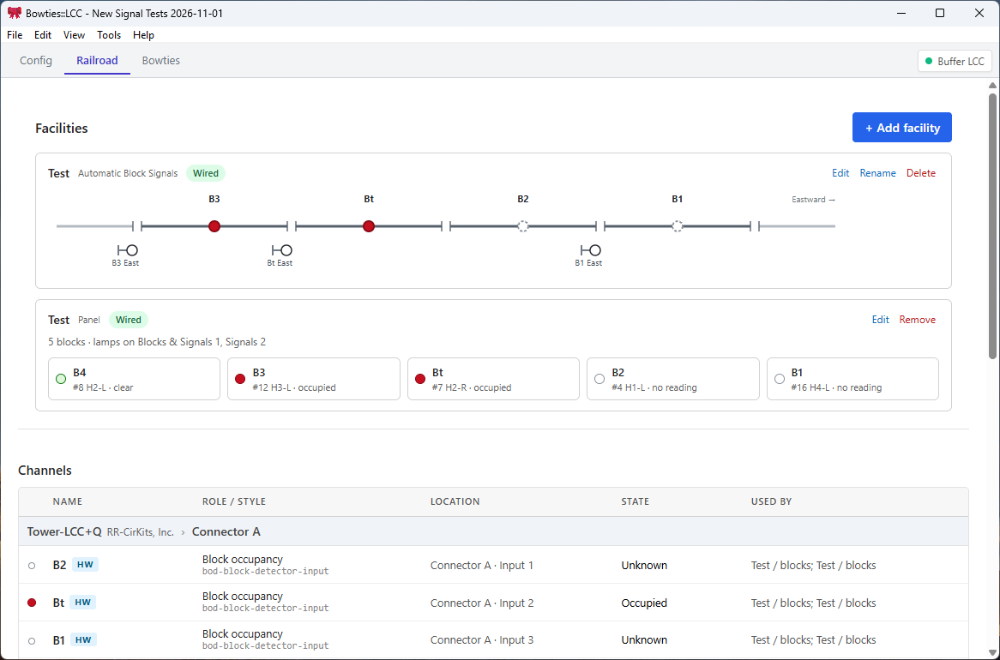

# Bowties

**Describe your railroad. Let Bowties work out the configuration.**

Configuring an LCC (Layout Command Control) railroad can mean translating a simple goal into dozens of board settings and event connections. Bowties helps bridge that gap.

Describe the behavior you want — such as signals protecting a sequence of blocks or panel lamps showing occupancy — then choose the hardware and wiring. Bowties turns those choices into configuration changes you can review, save, and apply to your boards.

Automatic Block Signals illustrates the shift: instead of configuring each rule and event connection yourself, you describe the blocks in travel order and the signals protecting them. Bowties works out the supported signal logic and board settings.

## Why use Bowties?

- **Think in railroad terms:** blocks, signals, and indicator lamps, not just configuration fields.
- **Reduce translation work:** guided facilities handle the underlying settings and event connections for supported behaviors.
- **Let Bowties handle hardware rules:** selecting a supported daughterboard adjusts incompatible settings and limits available options, so you do not have to derive those configuration rules from the manual.
- **Keep control:** inspect the configuration, edit individual settings when needed, and decide when to apply changes.
- **Work beyond the workbench:** capture an existing layout and plan changes offline.

## Early days — and where we're going

This approach is still in its early stages. **Panels** and **Automatic Block Signals** are the first guided facilities. Even Automatic Block Signals currently supports only a limited arrangement: one direction of travel, three aspects (Stop, Approach, Clear), and always-lit red/green searchlights.

The direction is broader: describe how your railroad should behave, choose the hardware that will implement it, and let Bowties translate that intent into configuration. Over time, we want to support more signal arrangements and railroad behaviors, while keeping the underlying configuration accessible.

These are goals, not promises that every arrangement or board is supported today. See the [Railroad facilities guide](docs/user/railroad.md) for current capabilities and limitations.

## Getting started

1. **[Download and install](docs/user/installing.md)** — pre-built installers for Windows, macOS, and Linux.
2. **[Connect and explore](docs/user/using.md)** — open a layout, discover boards, read their configuration, and learn how Save and Sync work.
3. **[Set up block detection](docs/user/block-detection.md)** — select detector daughterboards, name the blocks, and verify occupancy reports.
4. **[Build railroad facilities](docs/user/railroad.md)** — create Panels and Automatic Block Signals with guided editors (preview).

The main tabs are **Config**, **Railroad**, and **Bowties**. Config is the starting view for board setup; Railroad describes facilities and their channels; Bowties shows the event connections behind your layout.

<!-- Screenshot needed: current main window with Config, Railroad, Bowties tabs and a populated Railroad view. -->



## What Bowties does

- **Connects** to your LCC network via TCP hub (JMRI, port 12021) or direct USB-to-CAN adapter
- **Discovers** every node on the network and shows manufacturer, model, and status
- **Displays** node configuration using a sidebar and card-based CDI browser, including read-only settings
- **Guides** Panel and Automatic Block Signals setup in the Railroad tab (preview)
- **Shows** event producer/consumer relationships as connection cards in the Bowties tab
- **Captures** the current layout so you can reopen it offline, browse saved node data, and plan changes away from the bus
- **Syncs** pending changes (edits saved in the layout that a board has not yet confirmed) back to the bus with conflict review when you reconnect
- **Links** events between nodes: pick a producer and consumer, review the staged changes, and use Save to persist them and write them while connected

## Supported hardware

| Connection type | Examples |
|----------------|---------|
| TCP hub | JMRI (port 12021), any GridConnect TCP bridge |
| USB GridConnect serial | SPROG CANISB, SPROG USB-LCC, SPROG PI-LCC, RR-CirKits LCC Buffer-USB, CAN2USBINO |
| MERG GridConnect serial | MERG CAN-RS, CANUSB4 |
| USB SLCAN | Canable, Lawicel CANUSB, any `slcand`-compatible adapter |

## Where the name comes from

Bowties takes its name and initial inspiration from John Socha-Leialoha's 2007 technical note, [Introduction to the Producer/Consumer Model](<docs/Tech Note - Introduction to the PC Model (2007-10-10).pdf>). Its bow-tie diagrams group the actions that produce an event on the left and the reactions that consume it on the right, making many-to-many relationships easier to understand than a web of individual connections.

The note also envisioned software for creating and maintaining those relationships while hiding the assignment of event numbers. This application began with that idea. Guided facilities now take it a step further: describe railroad behavior, and let Bowties work out the supporting event connections and board configuration.

---

## For developers

See **[docs/project/development.md](docs/project/development.md)** for full details on building, testing, architecture, project principles, and contributing.

Quick reference:

```bash
cd app && npm install
npm run tauri dev      # development build with hot-reload
npm run tauri build    # production build
```

- **[Developer Guide](docs/project/development.md)** — build, test, architecture, contributing
- **[Releasing](docs/project/releasing.md)** — version bumps, tagging, GitHub Actions workflow
- **[Feature Roadmap](docs/project/roadmap.md)** — development timeline and priorities

---

## License

Licensed under either of

- [MIT License](LICENSE-MIT)
- [Apache License, Version 2.0](LICENSE-APACHE)

at your option.
