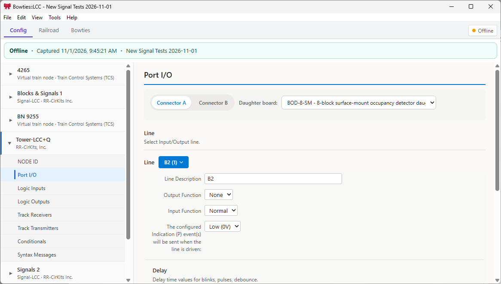
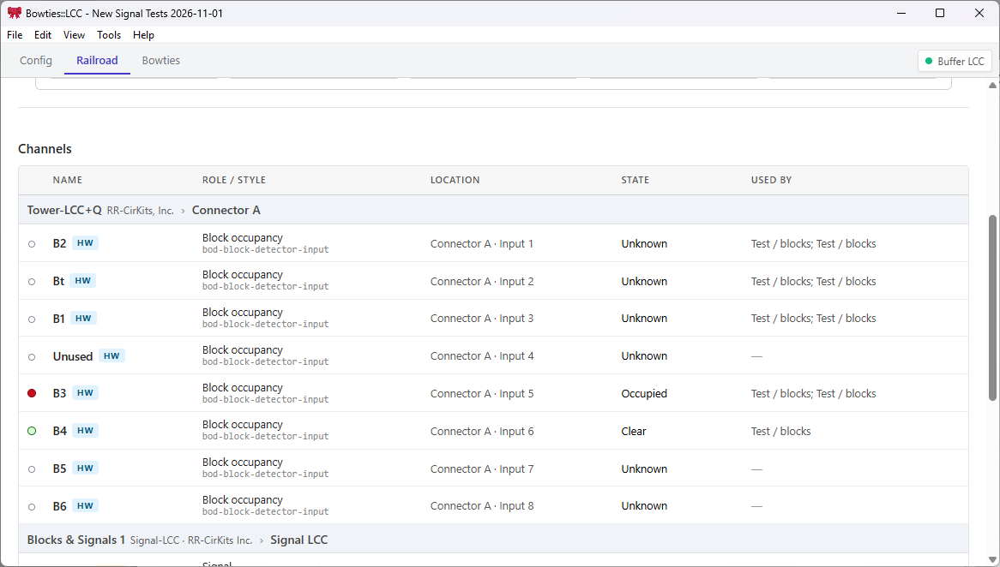
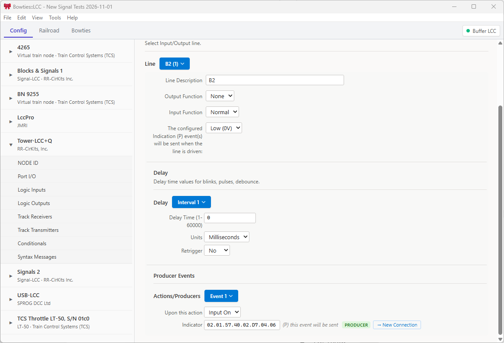
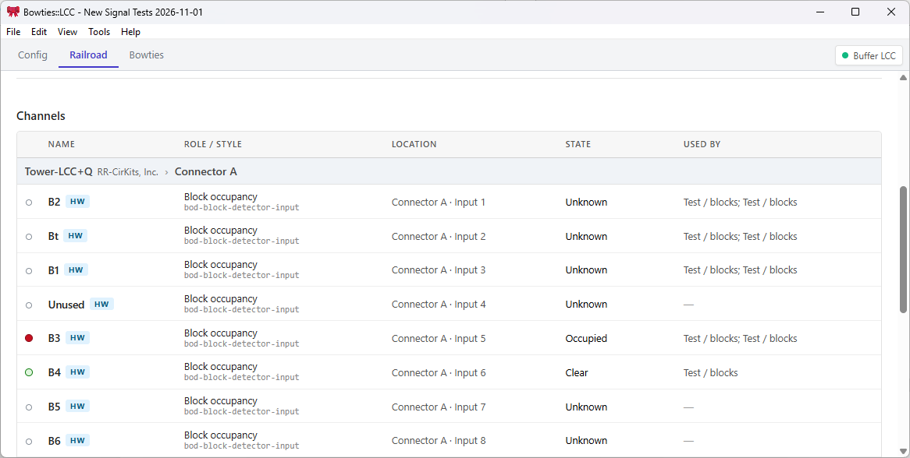

# Set up block detection

Panels and Automatic Block Signals both use detected blocks. Before creating either facility, tell Bowties which detector hardware is installed, identify its inputs, and check that it reports occupied and clear correctly.

This guide uses a **Tower-LCC+Q with a BOD-8-SM on Connector A** as an example. It creates eight block-occupancy channels. The workflow also applies to supported detector daughterboards on other LCC boards, but connector names, configuration labels, and available options can differ.

For connecting and reading boards, see [Using Bowties](using.md). For the next step after detection, see [Railroad facilities](railroad.md).

## What you need

- A supported LCC board, such as a Tower-LCC or Tower-LCC+Q.
- A supported occupancy-detector daughterboard installed on the appropriate connector.
- Track sections connected to the detector according to the manufacturer's instructions.
- A Bowties layout with that board's configuration read.

The LCC board connects to the bus. The detector **daughterboard** connects to that board and provides the detector inputs. A **Block occupancy channel** represents one detector input in Bowties; its name identifies the physical block for facility editors.

Selecting a daughterboard describes hardware already installed. Bowties does not automatically identify what is plugged into a connector, install hardware, or wire the track.

> Follow the LCC board and detector manuals for wiring, track isolation, detector sensitivity, and suitable test loads. This guide covers the Bowties setup, not electrical installation.

## 1. Select the installed daughterboard

1. Open your layout. Connect and read the board configuration if it has not already been captured.
2. Select **Config**.
3. Expand **Tower-LCC+Q** in the left sidebar and select **Port I/O** beneath it.
4. At the top of the Port I/O page, choose **Connector A** or **Connector B** to match where the detector is physically connected.
5. In the **Daughter board** dropdown beside those buttons, select the installed detector. For this example, choose **Connector A** and **BOD-8-SM**.
6. Review any compatibility warnings and configuration edits Bowties stages.

The connector buttons and Daughter board dropdown are in the main Port I/O area, not in the sidebar. If the board configuration was previously captured, you can make this selection offline; hardware changes still need to be applied when connected.

**Bowties handles the supported daughterboard's configuration rules for you.** Selecting it:

- Adjusts incompatible settings on the affected lines to compatible values.
- Limits the values you can choose so they remain compatible with that daughterboard.
- Hides configuration sections that do not apply.

For example, selecting BOD-8-SM sets up the supported detector input behavior and occupied/clear producer-event actions. You do not need to work out those settings from the manual or enter each one yourself.

Automatic adjustments are staged as unsaved configuration changes. **Save** keeps them and attempts the writes while connected; offline changes wait for Sync. Hardware wiring and live detection still need checking.

<!-- Screenshot needed: Tower-LCC+Q expanded in the Config sidebar with Port I/O selected; main area shows Connector A selected, Connector B, and the Daughter board dropdown set to BOD-8-SM. -->

On a Tower-LCC or Tower-LCC+Q, Connector A covers Port I/O lines 1-8; Connector B covers lines 9-16. A channel's Input number is local to its connector: Connector B Input 1 corresponds to Port I/O line 9, not line 1.

### How many channels should appear?

| Selected daughterboard | Block-occupancy channels per connector |
|------------------------|---------------------------------------|
| BOD-8-SM | Eight, for detector inputs 1-8 |
| BOD4 | Four, for detector inputs 1-4 |
| BOD4-CP | Four, for detector inputs 1-4 |

The BOD4 and BOD4-CP have additional functions on the other half of the connector. Bowties does not turn those other lines into four more detected blocks.

Only daughterboards with supported detector mappings create these channels. Choosing a generic breakout board is not equivalent to selecting a supported detector.

## 2. Find and name the detection channels

1. Open **Railroad**.
2. Find the **Channels** group for your board and connector. In this example it is **Tower-LCC+Q → Connector A**.
3. Check that the rows have the **Block occupancy** role.
4. Match each row's **Location**, such as **Connector A · Input 1**, to the detector input and physical track section.
5. Keep existing names if they already identify your blocks. To change a name, click it, enter the new name, and press **Enter**; **Escape** cancels the name edit.

A few channels from the example layout illustrate the mapping:

| Detector input | Channel name |
|----------------|--------------|
| Connector A Input 1 | B2 |
| Connector A Input 4 | Unused |
| Connector A Input 5 | B3 |

These are example names, not a naming scheme to copy. Use names that identify the blocks on your railroad. The input number and block name need not match: **B3** is connected to **Input 5** in this layout. Use your actual wiring to identify each block, not an assumed numerical sequence.

Default names include the board name, connector, and input number. Renaming makes the same channel easier to identify in Panel and signal editors; it does not change the physical wiring or assign a different Event ID.

All supported inputs appear, even when some are unused. Name unused inputs clearly, and do not include them in facilities simply because a channel exists.

The **HW** badge means the channel follows the selected hardware. Before using an existing connector selector to change or remove a daughterboard, review its channels and facility usage: changing that selection replaces the channels for that connector and can affect existing facilities.

<!-- Screenshot needed: Tower-LCC+Q / Connector A Channels group with the test layout's existing names; include Block occupancy roles, Input locations, HW badges, State, and Used by. -->

## 3. See what Bowties configured

You can inspect the settings Bowties prepared, but you do not need to reproduce the following settings manually for a supported daughterboard. This section explains the result and helps with troubleshooting.

Click the channel's **Location** link to jump to its underlying configuration when that link is available. For **B2**, the example's Input 1, inspect **Port I/O**, line 1. **B3** uses Input 5, so its configuration is on line 5.

For the supported detector mapping, Bowties configures the input behavior and producer-event actions:

- The line must behave as a detector input, not a commanded output.
- The first detector producer event reports **Input On** (occupied).
- The second detector producer event reports **Input Off** (clear).

The Event IDs associated with those two producer events identify the occupied and clear reports. If detection does not work, check that these are not unconfigured placeholders or accidentally shared with unrelated detector inputs.

BOD detector outputs are active-low. The board and firmware determine how that is expressed:

| Board and firmware | Detector setting |
|-------------------------|------------------|
| Tower-LCC legacy firmware | **Input Function: Active Lo**; no output function |
| Tower-LCC Rev-C7 or Tower-LCC+Q | **Input Function: Normal**, indication polarity **Low (0V)**, and **Output Function: None** |

Bowties uses the supported profile to apply the appropriate rules for your board and firmware. The table explains the differences; it is not a list of settings you must enter. Other boards may use different fields.

The occupied/clear association comes from the supported detector mapping and its producer events. A channel's name alone does not establish which physical condition emits which event.

If Bowties reports a compatibility warning or detection does not work after applying the changes, review the affected configuration and Event IDs. Unsupported hardware or fields may still require the board manual. For supported daughterboards, Bowties handles the configuration rules; it cannot verify the physical wiring or detector response for you.

<!-- Screenshot needed: example Tower-LCC+Q detector input configuration with input/polarity fields and producer events 1/2 set to Input On/Input Off; capture two views if these cannot be shown legibly together. -->

## 4. Save and verify the detector

1. Click **Save** to keep the daughterboard selection, channel names, and staged configuration changes.
2. While connected, review the configuration-write result. Resolve failures or pending changes.
3. Return to the detection channels on **Railroad**.
4. Following the detector manufacturer's procedure, occupy one connected test section with a suitable detectable vehicle or load.
5. Confirm that the matching named channel reports **Occupied**.
6. Clear that same section and confirm that the same channel reports **Clear**.
7. Repeat for the other inputs you plan to use.

Do not identify blocks solely by their default names. Test the mapping between physical sections and channel locations.

<!-- Screenshot needed: Channels with B3 Occupied after testing Connector A Input 5; include its name and location and keep other rows visible for context. -->

### Understand the state labels

| State | What it tells you |
|-------|-------------------|
| **Occupied** | Bowties observed an occupied event for this channel |
| **Clear** | Bowties observed a clear event for this channel |
| **Unknown** | No matching state event has been observed yet |
| **No config** | Bowties cannot resolve the channel's state Event IDs from the available configuration |

Unknown is not Clear. Reading configuration is not itself a live occupancy report: you may need to trigger a detector state change to get a report.

Treat the displayed state as the most recently observed report, not a guarantee of a new measurement. Verify while connected; offline data is not live detector feedback.

You can prepare selections and names offline using captured configuration. Save keeps that work, but pending hardware changes must be applied through [Sync](using.md#work-offline-and-reconnect) and detection verified on the real layout.

## 5. Use the blocks in facilities

Block-occupancy channels appear as detected blocks in both facility editors:

- In a [Panel](railroad.md#create-a-panel), add the named blocks and choose their indicator lamps.
- In [Automatic Block Signals](railroad.md#create-automatic-block-signals), add the blocks in travel order, then choose signal wiring.

Both facilities can use the same detection channel. You do not need a separate detector or a second set of occupancy events just to display a block on a panel as well as use it for signaling.

The channel's **Used by** column helps you see those relationships. Keep detection preparation separate from facility wiring: a named channel can be available to select before you have verified the detector.

## Troubleshooting

### No Block occupancy channels appeared

- Confirm that the correct board configuration was read successfully.
- Check the connector and selected daughterboard.
- Use a supported detector selection, not an unrelated breakout-board option.
- Review profile or compatibility warnings. Not every board has supported channel mappings.

### The number of channels is unexpected

- Check the daughterboard table above.
- Check the board/connector group: another connector may have its own channels.
- Remember that channels are created for supported inputs, not only wired track sections.

### A channel stays Unknown or shows No config

- Confirm the bus is connected.
- Inspect the underlying input's producer events and Event IDs.
- Apply any pending configuration and check write errors.
- For Unknown, trigger an occupied/clear transition according to the detector manual.
- Check detector power and wiring if the board never reports the transition.

### The wrong block changes, or occupied and clear are reversed

- Match the channel's Location to the actual connector input and track section.
- Check for unintentionally shared Event IDs.
- Check input polarity and the first two producer-event actions against the supported profile and board manual.
- Retest both transitions after saving corrections.
