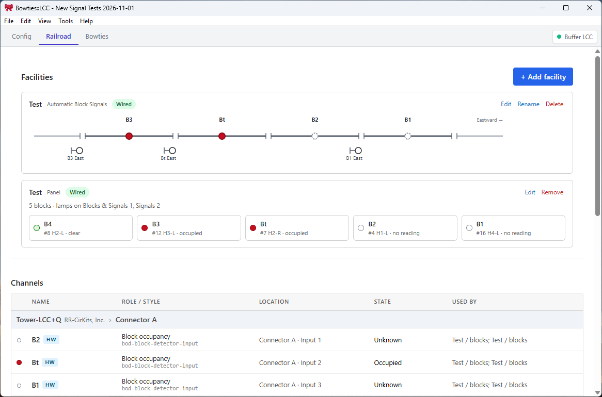
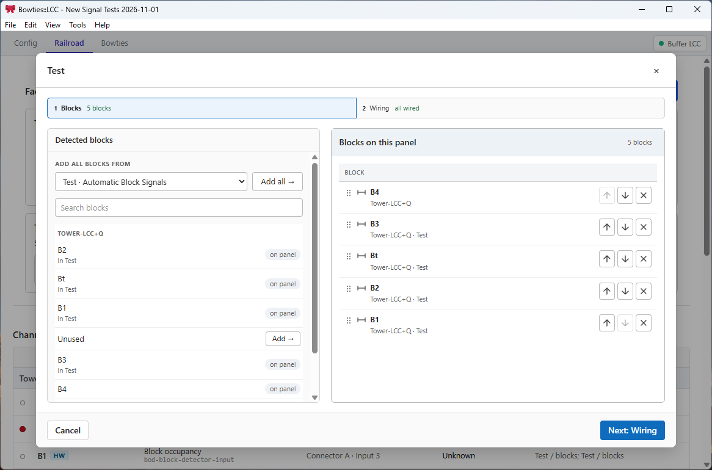
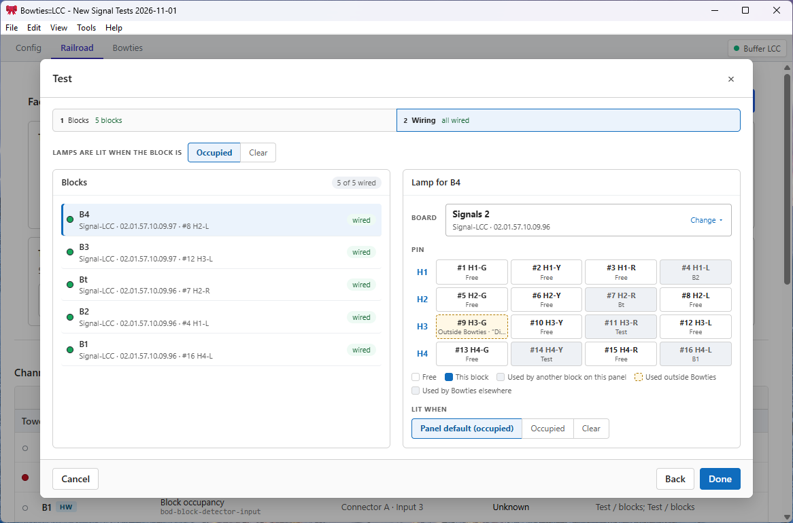
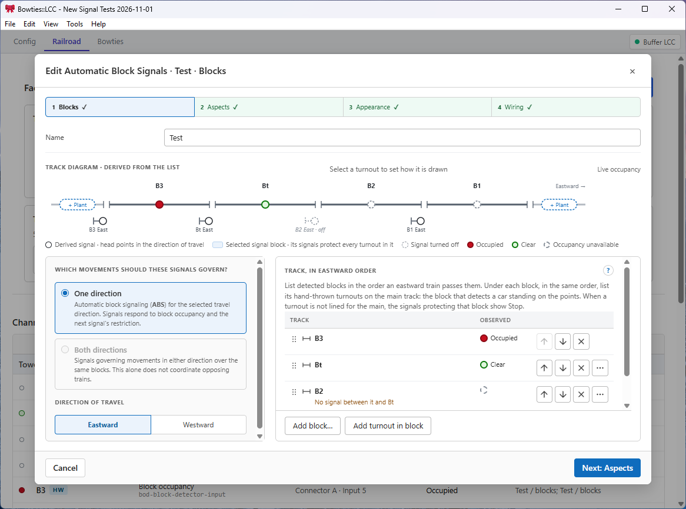
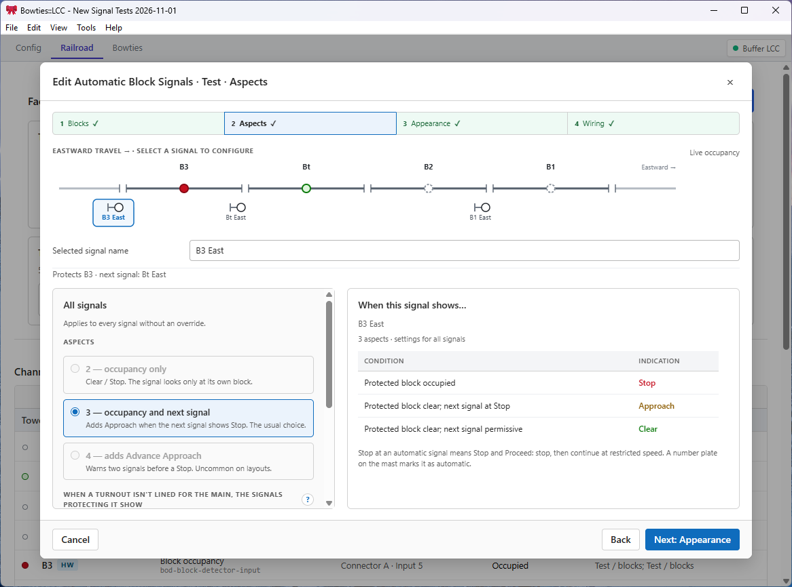
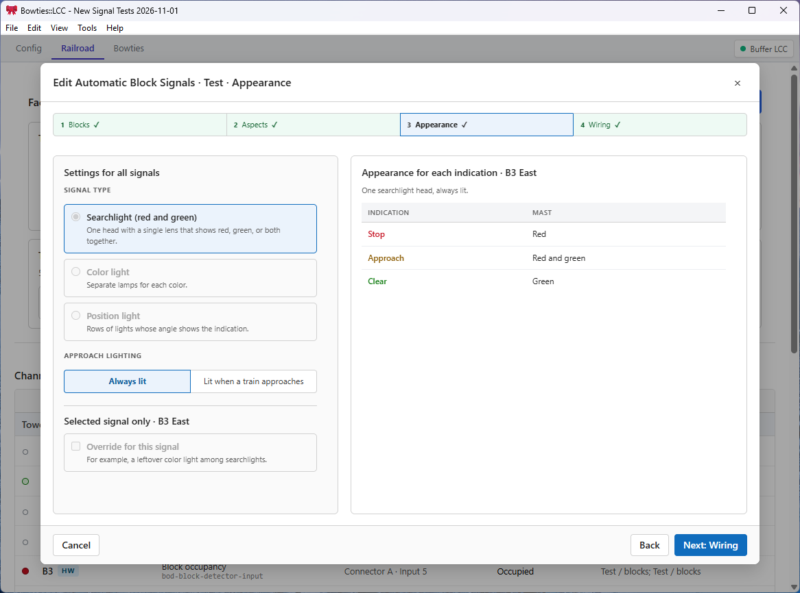
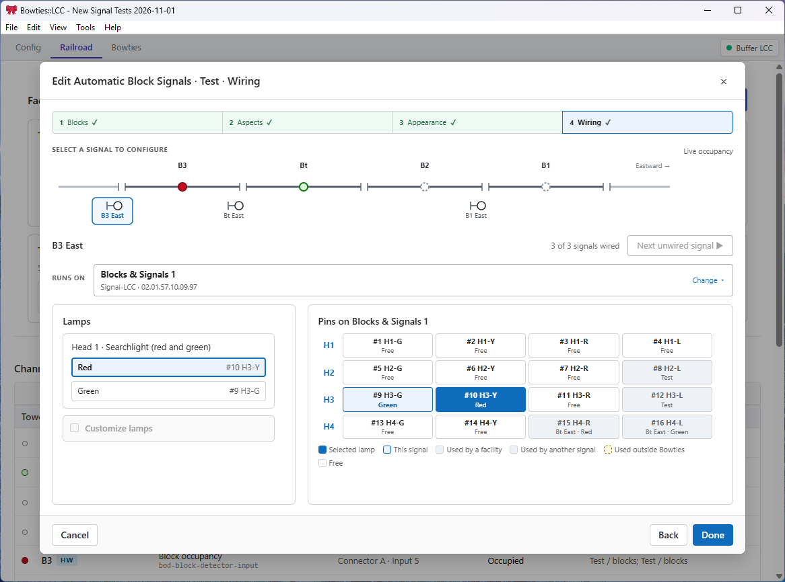
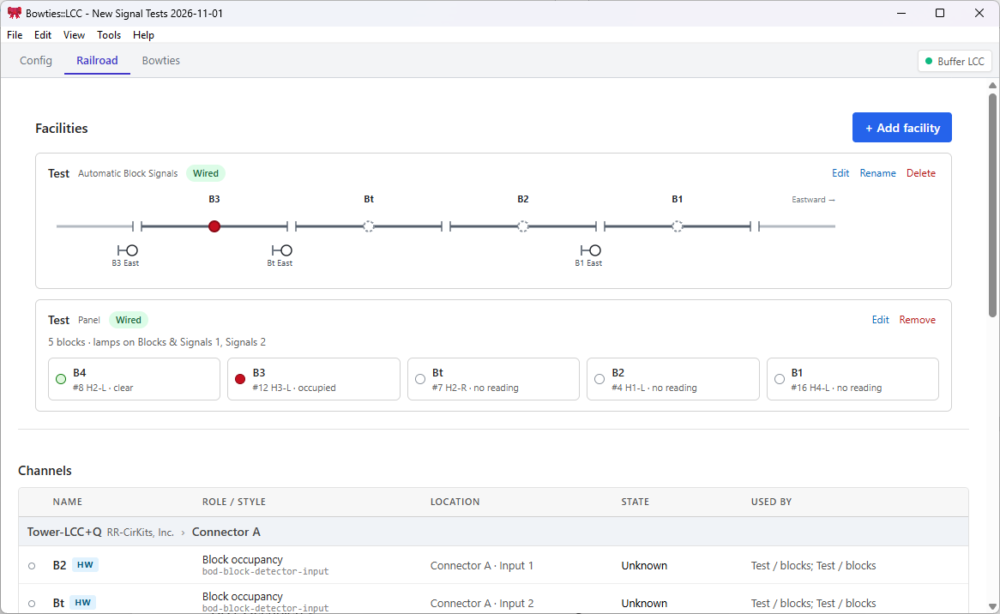

# Railroad facilities

The **Railroad** tab helps you describe what your railroad should do instead of entering every board setting yourself. Guided facility editors translate your choices into configuration changes.

> **Preview:** Panels and Automatic Block Signals are evolving features. Some choices are deliberately unavailable, and configuration and wiring preparation are still required.

For signaling, Bowties currently supports a limited **Automatic Block Signaling (ABS)** arrangement through the Automatic Block Signals facility. **Absolute Permissive Block (APB)** signaling is planned for the future, but is not available yet. The ABS options and limitations are described below.

For opening layouts, connecting, reading configuration, and Save/Sync, start with [Using Bowties](using.md).

## Facilities and channels

- A **facility** describes a piece of railroad behavior, such as a panel displaying block occupancy or signals protecting a run of blocks.
- A **channel** represents an input or output used by that behavior, such as block detection or an indicator lamp.
- Board resources, including pins and logic, provide the hardware behind those channels.

Railroad displays **Facilities** above **Channels**. Channels show their board context and where they are used. Facilities and their channel bindings are saved with the layout.

<!-- Screenshot needed: populated Railroad overview with a Panel, Automatic Block Signals, and Channels/Used by. -->

## Before you start

1. Open a layout.
2. Connect and read the relevant boards in **Config**.
3. Follow [Set up block detection](block-detection.md) to select installed detector daughterboards, name their channels, and check their occupied/clear reports.
4. Confirm that the named detected blocks needed by your facility are available.
5. Have the lamp or signal wiring information ready.

If relevant boards have not been read yet, use **Read Remaining** to load their configuration before setting up facilities.

An empty Channels section does not necessarily mean there is no hardware: board configuration or daughterboard selections may still be missing. An unread Signal-LCC cannot provide the pin information needed for signal wiring.

Panels and Automatic Block Signals reuse the same block-detection channels. Selecting a daughterboard can make blocks available in the editors, but it is not proof that the physical detectors work.

Do not assume every unread board must be configured before you can use a facility. Prepare the boards and inputs that the particular facility needs.

## Create a Panel

A Panel displays detected blocks using indicator lamps.

1. Click **Add facility**, choose **Panel**, and give it a name.
2. Complete **Blocks** and **Wiring**.
3. Click **Done** to add the Panel and stage its changes.
4. Review your unsaved changes and click **Save**.

### Blocks

The detected-block list is grouped by board.

- Search for a block and use **Add** to place it on the panel.
- Use **Add all blocks from** and **Add all** to add a source's blocks together.
- Arrange the panel order with the drag handles or up/down controls.
- Remove a row to take that block off the panel; this does not delete its detector.

A block already on this panel is marked **on panel** rather than added again.

<!-- Screenshot needed: Panel Blocks page with detected blocks, Add all, and reordered panel rows. -->

### Wiring

1. Select a block on the left.
2. Choose the lamp board and its output pin.
3. Repeat for the other blocks.
4. Review **Lit when**:
   - **Occupied** lights the lamp while the block is occupied.
   - **Clear** uses the opposite behavior.

Occupied is the default. You can set the panel default and override individual blocks.

The pin display distinguishes available pins from resources already in use. A pin held by another facility or another block is not freely assignable. For a resource configured outside Bowties, review the **Release** information before choosing to reuse it; releasing it can change the board's existing configuration.

You can finish a panel with unwired blocks. Bowties marks it **Incomplete** and identifies blocks still needing a lamp. Complete the wiring later with **Edit**.

<!-- Screenshot needed: Panel Wiring page with a selected block, pin grid, Lit when, and an incomplete row. -->

### Done, Cancel, and Save

- **Done** stages the panel and any configuration changes; it is not a hardware write.
- **Cancel** or closing the editor abandons that editor session.
- **Save** persists staged work. While connected, it also attempts the newly saved configuration writes.
- Offline configuration changes wait for Sync.
- **Discard** after Done abandons unsaved facility changes.

## Edit or remove a Panel

Use **Edit** on the panel card to change block membership, order, lamps, or Lit when. Review released resources when changing wiring, then finish with **Done** and **Save**.

Use **Remove** to delete the panel. Review the confirmation listing the board resources being released before confirming. Save the resulting changes; configuration resets require successful writes or a later Sync just like other edits.

Removing a panel is not the same as removing its detected blocks from the railroad.

## Create Automatic Block Signals

Automatic Block Signals configures signals for a sequence of detected blocks on Signal-LCC boards.

The currently supported ABS arrangement is:

- One direction of travel.
- Three aspects: **Stop**, **Approach**, and **Clear**.
- One always-lit red/green searchlight per signal.

Other arrangements may be visible but disabled. **Interlocking Plant** is not available yet.

1. Click **Add facility** and choose **Automatic Block Signals**.
2. Give the facility a name.
3. Work through **Blocks**, **Aspects**, **Appearance**, and **Wiring**.
4. Resolve the reported issues before choosing **Done**.
5. Review the staged work and click **Save**.

You can move between pages using the step headings. **Cancel** abandons the editor session before Done.

### Blocks: describe the line

List blocks in the order a train travels through them. Each block normally has a signal at its entrance.

- Use row controls to arrange the travel order.
- Use the row menu to join a block to the one above when one signal should protect both detection sections.
- Set what lies beyond the ends of the line using the track diagram's end controls.
- Add names for hand-thrown turnouts on the main where applicable.

> **Turnout limitation:** These turnout entries are placeholders, not connected position inputs. They are treated as not lined for the main; do not mistake the entered name for live turnout detection.

While connected, block dots show **Occupied** or **Clear** as detection events arrive. A dashed dot means no reading is available, including while offline or before a detector has reported.

<!-- Screenshot needed: signal Blocks page with travel order, a joined section, end controls, and live occupancy. -->

### Aspects: review the rules

Review the signal rules shown for your selected blocks and boundary choices. The basic progression is Stop for an occupied protected block, Approach behind a signal showing Stop, and otherwise Clear. Joined blocks, turnout placeholders, and end conditions affect the displayed rules.

Do not treat the diagram as confirmation that the board is already programmed.

### Appearance: review the signal

Review the supported searchlight arrangement. Disabled choices indicate arrangements not currently supported, rather than settings you can apply.

<!-- Screenshots needed: Aspects rules and Appearance with supported/disabled choices. -->

### Wiring: assign signal outputs

For each signal:

1. Choose its Signal-LCC.
2. Choose the pins wired to its red and green lamps.
3. Check the resource information and any reported problems.

Pins already assigned to another facility cannot simply be reused. If outside configuration holds a resource, inspect the release proposal before accepting it. Bowties needs readable board configuration to assess those resources.

Resolve all blocking wiring or composition issues before Done. A facility can span several Signal-LCC boards. Bowties allocates the necessary logic and may rearrange another facility's logic on a shared board to make room.

<!-- Screenshot needed: signal Wiring page with board selection, red/green pins, and validation/resource information. -->

## Save and check the result

After **Done**, the facility appears on Railroad and contributes to your unsaved changes.

**Save** records the layout first and, while connected, attempts its configuration writes. The signal facility card shows **Waiting** while settings remain unapplied, with information for each affected board. Offline work is applied through Sync after reconnecting.

Check write failures and pending changes. Successful writes are not an independent read-back verification: Bowties does not yet reread all facility settings to confirm them.

The card also shows the track diagram and available live occupancy. Occupancy reports are not proof that all signal configuration has been written successfully.

<!-- Screenshot needed: saved signal facility card with per-board Waiting/write outcome. -->

## Edit or remove Automatic Block Signals

**Edit** opens the facility with its current choices. Change the appropriate pages, finish with Done, and Save.

**Delete** on the signal facility card previews what will be reset on each board. Confirm only after reviewing that list. Removal resets the settings owned by the facility while keeping the blocks and detectors; Save or Sync carries the configuration changes to the hardware.

Because facilities can share a board, review resource and logic changes when modifying or removing one.

## Opening layouts with Block Indicators

Block Indicator has been replaced by Panel. Older layouts are converted automatically on open; there is no migration wizard.

- Indicators are grouped into one panel per lamp board, preserving block order.
- Old facility names become lamp-channel names.
- Blocks without lamps appear in **Indicators without a lamp**, marked Incomplete.
- Indicators without blocks are dropped.
- Malformed entries and same-panel duplicate blocks or lamps produce warnings; the first accepted entry is kept.

Bowties displays a conversion notice and any warnings.

- **Save** keeps the converted layout. If Save fails, conversion remains unsaved.
- **Discard** acknowledges conversion for that open session but keeps the converted panels in memory.
- Reopening the unchanged older file performs conversion again.

Conversion preserves existing events, lamp rows, Lamp Selection, and old bowtie names. It creates no configuration changes or new Sync work by itself, so an already-working lamp keeps its existing configuration. A converted lamp without a pin still needs wiring through Edit.

Back up the layout folder before upgrading, and review warnings before saving a converted layout.

## Current limitations and checks

- Facilities remain preview features, not complete railroad-design automation.
- Supported channel and pin choices depend on board profiles and captured configuration.
- Live occupancy requires incoming detector reports.
- Turnout placeholders do not provide live position detection.
- Only the signal arrangement described above is currently supported.
- Unapplied or failed configuration writes remain pending.
- Facility settings are not independently confirmed by a complete read-back.

For connection and pending-change troubleshooting, see [Using Bowties](using.md#troubleshooting).
