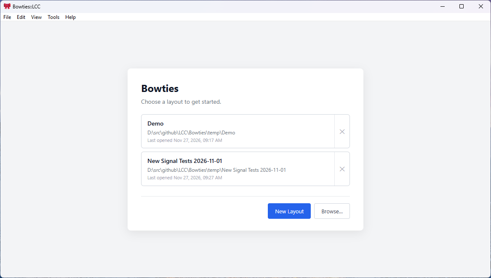
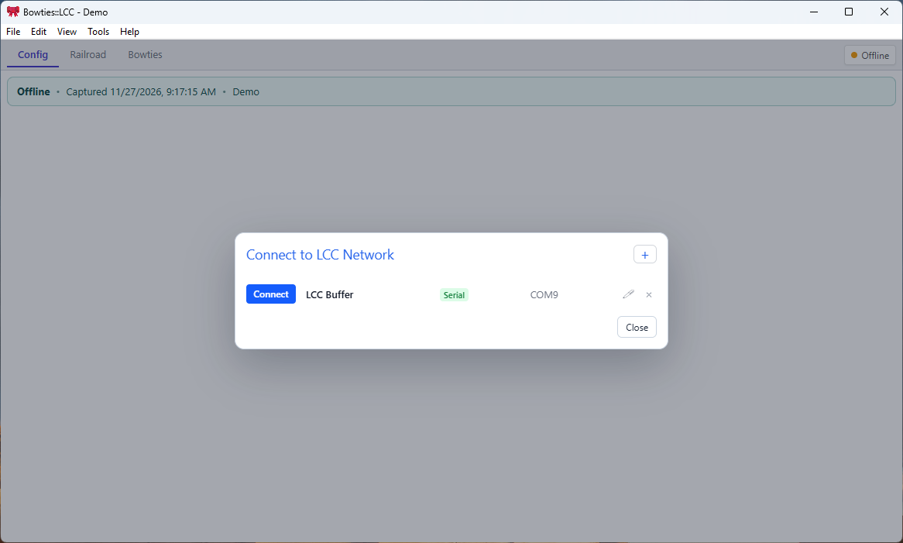
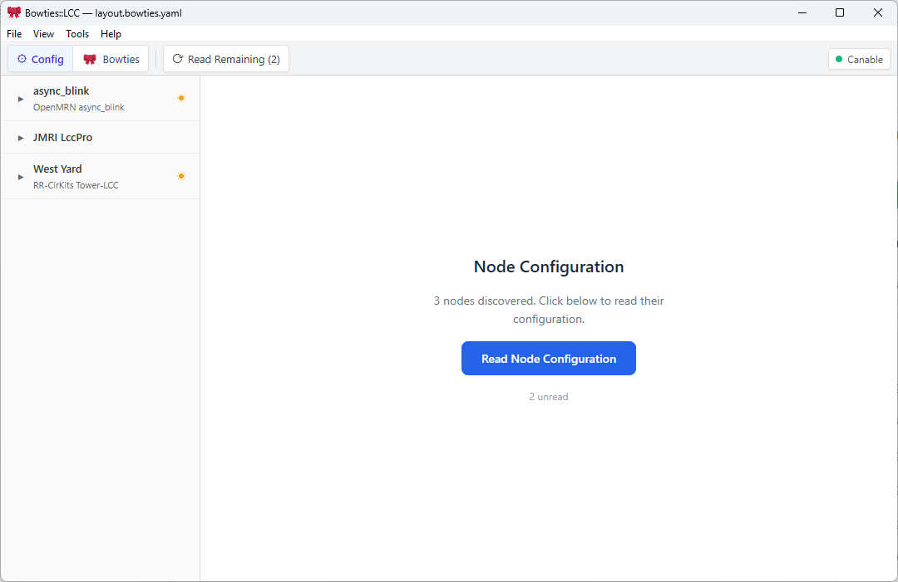
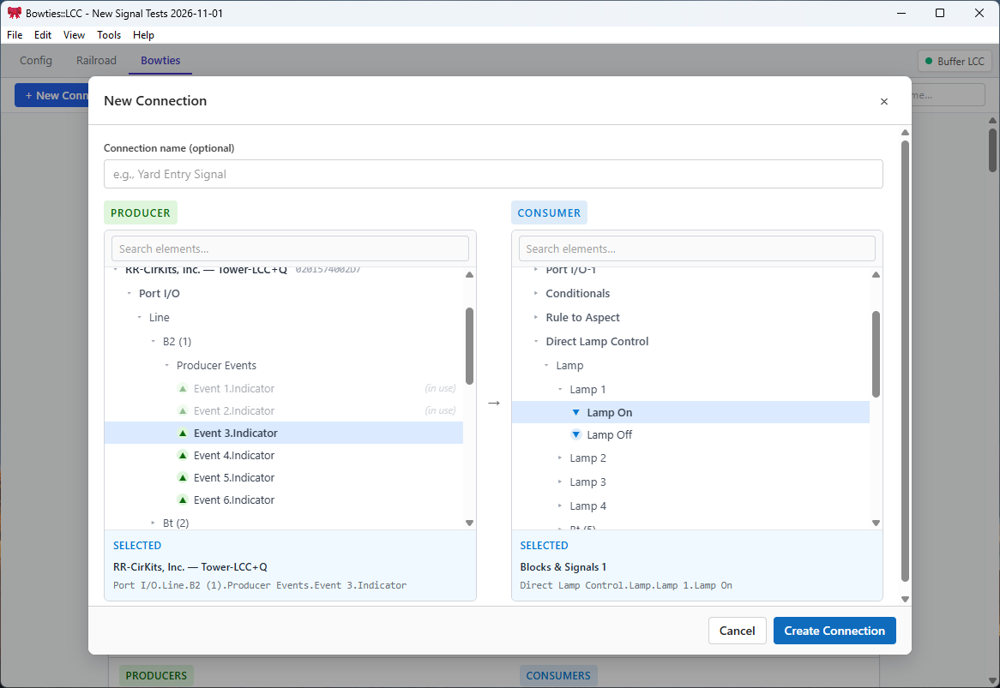
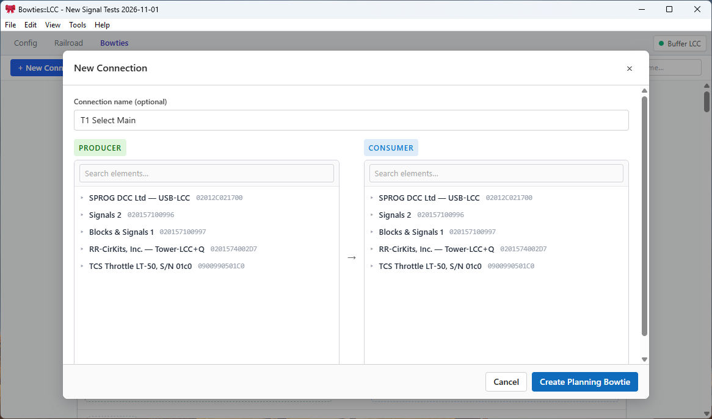
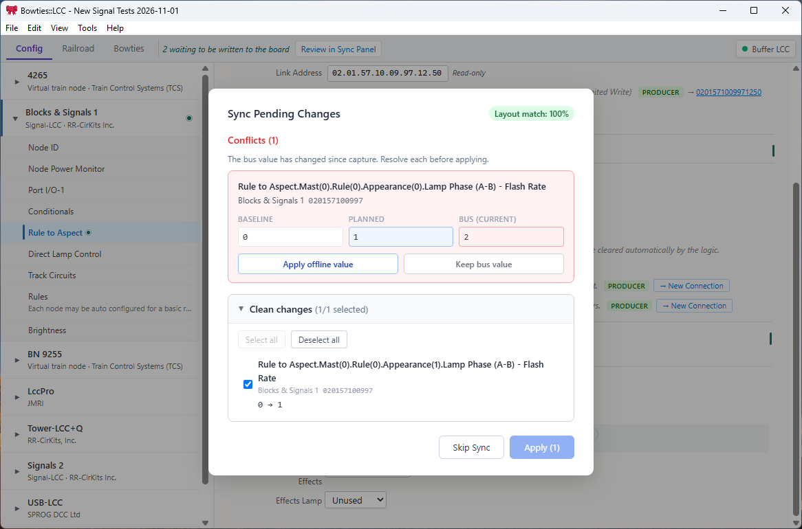

# Using Bowties

Bowties keeps a saved description of your layout alongside the configuration of its LCC boards. Start by opening a layout and reading your boards. You can then edit settings directly, describe railroad behavior with guided facilities, or work on event connections.

For installation, see [Installing Bowties](installing.md). For Panels and Automatic Block Signals, see [Railroad facilities](railroad.md).

## Open or create a layout

When no layout is open, Bowties shows the layout picker:

- **Open** a layout from the known-layout list.
- Choose **New Layout**, enter a name, and choose the parent folder where Bowties should create it.
- Choose **Browse...** to open an existing layout folder.

Bowties restores saved board snapshots, configuration, pending changes, connections, facilities, and channels when you reopen a layout.

If you have a recently used layout, Bowties may reopen it automatically at startup rather than show the picker.

> **Backup and sharing:** A layout is a self-contained folder. Copy the entire folder, not just one file, to back it up, share it, or move it to another computer.

<!-- Screenshot needed: layout picker with a known layout and New Layout/Browse actions. -->



## Connecting to your network

Each layout has its own named connections. Click the connection status button in the top-right corner to open **Connect to LCC Network**. Before connecting, the button shows **Offline**.

### Add a connection

1. Open or create a layout.
2. Open **Connect to LCC Network** and click **+**.
3. Enter a name, such as *Layout hub* or *Workbench SPROG*.
4. Choose your adapter from **Device**.
5. Enter the settings below. Named presets supply the appropriate baud rate and flow control.
6. Click **Add**, then **Connect** beside the saved entry.

| Device | Hardware | Settings |
|--------|----------|----------|
| Network hub (TCP) | JMRI, WifiTrax, or another GridConnect TCP bridge | Host and port; JMRI normally uses `localhost:12021` |
| RR-CirKits LCC Buffer-USB | Buffer-USB or LCC to Loconet Bridge | Serial port; additional settings are available if needed |
| SPROG USB-LCC | SPROG USB-LCC CAN adapter | Serial port |
| SPROG PI-LCC | SPROG Raspberry Pi LCC hat | Serial port |
| MERG CAN-RS / CANUSB4 | MERG adapters | Serial port; additional settings are available if needed |
| Canable / Lawicell CANUSB | SLCAN-compatible adapter | Serial port |
| Other GridConnect adapter | CAN2USBINO or another GridConnect device | Serial port, baud rate, and flow control |
| Other SLCAN adapter | Another SLCAN-compatible device | Serial port, baud rate, and flow control |

For serial devices, select the correct COM port on Windows, `/dev/cu.*` device on macOS, or `/dev/tty*` device on Linux. Use the rescan button beside the port list if you plugged in the adapter after opening the dialog.

Use the edit button beside a saved connection to change its settings. To remove one, use its remove button and confirm **Delete**. The status indicator turns green when connected.

<!-- Screenshots needed: current connection card and Add connection dialog with a named serial preset. -->




## Discover boards and read configuration

Connecting discovers boards automatically. Bowties calls these devices **nodes** in configuration and status displays. The Config sidebar shows their names, manufacturers, models, and status.

Discovery identifies the boards; reading configuration obtains their settings and event IDs.

1. Stay on **Config**, the initial tab.
2. Click **Read Node Configuration** in the main area when prompted.
3. Follow the progress indicators. Large layouts can take a while.
4. If **Read Remaining (N)** appears in the toolbar, use it to read configuration for the remaining eligible boards.

The number beside **Read Remaining** is a count of unread boards, not unfinished facilities or channels. The button can appear while another tab is selected, but it still performs configuration reads.

Some boards do not provide configuration data. Read failures are reported; check the affected board rather than assuming a partial read completed successfully. Saved snapshots let you browse captured configuration offline.

<!-- Screenshot needed: Config discovery/read view with progress and Read Remaining. -->



## Understand the three tabs

The tabs appear in this order:

| Tab | Use it for |
|-----|------------|
| **Config** | Read board settings, select daughterboards, inspect configuration, and edit fields |
| **Railroad** | Describe facilities such as Panels and Automatic Block Signals, and inspect their channels |
| **Bowties** | Inspect and edit event producer/consumer connections |

Use the arrow keys on a tab to cycle through the tabs. Configuration references can take you directly to the relevant view.

Railroad is a guided-workflow area, not yet a replacement for all board setup. An empty channel list may mean that you still need to select the installed daughterboard in Config. See [preparing for facilities](railroad.md#before-you-start).

## Edit, Save, and Discard

Changing a field or finishing a facility editor does **not** immediately write to the hardware.

| State | Meaning |
|-------|---------|
| **Unsaved edit** | A change you are still working on; Save keeps it, Discard abandons it |
| **Pending change** | Configuration saved in the layout that has not yet been accepted by the board |

### Save while connected

1. Make your edits.
2. Review the unsaved-change indication in the toolbar.
3. Click **Save**.

Bowties records the layout first, then attempts to write the configuration changes recorded by that Save. Successful writes stop being pending. Failed writes remain pending with a reason; review the outcome rather than assuming every board was updated.

Save is not a substitute for reviewing older pending changes through Sync.

### Save while offline

Save keeps your work in the layout folder. Configuration changes remain pending until you reconnect and apply them through Sync.

### Discard

**Discard** abandons unsaved work and returns to the saved layout state. It does not erase changes you previously saved as pending or undo writes already accepted by a board.

A failed layout Save is not successful persistence: resolve the error before closing. Closing with unsaved work prompts you to decide what to do.

> **Older layouts:** Automatic Block Indicator conversion has a special Discard rule. See [migration](railroad.md#opening-layouts-with-block-indicators).

<!-- Screenshot needed: an edited Config field with unsaved indication, Save, and Discard. -->


## Configure a board

1. Select a board in the **Config** sidebar.
2. Select a CDI segment beneath it. CDI is the board's description of its available configuration.
3. Use the cards and groups to find the field you need.
4. Edit a dropdown, text field, number, slider, or Event ID.
5. Use **Save** as described above.

Event IDs use `XX.XX.XX.XX.XX.XX.XX.XX` format. Fields marked **Read-only** can be selected and copied but cannot be changed. For example, the Signal-LCC mast Link Address is read-only; the separate Track Circuit Link Address is editable.

### Select installed daughterboards

On supported carrier boards:

1. Select the carrier board in Config.
2. Choose the daughterboard installed in each connector slot.
3. Review the resulting visible sections and available field options.
4. Review any compatible repairs Bowties stages when the selection makes an existing value invalid.
5. Save to keep the selection and any resulting configuration edits.

The selection describes the hardware attached to that board instance. It also helps Bowties identify channels for Railroad workflows. Boards without connector metadata continue to use their normal configuration view.

For detector daughterboards, follow [Set up block detection](block-detection.md) to match channels to track sections, name the blocks, check the input events, and verify occupied/clear reports before using them in facilities.

## Work with railroad facilities

Open **Railroad** to see **Facilities** and **Channels**.

- A **Panel** associates detected blocks with indicator lamps.
- **Automatic Block Signals** describes a run of blocks and the signals protecting them.
- **Channels** describe railroad inputs and outputs and show where facilities use them.

These facilities are **preview features**. Their editors help translate layout intent into board configuration, but you still need appropriate detection, supported boards, and wiring choices.

See [Railroad facilities](railroad.md) for step-by-step creation, editing, removal, and limitations.

## Work with Bowties

The **Bowties** tab shows connection cards, not a track diagram. A card groups the producers and consumers of an event:

- A **producer** sends an event, such as a button press or an occupancy change.
- A **consumer** responds to an event, such as changing a turnout or lighting a lamp.
- An incomplete connection may have only one side.
- A planning bowtie can hold a name before you choose its elements.

Use **Filter by name** to find a connection; the search also matches Event IDs. Click an element's configuration link to inspect its settings. Cards offer actions to rename, tag, and add producers or consumers.

<!-- Screenshot needed: current Bowties cards, producer/consumer links, and name filter. -->


### Create a connection

1. Click **+ New Connection**.
2. Choose an element in the **Producer** panel and one in the **Consumer** panel.
3. Optionally name the connection.
4. Click **Create Connection**.
5. Review the staged configuration changes and click **Save**.

Bowties resolves a shared Event ID, preferring an existing configured connection where appropriate. Check the selected elements' existing connections before saving: assigning a different Event ID can change what an element responds to.

For an eligible unconnected Event ID field in Config, **New Connection** opens the dialog with that element already selected.

### Create a planning bowtie

Enter a connection name without selecting either side, then choose **Create Planning Bowtie**. Save to keep it in the layout. Add producers and consumers later as you work out the connection.

Connection creation is unavailable when all nodes are offline. Existing saved data remains available for inspection.

> Removing a card or its metadata should not be treated as proof that the board's Event IDs have been reset. Check configuration before relying on a connection being disconnected.

<!-- Screenshot needed: New Connection dialog with selections, and its name-only planning state. -->





## Work offline and reconnect

Open a captured layout without connecting to browse saved settings and plan changes. Live occupancy is not available offline; saved configuration is a snapshot, not a new measurement.

When you reconnect with pending changes, Bowties compares your planned values with the board values in **Sync Pending Changes**:

- **Clean changes** are ready to apply and selected by default.
- **Conflicts** require a decision about applying your planned value or keeping the bus value.
- **Already applied** changes are cleared and reported.
- **Missing nodes** keep their pending changes until those boards are present.

If Bowties cannot confidently identify the connected network as your layout, it asks whether this is the **Target layout bus** or a **Bench / other bus** before presenting apply choices.

Review the selected changes, use **Apply** in the Sync panel, and check the result. This Apply action is different from editing a Config field: field edits use Save, not a per-field Apply button.

<!-- Screenshot needed: Sync review showing a conflict, a clean change, and a missing node. -->



## Troubleshooting

### No boards appear after connecting

- Check that the top-right connection status is green.
- For TCP, verify the host and port; JMRI normally uses port 12021.
- For serial, verify the port and choose the correct named adapter preset.
- Check power and CAN cabling. Try disconnecting and reconnecting if boards respond slowly.

### A USB adapter is not listed

- Check Device Manager on Windows, System Information on macOS, or `dmesg` on Linux.
- Rescan the port list after plugging in the adapter.
- Check that the required USB serial driver is installed.

### Railroad has no channels or blocks to choose

- Follow [Set up block detection](block-detection.md) for the complete detector-to-channel workflow.
- Read the relevant board configuration in Config.
- Select installed daughterboards on supported carrier boards.
- Confirm that the detection channels needed by your facility are available.
- Follow any wiring issues reported by the facility editor.

### Changes are saved but the board has not changed

- Check whether you saved offline.
- Review pending changes and write-failure reasons.
- Reconnect to the appropriate bus and review Sync.
- Some settings need a board reboot to take effect; consult its manual.

## Advanced configuration

Bowties reads an optional `tuning.toml` at startup from its application data directory:

| Platform | Location |
|----------|----------|
| Windows | `%APPDATA%\com.lcc.bowties\tuning.toml` |
| macOS | `~/Library/Application Support/com.lcc.bowties/tuning.toml` |
| Linux | `~/.config/com.lcc.bowties/tuning.toml` |

The following values are the built-in defaults:

```toml
# Delay after acknowledging a reply datagram, in milliseconds.
post_ack_delay_ms = 0

# Per-attempt memory-configuration read timeout, in milliseconds.
read_timeout_ms = 3000

# Retry limit for retryable datagram exchanges.
max_datagram_retries = 3
```

All fields are optional. Restart Bowties after changing this file. Adjust timing only when troubleshooting a specific connection problem; extra delay is not normally required.
