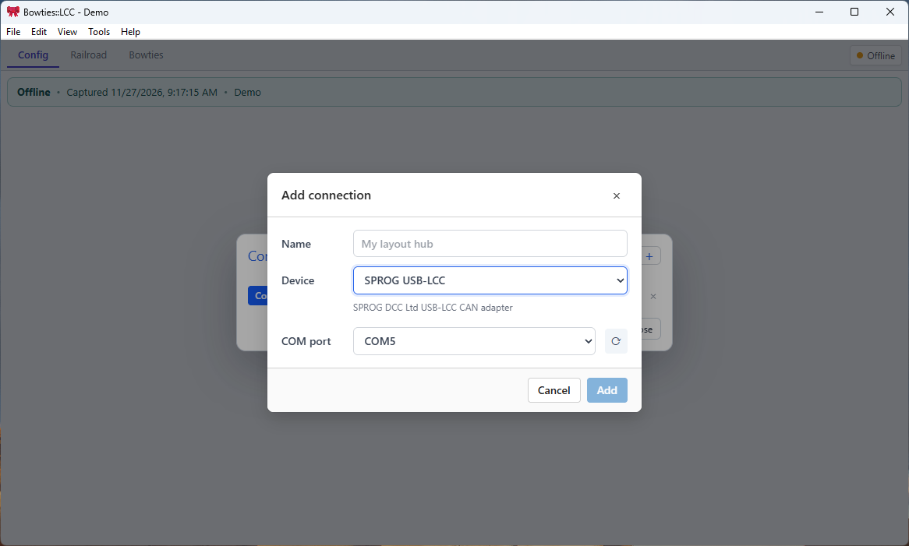
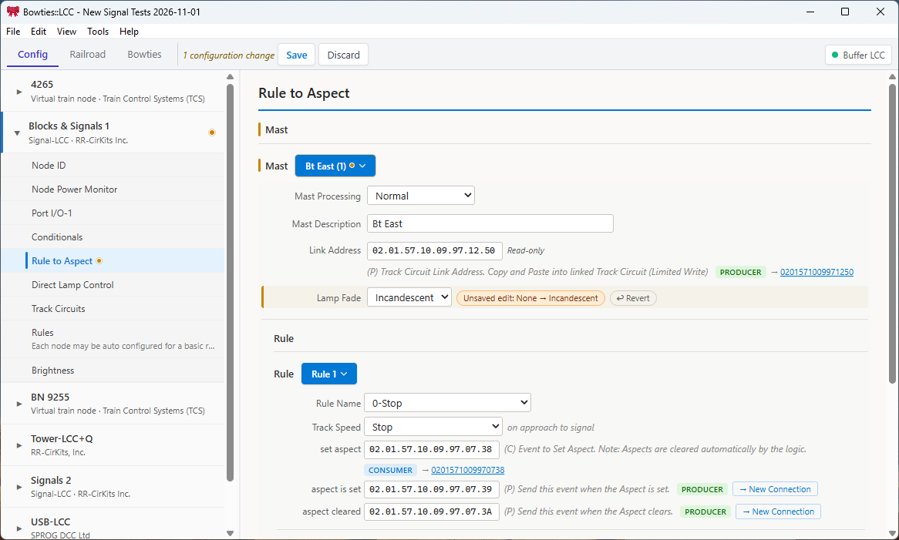
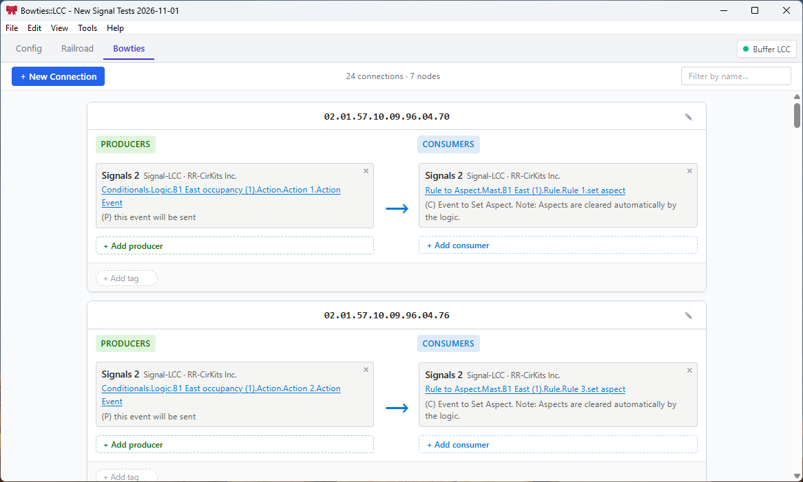

# Using Bowties

This guide walks you through opening a layout, connecting Bowties to your LCC bus, exploring your network, viewing and editing node configuration, and working offline.

## Opening or creating a layout

When Bowties starts, it opens to the layout picker. Choose one of these options before doing anything else:

- Open a known layout from the list.
- Click **New Layout** to create a new layout folder.
- Click **Browse...** to open an existing layout folder from disk.

Once a layout is open, Bowties restores the saved node snapshots, pending changes, and any layout-specific connections.

> **Tip:** A layout is a self-contained folder. You can share it with others, back it up, or move it to another computer by copying the entire folder and its contents.

## Connecting to your layout

Bowties keeps a list of named connections in the **Connect to LCC Network** card for the currently open layout. This card is opened from the connection status button in the top-right corner. When you have not connected yet, that button shows **Offline**.

Click the top-right **Offline** (or connection status) button to open the connection card. Each saved entry has a **Connect** button, plus an edit (🖊) and remove (×) action. The **`+`** button in the card header opens the Add connection dialog.

The status indicator in the connection bar turns green once a connection is established.

### Adding a connection

1. Open or create a layout.
2. Click the top-right **Offline** (or connection status) button to open the **Connect to LCC Network** card.
3. Click **`+`** in the card.
4. Enter a **Name** for the connection (for example *Layout hub* or *Workbench SPROG*).
5. Pick your hardware from the **Device** dropdown. Bowties auto-fills baud rate and flow control for known devices and shows only the fields that device needs.
6. Fill in the device-specific fields (see table below).
7. Click **Add**.



### Device options

| Device | Use for | Fields you enter |
|--------|---------|------------------|
| Network hub (TCP) | JMRI, WifiTrax, or a standalone TCP/IP bridge | Host + Port (JMRI uses `localhost:12021`) |
| RR-CirKits LCC Buffer-USB | RR-CirKits LCC Buffer-USB, also the LCC to Loconet Bridge | COM port |
| SPROG USB-LCC | SPROG DCC Ltd USB-LCC CAN adapter | COM port |
| SPROG PI-LCC | SPROG DCC Ltd Raspberry Pi LCC hat | COM port |
| Canable / Lawicel CANUSB | SLCAN-compatible USB-CAN adapter | COM port |
| Other GridConnect adapter | CAN2USBINO, MERG CAN-RS, or any other GridConnect device | COM port + Baud rate + Flow control |
| Other SLCAN adapter | Any `slcand`-compatible adapter not listed above | COM port + Baud rate + Flow control |

For serial devices, choose the correct COM port (Windows), `/dev/cu.*` device (macOS), or `/dev/tty*` device (Linux) from the dropdown. If you plugged the adapter in after opening the dialog, click the **⟳** button next to the COM port list to rescan.

### Connecting, editing, and removing

- Click **Connect** next to a saved entry to bring the link up.
- Click 🖊 to reopen the dialog pre-filled with that entry's settings.
- Click × and then **Delete** to remove a saved connection.

Saved connections persist with the layout.

---

## Discovering nodes

When you connect to the bus, Bowties discovers nodes automatically. The **Node List** populates with all nodes on your layout, showing manufacturer, model, and online status. Discovery is usually very fast.

## Reading node configuration

Before you can view configuration or the Bowties event map, click **Read Node Configuration** in the toolbar. Progress bars show how each node is coming along — on a large layout this can take a while.


Once complete, you can click into any node to view or edit its configuration, or switch to the Bowties view.

> **Note:** Configuration is cached after the first read, so subsequent launches are much faster.

## Making and saving changes

After reading node configuration, **Save** and **Discard** buttons appear in the toolbar.

- Edit configuration fields in the cards. The toolbar shows how many configuration changes are unsaved.
- Click **Save** to save your changes in the layout. Each configuration change is recorded in the layout as a **pending change** first.
- **While connected to the bus**, Save then writes those changes to the boards. A change the board accepted is no longer pending. A write that failed stays pending and the field shows the reason. Save tells you how many changes are still waiting.
- **While disconnected**, the changes stay pending in the layout until you reconnect (see below).
- Click **Discard** to abandon unsaved edits and restore the last saved layout state.

Your layout always reflects the state you last saved, so you can safely close and reopen Bowties without losing work.

---

## Viewing node configuration

1. Click any node row in the Node List to select it.
2. The **Configuration View** opens. The left sidebar lists the node's CDI segments. Click a segment to select it.
3. The main area shows the segment's groups as cards. Each card displays the fields and sub-groups for that configuration group.
4. Field values are read from the node and shown in-place inside each card.



Some Event IDs are labeled **Read-only** because the node determines their values. You can select and copy these values, but cannot edit them in Bowties. For example, the Signal-LCC mast Link Address is read-only; the separate Track Circuit Link Address can be edited.

### Connector daughterboards on supported carrier boards

Some RR-CirKits carrier boards include one or more connector slots for optional daughterboards.

1. Open the supported node's configuration view.
2. Choose the installed daughterboard for each connector slot from the selector above the affected configuration.
3. Bowties immediately narrows the visible sections and valid options for the governed lines.
4. If a new daughterboard makes a current value invalid, Bowties stages the compatible repair before you apply changes.
5. Save the layout or project to keep those connector selections with that node instance.

Nodes without connector-slot metadata keep the normal pre-feature configuration workflow.

---

## Editing configuration

1. Navigate to the field you want to change in the Configuration View.
2. Edit the value inside the card:
   - **Drop-down** fields: choose from the list of options.
   - **Text / number** fields: click and type the new value.
   - **Slider** fields: drag the control within the field's valid numeric range. Device profiles may use sliders for suitable values, including Signal-LCC Brightness intensities.
   - **Event ID** fields: enter a 64-bit event identifier in `XX.XX.XX.XX.XX.XX.XX.XX` format.
3. Click **Apply** to write the new value to the node.

The field indicator changes to ✓ when the write is confirmed by the node.

---

## Bowties view (event relationship map)

The **Bowties View** shows a visual map of event producer/consumer relationships across your entire layout.



- Each **bowtie** shape represents an event shared between one or more producers and one or more consumers.
- **Half-bowties** represent events that have producers but no consumers yet, or vice versa.
- **Hovering** a bowtie shows a summary tooltip (node name, segment, element).
- **Clicking** a bowtie jumps to that element in the Configuration View.

Use the filter bar at the top to show:

| Filter | Description |
|--------|-------------|
| Connected Only | Bowties with both a producer and consumer |
| Unconnected | Half-bowties only |
| All | Everything |

### Creating a new connection

To link a producer to a consumer:

1. Click **+ New Connection** in the Bowties view toolbar.
2. In the **New Connection** dialog, use the **Producer** panel (left) to pick the element that sends the event.
3. Use the **Consumer** panel (right) to pick the element that should respond to it.
4. Optionally enter a name for the connection.
5. Click **Create Connection**. Bowties resolves the event ID (preferring an already-configured side) and writes it to the other side.

You can also start a connection from the Configuration View: click **→ New Connection** next to any event ID field in a card. The dialog opens with that element pre-filled on the appropriate side.


---

## Facilities (preview)

The **Railroad** tab includes a **Facilities** section for Panels and Automatic Block Signals.

> **Preview feature.** Facilities are an early, evolving area of Bowties. The shape of facilities — what templates exist, how their slots are filled, and what they do once complete — is expected to change in upcoming releases. Feedback on this area is especially welcome.

### What you can do today

- **Add a Panel**, give it a name, and add detected blocks in the Blocks step.
- In **Wiring**, choose each block's lamp board and pin. **Lit when** defaults to Occupied; choose Clear for the opposite behavior.
- **Done** stages the panel and its configuration changes. **Cancel** leaves the saved layout unchanged.
- **Edit** a panel to change its blocks or wiring. **Remove** confirms the board resources being released.
- **Save** persists the changes; while connected it also writes the staged configuration to the boards. Offline, configuration changes wait for Sync.

Facilities and their names — along with every channel binding — are saved with the layout. Closing and reopening Bowties restores them exactly as you left them.

### Opening layouts with Block Indicators

Block Indicator has been replaced by Panel. Conversion happens automatically when an older layout opens; there is no wizard.

- Indicators are grouped into one panel per lamp board, preserving block order. Old facility names become lamp-channel names.
- Blocks without a lamp appear in **Indicators without a lamp**, marked Incomplete. Indicators without a block are dropped. Malformed entries and same-panel duplicate blocks or lamps produce explicit warnings; the first accepted entry is kept.
- A notice gives the numbers converted. **Save** keeps the converted layout. Failed Save leaves it unsaved.
- **Discard** acknowledges conversion for this open session but keeps the converted panels. Reopening the unchanged older file converts it again.
- Existing events, lamp rows and Lamp Selection are unchanged. Conversion creates no configuration changes or new Sync work; already-working lamps keep working.
- Old bowtie names remain on the **Bowties** tab. A converted lamp with no pin still needs wiring through **Edit**.

### Automatic Block Signals

**Add facility** also offers **Automatic Block Signals**, which sets up signals for a run of detected blocks on a Signal-LCC. This first release covers one direction of travel, three aspects (Stop, Approach, Clear) and one red/green searchlight per signal that is always lit. Other choices are shown but greyed out. **Interlocking Plant** is listed too but is not available yet.

The editor has four pages. You can move between them with the steps at the top, and **Cancel** discards everything until you press **Done**.

- **Blocks.** List your detected blocks in the order a train passes them. Each block gets a signal at its entrance; use **⋯** on a block's row to join it to the block above, so one signal protects both (for example a short detection section). Under each block you can list its hand-thrown turnouts on the main by name; for now they are placeholders, not connected to turnout position inputs, so each one is treated as not lined for the main. The chips at each end of the track diagram set what lies beyond the last block.
- **Live occupancy.** While you are connected, each block's dot shows **Occupied** or **Clear** as its detector reports. A dashed dot means there is no reading yet, for example before a train has moved through the block or while you are offline.
- **Aspects.** Shows the rules each signal follows: Stop while any block it protects is occupied, Approach when the next signal shows Stop, otherwise Clear.
- **Appearance.** Shows the searchlight each signal uses.
- **Wiring.** For each signal, choose the Signal-LCC it runs on and the pins its red and green lamps are wired to. Pins already used by another facility can't be chosen. If a pin is used by something configured on the board outside Bowties, you can release it so the signal can use it. Bowties checks your choices and lists anything needing attention before you can press **Done**.

When you press **Done**, the facility appears on the Railroad tab and its changes join your unsaved changes; **Discard** undoes them. **Save** records the board settings in the layout and, when you are connected, writes them to each Signal-LCC. Until every setting has been written, the facility card shows **Waiting** with a line for each board. If you saved offline, the settings are written when you next sync. Bowties does not yet read the settings back to confirm them.

The facility card on the Railroad tab draws the facility's track diagram with live occupancy. Use **Edit** on the card to change the facility; every page opens with your saved choices. Use **Remove** to delete it: Bowties lists what it will reset on each board, resets only the settings this facility made, and keeps your blocks and detectors. A facility can span several Signal-LCC boards; Bowties arranges the logic on each board and may move another facility's logic on the same board to make room.
---

## Reconnecting with pending changes

If you saved a layout with pending changes and later reconnect with that layout, Bowties opens the **Sync Pending Changes** flow so you can review and apply them safely.

---

## Syncing pending changes back to the bus

When a saved layout with pending changes is open and you reconnect to the bus, Bowties compares the planned values in the layout with the current live values.

- **Conflicts** require you to choose whether to apply your value or skip it.
- **Clean changes** are ready to apply and are selected by default.
- **Already applied** changes are cleared automatically and reported as a count.
- **Missing nodes** stay pending in the layout until those nodes are present again.

If Bowties is not confident the connected bus matches the saved layout, it asks whether this is the **Target layout bus** or a **Bench / other bus** before showing apply choices.

---

## Advanced Configuration

Bowties reads an optional `tuning.toml` file from the application data directory at startup. This file lets you adjust datagram timing parameters without rebuilding the application — useful when troubleshooting CAN gateway connectivity issues.

**File location:**

| Platform | Path |
|----------|------|
| Windows  | `%APPDATA%\com.lcc.bowties\tuning.toml` |
| macOS    | `~/Library/Application Support/com.lcc.bowties/tuning.toml` |
| Linux    | `~/.config/com.lcc.bowties/tuning.toml` |

**Example `tuning.toml`:**

```toml
# Delay (ms) after acknowledging a reply datagram before sending the next
# request. Increase if reads through a CAN gateway time out intermittently.
post_ack_delay_ms = 10

# Per-attempt timeout (ms) waiting for a memory-config read reply.
read_timeout_ms = 3000

# Maximum retries when a node rejects with the resend-OK flag.
max_datagram_retries = 3
```

All fields are optional — omitted fields use the built-in defaults shown above. Changes take effect the next time you launch the application.

---

## Troubleshooting

**No nodes appear after connecting**
- Check that the connection status is green (top-right button shows a colored status, not "Offline").
- Ensure your LCC network has power and that at least one node is online.
- If you still see no nodes after a few seconds, try disconnecting and reconnecting — some nodes respond slowly on first boot.

**A USB adapter is not listed**
- Check Device Manager (Windows), System Information → USB (macOS), or `dmesg` (Linux) to confirm the adapter is recognized as a serial port.
- Click the **⟳** button next to the COM port dropdown to rescan after plugging the adapter in.

**Configuration changes are not accepted**
- Some nodes require a reboot before new configuration takes effect. Check the node's manual.
- Ensure you are connected when clicking Apply — a dropped connection will prevent writes.
