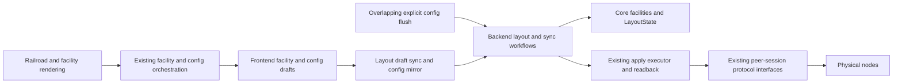
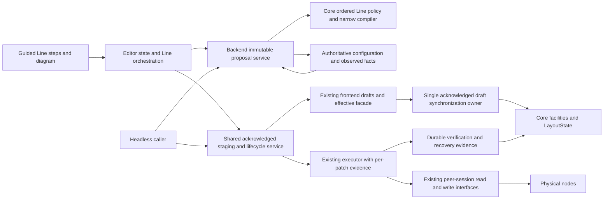

# Slices: One-Direction Automatic Block Signals

Branch: 020-block-signals-first-slice
Generated: 2026-11-07
Status: 1/8 slices complete

Approved input: [Architecture Assessment](plan.md#architecture-assessment) and
[feature specification](spec.md). Roadmap review split the assessment's first
slice into three UX checkpoints so feedback can precede persistence and hardware
application. The remaining five slices preserve the approved design contracts.

`/build` expands one card at a time with just-in-time tasks. S1 is complete,
including user-confirmed native Tauri review. S2 is checkpointed (commit
`7b1b641`) with its resource check and visual gate still open. S2R, a
feedback release that rebuilds Blocks and Aspects to the revised storyboard,
is the active card; downstream cards remain `sketched`.

## Architecture

### Before

### After

The diagrams show responsibilities, not new parallel persistence or apply paths.
Frontend UI edits remain frontend-authoritative; backend mirrors do not become a
second UI draft owner. Headless callers use the shared validated lifecycle
contract settled at S4, not a compiler-only bypass.

### Patterns

- **Ordered aggregate**: entered block membership is travel order and the only
  source of downstream relationships; direction is diagram metadata.
- **Functional core / imperative shell**: core policy, identity retention,
  compilation and resource diffs are pure; the backend supplies facts and effects.
- **Progressive proposal boundary**: incomplete editor input produces explicit
  missing-fact issues, not a fabricated valid or stageable hardware proposal.
- **Immutable proposal**: confirmation authorizes the exact reviewed revision
  and snapshot generations, never a silently reconstructed patch.
- **Effective-view facade**: rendering consumes composed saved/draft state and
  aggregate dirty state rather than local fallback or dirty calculations.
- **Single acknowledged staging owner**: stage the facility and config batch
  coherently, consolidate overlapping flushing, and await synchronization before
  dependent preview/apply.
- **Forward recovery**: fresh readback yields a new validated correction; neither
  acknowledgement nor a multi-node operation implies verified atomic success.

### Module Changes

Proposed module names are placements, not assertions that those modules exist.

| Module | Today | After |
|---|---|---|
| Core facilities and layout persistence | Facility deltas and saved/captured/draft ownership | Line records, compatible persistence, ownership and recovery roundtrip |
| Proposed core signaling module | No Line policy/compiler owner | Ordered policy, stable signal retention and narrow Signal-LCC patch/resource diff |
| Proposed backend signaling service | No unified Line proposal boundary | Authoritative facts, progressive validation and immutable reviewed proposals |
| Existing draft/config orchestration | Reactive mirror and overlapping explicit flushing | Shared acknowledged synchronization and coherent Line staging |
| Frontend layout facade and facility drafts | Effective facilities and aggregate dirty state | Line projections and edits in existing Save/discard/close participation |
| Proposed Line editor and orchestrator | No guided Line editor | Deterministic step state and lifecycle-scoped sequencing |
| Backend layout draft/capture commands | Existing sync, save/open and recovery boundaries | Line deltas and durable evidence through the same boundaries |
| Existing sync executor/readback | Write acknowledgements do not establish Line verification | Proposal-linked per-node/per-patch outcomes, verification and fresh-read recovery |
| Guided components and Railroad composition | Existing facility/channel rendering | Blocks, Signals, Display, Bindings, Confirm and truthful status |
| Channel events, profile bindings and style helpers | Shared detection/path/translation owners | Reused without a competing event or style model |
| Existing protocol interfaces | Peer-session transport/read/write ownership | Reused; no new protocol abstraction planned |

### Behavior Summary

| Slice | User-visible change | Demoable? |
|---|---|---|
| S1: Choose blocks and name signals | Exercise Blocks/Signals and a real one-block diagram | Yes |
| S2: Choose display and bind real outputs | Exercise Display/Bindings with actual wiring choices | Yes |
| S3: Review the complete terminal proposal | Exercise Confirm and all five steps before persistence | Yes |
| S4: Keep or discard Line drafts | Stage, save, reopen, rename, reorient or discard without applying | Yes |
| S5: Safely operate one signal | Apply, verify, recover and safely remove owned resources | Yes, terminal evidence required |
| S6: Extend on one board | Append a block while retaining the original signal | Yes, internal-signal bench-gated |
| S7: Operate across nodes | Distribute signals and recover visibly from partial application | Yes, cross-board bench-gated |
| S8: Maintain a three-block Line | Reorder, prepend, rebind and remove members safely | Yes |

## Roadmap

| # | Slice title | Label | Blocked by | Status |
|---|---|---|---|---|
| S1 | Choose blocks and name signals | HITL | None | done |
| S2 | Choose display and bind real outputs | HITL | S1 | tasked |
| S2R | Feedback release: Blocks and Aspects per revised storyboard | HITL | S1, S2 checkpoint | tasked |
| S3 | Review the complete terminal proposal | HITL | S2 | sketched |
| S4 | Keep or discard Line drafts | HITL | S3 | sketched |
| S5 | Safely operate one signal | HITL | S4 + terminal-recipe evidence | sketched |
| S6 | Extend on one board | HITL | S5 + internal-signal bench evidence | sketched |
| S7 | Operate across nodes | HITL | S6 + cross-board/receiver-restart evidence | sketched |
| S8 | Maintain a three-block Line | AFK | S7 | sketched |

Hardware gates refer to [single-board evidence](manual-track-circuit-test.md) and
[two-board evidence](manual-two-board-test.md). Measured subsets do not establish
full acceptance. Outstanding trigger, restart and quiet-bus checks remain gates
where relevant. Failure handling belongs in every affected slice, not a final
hardening pass. No horizontal foundation or test-only slice is authorized.

### S1: Choose blocks and name signals [HITL]

**Intent**: Exercise Blocks and Signals with a real one-block diagram and editable Line/signal names.
**Boundary**: Rendering -> editor state/orchestration -> IPC/backend -> core policy/identity.
**Blocked by**: None.
**Status**: done
**Complexity**: large
**User stories**: US1, US4 (preview-only portions).

**Acceptance criteria**:
- [x] Apply the user-reviewed fidelity corrections: searchable/scrollable Add block... dialog, Cancel flush left with navigation right, horizontal name rows, mockup ABS copy/emphasis, and Signals track-strip/selection/card structure without non-product narration. Retain one-block S1 behavior.
- [x] Preserve the approved [Blocks](../proposals/signaling-ux/signaling-facilities-storyboard.html#line-blocks) and [Signals](../proposals/signaling-ux/signaling-facilities-storyboard.html#line-signals) wizard experience: wide shared dialog, five numbered steps, guidance and cards, styled block picker, track diagram and Cancel/Back/Next footer. Later steps remain visibly unavailable, not omitted.
- [x] Select an existing named detected block and see its entrance signal and protected-block relationship in the diagram.
- [x] Edit Line/signal names and eastward/westward orientation without changing operational order, protected block or signal identity.
- [x] Occupied/clear terminal expectations are Stop/Clear; preview expectations and unavailable observations are distinct, with no implied protection beyond the terminal block.
- [x] Missing hardware bindings are explicitly incomplete, not a valid/stageable proposal; save/apply is unavailable.
- [x] Preview and navigation perform zero bus writes and create no lasting claims.
- [x] Equivalent guided/headless partial input follows the same policy/validation service and produces equal normalized expectations/issues.

**Architecture note**: Establish ordered membership, stable editor identities and the shared progressive proposal boundary. Incomplete input must be explicit, never a fabricated successful hardware proposal.

**HITL checkpoint**: Approved 2026-11-07: D1-A (transient editor intent with
core-owned signal identity retention) and D2-A (capability-discriminated
progressive proposal). Block/detector ownership stays unchanged: the Line
references shared blocks and owns only its signals. Use the storyboard's existing
Add facility entry point, adding Automatic Block Signals alongside Block Indicator without
replacing existing facilities or indicator lamps. Existing facility slots are not
ordered Line membership; S1 must not create persistent facility/configuration drafts.

**Tasks**:
- [x] S1-T1: Write the visible integration tracer test in `app/src/lib/components/Railroad/RailroadPanel.integration.test.ts` (Vitest + Testing Library): select an existing named detected block through the real editor/orchestrator, render its entrance signal and protected block from the IPC response, distinguish Stop/Clear expectations from unavailable observations, and expose no save/apply capability. Mock only IPC/system boundaries.
- [x] S1-T2: Core policy and identity in `bowties-core/src/signaling/` and `bowties-core/tests/block_signals_policy.rs` (Rust): normalize one-block input, retain signal identity by protected block through rename/orientation edits, derive terminal expectations independently of observations, and represent incomplete facts explicitly without patches or claims. Export through `bowties-core/src/lib.rs`.
- [x] S1-T3: Backend proposal service in `app/src-tauri/src/signaling/`, a focused command adapter and registration (Rust): resolve existing effective block/detection facts through canonical identities and shared event resolution; provide the same side-effect-free service for IPC and headless callers. Test normalized parity, unavailable/invalid detection and absence of draft, claim and write effects. Resolve any directly needed draft-aware fact contract at this owner rather than copying stale composition assumptions.
- [x] S1-T4: Typed API and transient editor state/orchestration in `app/src/lib/api/signaling.ts`, `app/src/lib/stores/blockSignalsEditor.svelte.ts` and `app/src/lib/orchestration/blockSignalsEditorOrchestrator.ts` with focused Vitest tests: sequence preview, adopt core-normalized identities, preserve choices across Blocks/Signals navigation, reject stale responses, surface failures explicitly and clear editor state on cancel/layout lifecycle reset. Use the existing effective-layout facade for block inventory; do not introduce a persistent Line store.
- [x] S1-T5: Restore the approved storyboard wizard in `app/src/lib/components/BlockSignals/BlockSignalsEditor.svelte` and existing facility composition with focused component/integration tests. Reuse shared Dialog, title/actions/buttons and selection primitives; provide Blocks/Signals cards, five-step indicator, contextual guidance, oriented track diagram and Cancel/Back/Next progression. Close/Esc/overlay/Cancel use existing cancellation ownership; later steps remain visibly disabled. Preserve all tested identity, preview-only and existing Block Indicator behavior.
- [x] S1-T6: Enrich durable product behavior and `aiwiki/owners.md`, `flows.md` and applicable seam entries; check `specs/backlog.md`. Record approved decisions and session progress here without tasking S2.
- [x] S1-T7: Validate restoration RED/GREEN and affected frontend regressions/build/diagnostics, baseline-relative file scope and actual running wizard against the linked storyboard Blocks/Signals screens. Verify selection, back/next, cancel/close, disabled later steps, identity/orientation and narrow-screen layout. Record observed visual results and authorized S1 differences before marking done. No write-mode formatters.

**Completion correction (2026-11-07)**: Previous tests established functional
plumbing, not the agreed wizard UX. The user rejected the bare inline form;
S1 is not complete until T5/T7 and wizard acceptance pass. User approved restoring
the original storyboard structure and updating build/worker handoff requirements.
Existing backend/core validation below remains historical evidence for unchanged
plumbing, not proof of wizard fidelity.

**User review correction (2026-11-07, 21:28)**: Earlier browser comparison
incorrectly accepted an inline picker, changed field/copy layout, substituted
diagram and right-aligned Cancel. These were not authorized differences.
The user approved correcting them through shared searchable selection and
semantic footer regions, while preserving S1's one-block preview-only scope.

**Native review correction (2026-11-08)**: The user rejected the remaining
stretched track, improvised mast, tile placement, outer frame and policy
placeholders. Option A approved: both Add facility types require a name and
the exact accepted name seeds the Line editor. Previous browser fixtures are
not proof of native Tauri fidelity; do not use the integrated browser or mark
S1 complete before native review.

**Native correction tasks**:
- [x] S1-N1: Require initial names consistently and pass the trimmed name through facility composition, orchestration and store initialization; retain later edits and cancel/reset behavior.
- [x] S1-N2: Alphabetize block-picker candidates without mutating the supplied inventory or operational membership.
- [x] S1-N3: Remove routine missing-binding messages from Blocks/Signals while keeping authoritative incomplete capabilities and real errors.
- [x] S1-N4: Adapt the original storyboard track-unit markup/CSS and SVG, selected signal icon/name stack, gap geometry and policy/expectation form rather than another full-width diagram approximation.
- [x] S1-N5: Review the updated Blocks/Signals screens in the native Tauri app against the original mockup. User screenshot/runtime evidence required; no integrated-browser substitute.

**Native acceptance (2026-11-08, 10:12)**: After reviewing the updated native
Tauri wizard and its scrolling/label-spacing refinements, the user confirmed:
"This is working as expected." This closes S1's pending native visual gate.
Acceptance is for the one-block preview wizard, not hardware binding,
application, readback or later multi-block behavior.

**Scroll/spacing refinement (2026-11-08)**: User approved inner-only scrolling
with a stationary indication preview. Shared `Dialog.bodyLayout="contained"`
delegates scrolling to the wizard; the default remains `scroll` for other
dialogs. Roomy viewports keep upper context fixed and budget the remaining
height to independent policy/indication panes. At width <=640px or height
<=700px, a single inner workspace scrolls instead of the individual panes.
The track region cannot shrink to make room for policy content.

The 14px label line height and 10px rail-edge gap place the upper text box at
y=12..26 and lower text at y=49..63 around the rail at y=36..39. The marker
is centered at y=37.5. Native review confirmed the refinement as working as
expected (see acceptance above).

Validation:
- RED: contained shell behavior and the shared rail-label geometry were absent;
  GREEN: focused Dialog/wizard suite — 34 passed.
- `app`: `npm run test:refactor-gate -- --reporter=dot` — 303 passed.
- `app`: combined Dialog, wizard, picker, footer and orchestration suites —
  47 passed.
- `app`: `npm run build` — passed. `npm run check` — unchanged 113 existing
  errors/two warnings; no new changed-file diagnostics.
- `git diff --check` — passed. Native scrolling/spacing review was subsequently
  accepted under N5; no integrated browser or application server was used.

**Automated evidence (2026-11-08)**:
- RED: the Automatic Block Signals Add button accepted an empty name; the initial Line name
  was discarded; unordered candidates stayed in source order; routine hardware
  notices remained; the original selected policy controls were absent.
- GREEN: `app` — `npm run test:refactor-gate -- --reporter=dot`: 303 passed.
- GREEN: `app` — combined wizard, name handoff, block picker, channel picker,
  facility and shared dialog/list suites: 63 passed across nine files.
- `app` — `npm run build`: passed. `npm run check`: 113 existing errors and
  two warnings after typing the directly touched Add facility test callbacks;
  no new production diagnostics. `git diff --check`: passed.
- Original source references: storyboard CSS 684–765 and Signals markup
  2117–2195. Compact 240px unit, 180px block area, 70px leading rail and 8px
  gap replace the uninterrupted rail; 148px selected tile contains the
  original 36×28 T-mast SVG and centered name below. Routine notices and the
  enclosing diagram frame are removed. Fixed/disabled policy choices preserve
  the mockup affordances without adding unsupported behavior.
- Source review and tests do not establish native visual fidelity. N5 was
  initially pending and is now closed by the user's native confirmation above;
  no integrated browser or application server was started for this pass.

**Fidelity correction tasks**:
- [x] S1-U1: Test and reuse the searchable/scrollable selection-dialog mechanics through a domain-neutral presentation owner and selection-only block adapter; preserve existing channel-picker behavior.
- [x] S1-U2: Test shared leading/trailing footer regions with backwards-compatible defaults; put wizard Cancel at the left edge and Back/Next at the right edge.
- [x] S1-U3: Test exact approved Blocks copy/label/form-row layout and Signals track-strip, occupancy marker, separate signal tile/name row and policy/table hierarchy. Remove storyboard narration while retaining actionable errors and truthful unavailable facts.
- [x] S1-U4: Run affected picker/dialog/wizard and lifecycle tests, production build/type diagnostics and running-browser mockup comparison at desktop/narrow sizes. Record results before restoring done status.

**User-reviewed correction evidence (2026-11-07)**:
- RED failures covered missing Add-block dialog, absent leading footer region,
  incorrect Signals section names and confirmation of a filtered-out choice.
  Each has GREEN implementation and focused-suite results.
- `app`: `npm run test:refactor-gate -- --reporter=dot` — 303 passed.
- `app`: `npx vitest run src\lib\components\Railroad\RailroadPanel.integration.test.ts src\lib\orchestration\blockSignalsEditorOrchestrator.test.ts src\lib\components\Facilities\SelectChannelPicker.test.ts src\lib\components\Facilities\AddFacilityDialog.test.ts src\lib\components\Facilities\wired.integration.test.ts src\lib\components\Dialog\Dialog.test.ts src\lib\components\Dialog\DialogActions.test.ts src\lib\components\SingleSelectList\SingleSelectList.test.ts src\lib\components\Line\SelectBlockPicker.test.ts --reporter=dot` — final nine-suite run: 60 passed.
- `app`: `npm run build` — passed. `npm run check` — unchanged 123 existing
  errors/two warnings after resolving a new picker title/snippet name collision.
- Browser comparison used production Railroad/Line components and real
  orchestration/stores with external IPC fixtures. Search narrowed 40 blocks to
  one; the list measured 286px visible height versus 1311px scroll height with
  `overflow-y: auto`. Confirm added only Line membership.
- Desktop screenshots verify horizontal name rows, bold ABS, Add block label,
  flush-left Cancel, trailing navigation, compact full-width track with boundary
  ticks/unknown occupancy marker, separate named signal tile, Entire Line and
  When-this-signal-shows cards. Removed storyboard narration and redundant
  request-status prose; missing-binding notice remains below the signal cards.
- At 390px, no wizard descendant has horizontal overflow. Rename/orientation
  and Back/Next preserve signal identity; Westward moves the tile to the east
  entrance. Cancel and two-stage picker/wizard Escape dismiss correctly.
- No backend, core, persistence or multi-block policy changes. Existing staged
  user work and the Git index were preserved.

**Wizard restoration validation (2026-11-07)**:
- RED failures proved the missing dialog, hypothetical expectation framing,
  picker Escape behavior and Signals policy/expectation cards; each was followed
  by GREEN implementation and affected-suite checks. Old inline-form assertions
  were migrated to picker/navigation contracts without dropping identity,
  error visibility or existing facility coverage.
- `app`: `npm run test:refactor-gate -- --reporter=dot` — 303 passed.
- `app`: `npx vitest run src\lib\components\Railroad\RailroadPanel.integration.test.ts src\lib\orchestration\blockSignalsEditorOrchestrator.test.ts src\lib\components\Facilities\AddFacilityDialog.test.ts src\lib\components\Facilities\wired.integration.test.ts src\lib\layout\effectiveLayoutStore.svelte.test.ts src\lib\orchestration\layoutLifecycleOrchestrator.test.ts --reporter=dot` — 65 passed.
- `app`: `npm run build` — passed. `npm run check` — unchanged 123 existing
  errors/two warnings after fixing the introduced nullable-preview diagnostic.
  Final focused wizard/orchestration rerun — 17 passed.
- Browser screenshots of running production Railroad/Line components on the
  Vite app were compared with `#line-blocks` and `#line-signals`. Real stores,
  components and orchestration were used; only external IPC and the existing
  detected-block inventory were supplied as fixtures. This is UI validation,
  not a live-bus or native-window test.
- Confirmed the shared wide dialog, numbered five-step shell, two Blocks cards,
  styled existing-block picker, selected signal/neutral diagram, fixed Entire
  Line policy card and When-this-signal-shows table. Renaming and Back/Next
  preserved the selected block; Westward moved its entrance marker. Future steps
  and Next: Display stayed disabled. Cancel and two-stage picker/wizard Escape
  dismissed correctly without deleting the shared block.
- At 390px viewport, cards stack, dialog width is 351px and no descendant has
  horizontal overflow. Initial browser-only failures exposed an unreadable SVG
  fill and narrow Signals-card overflow; both were corrected and rechecked.
- Intentional differences from the full storyboard: one block/one direction,
  fixed Speed/Essential policy instead of unsupported policy controls, unavailable
  observations, no downstream/Plant link, disabled future steps. Shared Fluent
  dialog typography follows the app's established primitives. The previously
  accepted right-aligned Cancel was a review error, not an authorized difference.
- No backend/core behavior changed during wizard restoration. Backlog reviewed;
  this correction remains tracked by the feature, not a duplicate backlog item.

**Implementation audit (2026-11-07)**: Caller validation corrected missing
Line-scoped identity wiring, incomplete capability/missing bindings, unsupported
multiple-block policy, a missing oriented diagram, in-flight navigation and
Signals-step error visibility. Each correction has recorded RED/GREEN evidence.
The actual AppState/headless parity test executes against resolved cached CDI.
Its initially invalid eight-byte Node ID fixture was corrected to six bytes
after the loader problem was resolved.

**Caller validation** (commands run from the named Bowties subdirectory):
- `app`: `npm run test:refactor-gate -- --reporter=dot` — 303 passed.
- `app`: `npx vitest run src\lib\components\Railroad\RailroadPanel.integration.test.ts src\lib\orchestration\blockSignalsEditorOrchestrator.test.ts src\lib\components\Facilities\AddFacilityDialog.test.ts src\lib\layout\effectiveLayoutStore.svelte.test.ts src\lib\orchestration\layoutLifecycleOrchestrator.test.ts --reporter=dot` — 57 passed.
- `bowties-core`: `cargo test` — 448 passed, one ignored.
- `app`: `npm run build` — passed.
- `app`: `npm run check` — 123 errors and two warnings in existing files; no diagnostics in the new Line files.
- `app/src-tauri`: `cargo test --lib --no-run` — passed. Direct execution of `target\debug\deps\bowties_lib-39a763e55fb50a26.exe signaling --nocapture` after test-only Common Controls v6 manifest activation — three passed.
- The same manifest-activated backend binary without a selector — 141 passed,
  two unrelated failures in unchanged event-router Node ID serialization and
  shared daughterboard profile-constraint tests. These were not changed.
- `git diff --check` — passed; source changes match the accepted S1 surface.

The ordinary Windows backend test binary imports `TaskDialogIndirect` but lacks
Common Controls v6 activation, causing `STATUS_ENTRYPOINT_NOT_FOUND` before
tests. Validation embedded a temporary v6 manifest into the generated test
binary using the Windows SDK `mt.exe`, not application source. The temporary
manifest and incidental core lockfile version rewrite were cleaned up.

**User test**:
1. Open Railroad, choose Add facility, select Automatic Block Signals alongside Block
   Indicator, and start the wide five-step wizard.
2. Name the Line, choose orientation, and use Add existing block to select a
   detected block. Choose Next: Signals; check its entrance diagram, editable
   name, protected block, fixed policy and hypothetical Stop/Clear table.
3. Edit names and eastward/westward orientation, then navigate back/forward.
   The signal stays associated with the same block; orientation moves the
   entrance in the diagram without changing operational membership.
4. Missing bindings remain incomplete; no save/apply action is available.
   Cancel leaves existing facilities, indicators and detection unchanged.

<!-- Session: 2026-11-08 — S1 complete: automated checks and native user review recorded. Next: S2 (HITL), still sketched and not yet approved/task-expanded. -->

### S2: Choose display and bind real outputs [HITL]

**Intent**: Exercise Display and Bindings and inspect actual red/green wiring choices.
**Boundary**: Rendering -> editor/orchestration -> backend authoritative facts -> core hardware validation/compiler.
**Blocked by**: S1.
**Status**: tasked
**Complexity**: large
**User stories**: US1, US4 (display/binding preview and validation portions).

**Acceptance criteria**:
- [ ] Show the supported two-driver RG display and separately assign red and green physical outputs on a compatible Signal-LCC.
- [ ] Reuse the selected block's detection; require no raw event IDs, downstream receiver numbers or logic tables.
- [ ] Unsupported hardware/choices, unavailable facts, conflicting outputs, invalid configuration and insufficient current resource capacity have actionable signal/node explanations.
- [ ] Bindings preserve S1's identities and names; back/cancel navigation creates no lasting claims or bus writes.
- [ ] Guided/headless equivalent inputs agree on bindings and validation through the shared proposal service.
- [ ] Explain red for Stop, red+green for Approach and green for Clear without subjective blended-color approval, a dedicated yellow driver or a flashing substitute.
- [ ] Save/apply remains unavailable; unresolved required facts cannot appear as successful hardware validation.

**Architecture note**: Introduce only the narrow terminal hardware projection behind the shared proposal interface, not a generic recipe or resource-allocation framework.

**S1 carry-forward**: Preserve the transient Line ID, protected-block signal
identity mapping and explicit incomplete capability when bindings are added.
Keep one-block eligibility until S6; do not interpret resolved detection alone
as hardware validation. Use the actual backend adapter for parity coverage.
Preserve the native-reviewed wizard geometry, initial name handoff, alphabetical
picker and contained scrolling so policy growth does not move the indication
preview away.

**Approved UI contract**:
- Preserve [Display](../proposals/signaling-ux/signaling-facilities-storyboard.html#line-display)
  and [Bindings](../proposals/signaling-ux/signaling-facilities-storyboard.html#line-bindings),
  including the native-reviewed S1 wide contained dialog, five-step progression,
  compact selected-signal track strip, context/name hierarchy and independent
  inner scrolling. Cancel stays flush left; Back/Next stay right.
- Display retains the Entire Line default/Selected signal only hierarchy beside
  the physical-arrangement preview and indication/appearance table. Bindings
  retains the expandable existing-source summary, selected-signal Board and
  Green/Red assignment rows, and adjacent output-availability/ownership table.
  Links return to Signals/Display without losing valid input.
- Allowed narrower-slice differences: only the supported two-driver RG display
  is selectable; unsupported three-lamp/display overrides stay disabled within
  the approved structure. No yellow driver is required. Use actual board/output
  evidence instead of sample inventory; show unavailable evidence truthfully,
  never the storyboard's sample live occupancy. Confirm remains disabled until
  S3, and Save/apply remain unavailable. Do not render storyboard design notes
  or frame narration as product UI.

**HITL decisions approved (2026-11-08, 17:56)**:
- D1: Signals use the existing Information Channel model -- Line policy chooses
  the indication; Role defines its meaning; Style maps it to hardware; Binding
  identifies the concrete outputs. Extend the existing mechanism rather than
  creating a parallel Line-specific channel/binding model or treating each LED
  as an independent semantic signal. S2 remains transient; durable channel and
  Line references are settled at S4, not fabricated as unbound saved channels.
- D2: Preview and compilation share the same hardware interpretation -- one
  backend proposal contract combines style mappings with authoritative effective
  configuration, capacity, ownership and evidence. S3 revalidates changed facts
  before producing an immutable reviewed proposal. Offline captured facts are
  not live observations. Placement of a pure resource projector is not a
  separate PM decision and remains open within these ownership constraints.
- These replace the earlier snapshot/projector and terminal-projection framing
  following the user's Role/Style/Binding clarification. "Terminal" means the
  last signal in the modeled Line, not an output terminal or display style.
- User approved both revised contracts. Implementation is authorized for S2
  only; running visual acceptance remains a separate completion gate.

**Tasks**:
- [ ] S2-T1: Write integration tracer test -- extend `app/src/lib/components/Railroad/RailroadPanel.integration.test.ts` to reach the actual Line wizard through the existing entry point, navigate Blocks/Signals/Display/Bindings, select distinct real RG outputs from IPC-boundary evidence, and observe scoped validation in a user-visible Consumer. Keep real frontend stores/orchestration; mock only IPC. Record RED before implementation and GREEN after the vertical path works.
- [ ] S2-T2: Core/channel contract -- extend the existing Role/Style/Binding mechanism and `bowties-core/src/signaling/` with semantic signal indications, typed same-host red/green bindings, style-backed RG appearances and narrow resource requirements/validation, subject to D1 approval. Extend `bowties-core/tests/block_signals_policy.rs` and affected channel/profile contract tests. Preserve transient Line/protected-block signal identities, names, one-block eligibility and incomplete action capability; do not create durable unbound channels. Test invalid/duplicate/incompatible outputs, unknown evidence and insufficient current capacity sequentially; no generic allocator or exact patch lowering.
- [ ] S2-T3: Backend -- extend `app/src-tauri/src/signaling/mod.rs` and its tests to assemble authoritative effective configuration, supported profile/CDI facts and evidence provenance for all eligible hosts, including hosts without detector channels. Reuse typed detection and profile-path owners; derive occupied resources from complete configuration. Place any read-only resource interpretation according to D1. Prove actual IPC-adapter/headless parity, explicit unavailable/invalid/conflict issues, and zero configuration/draft/claim/write effects.
- [ ] S2-T4: IPC/editor workflow -- extend `app/src/lib/api/signaling.ts`, `app/src/lib/stores/blockSignalsEditor.svelte.ts`, `app/src/lib/orchestration/blockSignalsEditorOrchestrator.ts` and focused tests with Display/Bindings intent, retained input, shared proposal results and stale-request/cancel/layout-reset guards. Keep hardware rules out of frontend consumers and preserve S1 in-flight navigation and identity.
- [ ] S2-T5: Rendering -- extend `app/src/lib/components/BlockSignals/BlockSignalsEditor.svelte` and the existing Railroad wizard integration coverage to implement the linked Display/Bindings contract, real availability/assignment tables and actionable signal/node issues. Preserve S1 geometry, contained scrolling, keyboard/back/cancel behavior and unavailable observation framing. Unsupported future choices/Confirm stay disabled.
- [ ] S2-T6: Enrichment -- update relevant durable behavior/ownership docs and `aiwiki/owners.md`, `aiwiki/flows.md`, `aiwiki/seams.md` for the accepted projection/fact owner and tests; check `specs/backlog.md`. Extend a seam-scoped ADR only where the accepted decision changes its commitment.
- [ ] S2-T7: Validate -- verify each worker batch against the clean baseline and accepted file surface; require per-behavior RED/GREEN/affected-suite evidence. Run focused core/backend signaling tests, combined frontend wizard/orchestrator regressions and applicable aggregate gates/build/type diagnostics selected from `product/quality/testing-strategy.md`. Compare running Display/Bindings against the linked storyboard at roomy and narrow/short sizes, preserving native-reviewed S1 behavior. Record intentional differences and actual interaction/screenshot or native user evidence; leave visual acceptance/completion pending if runtime review is blocked. No hardware application is part of this slice.

<!-- Historical startup: 2026-11-08 -- S2 task-expanded before D1/D2 approval. -->

**S2 implementation progress (2026-11-08, D1/D2 approved 17:56)**:

- [x] **S2-T1** — `RailroadPanel.integration.test.ts` now drives the real
  Facilities → Line editor → store/orchestrator path with IPC as its only
  mock. It proves Display/Bindings navigation, profile-shaped RG appearances,
  distinct Board/Green/Red selection, output ownership, conflict messaging,
  disabled Confirm and no facility creation.
- [x] **S2-T2** — Core extends the existing role/style/binding vocabulary with
  transient `signal-indication` + same-host `signalLccRgOutputs`; the shipped
  Signal-LCC profile declares the two-driver RG Stop/Approach/Clear map.
  Policy tests cover valid, duplicate, unavailable output, unsupported style,
  unavailable evidence, insufficient current capacity and current-owner
  conflicts without creating a channel or claim.
- [x] **S2-T3** — The backend gathers every effective config tree (not only
  detector-bound nodes), profile style facts, Direct Lamp Control and active
  Rule-to-Aspect output ownership, then calls the shared pure projector.
  The adapter/headless parity test constructs real `AppState`/`LayoutState`
  inputs and asserts equal normalized output with zero draft/channel mutation.
- [x] **S2-T4/T5** — The transient editor preserves partial valid choices,
  rejects stale/cancelled responses, clears on cancel/layout reset, and renders
  the approved Display/Bindings structure using only backend-projected hardware
  facts. Missing/invalid host evidence is visible and disabled; no sample
  inventory is presented as live hardware.
- [x] **S2-T6** — Updated the Automatic Block Signals ownership/seam/flow records and the
  ADR-0013 extension. `specs/backlog.md` was checked; no new backlog item was
  needed because reviewed patch lowering, durable references and application
  remain explicitly deferred to S3/S4.

**Automated evidence (S2)**:

- `RailroadPanel.integration.test.ts` + `blockSignalsEditorOrchestrator.test.ts`:
  20 passed, 0 failed.
- `npm run test:refactor-gate -- --reporter=dot`: 23 files / 303 passed.
- `npm run build`: passed.
- `bowties-core cargo test`: passed (431 library tests plus profile/policy
  integration suites, 0 failed); Signal-LCC profile contract: 5 passed.
- Backend parity test: `cargo test ... --lib --no-run` compiled. After
  test-only Common Controls v6 manifest activation, direct execution of
  `app_state_adapter_and_headless_proposal_share_profile_backed_rg_hosts_without_detector_channels`
  ran 1 passed, 0 failed. The ordinary Windows test startup
  `STATUS_ENTRYPOINT_NOT_FOUND` remains a platform baseline, not a proposal
  assertion.
- Initial `npm run check`: 115 errors / 2 warnings. Caller found a directly
  induced `FacilityCard.svelte` binding-discriminator error in a previously
  unchanged consumer; it was not an unrelated baseline error.
- `git diff --check`: passed. Baseline-relative files are within the approved
  S2 core/signaling/profile/backend/frontend/docs surface; the sole
  pre-existing modified file was this `slices.md`. No dependency or lockfile
  change remains, and no reference repository was mutated or executed.

**Caller validation pending — keep status `tasked`**:

- Caller re-ran the frontend aggregate: 303 passed; corrected FacilityCard,
  Railroad wizard, Line orchestrator and wired-facility suites: 28 passed.
  Focused core policy/profile suites: 16 passed. Ordinary backend
  `cargo test --lib signaling::tests -- --nocapture`: 4 passed, without a
  startup blocker in this caller run. Production build passed.
- FacilityCard regression RED displayed `Row undefined` for an RG binding.
  GREEN exhaustive binding-kind rendering preserves connector/lamp labels and
  displays the two signal outputs; 5 focused tests passed. Final diagnostics:
  114 errors / 2 warnings, with the induced discriminator error eliminated.
  The remaining count differs from the historical 113 baseline; the type check
  is not a pass and the extra diagnostic has not been established as pre-existing.
- **Completeness blocker:** current host facts and core validation cover free
  physical outputs only. They do not establish available Mast/Conditional
  resources or a recipe-backed requirement for operating the signal.
  Parsing output selections alone is also not capture-completeness provenance.
  Missing identity/profile/style evidence can currently exclude hosts silently.
  These findings prevent accepting S2's full hardware/resource validation.
- **Resource direction resolved (2026-11-08, 19:40-19:43):** the earlier
  output-only-versus-recipe A/B choice is withdrawn. No new PM decision is
  pending. Determine the signal's required resource types/quantities, combine
  existing channel claims with authoritative board configuration, and check
  whether the selected board has those resources available. Include Mast,
  Logic/Conditional and applicable rule/output resources, not just LEDs.
  Unknown configuration means the available-resource check cannot yet be
  answered; it is not a new "readiness" state. No guessed formula or parallel
  claims registry is authorized. Provenance and actionable unavailable-host
  handling remain implementation work under the approved D1/D2 contracts;
  offline captured facts must not be confused with live observation.
- **Shared selector correction (2026-11-08):** user identified duplicated
  Display track markup and required a common signal selector on each page.
  `BlockSignalsSelector.svelte` now owns the Signals/Display/Bindings diagram,
  orientation, protected-block context and selection intent; `BlockSignalsEditor`
  retains the selected signal across steps. The missing Bindings selector is
  wired through the same component. Each page retains its distinct controls.
  Preserve the original 154px track unit, 82px signal position, rail/label gap
  and marker geometry rather than the duplicated Display-only compression.
  RED: missing selector component and missing common cross-page group;
  caller regressions also detected lost protected-block accessible labels.
  GREEN: shared component and cross-step wiring preserve those labels.
  Combined selector/wizard/orchestrator/FacilityCard suites: 26 passed;
  frontend refactor gate: 303 passed; final production build passed.
  Type diagnostics remain 114 errors/two warnings, with no selector/wizard
  diagnostic reported. Native visual acceptance remains pending.
- [ ] **S2-T7 visual/native gate** — compare the running native wizard with
  [Display](../proposals/signaling-ux/signaling-facilities-storyboard.html#line-display)
  and [Bindings](../proposals/signaling-ux/signaling-facilities-storyboard.html#line-bindings)
  at roomy and narrow/short sizes. Verify contained dialog, stationary preview
  plus inner scroll, hierarchy, selector track, Cancel/Back/Next, links,
  disabled Confirm and unavailable/evidence states. No runtime/native
  acceptance was performed in this implementation session.

<!-- Session: 2026-11-08 — S2 shared selector corrected. Resource-check direction resolved; full resource/provenance implementation and native visual acceptance remain pending. No PM decision outstanding. S3 remains sketched and unstarted. -->

### S2R: Feedback release — Blocks and Aspects per revised storyboard [HITL]

**Status**: tasked
**Complexity**: large
**Purpose**: ship a build people can try so feedback comes from use rather
than screenshots. Nothing can be saved, staged or applied, so the release
carries no layout risk.

**Approved UI contract**:
- Match [Blocks](../proposals/signaling-ux/signaling-facilities-storyboard.html#line-blocks)
  and [Aspects](../proposals/signaling-ux/signaling-facilities-storyboard.html#line-signals),
  including the shared SVG track drawing, "?" help bubbles and the
  "+ Plant" chips. The steps are Blocks, Aspects, then Physical signals
  shown disabled ("Available in a later release"). Display/Bindings from S2
  stay in the code but are not rendered.
- Add facility lists Block Indicator, Interlocking Plant (disabled, "Coming
  in a later release") and Automatic Block Signals.
- Allowed differences from the storyboard: occupancy is shown as unavailable,
  never sample occupancy. Turnouts are placeholders entered by name, each row
  saying "Position input: not yet connected". There are no Plant facilities
  yet, so "Choose a Plant…" is shown disabled; the "No Plant", "Nothing
  beyond" and "Nothing beyond · treat as Stop" choices are real. Storyboard
  controls, sample data and design notes are not product UI.

**Decisions (2026-11-15)**:
- Rename Signal Line to Automatic Block Signals and Signal Plant to
  Interlocking Plant in code and docs, not only in product text.
- Both directions ship in this release so they can get feedback; page 2
  shows the signals for both directions.
- The block list is in travel order for the selected direction; changing
  the direction redraws the diagram and wording but never reorders the list.
- Placeholder turnouts are transient request data, not layout objects, and
  the core treats their position as unknown.

**Tasks**:
- [x] S2R-T0: Checkpoint S2 (`7b1b641`); rename identifiers, files, IPC
  command and spec folder; add the disabled Interlocking Plant choice.
- [x] S2R-T1: Integration tracer — extend `RailroadPanel.integration.test.ts`
  to build a three-block facility with one joined pair, one placeholder
  turnout, both directions and a "treat as Stop" far end, then read the
  Aspects table for the first and last signal. Mock only IPC. Record RED.
- [x] S2R-T2: Core policy — in `bowties-core/src/signaling/`, replace the
  one-block limit with travel-order blocks, joined signal blocks, one or both
  directions, end conditions, placeholder turnouts, Line and per-signal
  settings (aspect count, Stop/Restricting, approach lighting) and the
  per-signal rules table with its next signal. Signal IDs come from the first
  block of a signal block plus direction. Extend `block_signals_policy.rs`.
- [x] S2R-T3: Backend — pass the new request through, check detection facts
  for every block, update the adapter/headless parity test. The S2 hardware
  projection stays but is not called by the UI.
- [x] S2R-T4: Store and orchestrator — new request shape and intents
  (add/remove/reorder blocks, join, turnouts, ends, settings, names);
  keep stale-response, cancel and layout-reset guards.
- [x] S2R-T5: Rendering — `TrackDiagram.svelte` (port of the storyboard's
  shared drawing, geometry in a tested pure helper, replacing
  `BlockSignalsSelector`), Blocks and Aspects steps, end-chip menu, disabled
  Plant picker, `HelpTip`, disabled Physical signals step.
- [ ] S2R-T6: Docs — aiwiki owners/flows/seams (done), data model and IPC contract (still to do).
- [ ] S2R-T7: Validate — core/backend/frontend suites, type check against
  the recorded baseline, production build, and a running-app comparison with
  the storyboard at roomy and narrow/short sizes.

**S2R progress (2026-11-15)**:

- Core: `signaling/chain.rs` derives signal blocks, both chains, next signals,
  end conditions and rules; 25 policy tests pass (written after the code, so
  no RED step was recorded). Full core suite passes.
- Backend: request passes through with layout-owned block names; tests
  compile. They cannot run on this Windows machine
  (`STATUS_ENTRYPOINT_NOT_FOUND` at test-exe startup, as before).
- Frontend: new store/orchestrator, `TrackDiagram` + `trackGeometry`,
  `BlocksStep`, `AspectsStep`, `EndChipMenu`, `HelpTip`. The S2 Display and
  Bindings markup and `BlockSignalsSelector` were removed from the frontend
  (recoverable from `7b1b641` for Physical signals). Integration (10),
  orchestrator (6) and geometry/wording (8) tests pass; refactor gate 303
  passed; type check at the 114-error baseline with none in touched files;
  production build passes.
- Visual: the editor was rendered in a browser against a fake backend and
  compared with the storyboard (Blocks eastward with a joined block, Blocks
  westward with both directions, Aspects with "treat as Stop"). Native Tauri
  review is still pending.

### S3: Review the complete terminal proposal [HITL]

**Intent**: Exercise Confirm and complete five-step navigation before saving/applying exists.
**Boundary**: Rendering -> orchestration -> backend immutable proposal -> core compiler/resource diff.
**Blocked by**: S2.
**Status**: sketched

**Acceptance criteria**:
- [ ] All five steps are exercisable; Confirm shows protected block, real wiring, terminal behavior, expected indications, claims/conflicts, affected configuration and every affected node.
- [ ] Missing observations remain unavailable; missing required facts or incompatible/conflicting bindings block proposal eligibility with scoped issues.
- [ ] Edits invalidate the prior review; confirmation identifies the exact proposal revision and snapshot generations.
- [ ] Preview performs zero bus writes and creates no lasting reservations.
- [ ] Identical guided/headless complete input uses the same service and yields equal normalized proposals, patches and issues.
- [ ] Back/forward navigation preserves valid choices and identities; saving/applying is explicitly unavailable until its later slice.

**Architecture note**: Establish the immutable reviewed-revision/snapshot contract used by staging and application, without client-reconstructed patches.

### S4: Keep or discard Line drafts [HITL]

**Intent**: Stage, save, reopen, rename, reorient or discard a Line without applying hardware changes.
**Boundary**: Rendering -> stores/orchestration -> backend draft mirror -> core facilities/layout persistence.
**Blocked by**: S3.
**Status**: sketched

**Acceptance criteria**:
- [ ] Facility metadata and node patches stage as one coherent batch or neither does. Synchronization failures are visible and block dependent preview/application.
- [ ] Line-only edits enable the Save toolbar, appear in the unsaved-changes per-bucket breakdown, trigger navigation/layout-close and window-close prompts, and count as in-memory edits.
- [ ] Save preserves metadata and pending node patches with zero bus writes; reopening restores actual pending work, not example defaults.
- [ ] Discard restores the baseline, removes pending claims from frontend/backend views and reconciles Save/close indicators. Canceling a close retains edits.
- [ ] Rename/orientation-only edits produce zero hardware patches and preserve membership order, signal identities, protected blocks, bindings, links and resource claims.
- [ ] Close/new/recovery reset leaves no prior Line editor, draft, mirror or observation state in another layout; a fresh live session does not carry stale observations.
- [ ] Reopened review, catalog and existing facility composition consume consistent effective saved/draft state. Snapshot/save and CDI access preserve existing CDI-backed views online and offline.
- [ ] Older layouts load unchanged; malformed or unknown Line records produce explicit load/reconciliation errors rather than disappearing.
- [ ] Guided/headless callers share the acknowledged staging/save/discard lifecycle; neither bypasses validation or creates another persistent draft owner.

**Architecture note**: Settle frontend draft authority, awaited synchronization and headless lifecycle contracts. Extend existing facility drafts, dirty aggregation and reset participation while consolidating overlapping flush ownership.

### S5: Safely operate one signal [HITL]

**Intent**: Apply a terminal signal, inspect actual verification, recover interruptions and remove only its owned resources.
**Boundary**: UI -> lifecycle/save/sync orchestration -> backend executor/readback/persistence -> existing protocol interface -> hardware.
**Blocked by**: S4 + supported terminal-recipe evidence.
**Status**: sketched

**Acceptance criteria**:
- [ ] Stale review never writes. The existing executor receives exactly the reviewed, acknowledged draft batch without lost or duplicate edits.
- [ ] Write acknowledgement alone is unverified, never displayed as verified hardware state.
- [ ] Mid-node interruption, mismatched or unavailable readback remains visibly unverified/diverged/unavailable through save/reopen and recovery. Retry reads actual state and validates a new delta.
- [ ] Disconnection/reconnection exposes truthful observation freshness; expected indications never replace unavailable live observations.
- [ ] Applied/read-back/reopened Line identity, names, direction, protected block and output bindings agree. Physical occupied/clear terminal cases match red/green Stop/Clear in 100% of tests.
- [ ] Reviewed removal blocks uncertain ownership/external references, releases only proven Line-owned resources and retains ownership/recovery evidence until verified or safely recorded as pending.
- [ ] Shared blocks/detection, existing facility/channel displays and unrelated configuration survive removal; generic facility teardown is not proof of safe Line release.
- [ ] Apply/recovery reconciles the Save toolbar, unsaved-changes breakdown, in-memory-edit and close-prompt surfaces with actual remaining work rather than hiding unresolved changes.
- [ ] Guided/headless callers use the same validated apply/readback/recovery service and existing persistence checkpoints.

**Architecture note**: Establish guarded release and durable forward recovery inside the existing executor. Acknowledgement is not verification; do not add a parallel apply engine or automatic rollback.

### S6: Extend on one board [HITL]

**Intent**: Append a second block to a working Line while retaining the original signal.
**Boundary**: Editor -> proposal/compiler -> existing draft/apply/readback lifecycle -> hardware.
**Blocked by**: S5 + completed relevant internal-signal bench evidence.
**Status**: sketched

**Acceptance criteria**:
- [ ] Review explains terminal-to-internal conversion, downstream links, actual allocations and affected changes before writes.
- [ ] The original signal retains identity, name, protected block and compatible outputs; the new terminal signal protects only its own block.
- [ ] All four two-block occupancy combinations match selected rules, physical outputs and published/received restrictions: own occupied block wins Stop; clear upstream plus downstream Stop gives Approach; clear upstream plus downstream Approach/Clear gives Clear.
- [ ] The receiving circuit belongs to the upstream host even for same-node links. Capacity checks use actual current allocations, not manufacturer maximums alone.
- [ ] Approach activates red+green and publishes Approach Track Speed independently of appearance mapping, without subjective blended-color approval.
- [ ] Extension remains saveable/discardable, appears in the Save toolbar and unsaved-change/close surfaces, and resets through the existing lifecycle.
- [ ] Invalid extension changes neither committed hardware nor lasting claims; unavailable observations remain explicitly unavailable.
- [ ] Equivalent guided/headless extensions yield equal normalized proposals and use the same staging/apply/readback service.

**Architecture note**: Introduce the narrow measured receiving-circuit implementation. Derive downstream links from ordered membership, not a second independently persisted graph.

### S7: Operate across nodes [HITL]

**Intent**: Distribute signals across boards and recover truthfully from partial application.
**Boundary**: Editor -> backend/core -> existing apply/readback/recovery -> multiple nodes.
**Blocked by**: S6 + completed relevant cross-board/receiver-restart evidence.
**Status**: sketched

**Acceptance criteria**:
- [ ] Receivers on upstream hosts bind to freshly hardware-read publisher Link Addresses, not assumed saved/edited values or arbitrary events. Readback verifies receiver bindings.
- [ ] Verified cross-node selected rules, output combinations and published/received restrictions match the tested policy; review includes every affected node/reference.
- [ ] Failures between nodes and within a later node distinguish acknowledged, verified, not-attempted and unknown work. Partial application is never shown complete and its evidence survives reopen.
- [ ] Reconnect marks observation freshness truthfully and offers fresh-read recovery without stale replay or assumed rollback. Unavailable/diverged facts block unsafe destructive recovery.
- [ ] Unresolved work remains visible in the Save toolbar, unsaved-change breakdown, in-memory-edit and close-prompt surfaces.
- [ ] Receiver restart, final trigger verification and sustained quiet-bus behavior satisfy relevant manual gates before hardware acceptance; record firmware input-loss behavior without inventing a fail-safe guarantee.
- [ ] Guided/headless callers use the same operation/recovery service and persistent evidence, not a separate multi-node executor or resource registry.

**Architecture note**: Widen S5's operation and ownership contracts across non-atomic physical nodes rather than introducing another executor or resource registry.

### S8: Maintain a three-block Line [AFK]

**Intent**: Reorder, prepend, rebind and remove nonfinal members while preserving surviving signals.
**Boundary**: Editor -> core identity/resource diff -> existing lifecycle -> all affected nodes.
**Blocked by**: S7.
**Status**: sketched

**Acceptance criteria**:
- [ ] Review shows changed links, claims/releases and old/new hosts before writes; uncertain ownership or references block destructive changes.
- [ ] Surviving signal identities/names and compatible bindings/resources persist through apply/readback/reopen after reorder, prepend, rebind and nonfinal removal.
- [ ] Prepending leaves the former terminal signal terminal; appending converts it to internal without replacing it.
- [ ] Removing the final remaining block requires Line removal. Line/member removal preserves shared detection, existing facility/channel views and unrelated configuration.
- [ ] All eight three-block occupancy combinations match policy, physical outputs and published/received restrictions in both orientations. Cover same-node, cross-node, swapped-host and A-B-A placements; the full one-/two-/three-block physical matrix achieves 100% agreement.
- [ ] With all blocks clear except the last, terminal Stop yields middle Approach and first Clear. Middle occupied yields middle Stop and first Approach; own occupancy always takes precedence.
- [ ] Orientation-only edits change the diagram but produce zero hardware patches and preserve operating order, identities, protected blocks, bindings, links and claims.
- [ ] Maintenance participates in Save/discard/close/reset behavior, including toolbar, breakdown, in-memory-edit and close-prompt consumers, and consistent effective facility/catalog views online and offline.
- [ ] Equivalent guided/headless maintenance and destructive inputs agree on normalized proposals/issues and use the established lifecycle.
- [ ] At least 4/5 modelers unfamiliar with Signal-LCC logic identify protected block, expected indication and required output wiring from review without consulting raw configuration.

## Architecture and Acceptance Guardrails

- Preserve [assessment findings and audit dispositions](plan.md#findings).
  Unknown audit rows are not passes. Correct directly touched contracts and Line
  surfaces, not a repository-wide facade migration; do not recreate the deleted
  saved-tree cache or copy prefix-based identity gates.
- Use the [seam Consumer lists](../../aiwiki/seams.md) as coverage checklists.
  Dirty-state acceptance covers every consumer, not just a store predicate.
  Preserve snapshot/save, CDI access, catalog and effective facility composition
  when extending persistent layout state. Resolve stale mirror-consumer contracts
  at S4/S5 rather than treating obsolete implementations as target architecture.
- Follow [code placement and ownership](../../product/architecture/code-placement-and-ownership.md).
  Components render/emit intent; orchestrators sequence workflows; the backend
  validates facts and effects; core policy/compiler remains pure.
- Reuse canonical detection, profile paths, binding/style translation and typed
  node identity. No second Line document, general recipe framework, global role
  registry, manually allocated Track Circuit identity or apply engine.
- Any new protocol emission or peer-state behavior requires the ADR-0019
  JMRI-compatibility gate; existing interface reuse does not authorize new wire
  behavior by assumption.
- Apply the [testing strategy](../../product/quality/testing-strategy.md) when
  each slice is tasked. Automated checks do not replace the manual hardware
  matrix or five-modeler review; perceived yellow hue is never a pass/fail gate.
- Update durable behavior/ownership documentation and relevant AIWiki mappings
  as implementation lands. Extend existing staging/recovery ADRs rather than
  introducing a generic architecture. Capture deferred issues only with explicit
  confirmation; do not absorb adjacent ideas into this feature.
