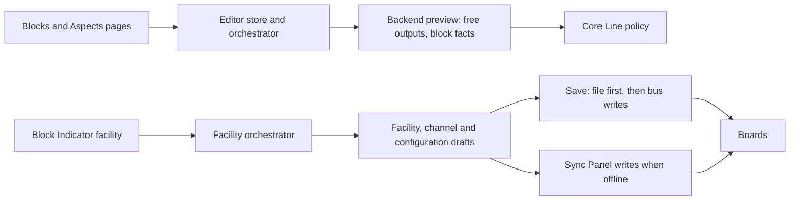
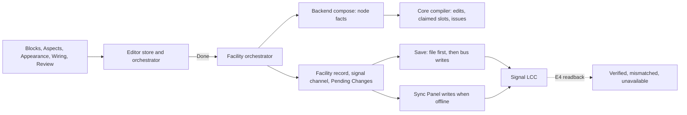

# Slices: One-Direction Automatic Block Signals

Branch: 020-block-signals-first-slice
Generated: 2026-11-07; roadmap regenerated 2026-11-22 for the end-to-end pivot
Status: 2/9 slices complete (S1, S2R); S2 and the old S3–S8 superseded by E1a–E6

Approved input: the
[2026-11-22 Architecture Assessment](plan.md#architecture-assessment-end-to-end-first-release-2026-11-22)
and the [feature specification](spec.md). `/build` expands one card at a
time with just-in-time tasks.

**Pivot (2026-11-22): end-to-end first, then add features.** The release
with Blocks and Aspects drew no feedback. Instead of building more preview
pages, the next work makes the spec's original scope work end to end:
- one direction;
- the three-indication policy (Stop, Approach, Clear);
- no turnouts;
- one RG searchlight head, always lit;
- save, write to the board, and check on the bench.

Features beyond that scope are added one at a time after E6 (see the
[2026-11-22 clarification](spec.md#session-2026-11-22)).

What this means for earlier work:
- S1 and S2R are done; their cards below are kept as the record.
- S2 (Display and Bindings) is superseded. Its output-binding work in
  `7b1b641` is the starting point for the Wiring step in E1a.
- The old S3–S8 cards (immutable proposal, separate Apply, recovery engine)
  are superseded by E1a–E6. The plan's F1 replaces the separate Apply with
  the existing Save and Sync Panel writers (ADR-0001, 2026-11-22 extension).
- The Appearance feedback design presented on 2026-11-19 stays paused. Two
  of its findings carry forward: the core owns rule evaluation, and signal
  type stays separate from channel Style.
- Options outside this scope are shown disabled, with no "coming later"
  text, and cannot reach a saved facility.

## Architecture

### Before

The Automatic Block Signals editor ends at a preview; nothing is saved or
written.

### After

### Patterns

- **Facility composes into Pending Changes**: the facility record is the
  intent; its hardware effect is ordinary configuration edits that ride Save
  and the Sync Panel. No second write path.
- **Pure compiler, imperative shell**: the core compiles a Line plus node
  facts into configuration edits, claimed slots and issues; the backend
  supplies facts; the orchestrator stages the result.
- **Claimed resources recorded on the facility**: recomposition touches the
  same slots; removal releases only those.
- **Gated options**: the model and pages keep S2R's broader options; the
  compiler accepts only this release's scope.
- **Accept older, reject newer**: the layout manifest check opens older
  versions and refuses newer ones (ADR-0005, 2026-11-22 extension).

### Module Changes

| Module | Today | After |
|---|---|---|
| Core signaling (`compiler.rs` new) | Line policy and S2 binding projection | Pure compiler: Line + node facts → configuration edits, claimed slots, issues |
| Core behavior templates | Block Indicator only | Also registers `automatic-block-signals` |
| Core facilities document | No Line fields; `schemaVersion` "1.0" | Optional ABS record (blocks, direction, signals, claimed slots); "2.0" |
| Core layout manifest | Version 4, exact match required | Version 5; accepts 4 to 5, rejects newer |
| Backend signaling | Preview facts for the editor | Compose command: gathers node facts and calls the compiler |
| Editor store and orchestrator | Blocks and Aspects preview | Five steps, scope gating, Wiring choices, edit mode; Done hands off to the facility orchestrator |
| Facility orchestrator | Composes Block Indicator facilities | Also composes and tears down ABS facilities |
| Step components | BlocksStep, AspectsStep | Plus AppearanceStep, WiringStep, ReviewStep; out-of-scope options disabled |
| Existing writers (Save, Sync Panel) | Write and record acknowledgement | Unchanged through E3; E4 adds readback |

### Behavior Summary

| Slice | User-visible change | Demoable? |
|---|---|---|
| E1a: Stage and save a one-block signal offline | Five steps, Done, Pending Changes, Save and reopen | Yes |
| E1b: Light the signal on the bench | LED red when occupied, green when clear | Yes, bench |
| E2: Edit and remove | Rename, reorient, rebind and remove a saved facility | Yes, bench |
| E3: Two blocks on one board | Approach behind an occupied block | Yes, bench |
| E4: Verify writes | Signals marked verified, mismatched or unavailable | Yes, bench |
| E5: Across boards | Signals on two boards coordinate; partial failure shown | Yes, two boards |
| E6: Maintain a three-block facility | Reorder, prepend, remove a middle block | Yes |

## Roadmap

| # | Slice title | Label | Blocked by | Status |
|---|---|---|---|---|
| S1 | Choose blocks and name signals | HITL | None | done |
| S2 | Choose display and bind real outputs | HITL | S1 | superseded by E1a (Wiring) |
| S2R | Feedback release: Blocks and Aspects per revised storyboard | HITL | S1, S2 checkpoint | done |
| E1a | Stage and save a one-block signal offline | HITL | S2R | sketched |
| E1b | Light the signal on the bench | HITL | E1a + terminal-recipe evidence | sketched |
| E2 | Edit and remove | HITL | E1b | sketched |
| E3 | Two blocks on one board | HITL | E2 + same-board Approach evidence | sketched |
| E4 | Verify writes | HITL | E1b | sketched |
| E5 | Across boards | HITL | E3 + E4 + cross-board Approach and receiver-restart evidence | sketched |
| E6 | Maintain a three-block facility | AFK | E5 | sketched |

Hardware gates refer to [single-board evidence](manual-track-circuit-test.md)
and [two-board evidence](manual-two-board-test.md). The terminal recipe and
same-board Approach have passed; cross-board Approach and receiver restart
are outstanding. Failure handling belongs in every affected slice, not a
final hardening pass. No horizontal foundation or test-only slice is
authorized.

### S1: Choose blocks and name signals [HITL]

**Intent**: Exercise Blocks and Signals with a real one-block diagram and editable Line/signal names.
**Boundary**: Rendering -> editor state/orchestration -> IPC/backend -> core policy/identity.
**Blocked by**: None.
**Status**: done
**Complexity**: large
**User stories**: US1, US4 (preview-only portions).

**Acceptance criteria**:
- [x] Apply the user-reviewed fidelity corrections: searchable/scrollable Add block... dialog, Cancel flush left with navigation right, horizontal name rows, mockup ABS copy/emphasis, and Signals track-strip/selection/card structure without non-product narration. Retain one-block S1 behavior.
- [x] Preserve the approved [Blocks](../proposals/signaling-ux/signaling-facilities-storyboard.html#line-blocks) and [Signals](../proposals/signaling-ux/signaling-facilities-storyboard.html#line-signals) wizard experience: wide shared dialog, five numbered steps, guidance and cards, styled block picker, track diagram and Cancel/Back/Next footer. Later steps remain visibly unavailable, not omitted.
- [x] Select an existing named detected block and see its entrance signal and protected-block relationship in the diagram.
- [x] Edit Line/signal names and eastward/westward orientation without changing operational order, protected block or signal identity.
- [x] Occupied/clear terminal expectations are Stop/Clear; preview expectations and unavailable observations are distinct, with no implied protection beyond the terminal block.
- [x] Missing hardware bindings are explicitly incomplete, not a valid/stageable proposal; save/apply is unavailable.
- [x] Preview and navigation perform zero bus writes and create no lasting claims.
- [x] Equivalent guided/headless partial input follows the same policy/validation service and produces equal normalized expectations/issues.

**Architecture note**: Establish ordered membership, stable editor identities and the shared progressive proposal boundary. Incomplete input must be explicit, never a fabricated successful hardware proposal.

**HITL checkpoint**: Approved 2026-11-07: D1-A (transient editor intent with
core-owned signal identity retention) and D2-A (capability-discriminated
progressive proposal). Block/detector ownership stays unchanged: the Line
references shared blocks and owns only its signals. Use the storyboard's existing
Add facility entry point, adding Automatic Block Signals alongside Block Indicator without
replacing existing facilities or indicator lamps. Existing facility slots are not
ordered Line membership; S1 must not create persistent facility/configuration drafts.

**Tasks**:
- [x] S1-T1: Write the visible integration tracer test in `app/src/lib/components/Railroad/RailroadPanel.integration.test.ts` (Vitest + Testing Library): select an existing named detected block through the real editor/orchestrator, render its entrance signal and protected block from the IPC response, distinguish Stop/Clear expectations from unavailable observations, and expose no save/apply capability. Mock only IPC/system boundaries.
- [x] S1-T2: Core policy and identity in `bowties-core/src/signaling/` and `bowties-core/tests/block_signals_policy.rs` (Rust): normalize one-block input, retain signal identity by protected block through rename/orientation edits, derive terminal expectations independently of observations, and represent incomplete facts explicitly without patches or claims. Export through `bowties-core/src/lib.rs`.
- [x] S1-T3: Backend proposal service in `app/src-tauri/src/signaling/`, a focused command adapter and registration (Rust): resolve existing effective block/detection facts through canonical identities and shared event resolution; provide the same side-effect-free service for IPC and headless callers. Test normalized parity, unavailable/invalid detection and absence of draft, claim and write effects. Resolve any directly needed draft-aware fact contract at this owner rather than copying stale composition assumptions.
- [x] S1-T4: Typed API and transient editor state/orchestration in `app/src/lib/api/signaling.ts`, `app/src/lib/stores/blockSignalsEditor.svelte.ts` and `app/src/lib/orchestration/blockSignalsEditorOrchestrator.ts` with focused Vitest tests: sequence preview, adopt core-normalized identities, preserve choices across Blocks/Signals navigation, reject stale responses, surface failures explicitly and clear editor state on cancel/layout lifecycle reset. Use the existing effective-layout facade for block inventory; do not introduce a persistent Line store.
- [x] S1-T5: Restore the approved storyboard wizard in `app/src/lib/components/BlockSignals/BlockSignalsEditor.svelte` and existing facility composition with focused component/integration tests. Reuse shared Dialog, title/actions/buttons and selection primitives; provide Blocks/Signals cards, five-step indicator, contextual guidance, oriented track diagram and Cancel/Back/Next progression. Close/Esc/overlay/Cancel use existing cancellation ownership; later steps remain visibly disabled. Preserve all tested identity, preview-only and existing Block Indicator behavior.
- [x] S1-T6: Enrich durable product behavior and `aiwiki/owners.md`, `flows.md` and applicable seam entries; check `specs/backlog.md`. Record approved decisions and session progress here without tasking S2.
- [x] S1-T7: Validate restoration RED/GREEN and affected frontend regressions/build/diagnostics, baseline-relative file scope and actual running wizard against the linked storyboard Blocks/Signals screens. Verify selection, back/next, cancel/close, disabled later steps, identity/orientation and narrow-screen layout. Record observed visual results and authorized S1 differences before marking done. No write-mode formatters.

**Completion correction (2026-11-07)**: Previous tests established functional
plumbing, not the agreed wizard UX. The user rejected the bare inline form;
S1 is not complete until T5/T7 and wizard acceptance pass. User approved restoring
the original storyboard structure and updating build/worker handoff requirements.
Existing backend/core validation below remains historical evidence for unchanged
plumbing, not proof of wizard fidelity.

**User review correction (2026-11-07, 21:28)**: Earlier browser comparison
incorrectly accepted an inline picker, changed field/copy layout, substituted
diagram and right-aligned Cancel. These were not authorized differences.
The user approved correcting them through shared searchable selection and
semantic footer regions, while preserving S1's one-block preview-only scope.

**Native review correction (2026-11-08)**: The user rejected the remaining
stretched track, improvised mast, tile placement, outer frame and policy
placeholders. Option A approved: both Add facility types require a name and
the exact accepted name seeds the Line editor. Previous browser fixtures are
not proof of native Tauri fidelity; do not use the integrated browser or mark
S1 complete before native review.

**Native correction tasks**:
- [x] S1-N1: Require initial names consistently and pass the trimmed name through facility composition, orchestration and store initialization; retain later edits and cancel/reset behavior.
- [x] S1-N2: Alphabetize block-picker candidates without mutating the supplied inventory or operational membership.
- [x] S1-N3: Remove routine missing-binding messages from Blocks/Signals while keeping authoritative incomplete capabilities and real errors.
- [x] S1-N4: Adapt the original storyboard track-unit markup/CSS and SVG, selected signal icon/name stack, gap geometry and policy/expectation form rather than another full-width diagram approximation.
- [x] S1-N5: Review the updated Blocks/Signals screens in the native Tauri app against the original mockup. User screenshot/runtime evidence required; no integrated-browser substitute.

**Native acceptance (2026-11-08, 10:12)**: After reviewing the updated native
Tauri wizard and its scrolling/label-spacing refinements, the user confirmed:
"This is working as expected." This closes S1's pending native visual gate.
Acceptance is for the one-block preview wizard, not hardware binding,
application, readback or later multi-block behavior.

**Scroll/spacing refinement (2026-11-08)**: User approved inner-only scrolling
with a stationary indication preview. Shared `Dialog.bodyLayout="contained"`
delegates scrolling to the wizard; the default remains `scroll` for other
dialogs. Roomy viewports keep upper context fixed and budget the remaining
height to independent policy/indication panes. At width <=640px or height
<=700px, a single inner workspace scrolls instead of the individual panes.
The track region cannot shrink to make room for policy content.

The 14px label line height and 10px rail-edge gap place the upper text box at
y=12..26 and lower text at y=49..63 around the rail at y=36..39. The marker
is centered at y=37.5. Native review confirmed the refinement as working as
expected (see acceptance above).

Validation:
- RED: contained shell behavior and the shared rail-label geometry were absent;
  GREEN: focused Dialog/wizard suite — 34 passed.
- `app`: `npm run test:refactor-gate -- --reporter=dot` — 303 passed.
- `app`: combined Dialog, wizard, picker, footer and orchestration suites —
  47 passed.
- `app`: `npm run build` — passed. `npm run check` — unchanged 113 existing
  errors/two warnings; no new changed-file diagnostics.
- `git diff --check` — passed. Native scrolling/spacing review was subsequently
  accepted under N5; no integrated browser or application server was used.

**Automated evidence (2026-11-08)**:
- RED: the Automatic Block Signals Add button accepted an empty name; the initial Line name
  was discarded; unordered candidates stayed in source order; routine hardware
  notices remained; the original selected policy controls were absent.
- GREEN: `app` — `npm run test:refactor-gate -- --reporter=dot`: 303 passed.
- GREEN: `app` — combined wizard, name handoff, block picker, channel picker,
  facility and shared dialog/list suites: 63 passed across nine files.
- `app` — `npm run build`: passed. `npm run check`: 113 existing errors and
  two warnings after typing the directly touched Add facility test callbacks;
  no new production diagnostics. `git diff --check`: passed.
- Original source references: storyboard CSS 684–765 and Signals markup
  2117–2195. Compact 240px unit, 180px block area, 70px leading rail and 8px
  gap replace the uninterrupted rail; 148px selected tile contains the
  original 36×28 T-mast SVG and centered name below. Routine notices and the
  enclosing diagram frame are removed. Fixed/disabled policy choices preserve
  the mockup affordances without adding unsupported behavior.
- Source review and tests do not establish native visual fidelity. N5 was
  initially pending and is now closed by the user's native confirmation above;
  no integrated browser or application server was started for this pass.

**Fidelity correction tasks**:
- [x] S1-U1: Test and reuse the searchable/scrollable selection-dialog mechanics through a domain-neutral presentation owner and selection-only block adapter; preserve existing channel-picker behavior.
- [x] S1-U2: Test shared leading/trailing footer regions with backwards-compatible defaults; put wizard Cancel at the left edge and Back/Next at the right edge.
- [x] S1-U3: Test exact approved Blocks copy/label/form-row layout and Signals track-strip, occupancy marker, separate signal tile/name row and policy/table hierarchy. Remove storyboard narration while retaining actionable errors and truthful unavailable facts.
- [x] S1-U4: Run affected picker/dialog/wizard and lifecycle tests, production build/type diagnostics and running-browser mockup comparison at desktop/narrow sizes. Record results before restoring done status.

**User-reviewed correction evidence (2026-11-07)**:
- RED failures covered missing Add-block dialog, absent leading footer region,
  incorrect Signals section names and confirmation of a filtered-out choice.
  Each has GREEN implementation and focused-suite results.
- `app`: `npm run test:refactor-gate -- --reporter=dot` — 303 passed.
- `app`: `npx vitest run src\lib\components\Railroad\RailroadPanel.integration.test.ts src\lib\orchestration\blockSignalsEditorOrchestrator.test.ts src\lib\components\Facilities\SelectChannelPicker.test.ts src\lib\components\Facilities\AddFacilityDialog.test.ts src\lib\components\Facilities\wired.integration.test.ts src\lib\components\Dialog\Dialog.test.ts src\lib\components\Dialog\DialogActions.test.ts src\lib\components\SingleSelectList\SingleSelectList.test.ts src\lib\components\Line\SelectBlockPicker.test.ts --reporter=dot` — final nine-suite run: 60 passed.
- `app`: `npm run build` — passed. `npm run check` — unchanged 123 existing
  errors/two warnings after resolving a new picker title/snippet name collision.
- Browser comparison used production Railroad/Line components and real
  orchestration/stores with external IPC fixtures. Search narrowed 40 blocks to
  one; the list measured 286px visible height versus 1311px scroll height with
  `overflow-y: auto`. Confirm added only Line membership.
- Desktop screenshots verify horizontal name rows, bold ABS, Add block label,
  flush-left Cancel, trailing navigation, compact full-width track with boundary
  ticks/unknown occupancy marker, separate named signal tile, Entire Line and
  When-this-signal-shows cards. Removed storyboard narration and redundant
  request-status prose; missing-binding notice remains below the signal cards.
- At 390px, no wizard descendant has horizontal overflow. Rename/orientation
  and Back/Next preserve signal identity; Westward moves the tile to the east
  entrance. Cancel and two-stage picker/wizard Escape dismiss correctly.
- No backend, core, persistence or multi-block policy changes. Existing staged
  user work and the Git index were preserved.

**Wizard restoration validation (2026-11-07)**:
- RED failures proved the missing dialog, hypothetical expectation framing,
  picker Escape behavior and Signals policy/expectation cards; each was followed
  by GREEN implementation and affected-suite checks. Old inline-form assertions
  were migrated to picker/navigation contracts without dropping identity,
  error visibility or existing facility coverage.
- `app`: `npm run test:refactor-gate -- --reporter=dot` — 303 passed.
- `app`: `npx vitest run src\lib\components\Railroad\RailroadPanel.integration.test.ts src\lib\orchestration\blockSignalsEditorOrchestrator.test.ts src\lib\components\Facilities\AddFacilityDialog.test.ts src\lib\components\Facilities\wired.integration.test.ts src\lib\layout\effectiveLayoutStore.svelte.test.ts src\lib\orchestration\layoutLifecycleOrchestrator.test.ts --reporter=dot` — 65 passed.
- `app`: `npm run build` — passed. `npm run check` — unchanged 123 existing
  errors/two warnings after fixing the introduced nullable-preview diagnostic.
  Final focused wizard/orchestration rerun — 17 passed.
- Browser screenshots of running production Railroad/Line components on the
  Vite app were compared with `#line-blocks` and `#line-signals`. Real stores,
  components and orchestration were used; only external IPC and the existing
  detected-block inventory were supplied as fixtures. This is UI validation,
  not a live-bus or native-window test.
- Confirmed the shared wide dialog, numbered five-step shell, two Blocks cards,
  styled existing-block picker, selected signal/neutral diagram, fixed Entire
  Line policy card and When-this-signal-shows table. Renaming and Back/Next
  preserved the selected block; Westward moved its entrance marker. Future steps
  and Next: Display stayed disabled. Cancel and two-stage picker/wizard Escape
  dismissed correctly without deleting the shared block.
- At 390px viewport, cards stack, dialog width is 351px and no descendant has
  horizontal overflow. Initial browser-only failures exposed an unreadable SVG
  fill and narrow Signals-card overflow; both were corrected and rechecked.
- Intentional differences from the full storyboard: one block/one direction,
  fixed Speed/Essential policy instead of unsupported policy controls, unavailable
  observations, no downstream/Plant link, disabled future steps. Shared Fluent
  dialog typography follows the app's established primitives. The previously
  accepted right-aligned Cancel was a review error, not an authorized difference.
- No backend/core behavior changed during wizard restoration. Backlog reviewed;
  this correction remains tracked by the feature, not a duplicate backlog item.

**Implementation audit (2026-11-07)**: Caller validation corrected missing
Line-scoped identity wiring, incomplete capability/missing bindings, unsupported
multiple-block policy, a missing oriented diagram, in-flight navigation and
Signals-step error visibility. Each correction has recorded RED/GREEN evidence.
The actual AppState/headless parity test executes against resolved cached CDI.
Its initially invalid eight-byte Node ID fixture was corrected to six bytes
after the loader problem was resolved.

**Caller validation** (commands run from the named Bowties subdirectory):
- `app`: `npm run test:refactor-gate -- --reporter=dot` — 303 passed.
- `app`: `npx vitest run src\lib\components\Railroad\RailroadPanel.integration.test.ts src\lib\orchestration\blockSignalsEditorOrchestrator.test.ts src\lib\components\Facilities\AddFacilityDialog.test.ts src\lib\layout\effectiveLayoutStore.svelte.test.ts src\lib\orchestration\layoutLifecycleOrchestrator.test.ts --reporter=dot` — 57 passed.
- `bowties-core`: `cargo test` — 448 passed, one ignored.
- `app`: `npm run build` — passed.
- `app`: `npm run check` — 123 errors and two warnings in existing files; no diagnostics in the new Line files.
- `app/src-tauri`: `cargo test --lib --no-run` — passed. Direct execution of `target\debug\deps\bowties_lib-39a763e55fb50a26.exe signaling --nocapture` after test-only Common Controls v6 manifest activation — three passed.
- The same manifest-activated backend binary without a selector — 141 passed,
  two unrelated failures in unchanged event-router Node ID serialization and
  shared daughterboard profile-constraint tests. These were not changed.
- `git diff --check` — passed; source changes match the accepted S1 surface.

The ordinary Windows backend test binary imports `TaskDialogIndirect` but lacks
Common Controls v6 activation, causing `STATUS_ENTRYPOINT_NOT_FOUND` before
tests. Validation embedded a temporary v6 manifest into the generated test
binary using the Windows SDK `mt.exe`, not application source. The temporary
manifest and incidental core lockfile version rewrite were cleaned up.

**User test**:
1. Open Railroad, choose Add facility, select Automatic Block Signals alongside Block
   Indicator, and start the wide five-step wizard.
2. Name the Line, choose orientation, and use Add existing block to select a
   detected block. Choose Next: Signals; check its entrance diagram, editable
   name, protected block, fixed policy and hypothetical Stop/Clear table.
3. Edit names and eastward/westward orientation, then navigate back/forward.
   The signal stays associated with the same block; orientation moves the
   entrance in the diagram without changing operational membership.
4. Missing bindings remain incomplete; no save/apply action is available.
   Cancel leaves existing facilities, indicators and detection unchanged.

<!-- Session: 2026-11-08 — S1 complete: automated checks and native user review recorded. Next: S2 (HITL), still sketched and not yet approved/task-expanded. -->

### S2: Choose display and bind real outputs [HITL]

**Intent**: Exercise Display and Bindings and inspect actual red/green wiring choices.
**Boundary**: Rendering -> editor/orchestration -> backend authoritative facts -> core hardware validation/compiler.
**Blocked by**: S1.
**Status**: superseded by E1a (Wiring step); output-binding work in `7b1b641` carries forward
**Complexity**: large
**User stories**: US1, US4 (display/binding preview and validation portions).

**Acceptance criteria**:
- [ ] Show the supported two-driver RG display and separately assign red and green physical outputs on a compatible Signal-LCC.
- [ ] Reuse the selected block's detection; require no raw event IDs, downstream receiver numbers or logic tables.
- [ ] Unsupported hardware/choices, unavailable facts, conflicting outputs, invalid configuration and insufficient current resource capacity have actionable signal/node explanations.
- [ ] Bindings preserve S1's identities and names; back/cancel navigation creates no lasting claims or bus writes.
- [ ] Guided/headless equivalent inputs agree on bindings and validation through the shared proposal service.
- [ ] Explain red for Stop, red+green for Approach and green for Clear without subjective blended-color approval, a dedicated yellow driver or a flashing substitute.
- [ ] Save/apply remains unavailable; unresolved required facts cannot appear as successful hardware validation.

**Architecture note**: Introduce only the narrow terminal hardware projection behind the shared proposal interface, not a generic recipe or resource-allocation framework.

**S1 carry-forward**: Preserve the transient Line ID, protected-block signal
identity mapping and explicit incomplete capability when bindings are added.
Keep one-block eligibility until S6; do not interpret resolved detection alone
as hardware validation. Use the actual backend adapter for parity coverage.
Preserve the native-reviewed wizard geometry, initial name handoff, alphabetical
picker and contained scrolling so policy growth does not move the indication
preview away.

**Approved UI contract**:
- Preserve [Display](../proposals/signaling-ux/signaling-facilities-storyboard.html#line-display)
  and [Bindings](../proposals/signaling-ux/signaling-facilities-storyboard.html#line-bindings),
  including the native-reviewed S1 wide contained dialog, five-step progression,
  compact selected-signal track strip, context/name hierarchy and independent
  inner scrolling. Cancel stays flush left; Back/Next stay right.
- Display retains the Entire Line default/Selected signal only hierarchy beside
  the physical-arrangement preview and indication/appearance table. Bindings
  retains the expandable existing-source summary, selected-signal Board and
  Green/Red assignment rows, and adjacent output-availability/ownership table.
  Links return to Signals/Display without losing valid input.
- Allowed narrower-slice differences: only the supported two-driver RG display
  is selectable; unsupported three-lamp/display overrides stay disabled within
  the approved structure. No yellow driver is required. Use actual board/output
  evidence instead of sample inventory; show unavailable evidence truthfully,
  never the storyboard's sample live occupancy. Confirm remains disabled until
  S3, and Save/apply remain unavailable. Do not render storyboard design notes
  or frame narration as product UI.

**HITL decisions approved (2026-11-08, 17:56)**:
- D1: Signals use the existing Information Channel model -- Line policy chooses
  the indication; Role defines its meaning; Style maps it to hardware; Binding
  identifies the concrete outputs. Extend the existing mechanism rather than
  creating a parallel Line-specific channel/binding model or treating each LED
  as an independent semantic signal. S2 remains transient; durable channel and
  Line references are settled at S4, not fabricated as unbound saved channels.
- D2: Preview and compilation share the same hardware interpretation -- one
  backend proposal contract combines style mappings with authoritative effective
  configuration, capacity, ownership and evidence. S3 revalidates changed facts
  before producing an immutable reviewed proposal. Offline captured facts are
  not live observations. Placement of a pure resource projector is not a
  separate PM decision and remains open within these ownership constraints.
- These replace the earlier snapshot/projector and terminal-projection framing
  following the user's Role/Style/Binding clarification. "Terminal" means the
  last signal in the modeled Line, not an output terminal or display style.
- User approved both revised contracts. Implementation is authorized for S2
  only; running visual acceptance remains a separate completion gate.

**Tasks**:
- [ ] S2-T1: Write integration tracer test -- extend `app/src/lib/components/Railroad/RailroadPanel.integration.test.ts` to reach the actual Line wizard through the existing entry point, navigate Blocks/Signals/Display/Bindings, select distinct real RG outputs from IPC-boundary evidence, and observe scoped validation in a user-visible Consumer. Keep real frontend stores/orchestration; mock only IPC. Record RED before implementation and GREEN after the vertical path works.
- [ ] S2-T2: Core/channel contract -- extend the existing Role/Style/Binding mechanism and `bowties-core/src/signaling/` with semantic signal indications, typed same-host red/green bindings, style-backed RG appearances and narrow resource requirements/validation, subject to D1 approval. Extend `bowties-core/tests/block_signals_policy.rs` and affected channel/profile contract tests. Preserve transient Line/protected-block signal identities, names, one-block eligibility and incomplete action capability; do not create durable unbound channels. Test invalid/duplicate/incompatible outputs, unknown evidence and insufficient current capacity sequentially; no generic allocator or exact patch lowering.
- [ ] S2-T3: Backend -- extend `app/src-tauri/src/signaling/mod.rs` and its tests to assemble authoritative effective configuration, supported profile/CDI facts and evidence provenance for all eligible hosts, including hosts without detector channels. Reuse typed detection and profile-path owners; derive occupied resources from complete configuration. Place any read-only resource interpretation according to D1. Prove actual IPC-adapter/headless parity, explicit unavailable/invalid/conflict issues, and zero configuration/draft/claim/write effects.
- [ ] S2-T4: IPC/editor workflow -- extend `app/src/lib/api/signaling.ts`, `app/src/lib/stores/blockSignalsEditor.svelte.ts`, `app/src/lib/orchestration/blockSignalsEditorOrchestrator.ts` and focused tests with Display/Bindings intent, retained input, shared proposal results and stale-request/cancel/layout-reset guards. Keep hardware rules out of frontend consumers and preserve S1 in-flight navigation and identity.
- [ ] S2-T5: Rendering -- extend `app/src/lib/components/BlockSignals/BlockSignalsEditor.svelte` and the existing Railroad wizard integration coverage to implement the linked Display/Bindings contract, real availability/assignment tables and actionable signal/node issues. Preserve S1 geometry, contained scrolling, keyboard/back/cancel behavior and unavailable observation framing. Unsupported future choices/Confirm stay disabled.
- [ ] S2-T6: Enrichment -- update relevant durable behavior/ownership docs and `aiwiki/owners.md`, `aiwiki/flows.md`, `aiwiki/seams.md` for the accepted projection/fact owner and tests; check `specs/backlog.md`. Extend a seam-scoped ADR only where the accepted decision changes its commitment.
- [ ] S2-T7: Validate -- verify each worker batch against the clean baseline and accepted file surface; require per-behavior RED/GREEN/affected-suite evidence. Run focused core/backend signaling tests, combined frontend wizard/orchestrator regressions and applicable aggregate gates/build/type diagnostics selected from `product/quality/testing-strategy.md`. Compare running Display/Bindings against the linked storyboard at roomy and narrow/short sizes, preserving native-reviewed S1 behavior. Record intentional differences and actual interaction/screenshot or native user evidence; leave visual acceptance/completion pending if runtime review is blocked. No hardware application is part of this slice.

<!-- Historical startup: 2026-11-08 -- S2 task-expanded before D1/D2 approval. -->

**S2 implementation progress (2026-11-08, D1/D2 approved 17:56)**:

- [x] **S2-T1** — `RailroadPanel.integration.test.ts` now drives the real
  Facilities → Line editor → store/orchestrator path with IPC as its only
  mock. It proves Display/Bindings navigation, profile-shaped RG appearances,
  distinct Board/Green/Red selection, output ownership, conflict messaging,
  disabled Confirm and no facility creation.
- [x] **S2-T2** — Core extends the existing role/style/binding vocabulary with
  transient `signal-indication` + same-host `signalLccRgOutputs`; the shipped
  Signal-LCC profile declares the two-driver RG Stop/Approach/Clear map.
  Policy tests cover valid, duplicate, unavailable output, unsupported style,
  unavailable evidence, insufficient current capacity and current-owner
  conflicts without creating a channel or claim.
- [x] **S2-T3** — The backend gathers every effective config tree (not only
  detector-bound nodes), profile style facts, Direct Lamp Control and active
  Rule-to-Aspect output ownership, then calls the shared pure projector.
  The adapter/headless parity test constructs real `AppState`/`LayoutState`
  inputs and asserts equal normalized output with zero draft/channel mutation.
- [x] **S2-T4/T5** — The transient editor preserves partial valid choices,
  rejects stale/cancelled responses, clears on cancel/layout reset, and renders
  the approved Display/Bindings structure using only backend-projected hardware
  facts. Missing/invalid host evidence is visible and disabled; no sample
  inventory is presented as live hardware.
- [x] **S2-T6** — Updated the Automatic Block Signals ownership/seam/flow records and the
  ADR-0013 extension. `specs/backlog.md` was checked; no new backlog item was
  needed because reviewed patch lowering, durable references and application
  remain explicitly deferred to S3/S4.

**Automated evidence (S2)**:

- `RailroadPanel.integration.test.ts` + `blockSignalsEditorOrchestrator.test.ts`:
  20 passed, 0 failed.
- `npm run test:refactor-gate -- --reporter=dot`: 23 files / 303 passed.
- `npm run build`: passed.
- `bowties-core cargo test`: passed (431 library tests plus profile/policy
  integration suites, 0 failed); Signal-LCC profile contract: 5 passed.
- Backend parity test: `cargo test ... --lib --no-run` compiled. After
  test-only Common Controls v6 manifest activation, direct execution of
  `app_state_adapter_and_headless_proposal_share_profile_backed_rg_hosts_without_detector_channels`
  ran 1 passed, 0 failed. The ordinary Windows test startup
  `STATUS_ENTRYPOINT_NOT_FOUND` remains a platform baseline, not a proposal
  assertion.
- Initial `npm run check`: 115 errors / 2 warnings. Caller found a directly
  induced `FacilityCard.svelte` binding-discriminator error in a previously
  unchanged consumer; it was not an unrelated baseline error.
- `git diff --check`: passed. Baseline-relative files are within the approved
  S2 core/signaling/profile/backend/frontend/docs surface; the sole
  pre-existing modified file was this `slices.md`. No dependency or lockfile
  change remains, and no reference repository was mutated or executed.

**Caller validation pending — keep status `tasked`**:

- Caller re-ran the frontend aggregate: 303 passed; corrected FacilityCard,
  Railroad wizard, Line orchestrator and wired-facility suites: 28 passed.
  Focused core policy/profile suites: 16 passed. Ordinary backend
  `cargo test --lib signaling::tests -- --nocapture`: 4 passed, without a
  startup blocker in this caller run. Production build passed.
- FacilityCard regression RED displayed `Row undefined` for an RG binding.
  GREEN exhaustive binding-kind rendering preserves connector/lamp labels and
  displays the two signal outputs; 5 focused tests passed. Final diagnostics:
  114 errors / 2 warnings, with the induced discriminator error eliminated.
  The remaining count differs from the historical 113 baseline; the type check
  is not a pass and the extra diagnostic has not been established as pre-existing.
- **Completeness blocker:** current host facts and core validation cover free
  physical outputs only. They do not establish available Mast/Conditional
  resources or a recipe-backed requirement for operating the signal.
  Parsing output selections alone is also not capture-completeness provenance.
  Missing identity/profile/style evidence can currently exclude hosts silently.
  These findings prevent accepting S2's full hardware/resource validation.
- **Resource direction resolved (2026-11-08, 19:40-19:43):** the earlier
  output-only-versus-recipe A/B choice is withdrawn. No new PM decision is
  pending. Determine the signal's required resource types/quantities, combine
  existing channel claims with authoritative board configuration, and check
  whether the selected board has those resources available. Include Mast,
  Logic/Conditional and applicable rule/output resources, not just LEDs.
  Unknown configuration means the available-resource check cannot yet be
  answered; it is not a new "readiness" state. No guessed formula or parallel
  claims registry is authorized. Provenance and actionable unavailable-host
  handling remain implementation work under the approved D1/D2 contracts;
  offline captured facts must not be confused with live observation.
- **Shared selector correction (2026-11-08):** user identified duplicated
  Display track markup and required a common signal selector on each page.
  `BlockSignalsSelector.svelte` now owns the Signals/Display/Bindings diagram,
  orientation, protected-block context and selection intent; `BlockSignalsEditor`
  retains the selected signal across steps. The missing Bindings selector is
  wired through the same component. Each page retains its distinct controls.
  Preserve the original 154px track unit, 82px signal position, rail/label gap
  and marker geometry rather than the duplicated Display-only compression.
  RED: missing selector component and missing common cross-page group;
  caller regressions also detected lost protected-block accessible labels.
  GREEN: shared component and cross-step wiring preserve those labels.
  Combined selector/wizard/orchestrator/FacilityCard suites: 26 passed;
  frontend refactor gate: 303 passed; final production build passed.
  Type diagnostics remain 114 errors/two warnings, with no selector/wizard
  diagnostic reported. Native visual acceptance remains pending.
- [ ] **S2-T7 visual/native gate** — compare the running native wizard with
  [Display](../proposals/signaling-ux/signaling-facilities-storyboard.html#line-display)
  and [Bindings](../proposals/signaling-ux/signaling-facilities-storyboard.html#line-bindings)
  at roomy and narrow/short sizes. Verify contained dialog, stationary preview
  plus inner scroll, hierarchy, selector track, Cancel/Back/Next, links,
  disabled Confirm and unavailable/evidence states. No runtime/native
  acceptance was performed in this implementation session.

<!-- Session: 2026-11-08 — S2 shared selector corrected. Resource-check direction resolved; full resource/provenance implementation and native visual acceptance remain pending. No PM decision outstanding. S3 remains sketched and unstarted. -->

### S2R: Feedback release — Blocks and Aspects per revised storyboard [HITL]

**Status**: done
**Complexity**: large
**Purpose**: ship a build people can try so feedback comes from use rather
than screenshots. Nothing can be saved, staged or applied, so the release
carries no layout risk.

**Approved UI contract**:
- Match [Blocks](../proposals/signaling-ux/signaling-facilities-storyboard.html#line-blocks)
  and [Aspects](../proposals/signaling-ux/signaling-facilities-storyboard.html#line-signals),
  including the shared SVG track drawing, "?" help bubbles and the
  "+ Plant" chips. The steps are Blocks, Aspects, then Physical signals
  shown disabled ("Available in a later release"). Display/Bindings from S2
  stay in the code but are not rendered.
- Add facility lists Block Indicator, Interlocking Plant (disabled, "Coming
  in a later release") and Automatic Block Signals.
- Allowed differences from the storyboard: occupancy is shown as unavailable,
  never sample occupancy. Turnouts are placeholders entered by name, each row
  saying "Position input: not yet connected". There are no Plant facilities
  yet, so "Choose a Plant…" is shown disabled; the "No Plant", "Nothing
  beyond" and "Nothing beyond · treat as Stop" choices are real. Storyboard
  controls, sample data and design notes are not product UI.

**Decisions (2026-11-15)**:
- Rename Signal Line to Automatic Block Signals and Signal Plant to
  Interlocking Plant in code and docs, not only in product text.
- Both directions ship in this release so they can get feedback; page 2
  shows the signals for both directions.
- The block list is in travel order for the selected direction; changing
  the direction redraws the diagram and wording but never reorders the list.
- Placeholder turnouts are transient request data, not layout objects, and
  the core treats their position as unknown.

**Tasks**:
- [x] S2R-T0: Checkpoint S2 (`7b1b641`); rename identifiers, files, IPC
  command and spec folder; add the disabled Interlocking Plant choice.
- [x] S2R-T1: Integration tracer — extend `RailroadPanel.integration.test.ts`
  to build a three-block facility with one joined pair, one placeholder
  turnout, both directions and a "treat as Stop" far end, then read the
  Aspects table for the first and last signal. Mock only IPC. Record RED.
- [x] S2R-T2: Core policy — in `bowties-core/src/signaling/`, replace the
  one-block limit with travel-order blocks, joined signal blocks, one or both
  directions, end conditions, placeholder turnouts, Line and per-signal
  settings (aspect count, Stop/Restricting, approach lighting) and the
  per-signal rules table with its next signal. Signal IDs come from the first
  block of a signal block plus direction. Extend `block_signals_policy.rs`.
- [x] S2R-T3: Backend — pass the new request through, check detection facts
  for every block, update the adapter/headless parity test. The S2 hardware
  projection stays but is not called by the UI.
- [x] S2R-T4: Store and orchestrator — new request shape and intents
  (add/remove/reorder blocks, join, turnouts, ends, settings, names);
  keep stale-response, cancel and layout-reset guards.
- [x] S2R-T5: Rendering — `TrackDiagram.svelte` (port of the storyboard's
  shared drawing, geometry in a tested pure helper, replacing
  `BlockSignalsSelector`), Blocks and Aspects steps, end-chip menu, disabled
  Plant picker, `HelpTip`, disabled Physical signals step.
- [x] S2R-T6: Docs — aiwiki owners/flows/seams, plus the implemented preview in
  [data-model.md](data-model.md) and [contracts/tauri-ipc.md](contracts/tauri-ipc.md).
- [x] S2R-T7: Validate — core/backend/frontend suites, type check against
  the recorded baseline, production build, and a running-app comparison with
  the storyboard at roomy and narrow/short sizes (browser with a fake backend;
  see the progress notes).
- [x] S2R-T8: Native Tauri review of Blocks and Aspects against the storyboard
  (user, 2026-11-19). Both pages match, except approach lighting, which the
  storyboard has since moved to Appearance; the Appearance slice moves it.

**S2R progress (2026-11-15)**:

- Core: `signaling/chain.rs` derives signal blocks, both chains, next signals,
  end conditions and rules; 25 policy tests pass (written after the code, so
  no RED step was recorded). Full core suite passes.
- Backend: request passes through with layout-owned block names; tests
  compile. They cannot run on this Windows machine
  (`STATUS_ENTRYPOINT_NOT_FOUND` at test-exe startup, as before).
- Frontend: new store/orchestrator, `TrackDiagram` + `trackGeometry`,
  `BlocksStep`, `AspectsStep`, `EndChipMenu`, `HelpTip`. The S2 Display and
  Bindings markup and `BlockSignalsSelector` were removed from the frontend
  (recoverable from `7b1b641` for Physical signals). Integration (10),
  orchestrator (6) and geometry/wording (8) tests pass; refactor gate 303
  passed; type check at the 114-error baseline with none in touched files;
  production build passes.
- Visual: the editor was rendered in a browser against a fake backend and
  compared with the storyboard (Blocks eastward with a joined block, Blocks
  westward with both directions, Aspects with "treat as Stop"). Native Tauri
  review is still pending.

**S2R validation (2026-11-18)**:

- Core: `cargo test` in `bowties-core` passes, including the 25
  `block_signals_policy.rs` tests.
- Backend: `cargo test --no-run` compiles with no warnings after moving two
  test-only imports into the test module of `app/src-tauri/src/signaling/mod.rs`.
  The tests still cannot run on this Windows machine
  (`STATUS_ENTRYPOINT_NOT_FOUND`).
- Frontend: Vitest 1503 of 1504 passed in the full run. The one failure was
  the S2R integration test "builds a travel-order list…", which timed out at
  the 5 s default while cargo builds ran alongside it. Run alone it passes
  in about 2 s (all 11 tests in the file pass). It is the slowest S2R test and
  may need a longer timeout if it flakes again.
- Type check: 114 errors, the recorded baseline; none in S2R files.
- Production build passes.

**S2R test coverage decision (2026-11-18)**:

Blocks and Aspects are a feedback release: they cannot save or apply, and the
first release that does is expected to turn most options off (for example,
3-aspect ABS in one direction with no turnouts). Tests for the UI layer are
therefore deferred, not skipped. They must be added in the slice that first
makes these pages save or apply, for the options that slice keeps enabled.

Covered now, and kept because the signaling rules are what reviewers judge:
- Core policy (`bowties-core/tests/block_signals_policy.rs`, 25 tests): signal
  blocks, joins, identity, both chains, ends, 2/3/4 aspects, turnout policy,
  overrides and issues. These were written after the code, so no RED step
  was recorded.
- Orchestrator (`blockSignalsEditorOrchestrator.test.ts`, 6 tests): request
  shape, stale responses and cancel, turnout moves.
- Geometry and wording helpers (`trackGeometry.test.ts`): 8 tests.
- Integration (`RailroadPanel.integration.test.ts`, 6 S2R tests): the real
  editor through IPC mocks, covering Add facility, list building, ends, both
  directions, missing detection and cancel.

Deferred until the save/apply slice:
- Component tests for `BlocksStep`, `AspectsStep`, `EndChipMenu`, `RowMenu`,
  `HelpTip` and `TrackDiagram` rendering (now covered only through the
  integration tests).
- Direct store tests for `blockSignalsEditor.svelte.ts` transitions (add,
  remove, reorder, join, turnout moves, overrides); now covered only through
  the orchestrator.
- UI tests for per-signal overrides on Aspects and for the row menu join and
  remove actions.
- Running the backend adapter and headless parity tests on a machine where
  the Tauri test executable starts.

### E1a: Stage and save a one-block signal offline [HITL]

**Intent**: The modeler completes all five steps, clicks Done, and saves offline; the facility, its signal channel and the Pending Changes survive reopening.
**Boundary**: Step components → editor store/orchestrator → facility orchestrator → facility, channel and configuration drafts → backend compose → core compiler → layout file.
**Blocked by**: S2R.
**Status**: sketched

**Acceptance criteria**:
- [ ] Blocks, Aspects, Appearance, Wiring and Review are all exercisable. Aspects and Appearance show this release's fixed values.
- [ ] Options outside this release's scope are shown disabled with no "coming later" text, including the existing S2R notes (APB, Interlocking Plant, physical signals). No disabled option can reach a saved facility.
- [ ] Wiring lets the modeler pick a node, a red pin and a green pin. A pin already in use, or a mast or Logic slot that is not free, shows a blocking issue on Review, and Done is unavailable.
- [ ] Review lists the protected block, the behavior (red when occupied, green when clear), the outputs and the claimed slots.
- [ ] Done adds a facility card to the Railroad tab, adds a signal-indication channel to the Railroad panel whose "Used by" names the facility, and shows the generated values as Pending Changes in the node's configuration.
- [ ] Facility-only edits enable the Save toolbar, appear in the unsaved-changes breakdown, count as in-memory edits, and trigger the navigation/layout-close and window-close prompts. Canceling a close keeps the edits.
- [ ] Discard removes the facility, the channel and the Pending Changes together, and the toolbar and prompts return to clean.
- [ ] Saving offline and reopening restores the facility, the channel and the Pending Changes. Closing the layout or starting a new one leaves no editor, draft or mirror state behind.
- [ ] A version-4 layout opens unchanged. A layout with a newer manifest version is refused with a "made by a newer Bowties" message. `docs/technical/layout-file-format.md` describes the policy.

**Architecture note**: Introduces the pure compiler and claimed slots recorded on the facility, and makes Automatic Block Signals the first facility that composes mast and Logic configuration into Pending Changes and the first to persist a signal channel (ADR-0001, ADR-0005 and ADR-0013 2026-11-22 extensions). Rewrite the ABS seam invariant in `aiwiki/seams.md` when this lands.

### E1b: Light the signal on the bench [HITL]

**Intent**: Saving while connected writes the configuration to the board; the LED is red when the block is occupied and green when it is clear.
**Boundary**: Save with bus writes and the Sync Panel → Signal LCC.
**Blocked by**: E1a + terminal-recipe evidence (passed).
**Status**: sketched

**Acceptance criteria**:
- [ ] A connected Save writes the staged values to the board. A layout saved offline and opened while connected writes them through the Sync Panel.
- [ ] On the bench, an occupied block shows red and a clear block shows green, following each change in occupancy.
- [ ] Nothing in the app says the signal is verified after writing; readback arrives in E4.
- [ ] Block detection and unrelated configuration on the board are unchanged.
- [ ] Reopening after a connected Save shows the facility with no leftover Pending Changes, and the Bowties catalog shows the same cards before and after reopening.

**Architecture note**: First use of the existing Save and Sync Panel writers for a facility that generates logic, with no separate Apply. A failure here that cannot be reported truthfully through those writers is the trigger the ADR-0001 extension names for revisiting.

### E2: Edit and remove [HITL]

**Intent**: The modeler reopens a saved facility to rename, reorient, rebind its outputs, or remove it.
**Boundary**: Editor (edit mode from the saved record) → facility orchestrator → compiler → drafts → Save.
**Blocked by**: E1b.
**Status**: sketched

**Acceptance criteria**:
- [ ] Opening a saved facility shows its saved choices on every step.
- [ ] Renaming or reorienting stages zero configuration edits and keeps the signal's identity, protected block and outputs.
- [ ] Rebinding moves the outputs; the old pins show as free in the Railroad panel and the new ones show "Used by" the facility.
- [ ] Removal resets only the claimed slots, returns Direct Lamp rows to "Used by Mast", keeps block detection, and removes the facility card and channel.
- [ ] Every edit and removal shows in the Save toolbar, the unsaved-changes breakdown and the close prompts, and Discard restores the saved facility.
- [ ] On the bench, the signal follows the block after a rebind and goes dark after removal.

**Architecture note**: Recompiling from the claimed slots on the facility record is what makes release safe (plan F4); this slice tests that design. Generic facility teardown is not proof that a slot is safe to release.

### E3: Two blocks on one board [HITL]

**Intent**: The modeler adds a second block; the first signal keeps its identity and shows Approach behind an occupied block.
**Boundary**: Editor → compiler (receiving logic, Track Circuit) → drafts → Save → Signal LCC.
**Blocked by**: E2 + same-board Approach evidence (passed).
**Status**: sketched

**Acceptance criteria**:
- [ ] Adding a block keeps the first signal's identity, name, protected block and outputs; the new signal protects only its own block.
- [ ] Review explains that the first signal now has a signal after it, and lists the added logic and claimed slots.
- [ ] All four two-block occupancy combinations match the policy on the bench: own block occupied gives Stop (red); clear with the next block occupied gives Approach (red and green together); both clear gives Clear (green).
- [ ] The Track Circuit Link Address comes from values freshly read from the board, not saved or assumed ones.
- [ ] A needed slot that is not free blocks Done with a scoped issue; nothing is overwritten.
- [ ] The change shows in the Save toolbar, the unsaved-changes breakdown and the close prompts, and can be discarded.

**Architecture note**: Adds the receiving-logic recipe and a Track Circuit derived from block order, not a separately stored link graph.

### E4: Verify writes [HITL]

**Intent**: After writing, Bowties reads the values back and marks each signal verified, mismatched or unavailable.
**Boundary**: Existing writers (`write_modified_values`, `apply_sync_changes`) → readback → status on the facility card and Review.
**Blocked by**: E1b.
**Status**: sketched

**Acceptance criteria**:
- [ ] After a connected Save or a Sync Panel write, each signal is marked verified only when its values read back as written.
- [ ] A mismatched value marks the signal mismatched, names the value, and stays visible after reopening.
- [ ] When the board cannot be read, the signal is marked unavailable, never shown as live or verified.
- [ ] A mismatch or unavailable result keeps the work visible in the Save toolbar or Sync Panel rather than hiding it.

**Architecture note**: Readback extends the existing writers rather than adding a second executor (ADR-0001 2026-11-22 extension).

### E5: Across boards [HITL]

**Intent**: Signals hosted on two Signal LCC boards coordinate correctly, and a partial failure is reported per board.
**Boundary**: Compiler (cross-node receiver) → drafts → Save / Sync Panel → two nodes.
**Blocked by**: E3 + E4 + cross-board Approach and receiver-restart evidence (outstanding).
**Status**: sketched

**Acceptance criteria**:
- [ ] The receiver on the upstream board binds to the downstream board's Link Address read fresh from hardware, and readback verifies it.
- [ ] Cross-board Stop, Approach and Clear match the policy on the bench.
- [ ] Review lists every affected board.
- [ ] When writes fail partway, each board's outcome is shown (written and verified, written but unverified, not attempted) and the facility is never shown complete. The outcome survives reopening.
- [ ] Unfinished work stays visible in the Save toolbar, the unsaved-changes breakdown and the close prompts.
- [ ] The receiver-restart manual check passes before this slice is accepted.

**Architecture note**: Widens E4's readback across boards that cannot be written atomically, without a second executor or resource registry.

### E6: Maintain a three-block facility [AFK]

**Intent**: The modeler reorders blocks, adds one at the start, or removes a middle block, and surviving signals keep their identity and wiring.
**Boundary**: Editor → compiler → drafts → Save.
**Blocked by**: E5.
**Status**: sketched

**Acceptance criteria**:
- [ ] All eight three-block occupancy combinations match the policy on the bench.
- [ ] Adding a block at the start leaves the former last signal as the last one; adding at the end gives it a signal after it without replacing it.
- [ ] After reorder, prepend or middle removal, surviving signals keep their identity, name, outputs and claimed slots through Save and reopen.
- [ ] Removing the only remaining block requires removing the facility. Removal keeps block detection and unrelated configuration.
- [ ] Maintenance edits show in the Save toolbar, the unsaved-changes breakdown and the close prompts, and can be discarded.

## Architecture and Acceptance Guardrails

- Follow the [2026-11-22 assessment](plan.md#architecture-assessment-end-to-end-first-release-2026-11-22).
  The 2026-11-07 findings and audit dispositions still hold where it does
  not replace them. Unknown audit rows are not passes.
- Use the [seam Consumer lists](../../aiwiki/seams.md) as coverage
  checklists. Dirty-state acceptance covers every consumer (Save toolbar,
  unsaved-changes breakdown, in-memory edits, navigation and window-close
  prompts), not just a store predicate. New layout-scoped state registers
  with the Lifecycle Reset seam.
- Every configuration value goes through `configEditor.applyEdit`. No
  direct `setModifiedValue` calls, no second write path, no separate Apply.
- Follow [code placement and ownership](../../product/architecture/code-placement-and-ownership.md).
  Components render and emit intent; orchestrators sequence; the backend
  gathers facts; the compiler stays pure.
- Reuse canonical detection, profile paths, binding and style translation,
  and typed node identity. No second Line document, general recipe
  framework, global role registry or manually allocated Track Circuit.
- Any new protocol emission requires the ADR-0019 JMRI-compatibility gate.
- Apply the [testing strategy](../../product/quality/testing-strategy.md)
  when each slice is tasked. Automated checks do not replace the bench
  matrix; perceived yellow hue is never a pass/fail gate.
- Capture deferred ideas as issues only with explicit confirmation.
