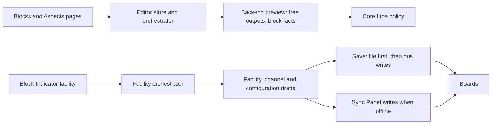
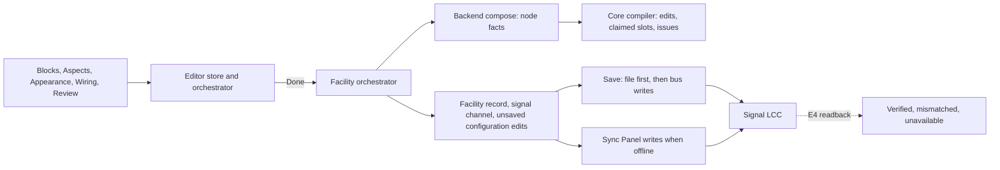

# Slices: One-Direction Automatic Block Signals

Branch: 020-block-signals-first-slice
Generated: 2026-11-07; roadmap regenerated 2026-11-22 for the end-to-end pivot
Status: 13/17 slices complete (S1, S2R, E1a, E1b, E2a, E2b, E2c, E3a, E3, E3b-0, E3b-1, E5, E6); S2 and the old S3–S8 superseded by E1a–E6

Approved input: the
[2026-11-22 Architecture Assessment](plan.md#architecture-assessment-end-to-end-first-release-2026-11-22)
and the [feature specification](spec.md). `/build` expands one card at a
time with just-in-time tasks.

**Pivot (2026-11-22): end-to-end first, then add features.** The release
with Blocks and Aspects drew no feedback. Instead of building more preview
pages, the next work makes the spec's original scope work end to end:
- one direction;
- the three-indication policy (Stop, Approach, Clear);
- no turnouts;
- one RG searchlight head, always lit;
- save, write to the board, and check on the bench.

Features beyond that scope are added one at a time after E6 (see the
[2026-11-22 clarification](spec.md#session-2026-11-22)).

What this means for earlier work:
- S1 and S2R are done; their cards below are kept as the record.
- S2 (Display and Bindings) is superseded. Its output-binding work in
  `7b1b641` is the starting point for the Wiring step in E1a.
- The old S3–S8 cards (immutable proposal, separate Apply, recovery engine)
  are superseded by E1a–E6. The plan's F1 replaces the separate Apply with
  the existing Save and Sync Panel writers (ADR-0001, 2026-11-22 extension).
- The Appearance feedback design presented on 2026-11-19 stays paused. Two
  of its findings carry forward: the core owns rule evaluation, and signal
  type stays separate from channel Style.
- Options outside this scope are shown disabled, with no "coming later"
  text, and cannot reach a saved facility.

## Architecture

### Before

The Automatic Block Signals editor ends at a preview; nothing is saved or
written.

### After

### Patterns

- **Facility composes into configuration edits**: the facility record is the
  intent; its hardware effect is ordinary unsaved configuration edits that
  ride Save (Offline Changes when offline) and the Sync Panel. No second write path.
- **Pure compiler, imperative shell**: the core compiles a Line plus node
  facts into configuration edits, claimed slots and issues; the backend
  supplies facts; the orchestrator stages the result.
- **Claimed resources recorded on the facility**: recomposition touches the
  same slots; removal releases only those.
- **Gated options**: the model and pages keep S2R's broader options; the
  compiler accepts only this release's scope.
- **Accept older, reject newer**: the layout manifest check opens older
  versions and refuses newer ones (ADR-0005, 2026-11-22 extension).

### Module Changes

| Module | Today | After |
|---|---|---|
| Core signaling (`compiler.rs` new) | Line policy and S2 binding projection | Pure compiler: Line + node facts → configuration edits, claimed slots, issues |
| Core behavior templates | Block Indicator only | Also registers `automatic-block-signals` |
| Core facilities document | No Line fields; `schemaVersion` "1.0" | Optional ABS record (blocks, direction, signals, claimed slots); "2.0" |
| Core layout manifest | Version 4, exact match required | Version 5; accepts 4 to 5, rejects newer |
| Backend signaling | Preview facts for the editor | Compose command: gathers node facts and calls the compiler |
| Editor store and orchestrator | Blocks and Aspects preview | Five steps, scope gating, Wiring choices, edit mode; Done hands off to the facility orchestrator |
| Facility orchestrator | Composes Block Indicator facilities | Also composes and tears down ABS facilities |
| Step components | BlocksStep, AspectsStep | Plus AppearanceStep, WiringStep, ReviewStep; out-of-scope options disabled |
| Existing writers (Save, Sync Panel) | Two writers; a connected Save writes only drafts copied while connected, and records acknowledgement | E3b: every Save records configuration as Pending Changes and one writer sends them; E4 adds readback to its row results |

### Behavior Summary

| Slice | User-visible change | Demoable? |
|---|---|---|
| E1a: Stage and save a one-block signal offline | Four steps, Done, unsaved edits, offline Save and reopen | Yes |
| E1b: Light the signal on the bench | LED red when occupied, green when clear | Yes, bench |
| E2a: Edit a saved facility | Rename, reorient and rebind a saved facility; write it online and through the Sync Panel | Yes, bench |
| E2b: Remove a facility | Removal resets only the claimed slots; the signal goes dark | Yes, bench |
| E2c: Release pins used outside Bowties | A pin held by a mast or Direct Lamp row that no facility owns can be released and used, undoably | Yes, bench |
| E3a: Board Logic planner [REFACTOR + guard] | One-block create, edit and remove behave as before; Done is blocked, naming the Logic, when the board has Logic Bowties does not own with an undefined Function value or a group with no end | Yes (guard) |
| E3: Two blocks on one board | Approach behind an occupied block | Yes, bench |
| E3r: Review step | Review lists each signal, its outputs, claimed slots and moved Logic before Done | Yes |
| E3b-0: One owner and one writer for Pending Changes [REFACTOR] | None: Sync Panel, offline Save and open behave as before | No (invariants) |
| E3b-1: Save writes configuration through Pending Changes | Edits made offline reach the board on a later connected Save; a failed write stays waiting with a reason; waiting changes open the Sync Panel from the toolbar | Yes, bench |
| E3b-2: Accept or keep a refused value | In the Sync Panel, accept the board's value (change dropped) or keep yours | Yes, bench |
| E4: Verify writes | Signals marked verified, mismatched or unavailable | Yes, bench |
| E5: Across boards | Signals on two boards coordinate; partial failure shown | Yes, two boards |
| E6: Maintain a three-block facility | Reorder, prepend, remove a middle block | Yes |

## Roadmap

| # | Slice title | Label | Blocked by | Status |
|---|---|---|---|---|
| S1 | Choose blocks and name signals | HITL | None | done |
| S2 | Choose display and bind real outputs | HITL | S1 | superseded by E1a (Wiring) |
| S2R | Feedback release: Blocks and Aspects per revised storyboard | HITL | S1, S2 checkpoint | done |
| E1a | Stage and save a one-block signal offline | HITL | S2R | done |
| E1b | Light the signal on the bench | HITL | E1a + terminal-recipe evidence | done (Sync Panel check moved to E2a) |
| E2a | Edit a saved facility | HITL | E1b | done |
| E2b | Remove a facility | HITL | E2a | done |
| E2c | Release pins used outside Bowties | HITL | E2b | done |
| E3a | Board Logic planner | AFK | E3b-1 | done |
| E3 | Two blocks on one board | HITL | E3a + same-board Approach evidence (passed) | done |
| E3r | Review step | HITL | E3 | sketched |
| E3b-0 | One owner and one writer for Pending Changes | REFACTOR | E2c | done |
| E3b-1 | Save writes configuration through Pending Changes | HITL | E3b-0 | done |
| E3b-2 | Accept or keep a refused value | HITL | E4 | sketched |
| E4 | Verify writes | HITL | E1b, E3b-1 | sketched |
| E5 | Across boards | HITL | E3 + E3b-1 (re-cut 2026-11-24: no longer waits on E3r or E4; bench evidence checked in the slice) | done |
| E6 | Maintain a three-block facility | AFK | E5 | done |
| F1 | Hand off: lcc-rs inbound routing under a loaded bus | HITL | E6 | sketched |

Hardware gates refer to [single-board evidence](manual-track-circuit-test.md)
and [two-board evidence](manual-two-board-test.md). The terminal recipe and
same-board Approach have passed. Cross-board reception passed for both
receiver outcomes. Receiver restart passed in E5's bench run (2026-11-24). Failure handling belongs in every affected slice, not a
final hardening pass. No horizontal foundation or test-only slice is
authorized.

### S1: Choose blocks and name signals [HITL]

**Intent**: Exercise Blocks and Signals with a real one-block diagram and editable Line/signal names.
**Boundary**: Rendering -> editor state/orchestration -> IPC/backend -> core policy/identity.
**Blocked by**: None.
**Status**: done
**Complexity**: large
**User stories**: US1, US4 (preview-only portions).

**Acceptance criteria**:
- [x] Apply the user-reviewed fidelity corrections: searchable/scrollable Add block... dialog, Cancel flush left with navigation right, horizontal name rows, mockup ABS copy/emphasis, and Signals track-strip/selection/card structure without non-product narration. Retain one-block S1 behavior.
- [x] Preserve the approved [Blocks](../proposals/signaling-ux/signaling-facilities-storyboard.html#line-blocks) and [Signals](../proposals/signaling-ux/signaling-facilities-storyboard.html#line-signals) wizard experience: wide shared dialog, five numbered steps, guidance and cards, styled block picker, track diagram and Cancel/Back/Next footer. Later steps remain visibly unavailable, not omitted.
- [x] Select an existing named detected block and see its entrance signal and protected-block relationship in the diagram.
- [x] Edit Line/signal names and eastward/westward orientation without changing operational order, protected block or signal identity.
- [x] Occupied/clear terminal expectations are Stop/Clear; preview expectations and unavailable observations are distinct, with no implied protection beyond the terminal block.
- [x] Missing hardware bindings are explicitly incomplete, not a valid/stageable proposal; save/apply is unavailable.
- [x] Preview and navigation perform zero bus writes and create no lasting claims.
- [x] Equivalent guided/headless partial input follows the same policy/validation service and produces equal normalized expectations/issues.

**Architecture note**: Establish ordered membership, stable editor identities and the shared progressive proposal boundary. Incomplete input must be explicit, never a fabricated successful hardware proposal.

**HITL checkpoint**: Approved 2026-11-07: D1-A (transient editor intent with
core-owned signal identity retention) and D2-A (capability-discriminated
progressive proposal). Block/detector ownership stays unchanged: the Line
references shared blocks and owns only its signals. Use the storyboard's existing
Add facility entry point, adding Automatic Block Signals alongside Block Indicator without
replacing existing facilities or indicator lamps. Existing facility slots are not
ordered Line membership; S1 must not create persistent facility/configuration drafts.

**Tasks**:
- [x] S1-T1: Write the visible integration tracer test in `app/src/lib/components/Railroad/RailroadPanel.integration.test.ts` (Vitest + Testing Library): select an existing named detected block through the real editor/orchestrator, render its entrance signal and protected block from the IPC response, distinguish Stop/Clear expectations from unavailable observations, and expose no save/apply capability. Mock only IPC/system boundaries.
- [x] S1-T2: Core policy and identity in `bowties-core/src/signaling/` and `bowties-core/tests/block_signals_policy.rs` (Rust): normalize one-block input, retain signal identity by protected block through rename/orientation edits, derive terminal expectations independently of observations, and represent incomplete facts explicitly without patches or claims. Export through `bowties-core/src/lib.rs`.
- [x] S1-T3: Backend proposal service in `app/src-tauri/src/signaling/`, a focused command adapter and registration (Rust): resolve existing effective block/detection facts through canonical identities and shared event resolution; provide the same side-effect-free service for IPC and headless callers. Test normalized parity, unavailable/invalid detection and absence of draft, claim and write effects. Resolve any directly needed draft-aware fact contract at this owner rather than copying stale composition assumptions.
- [x] S1-T4: Typed API and transient editor state/orchestration in `app/src/lib/api/signaling.ts`, `app/src/lib/stores/blockSignalsEditor.svelte.ts` and `app/src/lib/orchestration/blockSignalsEditorOrchestrator.ts` with focused Vitest tests: sequence preview, adopt core-normalized identities, preserve choices across Blocks/Signals navigation, reject stale responses, surface failures explicitly and clear editor state on cancel/layout lifecycle reset. Use the existing effective-layout facade for block inventory; do not introduce a persistent Line store.
- [x] S1-T5: Restore the approved storyboard wizard in `app/src/lib/components/BlockSignals/BlockSignalsEditor.svelte` and existing facility composition with focused component/integration tests. Reuse shared Dialog, title/actions/buttons and selection primitives; provide Blocks/Signals cards, five-step indicator, contextual guidance, oriented track diagram and Cancel/Back/Next progression. Close/Esc/overlay/Cancel use existing cancellation ownership; later steps remain visibly disabled. Preserve all tested identity, preview-only and existing Block Indicator behavior.
- [x] S1-T6: Enrich durable product behavior and `aiwiki/owners.md`, `flows.md` and applicable seam entries; check `specs/backlog.md`. Record approved decisions and session progress here without tasking S2.
- [x] S1-T7: Validate restoration RED/GREEN and affected frontend regressions/build/diagnostics, baseline-relative file scope and actual running wizard against the linked storyboard Blocks/Signals screens. Verify selection, back/next, cancel/close, disabled later steps, identity/orientation and narrow-screen layout. Record observed visual results and authorized S1 differences before marking done. No write-mode formatters.

**Completion correction (2026-11-07)**: Previous tests established functional
plumbing, not the agreed wizard UX. The user rejected the bare inline form;
S1 is not complete until T5/T7 and wizard acceptance pass. User approved restoring
the original storyboard structure and updating build/worker handoff requirements.
Existing backend/core validation below remains historical evidence for unchanged
plumbing, not proof of wizard fidelity.

**User review correction (2026-11-07, 21:28)**: Earlier browser comparison
incorrectly accepted an inline picker, changed field/copy layout, substituted
diagram and right-aligned Cancel. These were not authorized differences.
The user approved correcting them through shared searchable selection and
semantic footer regions, while preserving S1's one-block preview-only scope.

**Native review correction (2026-11-08)**: The user rejected the remaining
stretched track, improvised mast, tile placement, outer frame and policy
placeholders. Option A approved: both Add facility types require a name and
the exact accepted name seeds the Line editor. Previous browser fixtures are
not proof of native Tauri fidelity; do not use the integrated browser or mark
S1 complete before native review.

**Native correction tasks**:
- [x] S1-N1: Require initial names consistently and pass the trimmed name through facility composition, orchestration and store initialization; retain later edits and cancel/reset behavior.
- [x] S1-N2: Alphabetize block-picker candidates without mutating the supplied inventory or operational membership.
- [x] S1-N3: Remove routine missing-binding messages from Blocks/Signals while keeping authoritative incomplete capabilities and real errors.
- [x] S1-N4: Adapt the original storyboard track-unit markup/CSS and SVG, selected signal icon/name stack, gap geometry and policy/expectation form rather than another full-width diagram approximation.
- [x] S1-N5: Review the updated Blocks/Signals screens in the native Tauri app against the original mockup. User screenshot/runtime evidence required; no integrated-browser substitute.

**Native acceptance (2026-11-08, 10:12)**: After reviewing the updated native
Tauri wizard and its scrolling/label-spacing refinements, the user confirmed:
"This is working as expected." This closes S1's pending native visual gate.
Acceptance is for the one-block preview wizard, not hardware binding,
application, readback or later multi-block behavior.

**Scroll/spacing refinement (2026-11-08)**: User approved inner-only scrolling
with a stationary indication preview. Shared `Dialog.bodyLayout="contained"`
delegates scrolling to the wizard; the default remains `scroll` for other
dialogs. Roomy viewports keep upper context fixed and budget the remaining
height to independent policy/indication panes. At width <=640px or height
<=700px, a single inner workspace scrolls instead of the individual panes.
The track region cannot shrink to make room for policy content.

The 14px label line height and 10px rail-edge gap place the upper text box at
y=12..26 and lower text at y=49..63 around the rail at y=36..39. The marker
is centered at y=37.5. Native review confirmed the refinement as working as
expected (see acceptance above).

Validation:
- RED: contained shell behavior and the shared rail-label geometry were absent;
  GREEN: focused Dialog/wizard suite — 34 passed.
- `app`: `npm run test:refactor-gate -- --reporter=dot` — 303 passed.
- `app`: combined Dialog, wizard, picker, footer and orchestration suites —
  47 passed.
- `app`: `npm run build` — passed. `npm run check` — unchanged 113 existing
  errors/two warnings; no new changed-file diagnostics.
- `git diff --check` — passed. Native scrolling/spacing review was subsequently
  accepted under N5; no integrated browser or application server was used.

**Automated evidence (2026-11-08)**:
- RED: the Automatic Block Signals Add button accepted an empty name; the initial Line name
  was discarded; unordered candidates stayed in source order; routine hardware
  notices remained; the original selected policy controls were absent.
- GREEN: `app` — `npm run test:refactor-gate -- --reporter=dot`: 303 passed.
- GREEN: `app` — combined wizard, name handoff, block picker, channel picker,
  facility and shared dialog/list suites: 63 passed across nine files.
- `app` — `npm run build`: passed. `npm run check`: 113 existing errors and
  two warnings after typing the directly touched Add facility test callbacks;
  no new production diagnostics. `git diff --check`: passed.
- Original source references: storyboard CSS 684–765 and Signals markup
  2117–2195. Compact 240px unit, 180px block area, 70px leading rail and 8px
  gap replace the uninterrupted rail; 148px selected tile contains the
  original 36×28 T-mast SVG and centered name below. Routine notices and the
  enclosing diagram frame are removed. Fixed/disabled policy choices preserve
  the mockup affordances without adding unsupported behavior.
- Source review and tests do not establish native visual fidelity. N5 was
  initially pending and is now closed by the user's native confirmation above;
  no integrated browser or application server was started for this pass.

**Fidelity correction tasks**:
- [x] S1-U1: Test and reuse the searchable/scrollable selection-dialog mechanics through a domain-neutral presentation owner and selection-only block adapter; preserve existing channel-picker behavior.
- [x] S1-U2: Test shared leading/trailing footer regions with backwards-compatible defaults; put wizard Cancel at the left edge and Back/Next at the right edge.
- [x] S1-U3: Test exact approved Blocks copy/label/form-row layout and Signals track-strip, occupancy marker, separate signal tile/name row and policy/table hierarchy. Remove storyboard narration while retaining actionable errors and truthful unavailable facts.
- [x] S1-U4: Run affected picker/dialog/wizard and lifecycle tests, production build/type diagnostics and running-browser mockup comparison at desktop/narrow sizes. Record results before restoring done status.

**User-reviewed correction evidence (2026-11-07)**:
- RED failures covered missing Add-block dialog, absent leading footer region,
  incorrect Signals section names and confirmation of a filtered-out choice.
  Each has GREEN implementation and focused-suite results.
- `app`: `npm run test:refactor-gate -- --reporter=dot` — 303 passed.
- `app`: `npx vitest run src\lib\components\Railroad\RailroadPanel.integration.test.ts src\lib\orchestration\blockSignalsEditorOrchestrator.test.ts src\lib\components\Facilities\SelectChannelPicker.test.ts src\lib\components\Facilities\AddFacilityDialog.test.ts src\lib\components\Facilities\wired.integration.test.ts src\lib\components\Dialog\Dialog.test.ts src\lib\components\Dialog\DialogActions.test.ts src\lib\components\SingleSelectList\SingleSelectList.test.ts src\lib\components\Line\SelectBlockPicker.test.ts --reporter=dot` — final nine-suite run: 60 passed.
- `app`: `npm run build` — passed. `npm run check` — unchanged 123 existing
  errors/two warnings after resolving a new picker title/snippet name collision.
- Browser comparison used production Railroad/Line components and real
  orchestration/stores with external IPC fixtures. Search narrowed 40 blocks to
  one; the list measured 286px visible height versus 1311px scroll height with
  `overflow-y: auto`. Confirm added only Line membership.
- Desktop screenshots verify horizontal name rows, bold ABS, Add block label,
  flush-left Cancel, trailing navigation, compact full-width track with boundary
  ticks/unknown occupancy marker, separate named signal tile, Entire Line and
  When-this-signal-shows cards. Removed storyboard narration and redundant
  request-status prose; missing-binding notice remains below the signal cards.
- At 390px, no wizard descendant has horizontal overflow. Rename/orientation
  and Back/Next preserve signal identity; Westward moves the tile to the east
  entrance. Cancel and two-stage picker/wizard Escape dismiss correctly.
- No backend, core, persistence or multi-block policy changes. Existing staged
  user work and the Git index were preserved.

**Wizard restoration validation (2026-11-07)**:
- RED failures proved the missing dialog, hypothetical expectation framing,
  picker Escape behavior and Signals policy/expectation cards; each was followed
  by GREEN implementation and affected-suite checks. Old inline-form assertions
  were migrated to picker/navigation contracts without dropping identity,
  error visibility or existing facility coverage.
- `app`: `npm run test:refactor-gate -- --reporter=dot` — 303 passed.
- `app`: `npx vitest run src\lib\components\Railroad\RailroadPanel.integration.test.ts src\lib\orchestration\blockSignalsEditorOrchestrator.test.ts src\lib\components\Facilities\AddFacilityDialog.test.ts src\lib\components\Facilities\wired.integration.test.ts src\lib\layout\effectiveLayoutStore.svelte.test.ts src\lib\orchestration\layoutLifecycleOrchestrator.test.ts --reporter=dot` — 65 passed.
- `app`: `npm run build` — passed. `npm run check` — unchanged 123 existing
  errors/two warnings after fixing the introduced nullable-preview diagnostic.
  Final focused wizard/orchestration rerun — 17 passed.
- Browser screenshots of running production Railroad/Line components on the
  Vite app were compared with `#line-blocks` and `#line-signals`. Real stores,
  components and orchestration were used; only external IPC and the existing
  detected-block inventory were supplied as fixtures. This is UI validation,
  not a live-bus or native-window test.
- Confirmed the shared wide dialog, numbered five-step shell, two Blocks cards,
  styled existing-block picker, selected signal/neutral diagram, fixed Entire
  Line policy card and When-this-signal-shows table. Renaming and Back/Next
  preserved the selected block; Westward moved its entrance marker. Future steps
  and Next: Display stayed disabled. Cancel and two-stage picker/wizard Escape
  dismissed correctly without deleting the shared block.
- At 390px viewport, cards stack, dialog width is 351px and no descendant has
  horizontal overflow. Initial browser-only failures exposed an unreadable SVG
  fill and narrow Signals-card overflow; both were corrected and rechecked.
- Intentional differences from the full storyboard: one block/one direction,
  fixed Speed/Essential policy instead of unsupported policy controls, unavailable
  observations, no downstream/Plant link, disabled future steps. Shared Fluent
  dialog typography follows the app's established primitives. The previously
  accepted right-aligned Cancel was a review error, not an authorized difference.
- No backend/core behavior changed during wizard restoration. Backlog reviewed;
  this correction remains tracked by the feature, not a duplicate backlog item.

**Implementation audit (2026-11-07)**: Caller validation corrected missing
Line-scoped identity wiring, incomplete capability/missing bindings, unsupported
multiple-block policy, a missing oriented diagram, in-flight navigation and
Signals-step error visibility. Each correction has recorded RED/GREEN evidence.
The actual AppState/headless parity test executes against resolved cached CDI.
Its initially invalid eight-byte Node ID fixture was corrected to six bytes
after the loader problem was resolved.

**Caller validation** (commands run from the named Bowties subdirectory):
- `app`: `npm run test:refactor-gate -- --reporter=dot` — 303 passed.
- `app`: `npx vitest run src\lib\components\Railroad\RailroadPanel.integration.test.ts src\lib\orchestration\blockSignalsEditorOrchestrator.test.ts src\lib\components\Facilities\AddFacilityDialog.test.ts src\lib\layout\effectiveLayoutStore.svelte.test.ts src\lib\orchestration\layoutLifecycleOrchestrator.test.ts --reporter=dot` — 57 passed.
- `bowties-core`: `cargo test` — 448 passed, one ignored.
- `app`: `npm run build` — passed.
- `app`: `npm run check` — 123 errors and two warnings in existing files; no diagnostics in the new Line files.
- `app/src-tauri`: `cargo test --lib --no-run` — passed. Direct execution of `target\debug\deps\bowties_lib-39a763e55fb50a26.exe signaling --nocapture` after test-only Common Controls v6 manifest activation — three passed.
- The same manifest-activated backend binary without a selector — 141 passed,
  two unrelated failures in unchanged event-router Node ID serialization and
  shared daughterboard profile-constraint tests. These were not changed.
- `git diff --check` — passed; source changes match the accepted S1 surface.

The ordinary Windows backend test binary imports `TaskDialogIndirect` but lacks
Common Controls v6 activation, causing `STATUS_ENTRYPOINT_NOT_FOUND` before
tests. Validation embedded a temporary v6 manifest into the generated test
binary using the Windows SDK `mt.exe`, not application source. The temporary
manifest and incidental core lockfile version rewrite were cleaned up.

**User test**:
1. Open Railroad, choose Add facility, select Automatic Block Signals alongside Block
   Indicator, and start the wide five-step wizard.
2. Name the Line, choose orientation, and use Add existing block to select a
   detected block. Choose Next: Signals; check its entrance diagram, editable
   name, protected block, fixed policy and hypothetical Stop/Clear table.
3. Edit names and eastward/westward orientation, then navigate back/forward.
   The signal stays associated with the same block; orientation moves the
   entrance in the diagram without changing operational membership.
4. Missing bindings remain incomplete; no save/apply action is available.
   Cancel leaves existing facilities, indicators and detection unchanged.

<!-- Session: 2026-11-08 — S1 complete: automated checks and native user review recorded. Next: S2 (HITL), still sketched and not yet approved/task-expanded. -->

### S2: Choose display and bind real outputs [HITL]

**Intent**: Exercise Display and Bindings and inspect actual red/green wiring choices.
**Boundary**: Rendering -> editor/orchestration -> backend authoritative facts -> core hardware validation/compiler.
**Blocked by**: S1.
**Status**: superseded by E1a (Wiring step); output-binding work in `7b1b641` carries forward
**Complexity**: large
**User stories**: US1, US4 (display/binding preview and validation portions).

**Acceptance criteria**:
- [ ] Show the supported two-driver RG display and separately assign red and green physical outputs on a compatible Signal-LCC.
- [ ] Reuse the selected block's detection; require no raw event IDs, downstream receiver numbers or logic tables.
- [ ] Unsupported hardware/choices, unavailable facts, conflicting outputs, invalid configuration and insufficient current resource capacity have actionable signal/node explanations.
- [ ] Bindings preserve S1's identities and names; back/cancel navigation creates no lasting claims or bus writes.
- [ ] Guided/headless equivalent inputs agree on bindings and validation through the shared proposal service.
- [ ] Explain red for Stop, red+green for Approach and green for Clear without subjective blended-color approval, a dedicated yellow driver or a flashing substitute.
- [ ] Save/apply remains unavailable; unresolved required facts cannot appear as successful hardware validation.

**Architecture note**: Introduce only the narrow terminal hardware projection behind the shared proposal interface, not a generic recipe or resource-allocation framework.

**S1 carry-forward**: Preserve the transient Line ID, protected-block signal
identity mapping and explicit incomplete capability when bindings are added.
Keep one-block eligibility until S6; do not interpret resolved detection alone
as hardware validation. Use the actual backend adapter for parity coverage.
Preserve the native-reviewed wizard geometry, initial name handoff, alphabetical
picker and contained scrolling so policy growth does not move the indication
preview away.

**Approved UI contract**:
- Preserve [Display](../proposals/signaling-ux/signaling-facilities-storyboard.html#line-display)
  and [Bindings](../proposals/signaling-ux/signaling-facilities-storyboard.html#line-bindings),
  including the native-reviewed S1 wide contained dialog, five-step progression,
  compact selected-signal track strip, context/name hierarchy and independent
  inner scrolling. Cancel stays flush left; Back/Next stay right.
- Display retains the Entire Line default/Selected signal only hierarchy beside
  the physical-arrangement preview and indication/appearance table. Bindings
  retains the expandable existing-source summary, selected-signal Board and
  Green/Red assignment rows, and adjacent output-availability/ownership table.
  Links return to Signals/Display without losing valid input.
- Allowed narrower-slice differences: only the supported two-driver RG display
  is selectable; unsupported three-lamp/display overrides stay disabled within
  the approved structure. No yellow driver is required. Use actual board/output
  evidence instead of sample inventory; show unavailable evidence truthfully,
  never the storyboard's sample live occupancy. Confirm remains disabled until
  S3, and Save/apply remain unavailable. Do not render storyboard design notes
  or frame narration as product UI.

**HITL decisions approved (2026-11-08, 17:56)**:
- D1: Signals use the existing Information Channel model -- Line policy chooses
  the indication; Role defines its meaning; Style maps it to hardware; Binding
  identifies the concrete outputs. Extend the existing mechanism rather than
  creating a parallel Line-specific channel/binding model or treating each LED
  as an independent semantic signal. S2 remains transient; durable channel and
  Line references are settled at S4, not fabricated as unbound saved channels.
- D2: Preview and compilation share the same hardware interpretation -- one
  backend proposal contract combines style mappings with authoritative effective
  configuration, capacity, ownership and evidence. S3 revalidates changed facts
  before producing an immutable reviewed proposal. Offline captured facts are
  not live observations. Placement of a pure resource projector is not a
  separate PM decision and remains open within these ownership constraints.
- These replace the earlier snapshot/projector and terminal-projection framing
  following the user's Role/Style/Binding clarification. "Terminal" means the
  last signal in the modeled Line, not an output terminal or display style.
- User approved both revised contracts. Implementation is authorized for S2
  only; running visual acceptance remains a separate completion gate.

**Tasks**:
- [ ] S2-T1: Write integration tracer test -- extend `app/src/lib/components/Railroad/RailroadPanel.integration.test.ts` to reach the actual Line wizard through the existing entry point, navigate Blocks/Signals/Display/Bindings, select distinct real RG outputs from IPC-boundary evidence, and observe scoped validation in a user-visible Consumer. Keep real frontend stores/orchestration; mock only IPC. Record RED before implementation and GREEN after the vertical path works.
- [ ] S2-T2: Core/channel contract -- extend the existing Role/Style/Binding mechanism and `bowties-core/src/signaling/` with semantic signal indications, typed same-host red/green bindings, style-backed RG appearances and narrow resource requirements/validation, subject to D1 approval. Extend `bowties-core/tests/block_signals_policy.rs` and affected channel/profile contract tests. Preserve transient Line/protected-block signal identities, names, one-block eligibility and incomplete action capability; do not create durable unbound channels. Test invalid/duplicate/incompatible outputs, unknown evidence and insufficient current capacity sequentially; no generic allocator or exact patch lowering.
- [ ] S2-T3: Backend -- extend `app/src-tauri/src/signaling/mod.rs` and its tests to assemble authoritative effective configuration, supported profile/CDI facts and evidence provenance for all eligible hosts, including hosts without detector channels. Reuse typed detection and profile-path owners; derive occupied resources from complete configuration. Place any read-only resource interpretation according to D1. Prove actual IPC-adapter/headless parity, explicit unavailable/invalid/conflict issues, and zero configuration/draft/claim/write effects.
- [ ] S2-T4: IPC/editor workflow -- extend `app/src/lib/api/signaling.ts`, `app/src/lib/stores/blockSignalsEditor.svelte.ts`, `app/src/lib/orchestration/blockSignalsEditorOrchestrator.ts` and focused tests with Display/Bindings intent, retained input, shared proposal results and stale-request/cancel/layout-reset guards. Keep hardware rules out of frontend consumers and preserve S1 in-flight navigation and identity.
- [ ] S2-T5: Rendering -- extend `app/src/lib/components/BlockSignals/BlockSignalsEditor.svelte` and the existing Railroad wizard integration coverage to implement the linked Display/Bindings contract, real availability/assignment tables and actionable signal/node issues. Preserve S1 geometry, contained scrolling, keyboard/back/cancel behavior and unavailable observation framing. Unsupported future choices/Confirm stay disabled.
- [ ] S2-T6: Enrichment -- update relevant durable behavior/ownership docs and `aiwiki/owners.md`, `aiwiki/flows.md`, `aiwiki/seams.md` for the accepted projection/fact owner and tests; check `specs/backlog.md`. Extend a seam-scoped ADR only where the accepted decision changes its commitment.
- [ ] S2-T7: Validate -- verify each worker batch against the clean baseline and accepted file surface; require per-behavior RED/GREEN/affected-suite evidence. Run focused core/backend signaling tests, combined frontend wizard/orchestrator regressions and applicable aggregate gates/build/type diagnostics selected from `product/quality/testing-strategy.md`. Compare running Display/Bindings against the linked storyboard at roomy and narrow/short sizes, preserving native-reviewed S1 behavior. Record intentional differences and actual interaction/screenshot or native user evidence; leave visual acceptance/completion pending if runtime review is blocked. No hardware application is part of this slice.

<!-- Historical startup: 2026-11-08 -- S2 task-expanded before D1/D2 approval. -->

**S2 implementation progress (2026-11-08, D1/D2 approved 17:56)**:

- [x] **S2-T1** — `RailroadPanel.integration.test.ts` now drives the real
  Facilities → Line editor → store/orchestrator path with IPC as its only
  mock. It proves Display/Bindings navigation, profile-shaped RG appearances,
  distinct Board/Green/Red selection, output ownership, conflict messaging,
  disabled Confirm and no facility creation.
- [x] **S2-T2** — Core extends the existing role/style/binding vocabulary with
  transient `signal-indication` + same-host `signalLccRgOutputs`; the shipped
  Signal-LCC profile declares the two-driver RG Stop/Approach/Clear map.
  Policy tests cover valid, duplicate, unavailable output, unsupported style,
  unavailable evidence, insufficient current capacity and current-owner
  conflicts without creating a channel or claim.
- [x] **S2-T3** — The backend gathers every effective config tree (not only
  detector-bound nodes), profile style facts, Direct Lamp Control and active
  Rule-to-Aspect output ownership, then calls the shared pure projector.
  The adapter/headless parity test constructs real `AppState`/`LayoutState`
  inputs and asserts equal normalized output with zero draft/channel mutation.
- [x] **S2-T4/T5** — The transient editor preserves partial valid choices,
  rejects stale/cancelled responses, clears on cancel/layout reset, and renders
  the approved Display/Bindings structure using only backend-projected hardware
  facts. Missing/invalid host evidence is visible and disabled; no sample
  inventory is presented as live hardware.
- [x] **S2-T6** — Updated the Automatic Block Signals ownership/seam/flow records and the
  ADR-0013 extension. `specs/backlog.md` was checked; no new backlog item was
  needed because reviewed patch lowering, durable references and application
  remain explicitly deferred to S3/S4.

**Automated evidence (S2)**:

- `RailroadPanel.integration.test.ts` + `blockSignalsEditorOrchestrator.test.ts`:
  20 passed, 0 failed.
- `npm run test:refactor-gate -- --reporter=dot`: 23 files / 303 passed.
- `npm run build`: passed.
- `bowties-core cargo test`: passed (431 library tests plus profile/policy
  integration suites, 0 failed); Signal-LCC profile contract: 5 passed.
- Backend parity test: `cargo test ... --lib --no-run` compiled. After
  test-only Common Controls v6 manifest activation, direct execution of
  `app_state_adapter_and_headless_proposal_share_profile_backed_rg_hosts_without_detector_channels`
  ran 1 passed, 0 failed. The ordinary Windows test startup
  `STATUS_ENTRYPOINT_NOT_FOUND` remains a platform baseline, not a proposal
  assertion.
- Initial `npm run check`: 115 errors / 2 warnings. Caller found a directly
  induced `FacilityCard.svelte` binding-discriminator error in a previously
  unchanged consumer; it was not an unrelated baseline error.
- `git diff --check`: passed. Baseline-relative files are within the approved
  S2 core/signaling/profile/backend/frontend/docs surface; the sole
  pre-existing modified file was this `slices.md`. No dependency or lockfile
  change remains, and no reference repository was mutated or executed.

**Caller validation pending — keep status `tasked`**:

- Caller re-ran the frontend aggregate: 303 passed; corrected FacilityCard,
  Railroad wizard, Line orchestrator and wired-facility suites: 28 passed.
  Focused core policy/profile suites: 16 passed. Ordinary backend
  `cargo test --lib signaling::tests -- --nocapture`: 4 passed, without a
  startup blocker in this caller run. Production build passed.
- FacilityCard regression RED displayed `Row undefined` for an RG binding.
  GREEN exhaustive binding-kind rendering preserves connector/lamp labels and
  displays the two signal outputs; 5 focused tests passed. Final diagnostics:
  114 errors / 2 warnings, with the induced discriminator error eliminated.
  The remaining count differs from the historical 113 baseline; the type check
  is not a pass and the extra diagnostic has not been established as pre-existing.
- **Completeness blocker:** current host facts and core validation cover free
  physical outputs only. They do not establish available Mast/Conditional
  resources or a recipe-backed requirement for operating the signal.
  Parsing output selections alone is also not capture-completeness provenance.
  Missing identity/profile/style evidence can currently exclude hosts silently.
  These findings prevent accepting S2's full hardware/resource validation.
- **Resource direction resolved (2026-11-08, 19:40-19:43):** the earlier
  output-only-versus-recipe A/B choice is withdrawn. No new PM decision is
  pending. Determine the signal's required resource types/quantities, combine
  existing channel claims with authoritative board configuration, and check
  whether the selected board has those resources available. Include Mast,
  Logic/Conditional and applicable rule/output resources, not just LEDs.
  Unknown configuration means the available-resource check cannot yet be
  answered; it is not a new "readiness" state. No guessed formula or parallel
  claims registry is authorized. Provenance and actionable unavailable-host
  handling remain implementation work under the approved D1/D2 contracts;
  offline captured facts must not be confused with live observation.
- **Shared selector correction (2026-11-08):** user identified duplicated
  Display track markup and required a common signal selector on each page.
  `BlockSignalsSelector.svelte` now owns the Signals/Display/Bindings diagram,
  orientation, protected-block context and selection intent; `BlockSignalsEditor`
  retains the selected signal across steps. The missing Bindings selector is
  wired through the same component. Each page retains its distinct controls.
  Preserve the original 154px track unit, 82px signal position, rail/label gap
  and marker geometry rather than the duplicated Display-only compression.
  RED: missing selector component and missing common cross-page group;
  caller regressions also detected lost protected-block accessible labels.
  GREEN: shared component and cross-step wiring preserve those labels.
  Combined selector/wizard/orchestrator/FacilityCard suites: 26 passed;
  frontend refactor gate: 303 passed; final production build passed.
  Type diagnostics remain 114 errors/two warnings, with no selector/wizard
  diagnostic reported. Native visual acceptance remains pending.
- [ ] **S2-T7 visual/native gate** — compare the running native wizard with
  [Display](../proposals/signaling-ux/signaling-facilities-storyboard.html#line-display)
  and [Bindings](../proposals/signaling-ux/signaling-facilities-storyboard.html#line-bindings)
  at roomy and narrow/short sizes. Verify contained dialog, stationary preview
  plus inner scroll, hierarchy, selector track, Cancel/Back/Next, links,
  disabled Confirm and unavailable/evidence states. No runtime/native
  acceptance was performed in this implementation session.

<!-- Session: 2026-11-08 — S2 shared selector corrected. Resource-check direction resolved; full resource/provenance implementation and native visual acceptance remain pending. No PM decision outstanding. S3 remains sketched and unstarted. -->

### S2R: Feedback release — Blocks and Aspects per revised storyboard [HITL]

**Status**: done
**Complexity**: large
**Purpose**: ship a build people can try so feedback comes from use rather
than screenshots. Nothing can be saved, staged or applied, so the release
carries no layout risk.

**Approved UI contract**:
- Match [Blocks](../proposals/signaling-ux/signaling-facilities-storyboard.html#line-blocks)
  and [Aspects](../proposals/signaling-ux/signaling-facilities-storyboard.html#line-signals),
  including the shared SVG track drawing, "?" help bubbles and the
  "+ Plant" chips. The steps are Blocks, Aspects, then Physical signals
  shown disabled ("Available in a later release"). Display/Bindings from S2
  stay in the code but are not rendered.
- Add facility lists Block Indicator, Interlocking Plant (disabled, "Coming
  in a later release") and Automatic Block Signals.
- Allowed differences from the storyboard: occupancy is shown as unavailable,
  never sample occupancy. Turnouts are placeholders entered by name, each row
  saying "Position input: not yet connected". There are no Plant facilities
  yet, so "Choose a Plant…" is shown disabled; the "No Plant", "Nothing
  beyond" and "Nothing beyond · treat as Stop" choices are real. Storyboard
  controls, sample data and design notes are not product UI.

**Decisions (2026-11-15)**:
- Rename Signal Line to Automatic Block Signals and Signal Plant to
  Interlocking Plant in code and docs, not only in product text.
- Both directions ship in this release so they can get feedback; page 2
  shows the signals for both directions.
- The block list is in travel order for the selected direction; changing
  the direction redraws the diagram and wording but never reorders the list.
- Placeholder turnouts are transient request data, not layout objects, and
  the core treats their position as unknown.

**Tasks**:
- [x] S2R-T0: Checkpoint S2 (`7b1b641`); rename identifiers, files, IPC
  command and spec folder; add the disabled Interlocking Plant choice.
- [x] S2R-T1: Integration tracer — extend `RailroadPanel.integration.test.ts`
  to build a three-block facility with one joined pair, one placeholder
  turnout, both directions and a "treat as Stop" far end, then read the
  Aspects table for the first and last signal. Mock only IPC. Record RED.
- [x] S2R-T2: Core policy — in `bowties-core/src/signaling/`, replace the
  one-block limit with travel-order blocks, joined signal blocks, one or both
  directions, end conditions, placeholder turnouts, Line and per-signal
  settings (aspect count, Stop/Restricting, approach lighting) and the
  per-signal rules table with its next signal. Signal IDs come from the first
  block of a signal block plus direction. Extend `block_signals_policy.rs`.
- [x] S2R-T3: Backend — pass the new request through, check detection facts
  for every block, update the adapter/headless parity test. The S2 hardware
  projection stays but is not called by the UI.
- [x] S2R-T4: Store and orchestrator — new request shape and intents
  (add/remove/reorder blocks, join, turnouts, ends, settings, names);
  keep stale-response, cancel and layout-reset guards.
- [x] S2R-T5: Rendering — `TrackDiagram.svelte` (port of the storyboard's
  shared drawing, geometry in a tested pure helper, replacing
  `BlockSignalsSelector`), Blocks and Aspects steps, end-chip menu, disabled
  Plant picker, `HelpTip`, disabled Physical signals step.
- [x] S2R-T6: Docs — aiwiki owners/flows/seams, plus the implemented preview in
  [data-model.md](data-model.md) and [contracts/tauri-ipc.md](contracts/tauri-ipc.md).
- [x] S2R-T7: Validate — core/backend/frontend suites, type check against
  the recorded baseline, production build, and a running-app comparison with
  the storyboard at roomy and narrow/short sizes (browser with a fake backend;
  see the progress notes).
- [x] S2R-T8: Native Tauri review of Blocks and Aspects against the storyboard
  (user, 2026-11-19). Both pages match, except approach lighting, which the
  storyboard has since moved to Appearance; the Appearance slice moves it.

**S2R progress (2026-11-15)**:

- Core: `signaling/chain.rs` derives signal blocks, both chains, next signals,
  end conditions and rules; 25 policy tests pass (written after the code, so
  no RED step was recorded). Full core suite passes.
- Backend: request passes through with layout-owned block names; tests
  compile. They cannot run on this Windows machine
  (`STATUS_ENTRYPOINT_NOT_FOUND` at test-exe startup, as before).
- Frontend: new store/orchestrator, `TrackDiagram` + `trackGeometry`,
  `BlocksStep`, `AspectsStep`, `EndChipMenu`, `HelpTip`. The S2 Display and
  Bindings markup and `BlockSignalsSelector` were removed from the frontend
  (recoverable from `7b1b641` for Physical signals). Integration (10),
  orchestrator (6) and geometry/wording (8) tests pass; refactor gate 303
  passed; type check at the 114-error baseline with none in touched files;
  production build passes.
- Visual: the editor was rendered in a browser against a fake backend and
  compared with the storyboard (Blocks eastward with a joined block, Blocks
  westward with both directions, Aspects with "treat as Stop"). Native Tauri
  review is still pending.

**S2R validation (2026-11-18)**:

- Core: `cargo test` in `bowties-core` passes, including the 25
  `block_signals_policy.rs` tests.
- Backend: `cargo test --no-run` compiles with no warnings after moving two
  test-only imports into the test module of `app/src-tauri/src/signaling/mod.rs`.
  The tests still cannot run on this Windows machine
  (`STATUS_ENTRYPOINT_NOT_FOUND`).
- Frontend: Vitest 1503 of 1504 passed in the full run. The one failure was
  the S2R integration test "builds a travel-order list…", which timed out at
  the 5 s default while cargo builds ran alongside it. Run alone it passes
  in about 2 s (all 11 tests in the file pass). It is the slowest S2R test and
  may need a longer timeout if it flakes again.
- Type check: 114 errors, the recorded baseline; none in S2R files.
- Production build passes.

**S2R test coverage decision (2026-11-18)**:

Blocks and Aspects are a feedback release: they cannot save or apply, and the
first release that does is expected to turn most options off (for example,
3-aspect ABS in one direction with no turnouts). Tests for the UI layer are
therefore deferred, not skipped. They must be added in the slice that first
makes these pages save or apply, for the options that slice keeps enabled.

Covered now, and kept because the signaling rules are what reviewers judge:
- Core policy (`bowties-core/tests/block_signals_policy.rs`, 25 tests): signal
  blocks, joins, identity, both chains, ends, 2/3/4 aspects, turnout policy,
  overrides and issues. These were written after the code, so no RED step
  was recorded.
- Orchestrator (`blockSignalsEditorOrchestrator.test.ts`, 6 tests): request
  shape, stale responses and cancel, turnout moves.
- Geometry and wording helpers (`trackGeometry.test.ts`): 8 tests.
- Integration (`RailroadPanel.integration.test.ts`, 6 S2R tests): the real
  editor through IPC mocks, covering Add facility, list building, ends, both
  directions, missing detection and cancel.

Deferred until the save/apply slice:
- Component tests for `BlocksStep`, `AspectsStep`, `EndChipMenu`, `RowMenu`,
  `HelpTip` and `TrackDiagram` rendering (now covered only through the
  integration tests).
- Direct store tests for `blockSignalsEditor.svelte.ts` transitions (add,
  remove, reorder, join, turnout moves, overrides); now covered only through
  the orchestrator.
- UI tests for per-signal overrides on Aspects and for the row menu join and
  remove actions.
- Running the backend adapter and headless parity tests on a machine where
  the Tauri test executable starts.

### E1a: Stage and save a one-block signal offline [HITL]

**Intent**: The modeler completes Blocks, Aspects, Appearance and Wiring, clicks Done, and saves offline; the facility, its signal channel and the configuration edits (saved as Offline Changes) survive reopening.
**Boundary**: Step components → editor store/orchestrator → facility orchestrator → facility, channel and configuration drafts → backend compose → core compiler → layout file.
**Blocked by**: S2R.
**Status**: done
**Complexity**: large
**User stories**: US1 (offline portion), US4 (output and resource checks)

**Change layers** (existing, unchanged): Done stages *unsaved configuration edits* through `configEditor.applyEdit`, like hand edits; an offline Save stores them as *Offline Changes* (`offline-changes.yaml`), which the Sync Panel writes after reconnecting (E1b); *live values* on the board change only through a connected Save or the Sync Panel.

**Decisions (approved 2026-11-22)**:
- D1 A: the `automatic-block-signals` template (registered in core) declares one `signals` slot (role signal-indication, any number of channels, no bowtie mapping). Each signal record also keeps its channel ID; core checks the two agree. ADR-0013 extension gains one line.
- D2 A: typed optional `blockSignals` record on the facility; `AddFacility` carries it; one whole-record replace delta with no-op suppression; `addFacility` accepts the editor's facility ID. ADR-0012 extension: whole-record replace for compiled facility intent.
- D3 A: pure core compiler (`bowties-core/src/signaling/compiler.rs`) absorbs the S2 binding check; backend `compose_block_signals` gathers facts (effective layout and configuration, ADR-0015) and returns edits (node, space, address, typed value), claimed slots and issues. Wiring calls it without writing; Done calls it again and refuses on any blocking issue; a shared facility-orchestrator applier stages edits through `configEditor.applyEdit`. ADR-0012's mapping rule is scoped to bowtie-composing templates.
- D4 A: the compose request carries the target node's unsaved configuration edits so offline slot checks see them.
- D5: storyboard frame, stepper, order and footers kept. Appearance ([`#line-appearance`](../proposals/signaling-ux/signaling-facilities-storyboard.html#line-appearance)) shows fixed values with other choices disabled and no "Try the signals" simulator. Wiring ([`#line-wiring`](../proposals/signaling-ux/signaling-facilities-storyboard.html#line-wiring)) keeps the "Runs on" picker and pin grid but asks only for red and green; Customize lamps, Blink and Show disabled. Review ([`#line-review`](../proposals/signaling-ux/signaling-facilities-storyboard.html#line-review)) is deferred to E3 and shown disabled in the stepper; Wiring's footer has Done.

**Acceptance criteria**:
- [x] Blocks, Aspects, Appearance and Wiring are all exercisable, and Review is shown disabled in the step list. Aspects and Appearance show this release's fixed values.
- [x] Options outside this release's scope are shown disabled with no "coming later" text, including the existing S2R notes in the editor (APB, Interlocking Plant end choice, physical signals). No disabled option can reach a saved facility.
- [x] Wiring lets the modeler pick a Signal LCC, a red pin and a green pin. A pin already in use, or a mast or Logic slot that is not free (including one with an unsaved hand edit), shows a blocking issue on Wiring, and Done is unavailable.
- [x] Done adds a facility card to the Railroad tab, adds a signal-indication channel to the Railroad panel (in its own Signal LCC group) whose "Used by" names the facility, and shows the generated values as unsaved edits in the node's configuration.
- [x] Those edits enable the Save toolbar, appear in the unsaved-changes breakdown, count as in-memory edits, and trigger the navigation/layout-close and window-close prompts. Canceling a close keeps the edits.
- [x] Discard removes the facility, the channel and the configuration edits together, and the toolbar and prompts return to clean.
- [x] Saving offline and reopening restores the facility, the channel and the configuration edits as Offline Changes. Closing the layout or starting a new one leaves no editor, draft or mirror state behind.
- [x] A version-4 layout opens unchanged. A layout with a newer manifest version is refused with a "made by a newer Bowties" message. `docs/technical/layout-file-format.md` describes the policy.

**Architecture note**: Introduces the pure compiler and claimed slots recorded on the facility, and makes Automatic Block Signals the first facility that composes mast and Logic configuration into configuration edits and the first to persist a signal channel (ADR-0001, ADR-0005, ADR-0012 and ADR-0013 extensions). Rewrite the ABS seam invariant in `aiwiki/seams.md` when this lands.

**Tasks**:
- [x] E1a-T1: Integration test — in `RailroadPanel.integration.test.ts`, Add facility → Blocks → Aspects → Appearance → Wiring (node, red, green) → Done shows the facility card, the channel row "Used by" the facility, the edits in the Save toolbar/unsaved breakdown; Discard clears all three.
- [x] E1a-T2: Core version policy — `LAYOUT_SCHEMA_VERSION` 5; `validate()` accepts 4..=5, rejects newer with a "newer Bowties" message; facilities `schemaVersion` "2.0".
- [x] E1a-T3: Core facility record — `blockSignals` record type, `AddFacility` carries it, whole-record replace delta with no-op, save/load roundtrip, signals-slot ↔ record channel-ID agreement check.
- [x] E1a-T4: Core template — register `automatic-block-signals` with the `signals` slot and no mapping; bowtie composition skips it; facility status is not driven Wired into bowtie composition.
- [x] E1a-T5: Core compiler — Line + node facts (+ unsaved edits) → typed edits, claimed slots, issues for the terminal recipe (mast processing, Rules 1/2/3, one Logic conditional on the block's occupied/clear events, lamp selection); issues for output in use, no free mast, no free Logic, missing occupancy events; absorbs `project_signal_binding`.
- [x] E1a-T6: Backend — `compose_block_signals` command gathering free mast/Logic facts, occupancy event IDs and output owners from the effective view plus request drafts; IPC registration; TS API.
- [x] E1a-T7: Stores — `facilitiesStore.addFacility` accepts an ID and record; record replace with no-op; dirty count includes it.
- [x] E1a-T8: Railroad panel plumbing — `signalLccRgOutputs` in `hardwareGroupKey`, `ChannelsPanel` group label/node, `ChannelRow` role label and location; channel event resolver arm.
- [x] E1a-T9: Editor store/orchestrator — Appearance and Wiring steps (Review disabled), Wiring choices, compose check with generation guard, Done intent.
- [x] E1a-T10: facilityOrchestrator — create ABS facility: fresh compose, refuse on issues, add facility with record, create channel, attach to `signals`, stage edits through `configEditor.applyEdit`, roll back on failure, close the editor.
- [x] E1a-T11: Components — `AppearanceStep`, `WiringStep` (Runs on picker, red/green pin grid, issues, Done), stepper with Review disabled; remove "later" text in the editor.
- [x] E1a-T12: Offline save and reopen — facility, channel and Offline Changes roundtrip; lifecycle reset leaves no editor state.
- [x] E1a-T13: Docs — `docs/technical/layout-file-format.md`, ADR-0012 and ADR-0013 extension lines, seams (ABS invariant, Lifecycle Reset participant, Railroad panel, Slot Binding), owners.
- [x] E1a-T14: Validate — vitest, `cargo test -p bowties-core`, app backend check/tests, svelte-check; native review against the storyboard sections above.

**Validation (2026-11-22)**:
- `cargo test` in `bowties-core`: all passing (453 unit tests + 9 integration binaries, incl. `block_signals_compiler.rs`, `block_signals_layout_roundtrip.rs`, and a test that resolves every compiled edit against the bundled Signal LCC CDI).
- `app/src-tauri`: `cargo check --tests` clean. Its test executable does not start on this machine (`STATUS_ENTRYPOINT_NOT_FOUND`), so `compose.rs` and the command glue have compile-only evidence.
- `npx vitest run`: 1543 passed, 2 failed. The 2 failures are 5 s timeouts in older S2R tests in `RailroadPanel.integration.test.ts` ("shows live occupancy…", "builds a travel-order list…") under full-suite load; the file passes alone (13/13). The slice made that file's shared `openEditor` setup heavier. Open: decide between a per-test timeout and splitting the file.
- svelte-check: no errors in touched files (pre-existing errors elsewhere unchanged).
- Native review: accepted by the user on 2026-11-22 after the fixes below. The offline Save → reopen path in the running app (compiled edits shown as Offline Changes) is covered by the core round trip and the existing draft-to-Offline-Change path; it is exercised in the app by E1b's Sync Panel check.

**Implementation differences from the storyboard (for native review)**: Appearance shows three disabled signal types with RG searchlight checked, omits "Restricting looks like", shows a disabled "Override for this signal", and a fixed Indication × Mast table. Wiring has no "Next unwired signal" or progress counter (one signal); "Runs on" is a field button with "Change ▾" and no usage line; the picker is the shared `SearchableSingleSelectDialog` without the "Only nodes that can host" filter; lamps are two radios (Red lamp, Green lamp) instead of head cards; Customize lamps, Blink and Show are disabled; taken and this-signal pins are disabled (no swap or clear); no colour legend; issues show in an amber "Choices needing attention" box.

**Native review fixes (2026-11-22)**: the pin grid was empty because output ownership counted each mast rule as a separate owner (a mast reusing red in Stop and Approach became a "conflict" and the host's facts were marked invalid); ownership moved to `bowties-core/src/signaling/outputs.rs` with one owner per mast, and Wiring now explains an unusable host instead of showing an empty grid. The node picker and "Runs on" use the shared node name with "<model> · <address>" underneath. Pin labels include the number ("#1 H1-G"). `facilities.yaml` written by this build is stamped "2.0" (a saved bench layout showed "1.0" with a `blockSignals` record). Bench result from the user's saved layout: signal on mast 2 / Logic 1, red #7, green #8, saved connected, LED follows the block (Stop/Clear).

**Open items found during build**:
- Deleting an Automatic Block Signals facility removes the facility and channel but does not reset its claimed mast/Logic slots on the board. Decided 2026-11-22: leave delete as is on this development build; E2b fixes it.
- `channels.yaml` has the same latent version-stamp behavior (keeps a loaded "1.0").
- "Used by" reads "<facility> / signals" because `usedBy` is built from the raw slot key, not the template's slot label. Fixing it changes the `usedBy` contract (all facility slots); candidate for a small follow-up.
- Hardware questions before E1b: (1) the Logic sends the mast's own Rule 1/Rule 3 "set aspect" events read from the board; (2) the compiler writes "Delay before action" = 0 ms although the CDI label reads 1–60000, and zeroes unused Appearance lamps and Actions 3–4.

### E1b: Light the signal on the bench [HITL]

**Intent**: Saving while connected writes the configuration to the board; the LED is red when the block is occupied and green when it is clear.
**Boundary**: Save with bus writes and the Sync Panel → Signal LCC.
**Blocked by**: E1a + terminal-recipe evidence (passed).
**Status**: done

**Already observed (2026-11-22, during E1a review)**: a connected Save of the bench layout wrote the board, and the LED follows the block (red occupied, green clear). On 2026-11-22 the user chose to close E1b on that result and move the remaining checks into E2a, where a rebind gives a real change to write both online and through the Sync Panel: the Sync Panel path, nothing claiming "verified", detection and unrelated configuration unchanged, and the reopen/catalog check.

**Acceptance criteria**:
- [ ] A connected Save writes the staged values to the board. A layout saved offline and opened while connected writes them through the Sync Panel.
- [ ] On the bench, an occupied block shows red and a clear block shows green, following each change in occupancy.
- [ ] Nothing in the app says the signal is verified after writing; readback arrives in E4.
- [ ] Block detection and unrelated configuration on the board are unchanged.
- [ ] Reopening after a connected Save shows the facility with no leftover Offline Changes, and the Bowties catalog shows the same cards before and after reopening.

**Architecture note**: First use of the existing Save and Sync Panel writers for a facility that generates logic, with no separate Apply. A failure here that cannot be reported truthfully through those writers is the trigger the ADR-0001 extension names for revisiting.

### E2a: Edit a saved facility [HITL]

**Intent**: The modeler reopens a saved facility to rename it, reorient it, or change its red and green pins; the change is written by a connected Save or, after an offline Save, through the Sync Panel.
**Boundary**: Facility card → editor (edit mode from the saved record) → facility orchestrator → backend compose → compiler (reusing the facility's claimed slots) → drafts → Save / Sync Panel → Signal LCC.
**Blocked by**: E1b.
**Status**: done
**Complexity**: large
**User stories**: US1 (edit), US4 (output and resource checks)

**Acceptance criteria**:
- [x] Opening a saved facility shows its saved choices on every step.
- [x] Renaming the facility or reorienting stages zero configuration edits; renaming a signal stages only its mast and Logic descriptions; each keeps the signal's identity, protected block and outputs.
- [x] Rebinding recompiles into the facility's own claimed mast and Logic slots (no new slots claimed) and the facility's own pins are never reported as in use; the old pins show as free in the Railroad panel and the new ones show "Used by" the facility. If a claimed slot no longer exists or the signal moves to another board, Wiring shows a blocking issue and Done is unavailable.
- [x] Every edit shows in the Save toolbar, the unsaved-changes breakdown and the close prompts, and Discard restores the saved facility and its configuration.
- [x] On the bench, after a rebind saved while connected, the signal follows the block on the new pins.
- [x] On the bench, after a rebind saved offline, reopening while connected and writing from the Sync Panel moves the signal to the new pins (carried from E1b).
- [x] Nothing in the app says the signal is verified after writing; block detection and unrelated configuration are unchanged; reopening shows the facility with no leftover Offline Changes (carried from E1b).

**Architecture note**: Recompiling from the claimed slots on the facility record (plan F4) is tested here first: the compiler must treat the facility's own claims as its own, not as taken. Edit mode is the first time the editor is seeded from a saved record.

**Decisions (approved 2026-11-22)**:
- D1 A: the compiler takes the facility's claimed slots as input and recompiles into exactly those; pins owned by the facility's own masts are not conflicts; output owners are typed (mast index), not "Mast N" strings; a missing claimed slot or a move to another board is a blocking `ClaimedSlotUnavailable` issue (no silent re-pick). A hand edit to a claimed slot is overwritten.
- D2 A: a `SetChannelBinding` whole-binding replace delta (core `layout::channels`) and `channelsStore.rebindChannel`, with deep-equal no-op and the pending entry dropped when the binding returns to the saved value. Channel ID and `signals` slot membership unchanged.
- D3 A: saved signal IDs win. Derivation (`chain.rs`) keeps a saved signal's ID, name and channel when a derived signal protects the same block; unmatched signals get a derived ID. The backend reads the saved record from the effective layout by facility ID.
- D4 A: `blockSignalsEditor.startEdit(facilityId)` seeds every step from the effective record and channel bindings (mode `edit`); Done runs one shared facility-orchestrator pipeline (fresh compose, refuse on issues, stage, roll back) with a create or update target; FacilityCard emits an Edit intent.

**Tasks**:
- [x] E2a-T1: Integration test — open a saved ABS facility from its card (Edit) → every step shows the saved choices → change red/green → Done stages only the mast lamp edits into the same mast/Logic slots, the channel row shows the new pins "Used by" the facility, the Save toolbar/unsaved breakdown show the change; Discard restores the saved pins and edits. Rename of the facility stages no configuration edits. Prefer a new test file to keep `RailroadPanel.integration.test.ts` within its timeouts; share helpers through a test-support module.
- [x] E2a-T2: Core compiler — `own_claims` input, own slots reused, own pins not in use, typed output owner, `ClaimedSlotUnavailable` for missing slot or different node.
- [x] E2a-T3: Core identity — derived signals matching a saved signal by protected block keep its ID (and the editor gets saved names through it).
- [x] E2a-T4: Core channel delta — `SetChannelBinding` apply, no-op, save/load roundtrip, agreement check still holds.
- [x] E2a-T5: Backend — compose and preview read the facility's record (claimed slots, saved signals) from the effective layout by facility ID; TS API types.
- [x] E2a-T6: Stores — `channelsStore.rebindChannel` with no-op and return-to-saved; dirty count, Discard and lifecycle reset cover it.
- [x] E2a-T7: Editor store/orchestrator — `startEdit(facilityId)` seeding from effective record + bindings, edit mode, Done routes to update.
- [x] E2a-T8: facilityOrchestrator — shared compose → guard → stage → rollback pipeline with create and update targets; update replaces the record, rebinds/renames channels, stages edits.
- [x] E2a-T9: Components — FacilityCard Edit action; FacilitiesSection opens the editor in edit mode; editor heading for edit mode.
- [x] E2a-T10: Docs — ADR-0012 and ADR-0013 extension lines, `aiwiki/seams.md` (ABS seam, channel deltas), owners, flows.
- [x] E2a-T11: Validate — vitest, `cargo test` in `bowties-core`, backend `cargo check --tests`, svelte-check; bench: rebind saved online, rebind saved offline then written from the Sync Panel; E1b carried checks.

**Validation (2026-11-22)**:
- `cargo test` in `bowties-core`: all passing (463 unit tests + integration binaries, incl. new `block_signals_identity.rs` and the own-claim tests in `block_signals_compiler.rs`).
- `app/src-tauri`: `cargo check --tests` clean (test executable does not start on this machine; `compose.rs` and `signaling/mod.rs` have compile-only evidence).
- `npx vitest run`: 1569 passed, 2 failed — both 5 s timeouts in the long editor walk-throughs (`RailroadPanel.edit.integration.test.ts` E2a-T1 at 8.5 s, and the older S2R travel-order test) under full-suite load; `src/lib/components/Railroad` alone passes 19/19. Open: per-test timeout for these walk-throughs.
- svelte-check: no errors in touched files.
- E2a-T1 note: the integration test was written after the lower batches and passed on first run; each lower behavior had its own recorded RED (compiler own claims, saved identity, `SetChannelBinding`, `rebindChannel`, shared pipeline, edit mode, Edit action and heading).
- Bench (2026-11-22, user): pins changed offline and saved; on reconnecting the app offered to sync and the Sync Panel write moved the signal to the new pins. Pins changed again and saved while connected; the board updated correctly.

**Storyboard**: the edit dialog title follows the storyboard ("Edit Automatic Block Signals · <facility> · <step>"); the storyboard has no card-level Edit, so the card uses the existing link-button style next to Rename and Delete.

**Open items found during build**:
- ~~An edit that leaves a saved signal with no matching derived signal (a removed block) drops it from the record but leaves its channel and slot attachment.~~ Fixed 2026-11-24 (bugfix after E5): the recipe resets a dropped signal's mast, Track Circuits and Logic, Done removes its channel, and pins of any mast the facility holds count as its own (ADR-0020 extension). Same day: Wiring pins follow seat rules (own pin clears the lamp, the other lamp's pin swaps). Bench passed (2026-11-24, user).
- Joined blocks (2026-11-24, bugfix): a signal whose following signal is turned off watched only its entrance block (Bt East showed Clear with only B2 occupied). Now one `Group` Stop rung per protected block, then the `Last (Single)` rung (ADR-0020 extension; V1 OR V2 pairing rejected). Core 632 passed. Bench: passed (2026-11-24, user): B3, Bt, B2 (joined), B1, each block occupied alone gives the policy aspects, including Bt East at Stop with only B2 occupied (three-rung group). The joined blocks were added fresh, so growing a saved group from two rungs to three was not exercised on the bench.
- Per-signal setting overrides are not saved in the record, so edit mode starts without them (no overrides are reachable in this release).
- `ChannelApplyError` has separate `UnknownRenameTarget` and `UnknownBindingTarget` variants; could merge into one unknown-channel error later.

**Follow-up changes after E2a (2026-11-22, from bench review)**:
- `d435078`: Wiring names the owner of each taken pin (the facility's name, else "Mast N" / "Direct lamp N"). Core `attribute_output_facilities` links an output to the facility whose claimed mast slot holds it. This commit also added the E2c card and the deferred idea [import-existing-signal-configuration.md](../ideas/features/import-existing-signal-configuration.md), and designed the storyboard's "used outside Bowties" card and the Railroad panel line.
- `466afbf`: Wiring follows the storyboard [`#line-wiring`](../proposals/signaling-ux/signaling-facilities-storyboard.html#line-wiring) layout:
  - a head card with one button per lamp, the selected lamp highlighted;
  - the pin grid in header rows (H1–H4) with a legend;
  - Blink and Show removed.

  Clicking a pin used outside Bowties opens a details card with its description, its pins and Show in Configuration. Release and use stays disabled until E2c. The card closes with ×, with Escape (which closes only the card) or by clicking the pin again, and focus returns to the pin.
- Step bar: each step shows its state from the facility's data, not its position. A check means complete, an amber "!" means it needs attention, plain text means not reached yet and gray means unavailable, with a tooltip giving the reason. In edit mode every step counts as reached, so a saved facility opens with a check on every step. The store owns the statuses and refuses navigation to an unavailable step. The storyboard step bars match, with a Create/Edit preview and a "Step bar" design note. Validation: `npx vitest run` 1592/1592.
- Still open from these changes:
  - the card's rules count and "Aspects set by Logic …" line, which need the backend to link a mast to its conditionals;
  - the Railroad panel "In use outside Bowties" line, which exists only in the storyboard;
  - clicking a header to place a whole head;
  - clearing or swapping this signal's own pin.

### E2b: Remove a facility [HITL]

**Intent**: The modeler removes an Automatic Block Signals facility, and only its claimed slots are reset.
**Boundary**: Facility card → facility orchestrator → compiler (release edits for claimed slots) → drafts → Save.
**Blocked by**: E2a.
**Status**: done
**Complexity**: medium
**User stories**: US1 (remove)

**Acceptance criteria**:
- [x] Removal resets only the claimed slots (each claimed mast: Mast Processing 0, its description cleared, and Lamp Selection / Effects Lamp of Rules 1–3 set to Unused; each claimed Logic: Logic Function 0, its description cleared, and a fresh event ID on each event field the recipe wrote, so the Bowties catalog shows no leftover connection), keeps block detection, and removes the facility card and channel. The facility claims no Direct Lamp rows, so removal changes none; a test proves every release edit lies inside a claimed slot.
- [x] Delete asks for confirmation naming the facility, the board, the mast and Logic slots it resets, that hand edits to those slots are lost, and that Discard restores everything until Save.
- [x] If the release cannot be worked out (the board's configuration is not loaded, or a claimed slot is missing), removal is refused with a message, and the confirmation offers "Remove without resetting the board", which removes the facility and channel and leaves the board as it is.
- [x] Removal shows in the Save toolbar, the unsaved-changes breakdown and the close prompts, and Discard restores the saved facility, channel and configuration.
- [x] On the bench, the signal goes dark after removal.

**Architecture note**: Generic facility teardown is not proof that a slot is safe to release; release is computed from the claimed slots on the record.

**Decisions (approved 2026-11-23)**:
- D1 A: a core `release_slots(claims)` next to the compiler's recipe edits produces the reset edits; the compose request gains a removal mode in which the backend loads the record's claimed slots from the effective layout. The facility orchestrator stages it as a third `remove` target of the shared pipeline (fresh compose → guard → stage → roll back). E2c reuses `release_slots` for untracked owners.
- D2 C: reset set per claimed slot is Mast Processing 0 + Mast Description "" and Logic Function 0 + Logic Description "". A slot is free when its processing/function is 0 and unclaimed, so this is enough to free it. E2c rule: event-ID matching skips a Logic whose Function is 0.
- Extended 2026-11-23 (user): the release also clears a released mast's lamps, and breaks the Logic's event connections with fresh event IDs (ADR-0012 2026-07-03 teardown rule; one frontend generator, core marks the fields). The catalog's disregard of profile relevance rules is a separate gap, not needed here.
- D3 A: the card criterion is amended (no Direct Lamp rows are claimed, so none are reset); a test asserts release edits ⊆ claimed slots.
- D4 B: removal is refused by default when release cannot be resolved (blocking issue); an explicit `leaveBoard` choice on the same target removes without resetting. Delete gets a destructive confirmation (Dialog README convention). spec.md FR-014 wording updated to match.
- Builds on `d0a1785` (effective configuration view): the release reads claimed slots and descriptions through `effective_config_tree`.

**Tasks**:
- [x] E2b-T1: Integration test — in `RailroadPanel.edit.integration.test.ts` (seed via `seedSavedBlockSignals`, now with a Logic claim): Delete on the ABS card → confirmation names facility, board, Mast and Logic → Remove → card and channel gone, the four release edits staged and shown in the Save toolbar/unsaved breakdown; Discard restores facility, channel and configuration. Cancel changes nothing.
- [x] E2b-T2: Core — `signaling::release_slots(claims, trees)` → reset edits for each claimed mast/Logic; `ClaimedSlotUnavailable` when a claimed slot is missing; edits ⊆ claimed slots; recompiling after release finds the slots free.
- [x] E2b-T3: Backend — compose request removal mode: loads the record's claimed slots from the effective layout, returns release edits or blocking issues (no tree loaded, missing slot); TS API types.
- [x] E2b-T4: facilityOrchestrator — `remove` target of the shared pipeline: compose release → refuse on issues unless `leaveBoard` → delete facility + channel → stage edits → roll back on failure. Generic `deleteFacility` routes ABS facilities here.
- [x] E2b-T5: Components — FacilityCard Delete opens a destructive confirmation for ABS (facility, board, slots, hand edits, Discard); a refused release shows the reason and offers "Remove without resetting the board".
- [x] E2b-T6: Docs — ADR-0012 dated extension (three targets: create, update, remove), `aiwiki/seams.md` ABS entry with removal, owners/flows, spec.md FR-014 wording, backlog.
- [x] E2b-T7: Validate — vitest, `cargo test` in `bowties-core`, backend `cargo check --tests`, svelte-check; bench: remove saved connected, signal goes dark, detection unchanged.

**Validation (2026-11-23)**:
- `cargo test` in `bowties-core`: all passing (471 unit tests + integration binaries; new release tests in `block_signals_compiler.rs` incl. edits ⊆ claims, and `slots.rs` proof that released slots count as free).
- `app/src-tauri`: `cargo check --tests` clean (compile-only evidence for `release_from_layout`).
- Release extended (batch 4): mast lamps cleared (Rules 1–3 Lamp Selection + Effects Lamp) and the Logic's four recipe event fields marked `FreshEventId` in core (`ResolvedValue` in `slots.rs`; create/update refuse it), filled by the orchestrator with `generateFreshEventIdForNode` through a shared `freshEventIdValue` helper also used by bowtie teardown. `cargo test` in core: 532 passed. `npx vitest run`: 1608/1608 on two runs; one earlier full run had a single failure that did not reproduce (not captured; likely the known 5 s timeout under load).
- `npx vitest run` (before batch 4): 1606/1606. New: `api/signaling.test.ts`, 6 `removeBlockSignalsFacility` tests in `facilityOrchestrator.test.ts`, `BlockSignalsRemoveDialog.test.ts`, 2 E2b walk-throughs in `RailroadPanel.edit.integration.test.ts` (seed now claims Mast 1 and Logic 1).
- svelte-check: no errors in touched files (113 pre-existing elsewhere).
- Implementation notes: removal is a sibling `removeBlockSignalsFacility` sharing helpers with the create/update pipeline (`restoreConfigDrafts`, `deleteFacilityAndChannels`) rather than a third `target` value; rollback works by ordering (release edits staged before the non-throwing deletes), so no store un-delete primitive was needed. The generic `deleteFacility` routes ABS facilities to it and throws `BlockSignalsRemovalError` on refusal. The dialog sequencing lives in `FacilitiesSection.svelte`, which already owned the Delete call. No separate refactor pass was run; the batches already extracted the shared helpers.
- Bench (2026-11-23, user): confirmed.

### E2c: Release pins used outside Bowties [HITL]

**Intent**: On Wiring, the modeler releases a pin held by a mast or Direct Lamp row that no facility owns, and uses it for the signal; the release is staged with the facility's edits and can be discarded.
**Boundary**: WiringStep → editor store/orchestrator → compose request (released owners) → compiler (reset edits for untracked owners, reusing E2b's release edits) → configuration edits → Save.
**Blocked by**: E2b (reuses its slot-reset edits).
**Status**: done
**Complexity**: high
**User stories**: US1 (wire a signal on a board with leftover configuration)
**Storyboard**: [`#line-wiring`](../proposals/signaling-ux/signaling-facilities-storyboard.html#line-wiring), "Pins used outside Bowties" notes and `renderLineOutsideCard`: the confirmation replaces the card's details in place ("Release Mast 3? All N of its pins (…) become free, and Mast 3, Logic 2 are reset when you save. Discard undoes it."), Cancel returns to the details, × closes the card, and the primary button "Release and put <lamp> on <pin>" places the selected lamp and moves selection to the next lamp without a pin. A mast's details list "Aspects set by Logic …".

**Context**: Bench testing after E2a found pins taken by configuration left from earlier testing. The Wiring step now names each owner and links to it in Configuration (quick change after E2a); this slice adds the overwrite path. Importing existing configuration as a facility is recorded separately in [specs/ideas/features/import-existing-signal-configuration.md](../ideas/features/import-existing-signal-configuration.md).

**Acceptance criteria**:
- [x] A pin held by a mast or Direct Lamp row that no facility claims offers "Release and use". Pins owned by a facility (including this one's other signals) cannot be released.
- [x] Releasing asks for confirmation that names the owner and every pin it frees, then frees all of that owner's pins, not only the chosen one.
- [x] Releasing a mast also resets the Logic conditionals on the same board that set its aspects (Function ≠ 0 and an Action Event equal to one of the mast's set-aspect events). A conditional whose actions also send other events (another action with Condition ≠ 0) is kept: only its actions that set the released mast's aspects get new event IDs, and it is named in the confirmation. The confirmation says that other boards or JMRI may still send to the mast.
- [x] The reset edits for the released owner are staged with the facility's edits: they appear in the node's configuration, the Save toolbar, the unsaved-changes breakdown and the close prompts, and Discard restores the owner.
- [x] A mast or Logic slot used outside Bowties that blocks Done ("no free mast/Logic") names how many slots are in use outside Bowties.
- [x] On the bench, the previous configuration stops driving the pin and the new signal follows its block.

**From E2b (D2)**: a released Logic is reset to Function 0, so event-ID matching of a mast's conditionals skips any Logic whose Function is 0.

**Architecture note**: Releasing an untracked owner is a removal with no facility record. The compiler must produce its reset edits through the same release path as E2b, never a second reset implementation, and never silently: an untracked owner is released only when the request names it.

**Decisions (approved 2026-11-23)**:
- D1 A: the editor holds the released owners; preview and compose requests carry `release: [{nodeKey, owner}]`. The backend builds their release edits, applies them to a request-scoped overlay of the effective trees, and derives pin owners, slot facts and the free-slot pick from the overlay (no exemption flags). Compose returns release edits merged with the recipe edits (recipe wins on a shared leaf); FreshEventId is allowed only in release edits and is filled at Done by the same helper removal uses. Staged together on Done; Cancel drops the list. Seam invariant becomes "never an overwrite, unless the request names the untracked owner".
- D2 A: `release_slots` takes a core `ReleaseTarget` (Mast | Logic | DirectLamp); the persisted `ClaimedSlot` (Mast | Logic) converts into it. Direct Lamp reset: Lamp Selection 0, Lamp Description "", fresh Lamp On / Lamp Off. Fade and Phase unchanged.
- D3 A: `untracked_release_targets` in core matches same-node Logic by configuration (see the amended criterion); a kept Logic gets fresh event IDs on only its mast-matching Action Events; others get a full release. Matching reads all 8 rules' set-aspect events.
- D4 A: one reset set for every release, E2b removal included: a mast clears every rule's Appearance lamps and Effects Lamp; a Logic gets fresh IDs on all 8 event fields (Variable #1/#2 set true/false, Action#2[1–4] Action Event). Amends E2b D2 and ADR-0012's "every event field the recipe wrote".
- Also in scope: slot facts separate "claimed by a facility" from "configured outside Bowties", so NoFreeMast / NoFreeLogic say how many slots are used outside Bowties.

**Tasks**:
- [x] E2c-T1: Integration test — `RailroadPanel.edit.integration.test.ts`: on Wiring a pin held by an untracked mast opens its details (with "Aspects set by Logic N"); Release and use → confirmation names the owner, every pin, the reset and kept conditionals; Release and put → lamp placed; Done → release edits and recipe edits staged together, shown in the Save toolbar / unsaved breakdown; Discard restores the mast and Logic. Cancel in the confirmation returns to the details; editor Cancel stages nothing.
- [x] E2c-T2: Core — `ReleaseTarget` + `release_slots(targets, nodes)` with the D4 reset set and Direct Lamp rows; `ClaimedSlot` → `ReleaseTarget`; E2b tests updated (edits ⊆ claims still holds).
- [x] E2c-T3: Core — slot facts read all 8 rules' set-aspect events and each Logic's actions (condition, event) and split claimed / outside; `untracked_release_targets(owners, nodes)` → targets + matched / kept Logic per owner; NoFreeMast / NoFreeLogic carry the outside count.
- [x] E2c-T4: Backend — preview and compose requests take `release`; overlay applied before facts; merged edits (recipe wins); FreshEventId allowed only in release edits; preview reports each untracked mast's matched and kept Logic; TS API types.
- [x] E2c-T5: Frontend — editor store `released` owners (seeded empty, dropped on Cancel), orchestrator sends them in preview/compose; `stageBlockSignalsFacility` fills FreshEventId through the shared helper; rollback unchanged.
- [x] E2c-T6: Components — WiringStep details show "Aspects set by Logic …"; Release and use opens the in-card confirmation per the storyboard; confirming releases the owner and places the selected lamp.
- [x] E2c-T7: Docs — ADR-0012 dated extension (named releases, overlay, one reset set), ADR-0015 note on the request-scoped overlay, `aiwiki/seams.md` ABS invariant, owners.md, backlog.
- [x] E2c-T8: Validate — `cargo test` in `bowties-core`, `cargo check --tests` in `app/src-tauri`, `npx vitest run`, svelte-check; bench: release a leftover mast, the old configuration stops driving the pin and the new signal follows its block.

**Validation (2026-11-23)**:
- `cargo test` in `bowties-core`: 540 passed, 0 failed. New: release with `ReleaseTarget` and the D4 reset set (every rule's lamps, all 8 Logic event fields, Direct Lamp row) resolving against the real Signal-LCC CDI; facts for all rules, Logic actions and claimed/outside split; no-free issues with the outside count; `untracked_release_targets` matching, keeping and deduping; `overlay_releases` (release frees the pins and slots, compile picks the freed mast, merged edits have no duplicate leaf, recipe wins) and `releaseInvalid` for a facility-owned or idle owner.
- `app/src-tauri`: `cargo check --tests` clean. The compose and preview paths (`proposal_facts_from_layout` applies the overlay once) have compile-only evidence; their logic is in core and tested there. Compose also indexes a released owner's node so its edits resolve when no signal is wired there.
- `npx vitest run`: 1621/1621. New: store `released`/`releaseAndPlace`, orchestrator `releaseAndPlaceOutput` (preview, check and Done carry `release`; Cancel stages nothing), `stageBlockSignalsFacility` with releases (fresh IDs filled through the shared `stageComposedEdits`, renamed from `stageRemovalEdits`; missing tree rolls back), 4 WiringStep tests, and two E2c-T1 walk-throughs (release → Done → Save toolbar config:4 → Discard; release then editor Cancel stages nothing).
- svelte-check: 113 errors, the pre-existing baseline; none in touched files.
- Red evidence: the T1 integration test passed on first run because it was written after the pieces it exercises (batch 4); the fill of fresh IDs is asserted in `facilityOrchestrator.test.ts`, not in T1. No separate refactor pass was run.
- Bench: passed (2026-11-23), connected throughout: the released mast stopped driving the pins and the signal followed its block on the new pins. A first attempt the same day did not reach the board because a connected Save dropped configuration drafts staged while not connected; that is the Save seam, moved to E3b.
- After the bench: each Wiring pin shows the board's full "#N Hx-Y" label, and the line below always says who holds it (lamp, facility, owner outside Bowties, or Free); the storyboard matches.
- Not done: producers of a released mast's set-aspect events on other boards or in JMRI are neither reset nor listed; the confirmation says they may still send to the mast.

**Bugs found during the E2c bench attempt (2026-11-23)**:
- [x] Wiring disables pins held by this facility's own mast: `WiringStep.svelte` `pinState` returns `facility` for any pin with `output.facility`, even when it is the facility being edited, so they show the facility name ("Test") and cannot be chosen. The backend already treats them as this signal's (`held_by_other` exempts `own_masts`). Fix: a pin whose facility is the one being edited counts as free for this signal.
- [x] A chosen pin held outside Bowties says "A chosen pin is already in use by another signal": the `outputInUse` text in `wiringText.ts` does not name the owner (the backend issue carries it, e.g. "Mast 1"). Fix: name the owner, and say when it is configured outside Bowties.
- [x] No way to release a chosen pin held outside Bowties: a pin that is this signal's choice renders as Red/Green, so its owner's details card (and Release and use) cannot be opened. Happens when a saved facility's pins were taken by configuration outside Bowties, or when a release was lost. Fix: a chosen pin with an outside owner shows that owner and opens its details.
- Save loses configuration drafts staged while not connected (architecture, not E2c): the draft mirror copies drafts to the backend only while connected and never re-sends them after connecting; a connected Save writes only what was copied, then `clearAllDrafts()` drops everything. Same symptom class as the ADR-0012 2026-07-03 extension; ADR-0001 says an online Save stages pending changes as Offline Changes first, which the code does not do. Moved to slice E3b (Save writes configuration through Pending Changes); bench-check E2c while already connected until then.
- Idea from the user: a "force write" of a node's saved configuration to the node, so the board matches the layout. Noted on the E3b card as a separate feature built on its writer; no issue.

### E3 decisions (approved 2026-11-24)

Taken while tasking E3, which split it into E3a, E3 and E3r.
- **Logic placement (D2, user direction)**: "never a re-pick" is revisited. The compiler describes each signal's Logic rungs without slot numbers; one pure per-board Logic planner places every Bowties group on that board and owns the board-wide rule (each group is consecutive Logic ending in a valid `Last (Single)`; Logic Bowties does not own can break groups after it). Groups stay put unless room is needed; then the fewest slots move, our own group first. The planner reports Logic it does not own with an undefined Function value or a `Group` run with no end, and places nothing on that board; a fix is only a named release the modeler confirms (E2c rule), never automatic. Placement is recorded per board in the layout (keyed by facility, signal and rung order), not in the facility record, so moving one facility's group never edits another facility's record. Rejected: handles held by facilities (a second identity next to the signal ID, and the board-wide rule stays split across compiles); deriving ownership from board content (a hand edit silently disowns a group).
- **Claims (D3 A)**: masts and Track Circuits never move (a mast's set-aspect events and Link Address are generated by the board and used by others; Logic refers to circuits by number). Each signal records its own mast and Track Circuits; the facility-wide `claimedSlots` list goes away.
- **No migration**: facilities "2.0" and layout 5 exist only on this branch, so the record shape changes in place with no version bump or old-shape reader. Remove the bench facility (or start the layout over) before opening it with E3a.
- **Link Address (D1 D)**: the receiver's Track Circuit takes the publisher mast's Link Address from the layout. The field is read-only in the profile, so its only source is a read of the board; the bench failure (`...04.68`) came from an edited value, which that lock now prevents. E4 checks the publisher's Link Address too. Rejected for now: a read at Done (loses offline Done for lines with two or more blocks; adds an observation layer).
- **Scope (D5)**: any number of blocks with every signal on one board; a line across boards is a scoped issue (E5). Three-block maintenance stays in E6.
- **Review (D4)**: moved to its own slice, E3r. Done stays on Wiring in E3a and E3.
- **No separate bench gate (2026-11-24, user)**: E3 is built directly; what the gate would have measured can change only recipe values, not its structure, so those checks are part of E3's bench acceptance. Defaults until the bench says otherwise: a Track Circuit is free when no facility claims it and no Logic uses it as a Source; a released circuit gets an empty Remote Mast Description and a fresh Link Address; `Blocked` ends a group.

### E3a: Board Logic planner [AFK]

**Intent**: One module places Bowties' Logic on each board and refuses a board whose Logic it cannot read safely; one-block signals behave exactly as before.
**Boundary**: Core record (`layout/facilities.rs`) → core planner (new `signaling/logic_placement.rs`) → compiler (`compiler.rs`, `slots.rs`, `facts.rs`, `outputs.rs`) → backend compose (`signaling/compose.rs`, `signaling/mod.rs`) → frontend types, facilities store, facility orchestrator, Remove dialog → layout file.
**Blocked by**: E3b-1.
**Status**: done
**Complexity**: large

**Acceptance criteria**:
- [x] A one-block facility can be created, edited, removed and saved and reopened as before. The same mast and Logic are chosen, and the same edits are produced (pinned by the existing compiler, roundtrip and RailroadPanel tests).
- [x] Each signal records its own mast (node and number) and Track Circuits (none until E3). The facility no longer stores `claimedSlots`. The layout records Logic placement for each board, and Done, Discard, Save and reopen keep it in step with the facility.
- [x] Editing a saved facility keeps its Logic where it is. A new facility's group goes in the lowest free run that is safe.
- [x] When Logic Bowties does not own on the chosen board has a Function value the CDI does not define, or a run of `Group` entries with no `Last (Single)`, Done is blocked with an issue that names the Logic number(s). Nothing is written.
- [x] Removing a facility releases its mast and its placed Logic, and its placement disappears. The Remove dialog and the Wiring "Used by" names are unchanged.
- [x] The change shows in the Save toolbar, the unsaved-changes breakdown and the close prompts, and can be discarded (the facilities bucket).

**Tasks**:
- [x] E3a-T1: Integration test first. A RailroadPanel test: on a board whose Logic it does not own has an undefined Function value, Done stays disabled and Wiring shows the issue naming the Logic. A core test runs compile and placement for one block through to the claims and placement written.
- [x] E3a-T2: Record. Add `SignalRecord.resources { nodeKey, mast, trackCircuits }` and remove `BlockSignalsRecord.claimedSlots`. Add a `logicPlacement` section to the facilities document (per board: groups of facility ID, signal ID, first Logic and length). Add one whole-board replace delta for it, applied in `apply_facility_deltas`. Roundtrip tests.
- [x] E3a-T3: Planner (pure, `signaling/logic_placement.rs`). Input: the board's Logic facts (raw Function values), the recorded placement, and the groups wanted. Output: a placement, plus issues for undefined Function values or `Group` runs with no end on Logic Bowties does not own. Placed groups stay put; a new group goes in the lowest free run that is safe. Unit tests. Moves come with two-rung groups in E3.
- [x] E3a-T4: Compiler. The recipe describes Logic content relative to the group; the planner supplies the slot. Own claims come from the signal's resources and the placement. Release targets come from the same two sources. `slots.rs` "claimed", `facts.rs` releases and `outputs.rs` attribution read the signal's resources and the placement. Existing compiler tests stay green.
- [x] E3a-T5: Backend compose. Pass the effective placement in, and return the planned placement for the board. Remove returns the placement without the facility's groups.
- [x] E3a-T6: Frontend. Types (`api/facilities.ts`, `api/signaling.ts`), the placement delta in the facilities store (dirty, discard, hydrate), and `stageBlockSignalsFacility` / `removeBlockSignalsFacility` staging the placement. `BlockSignalsRemoveDialog` and `FacilitiesSection` read the signal's resources and the placement. Product wording for the new issues goes in `wiringText.ts`.
- [x] E3a-T7: Docs. A new ADR, "Board Logic placement". An ADR-0012 dated extension replacing "never a re-pick": masts and circuits never move; only the planner places Logic; release edits ⊆ claims ∪ placement. `aiwiki/owners.md`, the seams entry "Automatic Block Signals Progressive Proposal", and `product/hardware/signal-lcc/conditionals.md` (link to the planner).
- [x] E3a-T8: Validate. `cargo test` in `bowties-core`, `cargo check --tests` in `app/src-tauri`, `npx vitest run`, svelte-check (baseline 113).

**Validation (2026-11-24, automated)**:
- `cargo test` in `bowties-core`: 602 passed, 0 failed, 0 warnings (was 580). New: planner unit tests (stay put, lowest free run, other facility untouched, drop undemanded, undefined Function, unterminated Group run, terminated outside group allowed, no room, unread); record and delta tests (resources and placement roundtrip, `SetLogicPlacement` replace/remove/no-op, `DeleteFacility` prunes); compiler tests (one block beside an outside group gives the pinned edits plus resources and placement; recompile keeps the placed Logic when a lower slot frees; an undefined Function blocks and names the Logic).
- `app/src-tauri`: `cargo check --tests` clean (its test binary does not start on this machine; compose and `list_facilities` have compile-only evidence, logic is in core).
- `npx vitest run`: 1676 passed, 125 files (was 1662/124). svelte-check: 113 errors, the baseline.
- Found while building: the layout writer dropped `logicPlacement` (caught by the roundtrip test, fixed in `layout/io.rs`); no command sent the placement to the frontend, so `list_facilities` now returns `{ facilities, logicPlacement }` and the store hydrates both from one read.
- Refactor pass: one lenient node-key canonicaliser (`layout::facilities::canonical_node_key`) replaces two private copies in the compiler; the derived `ClaimedSlot` view lost its unused serde derives.
- Docs: [ADR-0020](../../product/architecture/adr/0020-board-logic-placement.md), ADR-0012 2026-11-24 extension, `aiwiki/owners.md`, `aiwiki/seams.md` (Automatic Block Signals entry), `product/hardware/signal-lcc/conditionals.md`.
- Bench: passed (2026-11-24): one-block create, edit and remove used the same mast and Logic as before; Save and reopen kept them; an unterminated `Group` Logic outside Bowties blocked Done and named the Logic, and setting it back to Blocked cleared it; Discard removed the facility, its edits and its placement.

### E3: Two blocks on one board [HITL]

**Intent**: The modeler adds a second block; the first signal keeps its identity and shows Approach behind an occupied block.
**Boundary**: Editor → compiler (internal-signal recipe, Track Circuit, planner moves) → drafts → Save → Signal LCC.
**Blocked by**: E3a + same-board Approach evidence (passed).
**Status**: done
**Complexity**: large

**Acceptance criteria**:
- [x] Adding a block keeps the first signal's identity, name, protected block and outputs; the new signal protects only its own block.
- [x] An internal signal gets a two-rung group (own occupancy, then the Track Circuit) and a Track Circuit bound to the next signal's mast Link Address from the layout; the terminal recipe is unchanged.
- [x] All four two-block occupancy combinations match the policy on the bench: own block occupied gives Stop (red); clear with the next block occupied gives Approach (red and green together); both clear gives Clear (green). Also on the bench: changing the next block while the first is occupied keeps the first signal at Stop; note the aspect right after Save, before any detector changes.
- [x] A saved signal's group grows in place when the next Logic is free; otherwise only that signal's own group moves to the lowest free run (another facility's group is never moved in E3). A signal that stops having a signal after it shrinks back to one Logic and releases its Track Circuit. Write order never leaves a `Group` without its terminator: the `Last (Single)` rung is written before the `Group` rung, and vacated Logic is released after the new group is written.
- [x] A needed Logic run or Track Circuit that cannot be found, or a next mast whose Link Address has not been read, blocks Done with an issue naming the signal; nothing is overwritten.
- [x] Removing the facility releases its Track Circuits too, and the Remove dialog lists them.
- [x] A line whose signals are on more than one board is a scoped issue (E5).
- [x] The change shows in the Save toolbar, the unsaved-changes breakdown and the close prompts, and can be discarded.

**Architecture note**: Adds the internal-signal recipe and a Track Circuit derived from block order (no separately stored link graph), and planner moves for two-rung groups.

**Recipe (internal signal)**: rung 1 `Group`: own occupancy (as the terminal rung), true sends Stop then exits (Action 1 Immediate if True), false evaluates next. Rung 2 `Last (Single)`: Variable #1 Trigger On Variable Change, Source Track Circuit N, Track Speed Stop, V1 Only; true sends Approach (Rule 2's set aspect), false sends Clear. Track Circuit N: Remote Mast Description = next signal's name, Link Address = next signal's mast Link Address from the layout.

**Tasks**:
- [x] E3-T1: Integration tests first. Core: a two-block Line wired to one board compiles to the terminal recipe for the last signal and the two-rung recipe plus a Track Circuit for the first, with resources (mast and circuit) and placement. RailroadPanel: adding a second block to a saved one-block facility and wiring the new signal on the same board enables Done, stages the Track Circuit edit, and the first signal keeps its name and outputs.
- [x] E3-T2: Facts (`slots.rs`, `compiler.rs` types). `MastFact.link_address`; `LogicFact.sources` (Variable #1/#2 Source); `NodeSlotFacts.track_circuits` (index, claimed, in use when claimed or used as a Source by Logic Bowties does not own). `ClaimedSlotKind::TrackCircuit` from resources.
- [x] E3-T3: Planner resize (`logic_placement.rs`). Grow in place when the next Logic is free; else move the signal's own group to the lowest free run (its old slots count as free); shrink keeps the first slot. Return the vacated Logic. `ResizeUnsupported` goes away.
- [x] E3-T4: Compiler multi-signal. Scope: any number of blocks, one board (`UnsupportedBoards` when wiring names two boards); masts per signal (saved keep theirs; new ones take the lowest free, distinct); the internal recipe, Track Circuit pick (saved keep theirs; new ones lowest free); new issues `NoFreeTrackCircuit`, `LinkAddressMissing`; edit order (rung 2 before rung 1, vacated Logic and released circuits after the recipe).
- [x] E3-T5: Release. Removal and shrink release Track Circuits (Remote Mast Description empty, fresh Link Address) through `release_slots`; `facility_claimed_slots` includes circuits; backend compose removal path.
- [x] E3-T6: Frontend. Wording for the new issue codes (`wiringText.ts`), the Remove dialog lists Track Circuits, `api/signaling.ts` codes; staging already carries resources and placement.
- [x] E3-T7: Docs. ADR-0020 dated extension (resize and move rules, write order, circuit rules); `product/hardware/signal-lcc/track-circuits.md` (Bowties' circuit rules); `aiwiki/owners.md`, seams entry.
- [x] E3-T8: Validate. `cargo test` in `bowties-core`, `cargo check --tests` in `app/src-tauri`, `npx vitest run`, svelte-check (baseline 113). Then the bench run.

**Validation (2026-11-24, automated)**:
- `cargo test` in `bowties-core`: 623 passed, 0 failed, 0 warnings (was 602). New: facts (mast Link Address, Logic sources, Track Circuits claimed/in use); planner grow in place, move, shrink, vacated, no room naming the signal; compiler two-block recipe (terminal last signal unchanged; internal two-rung group and Track Circuit; write order), one board only, lowest free mast per signal, circuit kept/lowest free, no free circuit, unread Link Address, moved group's old Logic reset last, shrink releases Logic and circuit after the recipe; removal resets masts, Logic and circuits.
- `app/src-tauri`: `cargo check --tests` clean. The compose guard that refused any fresh event ID is gone: vacated Logic and released circuits need them, and `stageComposedEdits` already fills them.
- `npx vitest run`: 1681 passed, 125 files (was 1676). New: second block on a saved facility (RailroadPanel edit integration; it passed first run, the editor already allowed several blocks), Remove dialog and `facilityBoardSlots` list Track Circuits, wording for `unsupportedBoards` and `noFreeTrackCircuit` (`linkAddressMissing` shows the backend detail, which names the next signal). svelte-check: 113, the baseline.
- Planner issues now carry the signal they are about (`LogicPlacementIssue.signal_id`).
- Refactor pass: named constants for the CDI enum values in the rung writers, one shared set-aspect rung tail, CDI path helpers owned by `compiler.rs` (used by `slots.rs`).
- Docs: ADR-0020 2026-11-24 extension, `product/hardware/signal-lcc/track-circuits.md` ("How Bowties Uses Track Circuits"), `aiwiki/owners.md`, `aiwiki/seams.md`.
- Bench: passed (2026-11-24, user): adding the second block to the saved one-block facility kept the first signal, which now shows Stop, Approach and Clear; both signals follow the occupancy policy. Seen on the bench: the Wiring and Aspects diagrams show block occupancy dots, not signal aspects, so a clear first block reads green while its signal shows Approach (see E3r / E4 for showing expected or observed aspects).

### E3r: Review step [HITL]

**Intent**: Before Done, Review shows what the facility will change on each board.
**Boundary**: Editor store and steps (new `ReviewStep`) → compose result (edits, claims, placement, moves).
**Blocked by**: E3.
**Status**: sketched

**Acceptance criteria**:
- [ ] Review is enabled after Wiring and shows each signal's block, behavior, outputs, expected indications, affected configuration and claimed slots (FR-010); Done moves from Wiring to Review.
- [ ] Review explains that a signal now has a signal after it, and lists the added logic, claimed slots, and any Logic moved (including other facilities' groups).
- [ ] Review lists every affected board (moved here from E5, 2026-11-24).
- [ ] Layout follows the storyboard's [`#line-review`](../proposals/signaling-ux/signaling-facilities-storyboard.html#line-review) (behavior panel, summary cards, per-signal table, choices needing attention), with one Done in place of "Save new draft" and "Create and apply".

### E3b: Save writes configuration through Pending Changes (split into E3b-0, E3b-1, E3b-2)

**Intent**: Every Save records configuration edits in the layout file as Pending Changes before any bus write, and one writer sends them with readback, so an edit reaches the board whatever the connection was when it was made, and a value the board does not take is never shown as written.

**Context**: E2c bench attempt (2026-11-23): Done staged configuration drafts while not connected; the app connected; a connected Save wrote nothing and `clearAllDrafts()` dropped them. Architecture assessment (2026-11-23): Save has no single, Save-time definition of its configuration input. The draft mirror decides each edit's route at edit time by connection state, the connected writer reads the mirrored `modified_value`, and drafts are cleared whether or not they were written. ADR-0001 already says Phase 1 stages pending changes as Offline Changes; the connected path never did. Same class as the ADR-0012 2026-07-03 extension. Other symptoms of the same cause: a value reverted or rolled back while connected is still written; failed writes vanish after Save; staging and writing use different predicates (`isOfflineMode` vs `isConnected`); the two writers update `LayoutState` differently.

**Decisions (approved 2026-11-23)**:
- Option A: every Save converts configuration drafts into Pending Changes in Phase 1 (ADR-0001 as written); when connected, Phase 2 runs one writer, extracted from the Sync Panel's, and records each row's result. Conflicts, failures and refused values stay pending with a reason. Retired: the draft mirror, `flushDraftToBackend`, `set_modified_value` / `write_modified_values` as the Save path, the `modified_value` layer of `effective_config_tree`, the connected branch of connector repair, and `AppState.offline_changes_cache` (folded into `LayoutState`). Rejected: the layout as desired state with a reconciler (needs a last-observed layer, whole-node reads, and diverges from JMRI's explicit restore); flush-on-connect (fixes only the bench sequence).
- Save never opens the Sync Panel. A connected Save runs in the background as today and reports only what is left ("1 change is waiting in the Sync Panel").
- Always read after writing. Read before writing only when the baseline was not read during the current connection.
- A value the board does not take (for example a field not marked read-only in the CDI) stays pending with the board's value and a reason; the user accepts the board's value (the change is dropped) or keeps it. No automatic retry.

**Decisions at tasking (approved 2026-11-23)**:
- D1: A connected Save writes only the rows this Save recorded. Rows recorded earlier (offline Saves, rows skipped or kept pending in the Sync Panel, earlier failures) belong to the Sync Panel; the Save result counts every row still waiting. Matches JMRI's CdiPanel "Save Changes" (writes only the entries just edited).
- D2: Rename "Offline Change" to "Pending Change" end to end: types, store, IPC commands, `LayoutState` field, UI strings, glossary and docs. The file stays `offline-changes.yaml`; row format and schema version unchanged. Glossary: one Pending Change entry (a configuration or bowtie edit recorded in the layout file that the board has not confirmed, with a status and reason), no "Offline ⊇ Pending", Modified Value retired, drafts distinct from Pending Changes.
- D3: The Pending Change row is the only record of a write result. Field markers, the Sync Panel, the Save result and dirty counts derive from row status and reason; leaf `WriteState` / `write_error` are removed (read-only stays a field capability). One shared "still waiting" predicate (not applied, already applied or clean) replaces the `status === 'pending'` filters.
- D4: One shared app-side range planner merges pre-reads and readbacks into reads of up to 64 bytes (gaps of 8 bytes or less merged, as JMRI `RangeCacheUtil` / `MemorySpaceCache`); writes stay one per field. `build_read_plan` uses the same planner. A failed range read leaves its rows pending with a reason.
- D5: Three slices. E3b-0 (REFACTOR) pins today's Sync Panel writer behavior and gives Pending Changes one owner and one name; E3b-1 cuts Save over and retires every old write path in the same slice (never two Save writers); E3b-2 adds accept/keep for refused values.

**Architecture note**: Supersedes the ADR-0012 2026-07-03 mirror extension; extends ADR-0001 (Save routes configuration through Pending Changes, one writer, D1 scope, D4 planner); amends ADR-0015 (no `modified_value` layer; `LayoutState` single owner of Pending Changes). Resolves the ADR-0012 follow-ups (retire per-callsite `flushDraftToBackend`, batched `set_modified_values`, flush on connect) and the architecture-health entry "Offline Changes held in two places". Related idea: writing a node's saved configuration to the node ("force write") reuses this writer; a separate feature, no issue.

### E3b-0: One owner and one writer for Pending Changes [REFACTOR]

**Intent**: Pending Changes have one owner (`LayoutState`) and one name, and the Sync Panel's write loop is a backend module behind a memory port, with its current behavior pinned by tests. Nothing the user sees changes.
**Boundary**: `bowties-core` (Pending Change type, `LayoutState`, new writer module in `sync/`) → `app/src-tauri` (`sync_panel.rs`, `layout_capture.rs`, `bowties.rs`, `layout_drafts.rs`, `state.rs`) → frontend identifiers (`api/sync.ts`, `offlineChangesStore` → `pendingChangesStore` and callers).
**Blocked by**: E2c.
**Status**: done

**Acceptance criteria (invariants preserved)**:
- [x] Sync Panel session and apply results are unchanged, pinned by Rust tests on a fake memory port: bus == planned → already applied and removed; bus == baseline → clean; otherwise conflict; read failure → node missing with a reason; skipped rows stay pending; a successful write removes the row, updates the tree leaf and the snapshot baseline; 0x1083 clears the row and marks the field read-only; other errors leave the row pending and count as failed.
- [x] `AppState.offline_changes_cache` no longer exists; every reader and writer uses `LayoutState`'s rows. The one intended difference: rows removed by a Sync apply also leave `LayoutState`.
- [x] Code names say Pending Change (types, store, IPC commands, field); `offline-changes.yaml`, the row format and the schema version are unchanged. UI strings are unchanged in this slice (they change in E3b-1).
- [x] Offline Save, layout open/close, the Sync Panel and the existing vitest suite behave as before.

**Tasks**:
- [x] E3b-0-T1: Characterization: extract the Sync Panel's classify and apply loop from `build_sync_session` / `apply_sync_changes` into `bowties-core/src/sync/writer.rs` behind a `MemoryPort` trait (read, write); the Tauri commands adapt the live connection to it. Rust tests on a fake port pin every behavior in the first criterion.
- [x] E3b-0-T2: Single owner: fold `AppState.offline_changes_cache` into `LayoutState` (writers in `sync_panel.rs`, `bowties.rs`, `layout_capture.rs`; readers in `bowties.rs`, `layout_capture.rs`, `layout_drafts.rs`, `sync_panel.rs`); keep the `ActiveLayoutMode::OfflineFile` gate for now; a test for the applied-row removal.
- [x] E3b-0-T3: Rename: `OfflineChange*` → `PendingChange*`, `offline_changes` → `pending_changes`, `offlineChangesStore` → `pendingChangesStore`, the four IPC commands → `*_pending_change(s)`; `OFFLINE_CHANGES_FILE` kept and documented as the legacy file name. Behavior-neutral (tdd-refactor).
- [x] E3b-0-T4: Docs: ADR-0015 dated note (cache folded), `aiwiki/owners.md`, `aiwiki/seams.md` (new Pending Changes entry: owner, writer, consumers), `aiwiki/architecture-health.md` (double ownership resolved).
- [x] E3b-0-T5: Validate: `cargo test` in `bowties-core`, `cargo check --tests` in `app/src-tauri`, `npx vitest run`, svelte-check (baseline 113).

**Validation (2026-11-23)**:
- `cargo test` in `bowties-core`: 570 passed, 0 failed. New: 14 writer tests on a fake `MemoryPort` (session: already applied, clean, conflict, read failure, non-Config, non-pending excluded, read size and timeout, node not on bus; apply: skip echoed, success with leaf and baseline update, 0x1083 read-only, other error stays pending with reason, unknown id, non-Config); 3 `LayoutState` row tests (upsert same target resets to pending and keeps its id, upsert new appends, remove by id). `serialize_config_value` and its tests moved from `commands/cdi.rs` to `sync/field_meta.rs`.
- `app/src-tauri`: `cargo check --tests` clean. Its test binary does not start on this machine (STATUS_ENTRYPOINT_NOT_FOUND), so the adapters (`LivePort`, the rewired IPCs) have compile-only evidence; their logic is in core and tested there.
- `npx vitest run`: 1630/1630. svelte-check: 113 errors, the baseline.
- Differences: rows removed by a Sync apply or session build also leave `LayoutState`; while no layout is open, IPCs that record a row return "No layout is open" (only reachable inside new-layout creation, where the frontend makes no such call). The layout-capture result field `pendingOfflineChangeCount` is now `pendingChangeCount` (IPC only, not persisted).
- Kept for E3b-1: UI strings and user docs saying "offline changes", the `offline-change-msg` CSS class, Dirty Aggregation bucket keys (`offlineDrafts`, `offlineRevertedPersisted`, `offlinePending`), two log lines naming the file.
- ADR bodies before 2026-11-23 keep the old names; the ADR-0015 E3b-0 extension records the rename.

### E3b-1: Save writes configuration through Pending Changes [HITL]

**Intent**: Every Save records configuration drafts as Pending Changes; a connected Save writes the rows it recorded through the one writer and reports what is left (readback moved to E4).
**Boundary**: Save orchestrator (`+page.svelte`, `saveLayoutOrchestrator.ts`) → backend Save (`save_layout_with_bus_writes`) → the writer from E3b-0 (pre-read when needed, readback, range planner, row status and reason) → `pendingChangesStore` → field markers, Sync Panel, Save result, dirty counts.
**Blocked by**: E3b-0.
**Status**: done

**Re-cut at tasking (2026-11-23)**:
- Today a connected Save reaches the bus through the draft mirror (`configDraftMirrorOrchestrator` → `set_modified_value`) plus `write_modified_values` in Phase 2. Drafts are staged as rows only offline (`+page.svelte:658`), and `flushPending` and `reloadPendingChanges` also run only offline.
- `build_read_plan` (`cdi.rs`) already merges reads within a 64-byte span but has no gap limit. D4 moves it to the shared planner, so CDI reads also stop merging across gaps larger than 8 bytes.
- **Refused value.** The board accepted the write, but readback differs from the planned value.
  - The row becomes `Conflict`. Its existing `error` field holds the reason with the board's value ("The board kept 5").
  - The row format is unchanged (D2). E3b-2 re-reads the board when the user accepts.
- **Write failure.** The row becomes `Failed` with the reason. 0x1083 keeps today's handling: the row is cleared and the field becomes read-only.
- **Pre-read.** It is needed only when the node's tree was not read from this bus during this connection, which is the offline-edited case. A pre-read conflict (bus ≠ baseline and ≠ planned) becomes `Conflict` and is not written.

**Acceptance criteria**:
- [x] Edit offline, connect, Save: the edits reach the board and the layout's node snapshot; nothing is lost.
- [x] Edit one value while connected and Save: no Sync Panel opens, and the Save takes about as long as today (one write for that value).
- ~~A value the board does not take stays pending with the board's value and a reason~~ → moved to E4 (bench re-cut 2026-11-23). In E3b-1 a write the board rejects stays pending as failed with the reason, shown on the field, in the Save result and in the Sync Panel.
- [x] A write failure or conflict stays pending after Save, visible on the field, in the Sync Panel and in the Save toolbar, unsaved-changes breakdown and close prompts; drafts are cleared only once recorded in the layout file.
- [x] A value reverted, discarded or rolled back before Save is never written.
- [x] Rows recorded by an earlier Save, or skipped in the Sync Panel, are not written by a later Save; the Save result says how many are waiting.
- ~~A facility Done (about 50 values) is read back in merged ranges~~ → moved to E4 (bench re-cut 2026-11-23).
- [x] After a connected Save, each field shows the value the board now holds (no field falls back to its old value).
- [x] Changes still waiting can be written while connected: the toolbar's waiting line opens the Sync Panel.
- [x] UI and user docs say "Pending Changes"; the glossary is corrected (D2).
- [x] The draft mirror, `flushDraftToBackend`, `set_modified_value` / `write_modified_values` as the Save path, the `modified_value` layer and connector repair's connected branch are gone; the offline-change IPCs no longer require offline mode.
- [x] The Save toolbar counts only configuration changes, with one wording whether offline or connected: "N configuration change(s)" when only configuration is unsaved, "N configuration change(s) + other edits" when layout edits (bowtie names, facilities, channels, connector selections) are also unsaved, and "Unsaved changes" when only layout edits are unsaved. The close prompt follows the same rule (configuration with a count, other edits listed without numbers). Approved 2026-11-23 after the E3b-0 bench test ("4 unsaved" vs "2 pending").
- [x] Offline Save, the Sync Panel and the E1b/E2a/E2b/E2c bench flows behave as before.

**Tasks**:
- [x] E3b-1-T1: Range planner. A shared `bowties-core` planner merges (space, address, length) items into reads of at most 64 bytes, merging gaps of 8 bytes or less; it splits items over 64 bytes. `cdi.rs` `build_read_plan` uses it. Rust tests.
- [x] E3b-1-T2: Writer Save path (integration test first, fake port). `write_recorded_changes` writes only the given row IDs:
  - pre-reads when the port says the baseline was not read this connection;
  - writes each field;
  - reads back through the planner;
  - returns per-row results: applied (removed, leaf committed, baseline updated), refused → `Conflict` with the board's value in the reason, failure → `Failed` with the reason, 0x1083 as today, pre-read conflict → `Conflict` not written.
  - Other rows are untouched. The outcome counts the rows still waiting.
- [x] E3b-1-T3: Backend Save cutover.
  - `save_layout_with_bus_writes` takes the IDs this Save recorded. Phase 1 saves the layout with them; Phase 2 runs the writer through `LivePort` and persists the row results. The Save result reports written, refused, failed and waiting counts.
  - The pending-change IPCs drop the `OfflineFile` gate.
  - Remove `write_modified_values`, `set_modified_value`, `discard_modified_values`, `has_modified_values`, the `modified_value` layer of `effective_config_tree`, the leaf `modified_value` / `WriteState` / `write_error`, and their node_tree helpers.
- [x] E3b-1-T4: Frontend Save cutover.
  - `saveCurrentCaptureToFile` / `saveLayoutOrchestrated` always stage drafts as rows and flush them, pass the recorded IDs to the connected Save, clear drafts only after the rows are recorded, and always reload rows.
  - The Save result shows leftovers and never opens the Sync Panel.
  - Remove the mirror, `flushDraftToBackend` and its three callers, the `setModifiedValue` / `writeModifiedValues` wrappers, and connector repair's connected branch (it uses the draft path on both sides).
- [x] E3b-1-T5: One "still waiting" predicate (TS and Rust): status is not applied, already applied or clean. It replaces the `status === 'pending'` filters.
  - Field markers derive refused/failed/conflict from the row's status and reason (no `writeState`).
  - Failed and conflict rows count in the Save toolbar, the unsaved-changes breakdown and the close prompts.
- [x] E3b-1-T6: Toolbar and close prompt count only configuration changes, with one wording (criterion above); `saveControlsPresenter`, `UnsavedChangesDialog`; tests.
- [x] E3b-1-T7: Wording:
  - UI strings say "Pending Changes": SyncPanel, the "Saved in layout, pending apply to node" markers, and the `offlineDrafts` / `offlineRevertedPersisted` / `offlinePending` bucket keys and the `offline-change-msg` class.
  - User docs (`docs/user/using.md`, `README.md`) are updated.
  - The glossary: one Pending Change entry; Offline Change, "Offline ⊇ Pending" and Modified Value retired.
- [x] E3b-1-T8: Docs:
  - ADR-0001 dated extension (Save routes configuration through Pending Changes, D1 scope, D4 planner);
  - ADR-0012 mirror extension marked superseded;
  - ADR-0015 note (no `modified_value` layer);
  - `aiwiki` owners/seams/flows/architecture-health;
  - `specs/backlog.md`.
- [x] E3b-1-T9: Validate:
  - `cargo test` in `bowties-core`;
  - `cargo check --tests` in `app/src-tauri`;
  - `npx vitest run`;
  - svelte-check (baseline 113);
  - bench: offline edit → connect → Save; one connected edit (the field keeps the new value, and a second edit of it saves too); facility Done; a waiting row written through "Review in Sync Panel"; reopen and connect with a row already on the board (the notice appears).

**Bench re-cut (2026-11-23, approved)**: The first bench run failed.
- After a successful write the field fell back to its old value.
- A later Save timed out: Bowties sent its next read 1 ms before acknowledging the board's reply; the Signal LCC rejected it with 0x2020 (busy, resend allowed); lcc-rs did not resend.
- The Signal LCC also restarts about a second after Update Complete, so readback must wait for it to finish starting up.
- The user approved Option A:
  - E3b-1 drops the pre-read and the readback: a connected Save writes each recorded field and sends one Update Complete per node, as before E3b-1.
  - E4 owns verification: readback relative to Update Complete, waiting for a board that restarts, refused values and merged readback ranges.
  - E3b-2 now waits on E4.
  - The shared read planner stays (CDI reads use it).
  - The lcc-rs acknowledge/resend defect is not fixed here. After discussion (2026-11-23) it became a wider refactor of lcc-rs inbound routing for a loaded bus, recorded in F1 as the input for its own feature.
  - Per-board Update Complete (as JMRI's manual button) is captured as an idea for E4.
- Still fixed in E3b-1: the field shows the committed value after Save, and the waiting line opens the Sync Panel.

**Bench re-cut tasks (2026-11-23, approved: Option A, 1A, 2)**:
- [x] E3b-1-T10: Writer without verification.
  - `write_recorded_changes` writes each recorded row: no pre-read, no readback. A written row is removed, its leaf committed and its baseline updated. A rejected write is `Failed` with the reason. 0x1083 is handled as today.
  - `MemoryPort::baseline_read_this_connection` and the `config_read_nodes` tracking are removed; E4 adds back what it needs.
  - The planner stays (CDI reads).
- [x] E3b-1-T11: Trees refresh after every write (1A).
  - `apply_write_effects` emits `node-tree-updated` for each node whose tree changed (Save and the Sync Panel).
  - A connected Save clears the drafts only after the written nodes' trees are reloaded, so the field shows the board's new value and the next edit starts from it.
- [x] E3b-1-T12: "Already on the board" is visible (2).
  - When the Sync Panel finds a row the board already holds, it commits the leaf and the snapshot baseline (as a write does), refreshes the tree and tells the user how many were already on the board. Nothing is removed silently.
- [x] E3b-1-T13: "Review in Sync Panel" (2): a button on the toolbar's waiting line and on the field's "Not written" marker opens the Sync Panel.
- [x] E3b-1-T14: Docs: ADR-0001 2026-11-23 extension and `aiwiki` text drop readback and pre-read; validation as T9.
- Re-cut validation (2026-11-23, automated): `bowties-core` `cargo test` 580 passed, 0 warnings; `app/src-tauri` `cargo check --tests` clean; vitest 1662 passed (124 files); svelte-check 113 (baseline). The Sync Panel also opens when every waiting row was already on the board (`hasSyncSessionContent`). Bench retest passed (2026-11-24): offline edit → connect → Save, a connected edit edited and saved twice, facility Done, Review in Sync Panel from the toolbar, and the "already on the board" notice after reopen and connect.
- Not done: taking the board value as a connected draft's baseline. A waiting row's baseline is the value the board still holds, and the stale baseline seen on the bench came from the tree not refreshing, which T11 fixes.

**Validation (2026-11-23, automated)**: `bowties-core` `cargo test` 583 passed, 0 warnings; `app/src-tauri` `cargo check --tests` clean; vitest 1654 passed (124 files; run from PowerShell, Git Bash breaks the vitest runner); svelte-check 113 errors (baseline). Bench check (T9) pending. Notes: `replace_pending_changes` IPC removed (Save records rows with ID-preserving `set_pending_change`); the field marker says "Unsaved edit"; `is_waiting` counts `Skipped`, which nothing sets yet (aiwiki/architecture-health.md watch item).

### E3b-2: Accept or keep a refused value [HITL]

**Intent**: In the Sync Panel, a refused value shows the board's value; accepting it drops the change, keeping it leaves it pending. No automatic retry.
**Boundary**: Sync Panel component and store → writer row resolution → `LayoutState` rows.
**Blocked by**: E4 (readback and refused values moved there, 2026-11-23).
**Status**: sketched

**Acceptance criteria**:
- [ ] A refused row shows the planned value, the board's value and the reason.
- [ ] Accepting the board's value removes the row and the field shows the board's value; keeping it leaves the row pending and visible.
- [ ] Neither action writes to the board.

### E4: Verify writes [HITL]

**Intent**: After writing, Bowties reads the values back and marks each signal verified, mismatched or unavailable.
**Boundary**: The single writer from E3b-1 (its row results, including readback) → status on the facility card and Review.
**Blocked by**: E1b, E3b-1 (readback lives in the one writer).
**Status**: sketched

**Moved here from E3b-1 (2026-11-23)**:
- Readback in the one writer. Decide its timing relative to Update Complete: some boards commit only on Update Complete, and the Signal LCC restarts about a second after it.
- Wait for a restarting board (Initialization Complete) before the next access.
- A pre-read when the baseline was not read this connection.
- Merged readback ranges through `sync::read_plan` (a facility Done of about 50 values is not read one field at a time).
- A refused value stays pending with the board's value and a reason.
- Consider per-board Update Complete (JMRI makes it a user action).
- Read each publisher mast's Link Address and flag a Track Circuit bound to a different value (E3 D1), including a receiver on another board (moved here from E5, 2026-11-24).
- Each board's outcome gains "written and verified" (E5 shows written, waiting and not attempted).

**Acceptance criteria**:
- [ ] After a connected Save or a Sync Panel write, each signal is marked verified only when its values read back as written.
- [ ] A mismatched value marks the signal mismatched, names the value, and stays visible after reopening.
- [ ] When the board cannot be read, the signal is marked unavailable, never shown as live or verified.
- [ ] A mismatch or unavailable result keeps the work visible in the Save toolbar or Sync Panel rather than hiding it.

**Architecture note**: Readback extends the existing writers rather than adding a second executor (ADR-0001 2026-11-22 extension).

### E5: Across boards [HITL]

**Intent**: Signals hosted on two Signal LCC boards coordinate correctly, and a partial failure is reported per board.
**Boundary**: Compiler (per-board masts, circuits and Logic; cross-node receiver) → drafts → Save / Sync Panel → two nodes.
**Blocked by**: E3 + E3b-1. No separate bench gate (2026-11-24, user): the [two-board record](manual-two-board-test.md) showed both receiver outcomes across boards (publisher Stop → receiver Approach, publisher Clear → receiver Clear). The receiver compares only against Stop, so a publisher Approach takes the same path as Clear, and E3 confirmed all three on one board. The restart observation is not recorded; it is part of this slice's bench acceptance.
**Status**: done

**Re-cut (2026-11-24, user)**: E5 goes before E3r and E4. Signals across boards are useful without the Review step or readback. What moved out:
- Readback of the receiver's Link Address and "written and verified" per board → E4.
- Review listing every affected board → E3r.
- Until E4 lands, a stale publisher Link Address (a replaced or factory-reset board) is not detected; the bench is the check.

**Acceptance criteria**:
- [x] A line whose signals are on two Signal LCC boards composes; each board gets its own masts, Track Circuits and Logic, and `UnsupportedBoards` is gone.
- [x] The receiver on the upstream board binds to the downstream board's mast Link Address as read from that board; a missing one names the signal and the board.
- [x] Cross-board Stop, Approach and Clear match the policy on the bench.
- [x] When writes fail partway, each board's outcome is shown (written, waiting with the reason, not attempted) and the facility is never shown complete. The outcome survives reopening.
- [x] Unfinished work stays visible in the Save toolbar, the unsaved-changes breakdown and the close prompts.
- [x] Removing the facility releases its slots on both boards.
- [x] Bench: restart the upstream board while the downstream block is occupied. Record whether it shows Approach before any new occupancy change, then confirm normal transitions after one. If it does not acquire the state, record that; whether to fix it is decided then, and it does not change the compiler.

**Architecture note**: The compiler and Logic planner run per board. Writes go through the one writer from E3b-1, board by board, without a second executor; E4 later adds readback to its row results.

**Decisions at tasking (approved 2026-11-24)**:
- D1 B: each Pending Change row records the facility that staged it (optional `origin`, set by the facility staging pipeline; a hand edit to the same field clears it). Per-board outcome and "never shown complete" derive from tagged rows grouped by `node_key`; no per-board status in the writer result. Rejected: matching rows to claimed slots (misses release edits outside the slots), per-node writer counts (a parallel status, lost on reopen), deferral to E4 (readback does not answer attribution).
- No rule to stop writing a board that stops answering; "not attempted" is a recorded row with no result yet.

**Tasks**:
- [x] E5-T1: Integration test: a two-block line with the downstream signal on board B composes, stages and saves; a failed write on one board shows that board's waiting rows with the reason, the facility card says it is waiting, and after reopening it still does.
- [x] E5-T2: Compiler per board: masts, Track Circuits, aspect events and occupancy looked up on each signal's own board; one `plan_logic_placement` call per board; `out.placement` lists every affected board; the next signal's Link Address read from its own board (`LinkAddressMissing` names that board); vacated Logic and released circuits per board. `UnsupportedBoards` removed (core, API types, `wiringText.ts`).
- [x] E5-T3: Rows know their facility (D1): optional `origin` on `PendingChange` (serde default; schema unchanged); the facility staging pipeline tags its drafts; `recordDraftsToBackend` carries the tag; a hand edit to the same field clears it.
- [x] E5-T4: Per-board outcome: a pure util groups a facility's rows by board (written, waiting with reason, not attempted); `effectiveLayoutStore.facilityWriteOutcome` (separate from `facilityStatus`, which gates bowtie composition); the facility card shows waiting per board instead of reading as complete.
- [x] E5-T5: Remove across boards: `facilityBoardSlots` returns slots per board; the Remove dialog names each board and its slots.
- [x] E5-T6: Docs: ADR-0001 extension (row origin, per-board outcome from rows), ADR-0020 note (planner per board), aiwiki seams (Pending Changes, Progressive Proposal invariant made per board), owners.
- [x] E5-T7: Validation: core and app tests, svelte-check baseline, bench on two boards (Stop/Approach/Clear across boards; upstream board restart).

**Validation (2026-11-24)**: bowties-core `cargo test` 629 passed, 0 warnings; app/src-tauri `cargo check --tests` clean; vitest 128 files passed (1692 tests); svelte-check 113 (baseline). Bench: passed (2026-11-24, user): signals on two boards, cross-board Stop/Approach/Clear, the upstream-board restart check and the bench steps given at hand-off all work.
- Notes: a written row is removed (ADR-0001), so a board whose rows all wrote has no line on the card; only waiting and not-yet-written boards are listed. No `compose_from_layout` harness exists in app/src-tauri, so the two-board compose is covered by the core compiler tests and the frontend integration test (`signalsAcrossBoards.integration.test.ts`).

### E6: Maintain a three-block facility [AFK]

**Intent**: The modeler reorders blocks, adds one at the start, or removes a middle block, and surviving signals keep their identity and wiring.
**Boundary**: Editor → compiler → drafts → Save.
**Blocked by**: E5.
**Status**: done

**Acceptance criteria**:
- [x] All eight three-block occupancy combinations match the policy on the bench (2026-11-25, user).
- [x] Adding a block at the start leaves the former last signal as the last one; adding at the end gives it a signal after it without replacing it.
- [x] After reorder, prepend or middle removal, surviving signals keep their identity, name, outputs and claimed slots through Save and reopen.
- [x] Removing the only remaining block requires removing the facility. Removal keeps block detection and unrelated configuration.
- [x] Maintenance edits show in the Save toolbar, the unsaved-changes breakdown and the close prompts, and can be discarded.

**Bench before tasking (2026-11-25, user)**: reordering blocks, adding a block at the start, removing a middle block (the signal before it re-links to the new next signal) and growing a saved group from two rungs to three all work on the bench with no code change. Remaining: automated tests that pin these, all eight occupancy combinations, removing the last block, and the Save toolbar, close prompt and Discard checks.

**Tasks** (2026-11-25):
- [x] E6-T1: Core (`bowties-core/tests/block_signals_compiler.rs`, `block_signals_identity.rs`): on a saved three-block facility, reorder, prepend and middle removal keep each surviving signal's ID, mast and Track Circuits; the signal before a removed block links to the new next signal; prepending leaves the former first signal untouched; a saved two-rung group grows to three when the next signal is turned off. These pin bench-proven behavior; a red test is a bug.
- [x] E6-T2: Frontend integration (`app/src/lib/components/Facilities/`): a maintenance edit to a saved facility (reorder, middle removal) shows in the Save toolbar and close prompt, and Discard restores the saved facility and its configuration; removing the only block of a saved facility cannot finish with Done and points to Remove (removal keeps detection).
- [x] E6-T3: Validation: core and app tests, svelte-check baseline, bench: all eight three-block occupancy combinations.

**Validation (2026-11-25)**: no production change; every new test passed on its first run. bowties-core `cargo test` 640 passed (5 new), 0 warnings; vitest 129 files passed (1707 tests; new `facilityMaintenance.integration.test.ts`); svelte-check 113 (baseline). Bench: reorder, prepend, middle removal, growing a saved group to three rungs and all eight occupancy combinations passed (2026-11-25, user).
- Finding: with every block removed in edit mode the editor cannot finish (later steps disabled, "Add a block first"), but nothing points to Remove facility; Cancel is the only way out. Safe, not discoverable.

### F1: Hand off — lcc-rs inbound routing under a loaded bus [HITL]

**Intent**: Turn the findings below into the input for a new feature (`/speckit.specify`), so that Bowties stays reliable on a heavily loaded bus. This slice writes no code. It produces the new feature's description and, with confirmation, a `kind/idea` issue.
**Boundary**: Planning only: this card → the new feature's spec input; a proposed issue (`area/lcc-rs`, `area/transport`).
**Blocked by**: E6 (finish this feature first). If E4 needs restart detection sooner, pull item 3 below forward into E4 as a focused bugfix.
**Status**: sketched

**Origin (E3b-1 bench, 2026-11-23)**: A connected Save timed out on a read.
- The Signal LCC restarted after Update Complete and announced its events: hundreds of frames in about two seconds.
- Those frames filled the board's per-peer inbox. The resulting Lagged marker made the session resend its read before it acknowledged the board's reply.
- The board answered with DatagramRejected 0x2020 (busy, resend allowed). lcc-rs ignores a resend on reads, so the read waited out its timeout.

**How inbound frames flow today** (lcc-rs, read 2026-11-23):
- `transport_actor.rs` broadcasts every frame to `subscribe_all()` subscribers (`BROADCAST_CAPACITY` = 2048). `subscribe_mti` also exists.
- Event consumers (occupancy, monitor, spawn watcher) are independent broadcast subscribers. Changing the demux does not hide events from them.
- `PeerSessionRegistry` runs `demux_loop`, a broadcast subscriber that routes every frame by source alias (`route_frame`) into a per-peer mpsc (`INBOUND_CAPACITY` = 256, `peer_session.rs`).
  - On overflow it counts `pending_drops` and delivers `InboundEvent::Lagged(n)` before the next frame.
  - On upstream broadcast lag it signals every route ("over-signalling is safe", S7 D2=C).
- `PeerSession::run` polls its inbox only while an exchange is active, so an idle session's inbox fills with that board's event traffic.
- `handle_inbound_lag` resends the active request (Recover / RecoverRead / RecoverWrite), or aborts after `max_retries`.
- `on_memory_read_frame` ignores a resend-OK DatagramRejected. Writes resend it.
- `PeerCommand::PeerReinitialised` has no production sender. A same-alias Initialization Complete is a no-op in the spawn watcher.

**Problems on a loaded bus**:
1. Each per-peer inbox collects all of its board's traffic but is drained only during an exchange.
2. "Lost frames → resend the request" is unsafe for datagram exchanges. It sends duplicates while a reply is in flight (0x2020), or throws away a partly received reply (timeout).
3. Upstream lag signals every session at once, so every session resends together: load causes resends, and resends add load.
4. A resend-OK DatagramRejected on a read is ignored.
5. A board restarting is not noticed, so an in-flight request waits out its full timeout.
6. Everything hangs off one fixed broadcast ring. On a full CAN bus (about 1000–2000 frames/s) it holds one to two seconds of traffic, and any slow subscriber can lag.

**JMRI reference (ADR-0019)**:
- `DatagramMeteringBuffer.java:273-287` resends on DatagramRejected when `canResend()`.
- `MemoryConfigurationService` retries on timeout (`MAX_TRIES` = 3).
- JMRI has no lag-triggered re-issue.
- `CdiPanel` sends Update Complete only on a user action.

**Refactor directions to evaluate** (not decided):
1. Classify each frame once: exchange traffic addressed to our alias (datagrams, datagram OK/rejected, addressed replies) goes to that peer's session; global traffic (events, identify, verified node) goes to the event path only.
2. JMRI-style recovery: no resend on lost frames; retry on timeout, a bounded number of times; resend on a resend-OK DatagramRejected for reads as well as writes.
3. Board restart is visible: a same-alias Initialization Complete sends `PeerReinitialised`, which ends the in-flight request at once. The next access waits until the board finishes starting up (E4 needs this too).
4. A slow subscriber cannot cost a session its reply frames, and any subscriber that does lose frames is told how many (the broadcast already reports `Lagged`).
5. A load test: flood the simulated bus with thousands of event frames per second during memory reads. Check that no request is sent twice, no reply is lost and no event loss is silent.

**Open questions for the new feature**:
- Is one transport broadcast still the right hub, or should exchange routing sit before it?
- Does the mock harness's pre-queued-reply model (the reason idle inboxes are not drained) still hold after classification?
- Which ADR to extend (ADR-0016, dated extension) and what to cite from JMRI for each emit or resend site.
- What frame rate and duration define "highly loaded" for the acceptance load test?

**Acceptance criteria**:
- [ ] The new feature's description covers the origin, current flow, problems, JMRI reference, directions and open questions above, with nothing lost.
- [ ] A `kind/idea` issue is proposed (title, labels, body) and created only after the user confirms.
- [ ] `specs/backlog.md` and `aiwiki/architecture-health.md` point to the new feature or issue instead of repeating the details.

## Architecture and Acceptance Guardrails

- Follow the [2026-11-22 assessment](plan.md#architecture-assessment-end-to-end-first-release-2026-11-22).
  The 2026-11-07 findings and audit dispositions still hold where it does
  not replace them. Unknown audit rows are not passes.
- Use the [seam Consumer lists](../../aiwiki/seams.md) as coverage
  checklists. Dirty-state acceptance covers every consumer (Save toolbar,
  unsaved-changes breakdown, in-memory edits, navigation and window-close
  prompts), not just a store predicate. New layout-scoped state registers
  with the Lifecycle Reset seam.
- Every configuration value goes through `configEditor.applyEdit`. No
  direct `setModifiedValue` calls, no second write path, no separate Apply.
- Follow [code placement and ownership](../../product/architecture/code-placement-and-ownership.md).
  Components render and emit intent; orchestrators sequence; the backend
  gathers facts; the compiler stays pure.
- Reuse canonical detection, profile paths, binding and style translation,
  and typed node identity. No second Line document, general recipe
  framework, global role registry or manually allocated Track Circuit.
- Any new protocol emission requires the ADR-0019 JMRI-compatibility gate.
- Apply the [testing strategy](../../product/quality/testing-strategy.md)
  when each slice is tasked. Automated checks do not replace the bench
  matrix; perceived yellow hue is never a pass/fail gate.
- Capture deferred ideas as issues only with explicit confirmation.
