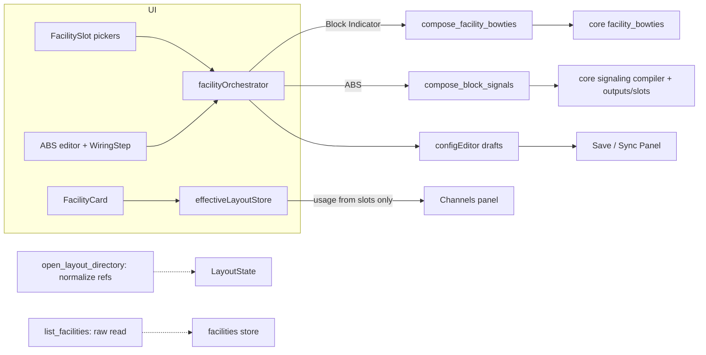
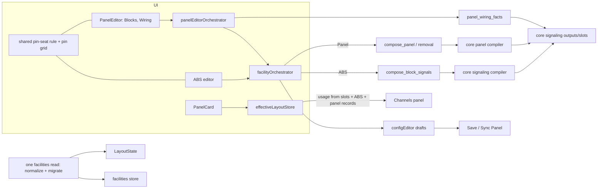

# Slices: Panel Facility

Branch: 021-panel-facility
Generated: 2026-11-25
Status: 3/6

## Architecture

### Before

### After

### Patterns

- **Facility composes into configuration edits**: the panel record is the intent. Its effect on hardware is ordinary configuration edits that Save writes. This is the ABS route; the Block Indicator bowtie route is retired.
- **Functional core, imperative shell**: a pure panel compiler in core. The backend gathers board facts, and `facilityOrchestrator` stages the edits, rolling back on failure.
- **Derived claims**: a panel's pins are derived from the lamp channels in its `lamps` slot and never stored.
- **Load-time conversion**: one facilities read converts Block Indicators into panels. The converted form is the baseline, and a "needs save" flag marks the layout changed.

### Module Changes

| Module | Today | After |
|---|---|---|
| `behavior_templates.rs` | Block Indicator, ABS | Panel, ABS. `"block-indicator"` is kept only as migration input. |
| `layout/facilities.rs`, `manifest.rs` | Facility with an optional ABS record; manifest 5 | Optional panel record and `SetPanelRecord`; facilities "3.0"; manifest 6 |
| `layout/mod.rs`, `io.rs` | Two facilities reads, one raw | One read that normalizes and migrates |
| `core panel/` (new) | — | Panel compiler: lamp-row edits, resets, issues |
| `core layout/panel_migration.rs` (new) | — | Block Indicator → Panel conversion |
| `core signaling/outputs.rs`, `slots.rs`, `facts.rs` | Pin owners and claimed slots for ABS | Pin label visible within the crate; claims and attribution include panel lamps |
| `facility_bowties` + command | Composes Block Indicator bowties | Deleted |
| Backend panel commands (new) | — | Wiring facts, compose, removal |
| `facilityOrchestrator` | Slot pickers, bowtie composition, ABS staging | Panel and ABS staging; slot pickers and bowtie code deleted |
| `panelEditor` store and orchestrator (new) | — | Steps, entries, wiring, "lit when" |
| Pin-seat rule in `utils/` (new) | Inside `blockSignalsEditor.seatLamp` | Shared by the Panel and ABS editors |
| `effectiveLayoutStore` | Status and channel usage from slots | Panel status; usage from slots and ABS and panel records |
| `facilities` store | Slot bindings, ABS record drafts | Panel record drafts; "needs save" after migration |
| `components/Panel/*` (new) | — | Editor, Blocks, Wiring, card, remove dialog |
| `FacilitySlot` + pickers, route slot handlers | Block Indicator editing | Deleted |
| Routes and components importing edit stores | Direct imports | Through `$lib/layout` only |

### Behavior Summary

| Slice | User-visible change | Demoable? |
|---|---|---|
| S1: One-board panel, end to end | Add a Panel, add blocks, wire each to any pin, Done, Save; lamps follow their blocks | Yes |
| S2: Panel card and channel usage | One card per panel with blocks in order, live lamp state and honest status; Channels "Used by" names panels and ABS | Yes |
| S3: Blocks step and "lit when" | Add all blocks from a signals facility or board; reorder; re-point; lit when Clear and per-block override | Yes |
| S4: Edit, release and remove | Rewire and remove with only dropped pins reset; release outside pins; confirmed removal | Yes |
| S5: Migrate Block Indicators and retire them | Old layouts open as panels with a notice, lamps still working, nothing written | Yes |
| S6: Route all layout imports through the facade | Invariant preserved: app behaves exactly as before | No (REFACTOR) |

---

## Roadmap

| # | Slice title | Label | Blocked by | Status |
|---|---|---|---|---|
| S1 | One-board panel, end to end | HITL | None | done |
| S2 | Panel card and channel usage | AFK | S1 | done |
| S3 | Blocks step and "lit when" | AFK | S1 | sketched |
| S4 | Edit, release and remove | HITL | S1 | done |
| S5 | Migrate Block Indicators and retire them | HITL | S1 + S2 | sketched |
| S6 | Route all layout imports through the facade | REFACTOR | S5 | sketched |

### S1: One-board panel, end to end [HITL]

**Intent**: Name a Panel, add blocks one at a time, wire each to any pin, then Done and Save. The lamps follow their blocks.
**Boundary**: Components → panel editor store/orchestrator → facilityOrchestrator → facilities, channels and config drafts → API → backend commands → core panel compiler and signaling outputs → Save → Signal LCC
**Blocked by**: None
**Status**: done

**Acceptance criteria**:
- [ ] Add facility offers Panel. Naming one opens the Blocks step, empty, with guidance.
- [ ] Blocks are added one at a time from a searchable list grouped by detector board. A block can't be added twice.
- [ ] Wiring lists the blocks with their status. Picking a board shows its pins labelled as the board labels them (#1 H1-G … #16 H4-L), each with its owner.
- [ ] Clicking a free pin wires the selected block. Clicking the same pin again clears it.
- [ ] Pins used by Automatic Block Signals can't be chosen, and Automatic Block Signals can't take panel pins.
- [ ] Done with an unwired block still creates the panel. The Save toolbar and the close prompt show unsaved changes. Cancel leaves nothing behind.
- [ ] Save while connected: blocks wired to #9, #3 and #14 each light their own LED. Offline, the changes wait in the Sync Panel.
- [ ] The Channels panel lists the panel's lamp channels. The Railroad tab shows a card for the panel with its status.
- [ ] Reopening the layout restores the panel. A version 6 layout opens; a newer one is refused with the "newer Bowties" message.

**Architecture note** *(HITL, new seam)*: Sets up the panel compile-and-stage pattern (record → pure compiler → staged configuration edits), the `panel_wiring_facts` and `compose_panel` IPC contracts, the shared pin-seat rule, and panel lamps as claimed pins in `signaling/`. The ADR-0012 Unknown audit rows are confirmed for the new paths. New code imports only through `$lib/layout`. The F7 wording fixes are made as each file is touched; the Panel glossary term is added.

**Complexity**: large
**User stories**: US1 (scenarios 1, 2, 5, 6, 7), US2 (minimal card only)

**UI contract**: [mockups.html](mockups.html) `#add`, `#blocks`, `#wiring`, `#railroad`. Allowed S1 differences, rendered disabled in place so the layout matches the mockup: "Add all blocks from" (S3), reorder ↑/↓ (S3), "Lit when" panel and per-block controls (S3, fixed at Occupied), and Release on outside pins (S4; outside pins show their Lamp Description and can't be chosen). Remove × on the Blocks step works in S1 because a new panel's entries are editor-only. The Railroad card in S1 shows name, Panel chip, status and the block count; per-entry tiles and live lamp state come in S2.

**Decisions** *(approved 2026-11-25)*: D1 lamp identity is its Direct Lamp row and the pin is that row's effective Lamp Selection; D2 one claims function over facilities and channels, with `ClaimedSlotKind::DirectLamp`; D3 one staging transaction in `facilityOrchestrator`, with ABS as its first user.

**Tasks**:
- [x] S1-T1: Integration tests. Frontend (`RailroadPanel.panel.integration.test.ts`, modelled on "Done to Discard (E1a-T1)"): Add facility → Panel → name → add three blocks → wire #9, #3, #14 → Done. Asserts one facility, three lamp channels on `lamps`, unsaved Lamp Selection/On/Off/Description edits on the assigned rows, the Save toolbar dirty, the Channels rows and the Railroad card. Cancel leaves nothing. Clicking a block's own pin clears it. ABS-owned pins are not choosable. Rust (`bowties-core/tests/panel_compiler.rs`): #9/#3/#14 compile to edits on three rows with Lamp Selection = pin; a pin claimed elsewhere is a blocking issue.
- [x] S1-T2: Core layout. Add the `PANEL` template to `REGISTRY` (Block Indicator stays until S5). Add `PanelRecord`/`PanelEntry` on `Facility`, the `SetPanelRecord` delta and the record-vs-`lamps`-slot agreement check. Facilities `SCHEMA_VERSION` "3.0"; `LAYOUT_SCHEMA_VERSION` 6 (4 and 5 open, 7 refused with the "newer Bowties" message). Roundtrip tests.
- [x] S1-T3: Core signaling claims (D2). `claimed_slots_where(facilities, channels)` adds `ClaimedSlotKind::DirectLamp` for each panel lamp row, through a panel-module helper. `attribute_output_facilities` names the panel for `DirectLamp(row)` owners. `overlay_releases` refuses claimed Direct Lamp rows. Update every caller to pass effective channels. Make the pin label visible within the crate. Unit tests, including the changed "direct lamp stays unattributed" test.
- [x] S1-T4: Core panel compiler (D1), in `bowties-core/src/panel/`. Input: record, lamps `{entryId, nodeKey, output, currentRow?}`, board facts. It keeps a lamp's row, otherwise allocates a free row (row == pin when free, else the lowest). It emits Lamp Selection = pin, Lamp On and Lamp Off from the block's occupancy events by effective "lit when", and Lamp Description = lamp name. It returns the row assignments and the issues `pinOwnedElsewhere`, `duplicatePin`, `blockEventsUnresolved`, `boardUnavailable` and `noFreeLampRow`, with edits grouped per node. Pure, typed issues, no panics.
- [x] S1-T5: Backend. `panel_wiring_facts` (16 labelled pins per Signal LCC, owner free / panel / facility / outside with Lamp Description, from the effective layout) and `compose_panel` (no writes, no draft mutation). Register both in `lib.rs`. Rust tests.
- [x] S1-T6: Frontend API and shared rule. `api/panels.ts` for typed IPC. A pure pin-seat rule in `utils/` (seat / clear / move with message / outside / not choosable); `blockSignalsEditor.seatLamp` uses it. Unit tests; ABS store tests stay green.
- [x] S1-T7: `facilityOrchestrator` (D3). Extract the staging transaction (sync → compose → refuse on issues → wrapped mutations that record their inverse → post-commit deletes) with ABS as its first user, keeping the ABS tests green. Then add `createPanelFacility`. Facilities store: `setPanelRecord`, and attaches folded into a pending AddFacility.
- [x] S1-T8: `panelEditor` store and `panelEditorOrchestrator`: steps and step-bar counts, add a block (no duplicates), select an entry, wiring facts per board shown, pin click through the shared rule, Done → `createPanelFacility`, Cancel. Register in the lifecycle reset. Store and orchestrator tests.
- [x] S1-T9: Components (imports through `$lib/layout` only). `AddFacilityDialog` offers Panel. `components/Panel/PanelEditor`, `BlocksStep` (searchable list grouped by detector board, "on panel" chip), `WiringStep` (block list with status, board select, pin grid by head with legend and owners) and a minimal `PanelCard` in `FacilitiesSection`. Component tests.
- [x] S1-T10: Docs. Glossary: the Panel term, plus the F7 fixes for Claimed Resource (derived; panels claim Direct Lamp rows) and the "at most one facility slot" rule. data-model.md and contracts/tauri-ipc.md updated for D1 (pins keyed by `output`, row assignments). ADR extensions: 0012 (Direct Lamp claims; staging transaction spans facility kinds), 0013 (lamp identity = row, pin = effective Lamp Selection), 0005 (manifest 6). aiwiki owners, flows and seams.
- [x] S1-T11: Validate. `cargo test -p bowties-core`; app crate tests (`cargo test -p app`, or `cargo check --tests` where only that is supported); `npm test`; `npm run check`; `cargo clippy -p bowties-core -p app -- -D warnings`. Check the changed-file set against the expected surface. Compare the running app against the mockup's `#add`, `#blocks`, `#wiring` and `#railroad` with the allowed differences above, and record the results here. Bench: #9, #3, #14 on a Signal LCC.

**S1 validation record (2026-11-25)**:
- Automated: `bowties-core` `cargo test` 562 lib + all integration suites green (incl. `panel_compiler.rs` 12, `panel_layout_roundtrip.rs` 3). App crate `cargo test --lib` 135 passed, 2 failed in untouched files (`events/router.rs` node ID format, `profile/loader.rs` BOD4 rules); not caused by this slice, not yet re-run on a clean checkout. Frontend `vitest run` 147 files / 1834 tests green. svelte-check 113 errors / 2 warnings, identical to committed HEAD. `cargo clippy -D warnings` fails on pre-existing lints only; none in new panel code.
- Timing risk: `RailroadPanel.panel.integration.test.ts` first test timed out once while cargo built in parallel; green alone (1.7 s) and in a clean full run. Same class as the ABS edit tests note in owners.md.
- Found and fixed during build: ABS update rollback left a newly created signal channel attached to `signals` (fixed by the staging transaction); ABS BlocksStep stored extra block fields (now picks `{blockId, name}`).
- PENDING (caller gates): running-app comparison against mockups `#add`, `#blocks`, `#wiring`, `#railroad` with the allowed differences above, and the bench check (#9, #3, #14 on a Signal LCC). Slice stays `tasked` until both are recorded.
- 2026-11-26 user check: one block wired and lit on the bench (works). Running-app review found three follow-ups, fixed before S1 closes: (1) Wiring's board picker is a plain node-type/address combo; reuse the ABS node selector (richer label plus search dialog). (2) Each step shows a message in the footer row beside Cancel/Next; remove or move it. (3) Regression from Spec 020: the ABS wiring step shows only the selected signal's pins as taken; pins of other signals in the same edit show as free.
- 2026-11-26 follow-ups done (user chose 1B, 2, 3): (1) ABS: a pin another signal in the edit holds shows that signal and lamp and is not choosable; `seatLamp` refuses it; the core compiler rejects two signals on one output (`SignalOutputHeldBySignal`). Panels keep "move" for another entry on the same panel (open question to the user). (2) Shared `SignalLcc/SignalLccPicker` replaces the Panel board `<select>` and the ABS inline picker. (3) Panel footer is buttons only; Done error and lamp note moved to the body. Validation: vitest 148 files / 1847 passed; svelte-check 113/2 (baseline); bowties-core cargo test green; app crate lib 135 passed, 2 pre-existing failures (router, profile loader). User confirmed in the running app (screenshots).
- 2026-11-26 shared pin grid (user chose A): `SignalLcc/PinGrid` renders both Wiring steps' pins in the ABS look. Approved deviation from mockup `#wiring`: row headers H1–H4 on the left instead of "Head H1" headings; legend has swatches; "Free"/"This block" capitalized. Outside pins stay clickable in S1 so the click explains they cannot be used (Release is S4). Validation: vitest 1850/1852 in the full run, the 2 failures were 5 s timeouts in Railroad integration walks under suite load and pass alone (20/20); svelte-check 113/2.
- 2026-11-26 panel pins: a pin another block on this panel holds is not choosable (user decision, same as ABS); pinSeat's `move` mode removed. Spec edge case and data-model pin-click table updated; mockups.html line 483 still says "moves", left to the user's mockup update.
- 2026-11-26 S1 closed: bench check complete (user). Final visual review against the updated mockups is handled by the user separately. Known: in full vitest runs the Panel create walk and the ABS "joined block … on Aspects" walk exceed the 5 s timeout under suite load (pass alone); see backlog.
- Known S1 limits carried to later slices: the panel card has no Edit or Remove (S4); deleting a panel any other way is not offered; boards appear in Wiring only when a Signal LCC profile matches (same as ABS).

### S2: Panel card and channel usage [AFK]

**Intent**: One card per panel shows its blocks in order, with live lamp state and an honest status.
**Boundary**: Components → effectiveLayoutStore → eventState
**Re-cut after S1**: extend the existing `Panel/PanelCard.svelte` and `effectiveLayoutStore.panelStatus` (Empty / Incomplete / Wired from the record) rather than adding new ones. Pins on the card are labelled from the row's effective Lamp Selection (D1), never from the row number. `detectedBlocks` already carries `board`.
**Blocked by**: S1
**Status**: done

**Acceptance criteria**:
- [ ] The card lists blocks in panel order, each with its pin or "needs a lamp", and its block's occupancy (occupied, clear, or no reading until an event is seen). *(2026-11-26 user decision: the tile shows occupancy in the shared occupancy colours, not the lamp state.)*
- [ ] Status is Empty, "Incomplete, N need a lamp", or Wired. A block that is no longer detected, or a lamp whose board is missing, counts as Incomplete and is labelled on its entry.
- [ ] Board changes not yet written show as waiting, per board.
- [ ] The Channels panel's "Used by" names both the panel and the Automatic Block Signals facility for a shared block.
- [ ] A layout with 24 lamps on two panels shows 2 cards.

**UI contract**: [mockups.html](mockups.html) `#railroad`: card head (name, Panel chip, status chip), sub line "N blocks · lamps on <boards>" (or "No blocks yet."), then a grid of lamp tiles in panel order: lamp dot (none / lit / unlit), block name, "#pin label" or "needs a lamp", and the block's reading. Edit stays S4. Waiting writes use the ABS FacilityCard's per-board "waiting" list.

**Complexity**: medium
**User stories**: US2

**Placement**: per-entry card view, status and "used by" stay in `effectiveLayoutStore` (ADR-0004 single owner). Block consumers go in a separate `channelUsedBy` derivation, not `channelUsageMap`: that map also drives `unboundChannelsForRole` (slot pickers), and a panel or ABS only *uses* a block (mockup note Q1). Live lamp and block state come from the lamp and block channels' resolved events (same as the Channels panel), in a pure util.

**Tasks**:
- [x] S2-T1: Integration test (`RailroadPanel.panel.integration.test.ts`): a saved panel shows tiles in panel order with pin labels from the effective Lamp Selection; a Lamp On event turns the tile lit; Channels "Used by" for a block shared with ABS names both facilities; two panels with 24 lamps show 2 cards.
- [x] S2-T2: `effectiveLayoutStore`: `panelCardEntries(facilityId)` (block name or missing, lamp channel, board, pin and label from effective Lamp Selection, board missing); `panelStatus` counts missing blocks and boards; `channelUsedBy` (slot usage plus ABS and panel block uses); route and test support switch "Used by" to it.
- [x] S2-T3: Pure lamp and block state for the card (reuse `deriveChannelState`).
- [x] S2-T4: `PanelCard` tiles, sub line, status chip and per-board waiting (`facilityWriteOutcome`); `FacilitiesSection` passes `resolvedEventIds`.
- [x] S2-T5: Docs (aiwiki owners and seams for `channelUsedBy`) and validation.

**S2 validation record (2026-11-26)**:
- Automated: vitest 151 files / 1871 tests green in the full run; svelte-check 113 errors / 2 warnings (baseline). Integration (`RailroadPanel.panel.integration.test.ts`): tiles in panel order with pins from Lamp Selection (row 2 shows #3); Lamp On lights the tile; "Used by" of a block shared with ABS names both; two panels with 24 lamps show 2 cards.
- Built: `effectiveLayoutStore.panelCardEntries`, `panelStatus` (missing block, board or pin is Incomplete), `channelUsedBy` (slot usage plus block uses; `channelUsageMap` unchanged so slot pickers still offer blocks a facility only uses); `utils/panelLampState`; `PanelCard` tiles, sub line, status and waiting; shared `Facilities/WriteOutcomeList` (refactor: was duplicated in FacilityCard and PanelCard).
- Differences from mockup `#railroad`: no Edit button (S4); tiles are not clickable (the mockup click fakes occupancy); "needs a pin" when a lamp row has Lamp Selection 0; missing block or board labelled on the tile.
- Changed S1 behaviour: chip text is "Incomplete · N needs a lamp" (was a separate span); the S1 create walk stubs the roster board and has a 15 s stopgap timeout (see backlog).
- 2026-11-26 user review: tile dots now use the Channels panel state indicator (shared `Railroad/ChannelStateIndicator`; lamp dot plus an occupancy dot on the reading), and every facility card uses one status badge in the panel style without the dot (shared `Facilities/StatusBadge`; the ABS/Block Indicator pulse dot is gone). Then: one occupancy palette everywhere (`--occupancy-*` tokens in app.css: the track diagram's red and light green, now also the Channels dots and the tiles); each tile has a single dot showing block occupancy (lamp state dropped from the card; `utils/panelLampState` removed). vitest 151 files / 1870 passed; svelte-check 113/2.
- PENDING (user): running-app look against mockup `#railroad` and live lamp state on the bench.

### S3: Blocks step and "lit when" [AFK]

**Intent**: Build a panel quickly from an existing signals facility or detector board, and choose when lamps light.
**Boundary**: Components → panel editor store/orchestrator → facilityOrchestrator → compiler
**Re-cut after S1**: the compiler already applies panel and per-entry "lit when"; S3 enables the disabled controls (Add all, ↑/↓, Lit when) in place and adds re-pointing in the store. "Add all from a signals facility" can read `detectedBlocks[].facility` plus the ABS record order.
**Blocked by**: S1
**Status**: sketched

**Acceptance criteria**:
- [ ] "Add all from" a signals facility adds its blocks in travel order; from a detector board, in input order. Blocks already on the panel are skipped. Later changes to that facility or board don't change the panel.
- [ ] Blocks can be reordered and removed. Wiring and the card follow the new order.
- [ ] An entry can be pointed at a different block, keeping its pin and position.
- [ ] Panel "lit when Clear" lights lamps on clear. A per-block override shows on its entry and wins over the panel setting.

### S4: Edit, release and remove [HITL]

**Intent**: Change or remove a panel safely; only that panel's pins change.
**Boundary**: Components → orchestrators → compiler resets and releases → drafts → Save
**Re-cut after S1**: adds Edit and Remove to `PanelCard` (none in S1), `updatePanelFacility` and `removePanelFacility` on the existing staging transaction (`tx.setPanelRecord` is ready), and `deleteFacility` routing for `panel`. A same-board pin move changes only Lamp Selection on the kept row (no rebind, nothing to reset); resets apply to dropped rows (`direct_lamp_reset_edits` via `facility_claimed_slots`). Release goes through `overlay_releases`, which already refuses claimed rows.
**Blocked by**: S1
**Status**: sketched

**Acceptance criteria**:
- [ ] Moving a lamp from #6 to #12 and saving: #12 follows the block and #6 is reset.
- [ ] Removing a block resets its pin. The block, its detector and a signals facility using it are unchanged.
- [ ] A pin another block on this panel holds can't be chosen until it is cleared on that block (decided 2026-11-26, same as ABS; already in place from S1).
- [ ] A pin used outside Bowties shows its Lamp Description and can be used only after Release. The release is written together with the panel's changes.
- [ ] Remove asks for confirmation naming the pins per board, then resets only those pins. The lamp channels leave the Channels panel and the blocks remain.
- [ ] Cancelling the editor on an existing panel leaves it unchanged.

**Architecture note** *(HITL)*: Lamp-row reset recipe and release through the existing `overlay_releases`. Removal must never touch pins the panel did not claim.

**Status**: done

**Re-cut after S2 (2026-11-26 pre-check)**: the card assumed more than exists. Only ABS can be removed (`compose_block_signals { remove: true }` → `release_from_layout` requires a `block_signals` record); the generic `deleteFacility` path would drop a panel's lamp channels but leave Lamp Selection set, so the pins would read "Outside Bowties". `compile_panel` has no input for the rows a panel held, so it never resets; `currentRow` comes from the request, not the layout. Panel compose and wiring facts pass an empty release list. The panel editor has no load-from-record path.

**Decisions** *(approved 2026-11-26)*:
- D1 (A): claims drive every reset. `compile_panel` takes the panel's saved rows from the effective layout (replaces request `currentRow`), keeps a row only when its lamp stays on the same board, and returns claimed-minus-assigned rows as release targets applied through `release_slots`. `release_from_layout` becomes the kind-agnostic `compose_facility_removal { facilityId }`; ABS removal moves onto it and `compose_block_signals`'s remove mode goes.
- D2 (B): the removal compose returns its claim list next to edits and issues. The orchestrator previews the removal (sync, compose, refusal) before the dialog opens, then composes again on confirm and refuses on a mismatch. One kind-neutral `FacilityRemoveDialog` renders the claims through a pure util (pin label, "row N (no pin set)", Mast/Logic/Track Circuit). `facilityOrchestrator.removeFacility` is the only kind router; `FacilitiesSection` emits intent only.
- D3 (A): panel wiring facts and compose accept `release` through `overlay_releases`; compose merges release edits and reports `releaseInvalid`. The ABS outside-owner card and its two-step confirm move to a shared presentational `SignalLcc/` component, released-owner dedupe to a pure `utils/` helper; both Wiring steps use them. Facts are re-fetched after a release.

**UI contract**: [mockups.html](mockups.html) `#railroad` (card Edit) and `#wiring` (outside pins, Release). Allowed S4 differences: Release uses the shared ABS outside-owner card instead of the mockup's inline "Release pin" note (D3); Remove has no mockup and uses the shared Dialog shell with the per-board claim list (D2); the card gets Remove beside Edit.

**Complexity**: large
**User stories**: US3 (scenarios 1–4), US2 scenario 4 (Edit opens both steps filled)

**Tasks**:
- [x] S4-T1: Integration tests. Frontend (`RailroadPanel.panel.integration.test.ts`): a saved panel's Edit opens both steps filled; moving a lamp #6 → #12 on the same board stages only Lamp Selection on the kept row; removing a block stages a reset of its row (Lamp Selection 0, empty description, fresh On/Off) and leaves the block and an ABS facility sharing it unchanged; Cancel on an existing panel leaves no drafts; Remove on the card opens the dialog naming pins per board, confirm resets only those rows, the lamp channels leave the Channels panel and the blocks remain; an outside pin can be seated only after Release, and the release edits are staged with Done. Rust: `panel_compiler.rs` dropped rows and cross-board move; `compose_facility_removal` for a panel and for ABS (same edits as today's ABS removal).
- [x] S4-T2: Core panel compiler (D1). `PanelCompileInput` gains the saved rows `{entryId, nodeKey, row}`; keep a row only for a same-board lamp; return `released` DirectLamp targets for claimed-minus-assigned rows. Unit tests.
- [x] S4-T3: Backend panel compose and facts (D1, D3). `compose_panel` reads saved rows from the effective layout (drop request `currentRow`), indexes the saved rows' boards, applies `release_slots` to the dropped rows (`ClaimedSlotUnavailable` blocks), accepts `release` (`releaseInvalid` first, `merge_release_edits`); `panel_wiring_facts` accepts `release` so released pins read free. Rust tests.
- [x] S4-T4: Backend `compose_facility_removal { facilityId }` (D1, D2): any facility with claims; returns edits, claims, Logic placement and issues. Remove `compose_block_signals`'s remove mode. Register in `lib.rs`. Rust tests (panel + ABS parity).
- [x] S4-T5: Frontend API and utils. `api/panels.ts` (`release`, no `currentRow`); `composeFacilityRemoval` in the API layer; `utils/facilityRemovalText.ts` (claims → per-board text); `utils/releasedOwners.ts` (dedupe on canonical node key, used by both editor stores). Unit tests.
- [x] S4-T6: `facilityOrchestrator`. `updatePanelFacility` on the staging transaction (record, rebind on board change, attach new lamps; dropped lamp channels detached and removed in commit). `previewFacilityRemoval` + `removeFacility({facilityId, leaveBoard})` as the only removal router, replacing `removeBlockSignalsFacility` and the ABS branch in `deleteFacility`. Orchestrator tests; ABS removal tests stay green.
- [x] S4-T7: `panelEditor` store and orchestrator: `startEdit(facilityId)` from the saved record (pins from effective Lamp Selection, keeps the facility ID), `releases` + `releaseAndSeat`, facts re-fetched with releases, Done → update in edit mode, Cancel leaves the panel unchanged. Store and orchestrator tests.
- [x] S4-T8: Components. Shared `SignalLcc/` outside-owner release card extracted from ABS `WiringStep` (ABS tests stay green); Panel `WiringStep` uses it. `Facilities/FacilityRemoveDialog` replaces `BlockSignalsRemoveDialog`. `PanelCard` Edit and Remove; `FacilitiesSection` emits intent only and mounts the dialog from the preview. Component tests.
- [x] S4-T9: Docs. ADR-0012 extension (kind-agnostic removal command, removal preview, panel edit releases claimed-minus-assigned, panel requests carry `release`); ADR-0013 extension (saved row read from the layout); spec FR-015 wording; data-model.md and contracts/tauri-ipc.md; aiwiki owners, flows and seams (Facility Bowtie Lifecycle, Slot Binding Spec 021 note, Progressive Proposal panel consumer). Mockup Release presentation left to the user.
- [x] S4-T10: Validate. `cargo test -p bowties-core`; app crate tests; vitest; svelte-check (baseline 113/2); clippy on new code. Changed-file set against the expected surface. Running-app check against `#railroad` and `#wiring`; bench: move #6 → #12 and remove a panel on a Signal LCC.

**S4 validation record (2026-11-26)**:
- Automated: bowties-core `cargo test` green (562 lib + all integration suites, incl. `panel_compiler.rs` 14). App crate `cargo test --lib` 145 passed, 2 failed: the known pre-existing `events::router` and `profile::loader` failures. vitest 154 files / 1896 tests green in the full run. svelte-check 113 errors / 2 warnings (baseline). Clippy: no findings in the slice's files (one unused test-only import fixed); other crate lints pre-existing.
- Built: core `compile_panel` takes saved rows from the layout and returns dropped rows; backend panel compose resets them via `release_slots` and both panel commands accept `release`; kind-agnostic `compose_facility_removal` returns `claims` (ABS removal moved onto it); `facilityOrchestrator.updatePanelFacility`, `previewFacilityRemoval`, `removeFacility` (only removal router); panel editor `startEdit`, release state and flow; shared `SignalLcc/OutsideOwnerRelease` (extracted from ABS) and `Facilities/FacilityRemoveDialog` (replaces `BlockSignalsRemoveDialog`); `utils/facilityRemovalText`, `utils/releasedOwners`; PanelCard Edit/Remove. Refactor: one `index_effective_trees` helper for three tree-indexing loops.
- Audit notes: Behavior "dropped entries released" (T2) and the release pass-through tests (T6/T8b) passed on first run (covered by earlier greens) and were proved by mutation; the Release flow red was proved by neutralising the implementation. The "Remove" and release Railroad walks were written after their UI and have no observed red.
- Differences from the mockups: Release uses the shared ABS outside-owner card instead of the inline note (`#wiring`, D3); Remove has no mockup and uses the shared Dialog with per-board claims (D2); PanelCard has Edit and Remove link buttons.
- Follow-ups (backlog): removal sequencing in `FacilitiesSection` should move behind an orchestrator action; no Rust test for ABS removal with Logic placement; the five new Panel walks carry the 15 s stopgap timeout.
- 2026-11-26 user check: running app and bench confirmed (edit, same-board move, block removal, Cancel, Release, Remove). S4 closed.

### S5: Migrate Block Indicators and retire them [HITL]

**Intent**: Layouts with Block Indicators open as panels, with the lamps still working and nothing written to the boards.
**Boundary**: Route → facilities store → API → backend open/list → core single facilities read and migration
**Re-cut after S1**: migrated lamps keep their row and hand-set Lamp Selection (D1); a migrated row with Lamp Selection 0 is a lamp with no pin and should show as needing a pin. Block Indicator is still offered in Add facility until this slice. Re-check the two backlog Lamp Selection items afterwards.
**Blocked by**: S1 + S2
**Status**: sketched

**Acceptance criteria**:
- [ ] A 0.4.x layout with Block Indicators on two boards opens as two panels named after the boards, blocks in the old order, lamps named after the old facilities.
- [ ] A Block Indicator with a block but no lamp goes into one "Indicators without a lamp" panel, shown as Incomplete. One with no block is dropped.
- [ ] A notice says how many Block Indicators became how many panels.
- [ ] The Save toolbar and the close prompt show unsaved changes. Discard keeps the panels. Nothing waits in the Sync Panel, and the lamps still follow occupancy.
- [ ] Add facility no longer offers Block Indicator.
- [ ] The old bowtie names still appear on the Bowties tab.
- [ ] A layout without Block Indicators opens unchanged and isn't marked changed.

**Architecture note** *(HITL, seam change)*: One facilities read serves both open and list (F1). The migrated document is the baseline, with a "needs save" flag as a new input to the Dirty Aggregation seam (F2). Block Indicator bowtie composition, the slot pickers and their route handlers are deleted (F4).

### S6: Route all layout imports through the facade [REFACTOR]

**Intent**: Invariant preserved. The app behaves exactly as before; routes and components reach layout state only through `$lib/layout`.
**Boundary**: Routes and components → `$lib/layout`
**Blocked by**: S5
**Status**: sketched

**Acceptance criteria**:
- [ ] Save, Discard, the close prompt, and the Bowties, Configuration and Railroad tabs behave as before.
- [ ] A guard test fails if a route or component imports an edit-layer store directly.
- [ ] The page reads only the aggregate dirty flag. The ADR-0004 and ADR-0011 audit rows become OK.

<!-- Session: 2026-11-26 — S1, S2, S4 done. Next: S3 (AFK; re-pointing has no mockup UI, ask the user) or S5 (HITL). -->
