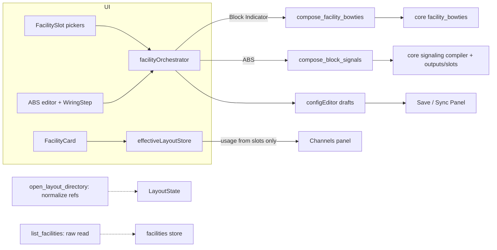
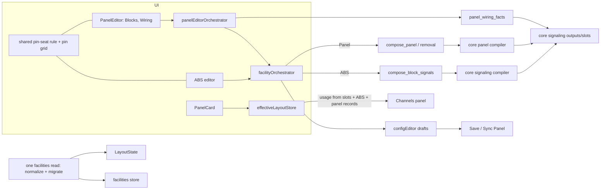

# Slices: Panel Facility

Branch: 021-panel-facility
Generated: 2026-11-25
Status: 6/7

## Architecture

### Before



### After



### Patterns

- **Facility composes into configuration edits**: the panel record is the intent. Its effect on hardware is ordinary configuration edits that Save writes. This is the ABS route; the Block Indicator bowtie route is retired.
- **Functional core, imperative shell**: a pure panel compiler in core. The backend gathers board facts, and `facilityOrchestrator` stages the edits, rolling back on failure.
- **Derived claims**: a panel's pins are derived from the lamp channels in its `lamps` slot and never stored.
- **Load-time conversion**: one facilities read converts Block Indicators into panels. The converted form is the baseline, and a "needs save" flag marks the layout changed.

### Module Changes

| Module | Today | After |
|---|---|---|
| `behavior_templates.rs` | Block Indicator, ABS | Panel, ABS. `"block-indicator"` is kept only as migration input. |
| `layout/facilities.rs`, `manifest.rs` | Facility with an optional ABS record; manifest 5 | Optional panel record and `SetPanelRecord`; facilities "3.0"; manifest 6 |
| `layout/mod.rs`, `io.rs` | Two facilities reads, one raw | One read that normalizes and migrates |
| `core panel/` (new) | — | Panel compiler: lamp-row edits, resets, issues |
| `core layout/panel_migration.rs` (new) | — | Block Indicator → Panel conversion |
| `core signaling/outputs.rs`, `slots.rs`, `facts.rs` | Pin owners and claimed slots for ABS | Pin label visible within the crate; claims and attribution include panel lamps |
| `facility_bowties` + command | Composes Block Indicator bowties | Deleted |
| Backend panel commands (new) | — | Wiring facts, compose, removal |
| `facilityOrchestrator` | Slot pickers, bowtie composition, ABS staging | Panel and ABS staging; slot pickers and bowtie code deleted |
| `panelEditor` store and orchestrator (new) | — | Steps, entries, wiring, "lit when" |
| Pin-seat rule in `utils/` (new) | Inside `blockSignalsEditor.seatLamp` | Shared by the Panel and ABS editors |
| `effectiveLayoutStore` | Status and channel usage from slots | Panel status; usage from slots and ABS and panel records |
| `facilities` store | Slot bindings, ABS record drafts | Panel record drafts; "needs save" after migration |
| `components/Panel/*` (new) | — | Editor, Blocks, Wiring, card, remove dialog |
| `FacilitySlot` + pickers, route slot handlers | Block Indicator editing | Deleted |
| Routes and components importing edit stores | Direct imports | Through `$lib/layout` only |

### Behavior Summary

| Slice | User-visible change | Demoable? |
|---|---|---|
| S1: One-board panel, end to end | Add a Panel, add blocks, wire each to any pin, Done, Save; lamps follow their blocks | Yes |
| S2: Panel card and channel usage | One card per panel with blocks in order, live lamp state and honest status; Channels "Used by" names panels and ABS | Yes |
| S3: Blocks step and "lit when" | Add all blocks from a signals facility or board; reorder; lit when Clear and per-block override | Yes |
| S4: Edit, release and remove | Rewire and remove with only dropped pins reset; release outside pins; confirmed removal | Yes |
| S5: Migrate Block Indicators and retire them | Old layouts open as panels with a notice, lamps still working, nothing written | Yes |
| S6: Route all layout imports through the facade | Invariant preserved: app behaves exactly as before | No (REFACTOR) |

---

## Roadmap

| # | Slice title | Label | Blocked by | Status |
|---|---|---|---|---|
| S1 | One-board panel, end to end | HITL | None | done |
| S2 | Panel card and channel usage | AFK | S1 | done |
| S3 | Blocks step and "lit when" | AFK | S1 | done |
| S4 | Edit, release and remove | HITL | S1 | done |
| S5 | Migrate Block Indicators and retire them | HITL | S1 + S2 | done |
| S6 | Route all layout imports through the facade | REFACTOR | S5 | done |
| S7 | Discard undoes placeholder board add and delete | HITL | S6 | sketched |

### S1: One-board panel, end to end [HITL]

**Intent**: Name a Panel, add blocks one at a time, wire each to any pin, then Done and Save. The lamps follow their blocks.
**Boundary**: Components → panel editor store/orchestrator → facilityOrchestrator → facilities, channels and config drafts → API → backend commands → core panel compiler and signaling outputs → Save → Signal LCC
**Blocked by**: None
**Status**: done

**Acceptance criteria**:
- [ ] Add facility offers Panel. Naming one opens the Blocks step, empty, with guidance.
- [ ] Blocks are added one at a time from a searchable list grouped by detector board. A block can't be added twice.
- [ ] Wiring lists the blocks with their status. Picking a board shows its pins labelled as the board labels them (#1 H1-G … #16 H4-L), each with its owner.
- [ ] Clicking a free pin wires the selected block. Clicking the same pin again clears it.
- [ ] Pins used by Automatic Block Signals can't be chosen, and Automatic Block Signals can't take panel pins.
- [ ] Done with an unwired block still creates the panel. The Save toolbar and the close prompt show unsaved changes. Cancel leaves nothing behind.
- [ ] Save while connected: blocks wired to #9, #3 and #14 each light their own LED. Offline, the changes wait in the Sync Panel.
- [ ] The Channels panel lists the panel's lamp channels. The Railroad tab shows a card for the panel with its status.
- [ ] Reopening the layout restores the panel. A version 6 layout opens; a newer one is refused with the "newer Bowties" message.

**Architecture note** *(HITL, new seam)*: Sets up the panel compile-and-stage pattern (record → pure compiler → staged configuration edits), the `panel_wiring_facts` and `compose_panel` IPC contracts, the shared pin-seat rule, and panel lamps as claimed pins in `signaling/`. The ADR-0012 Unknown audit rows are confirmed for the new paths. New code imports only through `$lib/layout`. The F7 wording fixes are made as each file is touched; the Panel glossary term is added.

**Complexity**: large
**User stories**: US1 (scenarios 1, 2, 5, 6, 7), US2 (minimal card only)

**UI contract**: [mockups.html](mockups.html) `#add`, `#blocks`, `#wiring`, `#railroad`. Allowed S1 differences, rendered disabled in place so the layout matches the mockup: "Add all blocks from" (S3), reorder ↑/↓ (S3), "Lit when" panel and per-block controls (S3, fixed at Occupied), and Release on outside pins (S4; outside pins show their Lamp Description and can't be chosen). Remove × on the Blocks step works in S1 because a new panel's entries are editor-only. The Railroad card in S1 shows name, Panel chip, status and the block count; per-entry tiles and live lamp state come in S2.

**Decisions** *(approved 2026-11-25)*: D1 lamp identity is its Direct Lamp row and the pin is that row's effective Lamp Selection; D2 one claims function over facilities and channels, with `ClaimedSlotKind::DirectLamp`; D3 one staging transaction in `facilityOrchestrator`, with ABS as its first user.

**Tasks**:
- [x] S1-T1: Integration tests. Frontend (`RailroadPanel.panel.integration.test.ts`, modelled on "Done to Discard (E1a-T1)"): Add facility → Panel → name → add three blocks → wire #9, #3, #14 → Done. Asserts one facility, three lamp channels on `lamps`, unsaved Lamp Selection/On/Off/Description edits on the assigned rows, the Save toolbar dirty, the Channels rows and the Railroad card. Cancel leaves nothing. Clicking a block's own pin clears it. ABS-owned pins are not choosable. Rust (`bowties-core/tests/panel_compiler.rs`): #9/#3/#14 compile to edits on three rows with Lamp Selection = pin; a pin claimed elsewhere is a blocking issue.
- [x] S1-T2: Core layout. Add the `PANEL` template to `REGISTRY` (Block Indicator stays until S5). Add `PanelRecord`/`PanelEntry` on `Facility`, the `SetPanelRecord` delta and the record-vs-`lamps`-slot agreement check. Facilities `SCHEMA_VERSION` "3.0"; `LAYOUT_SCHEMA_VERSION` 6 (4 and 5 open, 7 refused with the "newer Bowties" message). Roundtrip tests.
- [x] S1-T3: Core signaling claims (D2). `claimed_slots_where(facilities, channels)` adds `ClaimedSlotKind::DirectLamp` for each panel lamp row, through a panel-module helper. `attribute_output_facilities` names the panel for `DirectLamp(row)` owners. `overlay_releases` refuses claimed Direct Lamp rows. Update every caller to pass effective channels. Make the pin label visible within the crate. Unit tests, including the changed "direct lamp stays unattributed" test.
- [x] S1-T4: Core panel compiler (D1), in `bowties-core/src/panel/`. Input: record, lamps `{entryId, nodeKey, output, currentRow?}`, board facts. It keeps a lamp's row, otherwise allocates a free row (row == pin when free, else the lowest). It emits Lamp Selection = pin, Lamp On and Lamp Off from the block's occupancy events by effective "lit when", and Lamp Description = lamp name. It returns the row assignments and the issues `pinOwnedElsewhere`, `duplicatePin`, `blockEventsUnresolved`, `boardUnavailable` and `noFreeLampRow`, with edits grouped per node. Pure, typed issues, no panics.
- [x] S1-T5: Backend. `panel_wiring_facts` (16 labelled pins per Signal LCC, owner free / panel / facility / outside with Lamp Description, from the effective layout) and `compose_panel` (no writes, no draft mutation). Register both in `lib.rs`. Rust tests.
- [x] S1-T6: Frontend API and shared rule. `api/panels.ts` for typed IPC. A pure pin-seat rule in `utils/` (seat / clear / move with message / outside / not choosable); `blockSignalsEditor.seatLamp` uses it. Unit tests; ABS store tests stay green.
- [x] S1-T7: `facilityOrchestrator` (D3). Extract the staging transaction (sync → compose → refuse on issues → wrapped mutations that record their inverse → post-commit deletes) with ABS as its first user, keeping the ABS tests green. Then add `createPanelFacility`. Facilities store: `setPanelRecord`, and attaches folded into a pending AddFacility.
- [x] S1-T8: `panelEditor` store and `panelEditorOrchestrator`: steps and step-bar counts, add a block (no duplicates), select an entry, wiring facts per board shown, pin click through the shared rule, Done → `createPanelFacility`, Cancel. Register in the lifecycle reset. Store and orchestrator tests.
- [x] S1-T9: Components (imports through `$lib/layout` only). `AddFacilityDialog` offers Panel. `components/Panel/PanelEditor`, `BlocksStep` (searchable list grouped by detector board, "on panel" chip), `WiringStep` (block list with status, board select, pin grid by head with legend and owners) and a minimal `PanelCard` in `FacilitiesSection`. Component tests.
- [x] S1-T10: Docs. Glossary: the Panel term, plus the F7 fixes for Claimed Resource (derived; panels claim Direct Lamp rows) and the "at most one facility slot" rule. data-model.md and contracts/tauri-ipc.md updated for D1 (pins keyed by `output`, row assignments). ADR extensions: 0012 (Direct Lamp claims; staging transaction spans facility kinds), 0013 (lamp identity = row, pin = effective Lamp Selection), 0005 (manifest 6). aiwiki owners, flows and seams.
- [x] S1-T11: Validate. `cargo test -p bowties-core`; app crate tests (`cargo test -p app`, or `cargo check --tests` where only that is supported); `npm test`; `npm run check`; `cargo clippy -p bowties-core -p app -- -D warnings`. Check the changed-file set against the expected surface. Compare the running app against the mockup's `#add`, `#blocks`, `#wiring` and `#railroad` with the allowed differences above, and record the results here. Bench: #9, #3, #14 on a Signal LCC.

**S1 validation record (2026-11-25)**:
- Automated: `bowties-core` `cargo test` 562 lib + all integration suites green (incl. `panel_compiler.rs` 12, `panel_layout_roundtrip.rs` 3). App crate `cargo test --lib` 135 passed, 2 failed in untouched files (`events/router.rs` node ID format, `profile/loader.rs` BOD4 rules); not caused by this slice, not yet re-run on a clean checkout. Frontend `vitest run` 147 files / 1834 tests green. svelte-check 113 errors / 2 warnings, identical to committed HEAD. `cargo clippy -D warnings` fails on pre-existing lints only; none in new panel code.
- Timing risk: `RailroadPanel.panel.integration.test.ts` first test timed out once while cargo built in parallel; green alone (1.7 s) and in a clean full run. Same class as the ABS edit tests note in owners.md.
- Found and fixed during build: ABS update rollback left a newly created signal channel attached to `signals` (fixed by the staging transaction); ABS BlocksStep stored extra block fields (now picks `{blockId, name}`).
- PENDING (caller gates): running-app comparison against mockups `#add`, `#blocks`, `#wiring`, `#railroad` with the allowed differences above, and the bench check (#9, #3, #14 on a Signal LCC). Slice stays `tasked` until both are recorded.
- 2026-11-26 user check: one block wired and lit on the bench (works). Running-app review found three follow-ups, fixed before S1 closes: (1) Wiring's board picker is a plain node-type/address combo; reuse the ABS node selector (richer label plus search dialog). (2) Each step shows a message in the footer row beside Cancel/Next; remove or move it. (3) Regression from Spec 020: the ABS wiring step shows only the selected signal's pins as taken; pins of other signals in the same edit show as free.
- 2026-11-26 follow-ups done (user chose 1B, 2, 3): (1) ABS: a pin another signal in the edit holds shows that signal and lamp and is not choosable; `seatLamp` refuses it; the core compiler rejects two signals on one output (`SignalOutputHeldBySignal`). Panels keep "move" for another entry on the same panel (open question to the user). (2) Shared `SignalLcc/SignalLccPicker` replaces the Panel board `<select>` and the ABS inline picker. (3) Panel footer is buttons only; Done error and lamp note moved to the body. Validation: vitest 148 files / 1847 passed; svelte-check 113/2 (baseline); bowties-core cargo test green; app crate lib 135 passed, 2 pre-existing failures (router, profile loader). User confirmed in the running app (screenshots).
- 2026-11-26 shared pin grid (user chose A): `SignalLcc/PinGrid` renders both Wiring steps' pins in the ABS look. Approved deviation from mockup `#wiring`: row headers H1–H4 on the left instead of "Head H1" headings; legend has swatches; "Free"/"This block" capitalized. Outside pins stay clickable in S1 so the click explains they cannot be used (Release is S4). Validation: vitest 1850/1852 in the full run, the 2 failures were 5 s timeouts in Railroad integration walks under suite load and pass alone (20/20); svelte-check 113/2.
- 2026-11-26 panel pins: a pin another block on this panel holds is not choosable (user decision, same as ABS); pinSeat's `move` mode removed. Spec edge case and data-model pin-click table updated; mockups.html line 483 still says "moves", left to the user's mockup update.
- 2026-11-26 S1 closed: bench check complete (user). Final visual review against the updated mockups is handled by the user separately. Known: in full vitest runs the Panel create walk and the ABS "joined block … on Aspects" walk exceed the 5 s timeout under suite load (pass alone); see backlog.
- Known S1 limits carried to later slices: the panel card has no Edit or Remove (S4); deleting a panel any other way is not offered; boards appear in Wiring only when a Signal LCC profile matches (same as ABS).

### S2: Panel card and channel usage [AFK]

**Intent**: One card per panel shows its blocks in order, with live lamp state and an honest status.
**Boundary**: Components → effectiveLayoutStore → eventState
**Re-cut after S1**: extend the existing `Panel/PanelCard.svelte` and `effectiveLayoutStore.panelStatus` (Empty / Incomplete / Wired from the record) rather than adding new ones. Pins on the card are labelled from the row's effective Lamp Selection (D1), never from the row number. `detectedBlocks` already carries `board`.
**Blocked by**: S1
**Status**: done

**Acceptance criteria**:
- [ ] The card lists blocks in panel order, each with its pin or "needs a lamp", and its block's occupancy (occupied, clear, or no reading until an event is seen). *(2026-11-26 user decision: the tile shows occupancy in the shared occupancy colours, not the lamp state.)*
- [ ] Status is Empty, "Incomplete, N need a lamp", or Wired. A block that is no longer detected, or a lamp whose board is missing, counts as Incomplete and is labelled on its entry.
- [ ] Board changes not yet written show as waiting, per board.
- [ ] The Channels panel's "Used by" names both the panel and the Automatic Block Signals facility for a shared block.
- [ ] A layout with 24 lamps on two panels shows 2 cards.

**UI contract**: [mockups.html](mockups.html) `#railroad`: card head (name, Panel chip, status chip), sub line "N blocks · lamps on <boards>" (or "No blocks yet."), then a grid of lamp tiles in panel order: lamp dot (none / lit / unlit), block name, "#pin label" or "needs a lamp", and the block's reading. Edit stays S4. Waiting writes use the ABS FacilityCard's per-board "waiting" list.

**Complexity**: medium
**User stories**: US2

**Placement**: per-entry card view, status and "used by" stay in `effectiveLayoutStore` (ADR-0004 single owner). Block consumers go in a separate `channelUsedBy` derivation, not `channelUsageMap`: that map also drives `unboundChannelsForRole` (slot pickers), and a panel or ABS only *uses* a block (mockup note Q1). Live lamp and block state come from the lamp and block channels' resolved events (same as the Channels panel), in a pure util.

**Tasks**:
- [x] S2-T1: Integration test (`RailroadPanel.panel.integration.test.ts`): a saved panel shows tiles in panel order with pin labels from the effective Lamp Selection; a Lamp On event turns the tile lit; Channels "Used by" for a block shared with ABS names both facilities; two panels with 24 lamps show 2 cards.
- [x] S2-T2: `effectiveLayoutStore`: `panelCardEntries(facilityId)` (block name or missing, lamp channel, board, pin and label from effective Lamp Selection, board missing); `panelStatus` counts missing blocks and boards; `channelUsedBy` (slot usage plus ABS and panel block uses); route and test support switch "Used by" to it.
- [x] S2-T3: Pure lamp and block state for the card (reuse `deriveChannelState`).
- [x] S2-T4: `PanelCard` tiles, sub line, status chip and per-board waiting (`facilityWriteOutcome`); `FacilitiesSection` passes `resolvedEventIds`.
- [x] S2-T5: Docs (aiwiki owners and seams for `channelUsedBy`) and validation.

**S2 validation record (2026-11-26)**:
- Automated: vitest 151 files / 1871 tests green in the full run; svelte-check 113 errors / 2 warnings (baseline). Integration (`RailroadPanel.panel.integration.test.ts`): tiles in panel order with pins from Lamp Selection (row 2 shows #3); Lamp On lights the tile; "Used by" of a block shared with ABS names both; two panels with 24 lamps show 2 cards.
- Built: `effectiveLayoutStore.panelCardEntries`, `panelStatus` (missing block, board or pin is Incomplete), `channelUsedBy` (slot usage plus block uses; `channelUsageMap` unchanged so slot pickers still offer blocks a facility only uses); `utils/panelLampState`; `PanelCard` tiles, sub line, status and waiting; shared `Facilities/WriteOutcomeList` (refactor: was duplicated in FacilityCard and PanelCard).
- Differences from mockup `#railroad`: no Edit button (S4); tiles are not clickable (the mockup click fakes occupancy); "needs a pin" when a lamp row has Lamp Selection 0; missing block or board labelled on the tile.
- Changed S1 behaviour: chip text is "Incomplete · N needs a lamp" (was a separate span); the S1 create walk stubs the roster board and has a 15 s stopgap timeout (see backlog).
- 2026-11-26 user review: tile dots now use the Channels panel state indicator (shared `Railroad/ChannelStateIndicator`; lamp dot plus an occupancy dot on the reading), and every facility card uses one status badge in the panel style without the dot (shared `Facilities/StatusBadge`; the ABS/Block Indicator pulse dot is gone). Then: one occupancy palette everywhere (`--occupancy-*` tokens in app.css: the track diagram's red and light green, now also the Channels dots and the tiles); each tile has a single dot showing block occupancy (lamp state dropped from the card; `utils/panelLampState` removed). vitest 151 files / 1870 passed; svelte-check 113/2.
- PENDING (user): running-app look against mockup `#railroad` and live lamp state on the bench.

### S3: Blocks step and "lit when" [AFK]

**Intent**: Build a panel quickly from an existing signals facility or detector board, and choose when lamps light.
**Boundary**: Components → panel editor store/orchestrator → facilityOrchestrator → compiler
**Re-cut after S1**: the compiler already applies panel and per-entry "lit when"; S3 enables the disabled controls (Add all, ↑/↓, Lit when) in place. "Add all from a signals facility" can read `detectedBlocks[].facility` plus the ABS record order.
**Re-cut 2026-11-26 (user)**: re-pointing an entry is dropped (80/20: remove and re-add covers it; spec FR-009 updated). The per-block "lit when" override shows on the Wiring entry only, not on the Railroad card.
**Blocked by**: S1
**Status**: done

**Acceptance criteria**:
- [ ] "Add all from" a signals facility adds its blocks in travel order; from a detector board, in input order. Blocks already on the panel are skipped. Later changes to that facility or board don't change the panel.
- [ ] Blocks can be reordered and removed. Wiring and the card follow the new order.
- [ ] Panel "lit when Clear" lights lamps on clear. A per-block override shows on its entry and wins over the panel setting.

**UI contract**: [mockups.html](mockups.html) `#blocks` ("Add all blocks from" select + Add, ↑/↓/× per entry) and `#wiring` (toolbar "Lamps are lit when the block is" Occupied | Clear; per-block "Lit when" Panel default (x) | Occupied | Clear; entry meta "· lit when clear" when overridden). The S1 disabled controls are enabled in place. Source labels: "<facility> · Automatic Block Signals", "<board> · detector board".

**Complexity**: medium
**User stories**: US1 (scenarios 7, 8), FR-007, FR-008, FR-009, FR-010, FR-017

**Placement**: block sources for "Add all" are a derivation in `effectiveLayoutStore` (ADR-0004 single owner, next to `detectedBlocks`): ABS facilities in record travel order, detector boards in connector/input order, detected blocks only. Editor input (add many, move, lit when) is in `panelEditorStore`; the orchestrator forwards intents and sends per-entry `litWhen` on Done and reads it back on Edit. No backend change: the compiler already applies panel and per-entry lit when.

**Tasks**:
- [x] S3-T1: Integration test (`RailroadPanel.panel.integration.test.ts`): Add all from an ABS facility adds its blocks in travel order and skips one already on the panel; ↓ on the first entry swaps order and Wiring follows; panel lit when Clear plus one entry overridden to Occupied → Done sends a record with `litWhen: 'clear'` and that entry's `litWhen: 'occupied'`; Edit reopens with both settings shown.
- [x] S3-T2: `effectiveLayoutStore.blockSources` (ABS facilities in record order; detector boards by node in connector then input order; only detected blocks; empty sources omitted). Store tests.
- [x] S3-T3: `panelEditorStore`: `addBlocks` (skips duplicates, keeps order), `moveEntry(entryId, -1|1)`, `setLitWhen`, `setEntryLitWhen(entryId, LitWhen | undefined)`; `PanelEditorEntry.litWhen?`; `startEdit` keeps entry overrides. Extract shared pure `utils/moveInList.ts` neighbor swap and use it in ABS and Panel stores; utility and store tests.
- [x] S3-T4: `panelEditorOrchestrator`: intents for the above; Done sends entry `litWhen`; `startEdit` seeds overrides from the saved record. Orchestrator tests.
- [x] S3-T5: Components: `BlocksStep` "Add all blocks from" (sources passed from `FacilitiesSection` via `PanelEditor`) and ↑/↓ enabled (disabled at the ends); `WiringStep` panel and per-block lit when segmented controls enabled, entry meta shows "· lit when <x>" for an override. Extract shared SVG reorder controls for ABS and Panel block rows with matching accessible labels and end disabling. Component tests.
- [x] S3-T6: Docs (aiwiki owners for `blockSources`, panel editor store API) and validation: vitest, svelte-check (baseline 113/2). Running-app check against `#blocks` and `#wiring`; bench: a Clear lamp lights when its block is clear.

**S3 validation (2026-11-26)**: Full frontend Vitest: 1,918 passed, 0 failed (156 files), re-run by the caller. `npm run check`: 113 errors / 2 warnings (baseline unchanged). Changed-file set matches the S3 surface (plus the user-requested shared `components/ReorderButtons.svelte` and `utils/moveInList.ts`; ABS block rows now use them). Known cosmetic difference: the Panel × is still a text button next to the SVG arrows. PENDING (user): running-app comparison against `#blocks` and `#wiring`, and bench check that a Clear lamp lights when its block is clear; S3 stays `tasked` until recorded.
- 2026-11-26 user: bench tests pass. S3 closed. Follow-up UX changes from the updated mockup `#blocks` (swapped panes, widths, row styling, drag reorder, highlight after move, selected-row accent) are done after S3.
- 2026-11-26 Blocks UX follow-up built: panes swapped (2fr/3fr), "Add all →"/"Add →", card rows with grip and position, picked row with left accent (kept after add, click, arrow move, drag; focus stays on the arrow), drag reorder in the Panel and signals Blocks steps through shared `DragHandle` + `dragReorder` and `moveInList.moveItemTo`/`dropSlot`; selected rows in the signals track list and the Panel Wiring list get the left accent. vitest 156 files / 1948 tests green after updating the integration walks' labels; svelte-check 113/2.
- 2026-11-26 user review: HTML5 drag did not move rows in the app (the Tauri webview intercepts native drag and drop) → drag rebuilt on pointer events; one shared grip look (no per-dialog overrides); shared `ReorderButtons` now also renders remove and is used by Panel rows and signals block and turnout rows; the Panel list is a table styled like the signals track list (position numbers and cards from the mockup dropped for consistency); columns 9fr/11fr and "Add all →" no-wrap. vitest 156 files / 1950 green; svelte-check 113/2. PENDING (user): running-app drag check.
- 2026-11-26 user: running-app drag and look confirmed in both dialogs. Blocks UX follow-up complete.

### S4: Edit, release and remove [HITL]

**Intent**: Change or remove a panel safely; only that panel's pins change.
**Boundary**: Components → orchestrators → compiler resets and releases → drafts → Save
**Re-cut after S1**: adds Edit and Remove to `PanelCard` (none in S1), `updatePanelFacility` and `removePanelFacility` on the existing staging transaction (`tx.setPanelRecord` is ready), and `deleteFacility` routing for `panel`. A same-board pin move changes only Lamp Selection on the kept row (no rebind, nothing to reset); resets apply to dropped rows (`direct_lamp_reset_edits` via `facility_claimed_slots`). Release goes through `overlay_releases`, which already refuses claimed rows.
**Blocked by**: S1

**Acceptance criteria**:
- [ ] Moving a lamp from #6 to #12 and saving: #12 follows the block and #6 is reset.
- [ ] Removing a block resets its pin. The block, its detector and a signals facility using it are unchanged.
- [ ] A pin another block on this panel holds can't be chosen until it is cleared on that block (decided 2026-11-26, same as ABS; already in place from S1).
- [ ] A pin used outside Bowties shows its Lamp Description and can be used only after Release. The release is written together with the panel's changes.
- [ ] Remove asks for confirmation naming the pins per board, then resets only those pins. The lamp channels leave the Channels panel and the blocks remain.
- [ ] Cancelling the editor on an existing panel leaves it unchanged.

**Architecture note** *(HITL)*: Lamp-row reset recipe and release through the existing `overlay_releases`. Removal must never touch pins the panel did not claim.

**Status**: done

**Re-cut after S2 (2026-11-26 pre-check)**: the card assumed more than exists. Only ABS can be removed (`compose_block_signals { remove: true }` → `release_from_layout` requires a `block_signals` record); the generic `deleteFacility` path would drop a panel's lamp channels but leave Lamp Selection set, so the pins would read "Outside Bowties". `compile_panel` has no input for the rows a panel held, so it never resets; `currentRow` comes from the request, not the layout. Panel compose and wiring facts pass an empty release list. The panel editor has no load-from-record path.

**Decisions** *(approved 2026-11-26)*:
- D1 (A): claims drive every reset. `compile_panel` takes the panel's saved rows from the effective layout (replaces request `currentRow`), keeps a row only when its lamp stays on the same board, and returns claimed-minus-assigned rows as release targets applied through `release_slots`. `release_from_layout` becomes the kind-agnostic `compose_facility_removal { facilityId }`; ABS removal moves onto it and `compose_block_signals`'s remove mode goes.
- D2 (B): the removal compose returns its claim list next to edits and issues. The orchestrator previews the removal (sync, compose, refusal) before the dialog opens, then composes again on confirm and refuses on a mismatch. One kind-neutral `FacilityRemoveDialog` renders the claims through a pure util (pin label, "row N (no pin set)", Mast/Logic/Track Circuit). `facilityOrchestrator.removeFacility` is the only kind router; `FacilitiesSection` emits intent only.
- D3 (A): panel wiring facts and compose accept `release` through `overlay_releases`; compose merges release edits and reports `releaseInvalid`. The ABS outside-owner card and its two-step confirm move to a shared presentational `SignalLcc/` component, released-owner dedupe to a pure `utils/` helper; both Wiring steps use them. Facts are re-fetched after a release.

**UI contract**: [mockups.html](mockups.html) `#railroad` (card Edit) and `#wiring` (outside pins, Release). Allowed S4 differences: Release uses the shared ABS outside-owner card instead of the mockup's inline "Release pin" note (D3); Remove has no mockup and uses the shared Dialog shell with the per-board claim list (D2); the card gets Remove beside Edit.

**Complexity**: large
**User stories**: US3 (scenarios 1–4), US2 scenario 4 (Edit opens both steps filled)

**Tasks**:
- [x] S4-T1: Integration tests. Frontend (`RailroadPanel.panel.integration.test.ts`): a saved panel's Edit opens both steps filled; moving a lamp #6 → #12 on the same board stages only Lamp Selection on the kept row; removing a block stages a reset of its row (Lamp Selection 0, empty description, fresh On/Off) and leaves the block and an ABS facility sharing it unchanged; Cancel on an existing panel leaves no drafts; Remove on the card opens the dialog naming pins per board, confirm resets only those rows, the lamp channels leave the Channels panel and the blocks remain; an outside pin can be seated only after Release, and the release edits are staged with Done. Rust: `panel_compiler.rs` dropped rows and cross-board move; `compose_facility_removal` for a panel and for ABS (same edits as today's ABS removal).
- [x] S4-T2: Core panel compiler (D1). `PanelCompileInput` gains the saved rows `{entryId, nodeKey, row}`; keep a row only for a same-board lamp; return `released` DirectLamp targets for claimed-minus-assigned rows. Unit tests.
- [x] S4-T3: Backend panel compose and facts (D1, D3). `compose_panel` reads saved rows from the effective layout (drop request `currentRow`), indexes the saved rows' boards, applies `release_slots` to the dropped rows (`ClaimedSlotUnavailable` blocks), accepts `release` (`releaseInvalid` first, `merge_release_edits`); `panel_wiring_facts` accepts `release` so released pins read free. Rust tests.
- [x] S4-T4: Backend `compose_facility_removal { facilityId }` (D1, D2): any facility with claims; returns edits, claims, Logic placement and issues. Remove `compose_block_signals`'s remove mode. Register in `lib.rs`. Rust tests (panel + ABS parity).
- [x] S4-T5: Frontend API and utils. `api/panels.ts` (`release`, no `currentRow`); `composeFacilityRemoval` in the API layer; `utils/facilityRemovalText.ts` (claims → per-board text); `utils/releasedOwners.ts` (dedupe on canonical node key, used by both editor stores). Unit tests.
- [x] S4-T6: `facilityOrchestrator`. `updatePanelFacility` on the staging transaction (record, rebind on board change, attach new lamps; dropped lamp channels detached and removed in commit). `previewFacilityRemoval` + `removeFacility({facilityId, leaveBoard})` as the only removal router, replacing `removeBlockSignalsFacility` and the ABS branch in `deleteFacility`. Orchestrator tests; ABS removal tests stay green.
- [x] S4-T7: `panelEditor` store and orchestrator: `startEdit(facilityId)` from the saved record (pins from effective Lamp Selection, keeps the facility ID), `releases` + `releaseAndSeat`, facts re-fetched with releases, Done → update in edit mode, Cancel leaves the panel unchanged. Store and orchestrator tests.
- [x] S4-T8: Components. Shared `SignalLcc/` outside-owner release card extracted from ABS `WiringStep` (ABS tests stay green); Panel `WiringStep` uses it. `Facilities/FacilityRemoveDialog` replaces `BlockSignalsRemoveDialog`. `PanelCard` Edit and Remove; `FacilitiesSection` emits intent only and mounts the dialog from the preview. Component tests.
- [x] S4-T9: Docs. ADR-0012 extension (kind-agnostic removal command, removal preview, panel edit releases claimed-minus-assigned, panel requests carry `release`); ADR-0013 extension (saved row read from the layout); spec FR-015 wording; data-model.md and contracts/tauri-ipc.md; aiwiki owners, flows and seams (Facility Bowtie Lifecycle, Slot Binding Spec 021 note, Progressive Proposal panel consumer). Mockup Release presentation left to the user.
- [x] S4-T10: Validate. `cargo test -p bowties-core`; app crate tests; vitest; svelte-check (baseline 113/2); clippy on new code. Changed-file set against the expected surface. Running-app check against `#railroad` and `#wiring`; bench: move #6 → #12 and remove a panel on a Signal LCC.

**S4 validation record (2026-11-26)**:
- Automated: bowties-core `cargo test` green (562 lib + all integration suites, incl. `panel_compiler.rs` 14). App crate `cargo test --lib` 145 passed, 2 failed: the known pre-existing `events::router` and `profile::loader` failures. vitest 154 files / 1896 tests green in the full run. svelte-check 113 errors / 2 warnings (baseline). Clippy: no findings in the slice's files (one unused test-only import fixed); other crate lints pre-existing.
- Built: core `compile_panel` takes saved rows from the layout and returns dropped rows; backend panel compose resets them via `release_slots` and both panel commands accept `release`; kind-agnostic `compose_facility_removal` returns `claims` (ABS removal moved onto it); `facilityOrchestrator.updatePanelFacility`, `previewFacilityRemoval`, `removeFacility` (only removal router); panel editor `startEdit`, release state and flow; shared `SignalLcc/OutsideOwnerRelease` (extracted from ABS) and `Facilities/FacilityRemoveDialog` (replaces `BlockSignalsRemoveDialog`); `utils/facilityRemovalText`, `utils/releasedOwners`; PanelCard Edit/Remove. Refactor: one `index_effective_trees` helper for three tree-indexing loops.
- Audit notes: Behavior "dropped entries released" (T2) and the release pass-through tests (T6/T8b) passed on first run (covered by earlier greens) and were proved by mutation; the Release flow red was proved by neutralising the implementation. The "Remove" and release Railroad walks were written after their UI and have no observed red.
- Differences from the mockups: Release uses the shared ABS outside-owner card instead of the inline note (`#wiring`, D3); Remove has no mockup and uses the shared Dialog with per-board claims (D2); PanelCard has Edit and Remove link buttons.
- Follow-ups (backlog): removal sequencing in `FacilitiesSection` should move behind an orchestrator action; no Rust test for ABS removal with Logic placement; the five new Panel walks carry the 15 s stopgap timeout.
- 2026-11-26 user check: running app and bench confirmed (edit, same-board move, block removal, Cancel, Release, Remove). S4 closed.

### S5: Migrate Block Indicators and retire them [HITL]

**Intent**: Layouts with Block Indicators open as panels, with the lamps still working and nothing written to the boards.
**Boundary**: Route → facilities store → API → backend open/list → core single facilities read and migration
**Re-cut after S1**: migrated lamps keep their row and hand-set Lamp Selection (D1); a migrated row with Lamp Selection 0 is a lamp with no pin and should show as needing a pin. Block Indicator is still offered in Add facility until this slice. Re-check the two backlog Lamp Selection items afterwards.
**Blocked by**: S1 + S2
**Status**: done

**Acceptance criteria**:
- [x] A 0.4.x layout with Block Indicators on two boards opens as two panels named after the boards, blocks in the old order, lamps named after the old facilities.
- [x] A Block Indicator with a block but no lamp goes into one "Indicators without a lamp" panel, shown as Incomplete. One with no block is dropped.
- [x] A notice says how many Block Indicators became how many panels.
- [x] The Save toolbar and the close prompt show unsaved changes. Discard keeps the panels. Nothing waits in the Sync Panel, and the lamps still follow occupancy.
- [x] Add facility no longer offers Block Indicator.
- [x] The old bowtie names still appear on the Bowties tab.
- [x] A layout without Block Indicators opens unchanged and isn't marked changed.

**Architecture note** *(HITL, seam change)*: One facilities read serves both open and list (F1). The migrated document is the baseline, with a "needs save" flag as a new input to the Dirty Aggregation seam (F2). Block Indicator bowtie composition, the slot pickers and their route handlers are deleted (F4).

**Re-cut 2026-11-26**: current reads normalize references but do not migrate; `list_facilities` reads separately. Migration must cover channels and bowtie metadata as well as facilities so old lamp names and bowtie names survive. The current Block Indicator template maps occupied to lit and clear to unlit, so the panel's Occupied default preserves that behavior without event edits. Discard acknowledgement and malformed/duplicate legacy-record handling require explicit HITL approval; no first-wins or record-dropping policy is already approved.

**UI contract**: [mockups.html#migration](mockups.html#migration) (section 8, grouping and unchanged events), [mockups.html#railroad](mockups.html#railroad) (existing Panel cards), and the existing app notification, Save toolbar and close-dialog primitives. Spec precedence: the lamp-less group is named "Indicators without a lamp", rather than the mockup's illustrative "Unassigned lamps panel". Conversion is automatic, not a wizard or confirmation dialog.

**Complexity**: large
**User stories**: US4 (migration scenarios 1-5), FR-030, FR-031, FR-032

**Decisions approved (2026-11-26, user: "Proceed")**:
- D1 (A): core owns one canonical converted read; the facilities store owns the per-open migration persistence lifecycle, contributing through the aggregate dirty owner. Failed Save retains the marker; successful Save clears it; Discard acknowledges it for the open session while keeping converted panels; reopening unchanged legacy disk data reports conversion again.
- D2 (A): core layout conversion owns fidelity and retirement. Retain channel identities, bindings and events, source order, former facility lamp names and old bowtie metadata names; remove retired facility backlinks and runtime composition/slot UI. Malformed records are reported explicitly rather than truncated; same-panel duplicate block/lamp collisions keep the first accepted entry and warn. Cross-panel block sharing remains valid.

**Tasks**:
- [x] S5-T1: Integration tests first: opening a legacy layout reaches Railroad Panel cards and a conversion notice; Save and close show migration as unsaved, Discard retains converted panels, Sync has no migration writes, and old bowtie names remain visible. Rust load integration proves two-board grouping, order, lamp names/identity/events and no configuration edits.
- [x] S5-T2: Core layout migration: pure, idempotent conversion after reference normalization, using the approved fidelity/invalid-record policy; summary and explicit diagnostics; retain lamp bindings and events, preserve bowtie metadata names and clear retired facility backlinks.
- [x] S5-T3: Core read ownership and Tauri boundaries: one migrated aggregate serves open and listing and seeds authoritative LayoutState; propagate the conversion outcome without creating configuration drafts or board-write work.
- [x] S5-T4: Facilities store and layout facade: approved per-open migration lifecycle contributes through Dirty Aggregation; Save success/failure, equivalent rehydration, Discard, reset and reopen have focused regression coverage.
- [x] S5-T5: UI and orchestration retirement: present conversion notice through the existing notification surface; remove Block Indicator creation/composition, IPC/API registrations, slot pickers and route handlers, preserving Panel/ABS staging and manual bowtie names. Rewrite or remove only tests exclusive to retired behavior.
- [x] S5-T6: Enrichment: update relevant product behavior/ADRs, aiwiki owners/flows/seams and check backlog; keep S6 facade-import cleanup out of S5.
- [x] S5-T7: Validate the baseline-relative changed-file surface, core/app aggregate tests and frontend tests/diagnostics per testing strategy; compare the running migration/Railroad/Save/Discard/close workflow with the UI contract. Record runtime or bench blockers and keep acceptance pending where unverified.

**S5 implementation checkpoint (2026-11-26; fallback worker, no subagents)**:

Baseline: branch `021-panel-facility`, clean except the caller's S5 task/approval edits in this file, preserved. Work stops at S5. Status remains **tasked**, completion remains **4/6**, and all visual/bench acceptance remains pending for the caller. No architecture/issue investigation was repeated; no formatter, commit or dependency installation was run.

**Sequential TDD audit.** Working directories below: **C** = `bowties-core`, **A** = `app`, **T** = `app\src-tauri`, all under the verified Bowties root. Each numbered behavior completed its focused observed RED → minimum GREEN → affected suite before the next behavior. Scope was checked using `git status --short`/`git diff --stat` after each batch. The focused RED commands were rerun green; affected suites are recorded in the last column.

| # | Behavior / observed RED | Exact RED command | GREEN + affected suite |
|---|---|---|---|
| 1 | Canonical legacy read: `legacy runtime facilities must be converted` | C: `cargo test --test panel_migration_load` | Focused green; `cargo test --lib layout:: --quiet` (211 passed); migration/Panel roundtrips green. |
| 2 | Malformed binding + first accepted duplicates: accepted count 3, expected 2 | C: `cargo test --test panel_migration_load malformed --quiet` | Focused green; `cargo test --test panel_migration_load --test panel_layout_roundtrip --quiet`; layout suite 211 passed. |
| 3 | Canonical backend listing contract missing (`From<&LayoutState>` / `panel_migration`, E0308/E0609) | T: `cargo test --lib commands::facilities::tests --quiet` | Focused 1 passed; `cargo test --lib commands::layout_capture --quiet` (3 passed). |
| 4 | Migration reaches real Railroad/Save/close consumers: Save group missing | A: `npm test -- --reporter=dot src\lib\components\Railroad\RailroadPanel.migration.integration.test.ts` | Focused green; with `src\lib\stores\facilities.svelte.test.ts src\lib\layout\dirtyAggregate.integration.test.ts` (37 passed). Discard retains cards; equivalent reload stays acknowledged. |
| 5 | Save acknowledgement: dirty remained true after successful Save | A: `npm test -- --reporter=dot src\lib\components\Railroad\RailroadPanel.migration.integration.test.ts -t 'failed Save'` | Focused green; migration + `src\lib\orchestration\saveLayoutOrchestrator.test.ts src\lib\stores\facilities.svelte.test.ts` (69 passed). Failed Save retains marker. |
| 6 | Actual reopen: acknowledged legacy data stayed clean (false, expected true) | A: `npm test -- --reporter=dot src\lib\components\Railroad\RailroadPanel.migration.integration.test.ts -t 'opens converted'` | Focused green; migration + `src\lib\orchestration\offlineLayoutOrchestrator.test.ts src\lib\orchestration\layoutLifecycleOrchestrator.test.ts` (38 passed). |
| 7 | Real page/toast consumer: conversion count notice missing | A: `npm test -- --reporter=dot src\routes\page.migration.integration.test.ts` | Focused green; page migration + `src\routes\page.route.test.ts` + Railroad migration (23 passed). Explicit warning toast and real window-close prompt exercised. |
| 8 | Registry retirement: 3 templates, expected 2 | C: `cargo test --lib behavior_templates::tests::registry_retires --quiet` | Focused green; library 549 passed; Panel/migration/ABS roundtrips green. |
| 9 | Retired IPC still depended on deleted core composer (`unresolved import bowties_core::facility_bowties`) | T: `cargo test --lib commands::facilities::tests --quiet` | Compile/focused green; `cargo test --lib signaling:: --quiet` (8 passed). |
| 10 | Retired frontend public workflow still exported (`selectChannelForSlot must be retired`) | A: `npm test -- --reporter=dot src\lib\orchestration\facilityOrchestrator.retirement.test.ts` | Focused green; retirement/page/Panel/ABS walks (33 passed); shared orchestrator/Facilities/Railroad/page affected suite (127 passed). Removed only legacy-exclusive tests; preserved ABS/Panel staging/removal and repointed shared card/cascade tests. |
| 11 | Malformed facility identity: accepted count 2, expected 1 | C: `cargo test --test panel_migration_load malformed_identity --quiet` | Focused green; migration + Panel roundtrips (3 each), layout suite 211 passed. Empty/colliding IDs warn/drop; surviving facility backlinks remain. |
| 12 | Retired manual Add-channel tooltip still displayed; Panel wording missing | A: `npm test -- --reporter=dot src\lib\components\Railroad\ChannelRow.test.ts -t 'describes Panel'` | Focused green; ChannelRow + migration consumers (7 passed). |
| 13 | Malformed legacy wire record rejected the whole read (`slotBindings: invalid`, expected map) | C: `cargo test --test panel_migration_load malformed_legacy_wire --quiet` | Focused green; migration load 4 passed, Panel roundtrip 3 passed, layout suite 211 passed; final core aggregate green. Identifiable malformed retired records warn/drop while valid records load; malformed supported records still fail explicitly. |

Harness corrections (not counted as RED): initial malformed tests were accidentally nested and discovered zero tests; moved to top level before observing the expected failures. Toast tests needed a browser `Element.animate` boundary stub; dialog/button/tab queries were corrected to the existing accessible roles/names. Supplemental board-name/node-event-byte and Bowties-tab name preservation assertions were added after the original integration green, not represented as separately observed REDs.

**Bounded refactor audit:** facilities draft clearing now has one `_clearDrafts` implementation; redundant identity collision derivation removed; conversion diagnostics have one owner (`PanelMigration.warnings`, not duplicated in `load_warnings`); stale retired API mocks/comments removed without changing supported workflows. Core `clear_backlinks` is shared by typed and rejected-wire legacy records. Late narrow tooltip/wire-record cycles followed the initial cleanup, before finishing the final aggregate; no second delegated refactor or formatter was run. Post-refactor focused frontend suite: 8 files / 149 tests passed; final stale-mock cleanup: `npm test -- --reporter=dot src\lib\orchestration\blockSignalsEditorOrchestrator.test.ts src\lib\components\Facilities\signalsAcrossBoards.integration.test.ts src\lib\components\Facilities\facilityMaintenance.integration.test.ts` (34 passed).

**Final aggregate/diagnostic evidence:**
- C: `cargo test --quiet` — **549 library + 112 integration tests passed**, one doc test ignored; rerun after the wire decoder/backlink helper completed.
- A: `npm test -- --reporter=dot` — **152 files / 1907 tests passed**.
- T: `cargo test --lib --quiet` — **146 passed, 2 known baseline failures**: `events::router::tests::discovered_event_serializes_node_id_as_canonical_string` and `profile::loader::tests::bundled_shared_daughterboard_library_parses_phase_four_rules`. Not repaired.
- A: `npm run check`, then final `npx svelte-check --tsconfig .\tsconfig.json --output machine` — **112 errors / 2 warnings**, versus supplied baseline 113/2; no new diagnostics in the S5 production/new test files.
- C: `cargo clippy --lib --message-format short` — passed. `cargo clippy --lib --tests --message-format short` remains blocked by pre-existing approximate-PI errors at `node_tree.rs:2798` and `:3131`; no new migration finding.
- T: `cargo clippy --lib --message-format short` — passed with existing warnings, including unchanged `layout_capture.rs` needless borrow.
- `git diff --check` — passed. Native Git warns that the touched route's LF will be converted to CRLF; no formatter was run.
- Rust aggregate/affected reruns scoped `TEMP`/`TMP` to the crate's repository-local `target`; newly authored load fixtures are repository-local and cleaned. Nothing was executed in a reference repository.

**Baseline-relative file surface (M modified, A new, D deleted):**
```text
M aiwiki\architecture-health.md
M aiwiki\flows.md
M aiwiki\owners.md
M aiwiki\seams.md
M app\src-tauri\src\commands\channels.rs
M app\src-tauri\src\commands\facilities.rs
D app\src-tauri\src\commands\facility_bowties.rs
M app\src-tauri\src\commands\layout_capture.rs
M app\src-tauri\src\commands\mod.rs
M app\src-tauri\src\lib.rs
M app\src-tauri\src\signaling\mod.rs
M app\src\lib\api\facilities.ts
D app\src\lib\api\facilityBowties.test.ts
D app\src\lib\api\facilityBowties.ts
M app\src\lib\api\layout.ts
D app\src\lib\components\Facilities\AddChannelPicker.svelte
M app\src\lib\components\Facilities\FacilitiesSection.svelte
D app\src\lib\components\Facilities\FacilityCard.navigation.test.ts
M app\src\lib\components\Facilities\FacilityCard.svelte
M app\src\lib\components\Facilities\FacilityCard.test.ts
D app\src\lib\components\Facilities\FacilitySlot.svelte
M app\src\lib\components\Facilities\FacilityTypeIcon.svelte
D app\src\lib\components\Facilities\SelectChannelPicker.svelte
D app\src\lib\components\Facilities\SelectChannelPicker.test.ts
D app\src\lib\components\Facilities\SlotCard.svelte
D app\src\lib\components\Facilities\SlotCard.test.ts
D app\src\lib\components\Facilities\addChannel.integration.test.ts
M app\src\lib\components\Facilities\facilityMaintenance.integration.test.ts
D app\src\lib\components\Facilities\selectChannel.integration.test.ts
M app\src\lib\components\Facilities\signalsAcrossBoards.integration.test.ts
D app\src\lib\components\Facilities\wired.integration.test.ts
M app\src\lib\components\Railroad\ChannelRow.svelte
M app\src\lib\components\Railroad\ChannelRow.test.ts
A app\src\lib\components\Railroad\RailroadPanel.migration.integration.test.ts
M app\src\lib\components\Railroad\RailroadPanel.svelte
M app\src\lib\orchestration\blockSignalsEditorOrchestrator.test.ts
M app\src\lib\orchestration\facilityCascadeOrchestrator.svelte.test.ts
M app\src\lib\orchestration\facilityCascadeOrchestrator.svelte.ts
A app\src\lib\orchestration\facilityOrchestrator.retirement.test.ts
M app\src\lib\orchestration\facilityOrchestrator.test.ts
M app\src\lib\orchestration\facilityOrchestrator.ts
M app\src\lib\orchestration\offlineLayoutOrchestrator.ts
M app\src\lib\orchestration\saveLayoutOrchestrator.ts
M app\src\lib\stores\facilities.svelte.ts
M app\src\routes\+page.svelte
A app\src\routes\page.migration.integration.test.ts
M bowties-core\src\behavior_templates.rs
D bowties-core\src\facility_bowties\mod.rs
M bowties-core\src\layout\facilities.rs
M bowties-core\src\layout\io.rs
M bowties-core\src\layout\mod.rs
A bowties-core\src\layout\panel_migration.rs
M bowties-core\src\layout\state.rs
M bowties-core\src\lib.rs
M bowties-core\src\signaling\facts.rs
M bowties-core\tests\block_signals_layout_roundtrip.rs
M bowties-core\tests\panel_layout_roundtrip.rs
A bowties-core\tests\panel_migration_load.rs
M docs\user\using.md
M product\architecture\adr\0012-all-layout-edits-draft-layer.md
M product\architecture\adr\0013-channel-role-style-ownership.md
M product\architecture\adr\0015-backend-layout-state-single-owner.md
M product\glossary.md
M product\user-stories\offline-capture-edit-sync.md
M specs\021-panel-facility\slices.md
M specs\backlog.md
```

Necessary narrow surface additions: `signaling/facts.rs` and app `signaling/mod.rs` each update one read-data test literal for the new summary field; ABS roundtrip/shared tests preserve supported coverage after retirement; cascade and ChannelRow cleanup remove direct retired dependencies/manual-step presentation. No `lcc-rs`, dependency/configuration, or S6 facade-import cleanup changes. Backlog canonical-list routing and obsolete lamp-picker prerequisite/eligibility work removed; manual bowtie deletion remains independent.

**Caller-owned remaining acceptance:** compare the running UI with `mockups.html#migration` (678–715), `#railroad`, existing notification/Save/close primitives. Check two-board names/order, lamp-less Incomplete card, explicit invalid/duplicate warnings, Save failure/success, Discard retaining panels and actual legacy reopen re-dirtying. On a Signal LCC, verify existing occupancy lamps still work without conversion writes and a saved Lamp Selection 0 stays an honestly unwired lamp. No runtime session or physical bench was used by this worker; do not mark S5 done or visually accepted on automated evidence alone.

**Caller validation (2026-11-26)**:
- Baseline-relative 66-file set matches the worker's reported surface, including the narrow test-literal and retired ChannelRow/cascade dependencies documented above. Sequential RED/GREEN audit checked; no S6 or protocol-library changes.
- `bowties-core`: `cargo test --quiet` passed (661 tests; one doc test ignored).
- `app`: `npm test -- --reporter=dot` passed (152 files, 1907 tests); `npm run build` passed.
- `app\src-tauri`: `cargo test --lib --quiet` reproduced 146 passed and the same two known baseline failures in event Node ID serialization and daughterboard profile rules.
- `app`: `npm run check` reproduced 112 errors / 2 warnings (existing diagnostic backlog; supplied baseline 113/2). `git diff --check` passed.
- Runtime blocker: no running Bowties frontend session was available on the existing preview ports for browser validation, and no native/bench session was provided. Visual and hardware acceptance remains pending; S5 stays `tasked` and S6 remains blocked. Passing tests/build do not substitute for that acceptance.

**Acceptance (2026-11-26)**: user confirmed "Acceptance passes." This closes the pending running-app and bench acceptance above. S5 is done; progress is 5/6. S6 is unblocked, with its existing boundary and acceptance criteria unchanged; tasking remains deferred until S6 starts.

### S6: Route all layout imports through the facade [REFACTOR]

**Intent**: Invariant preserved. The app behaves exactly as before; routes and components reach layout state only through `$lib/layout`.
**Boundary**: Routes and components → `$lib/layout`
**Blocked by**: S5
**Status**: done

**Acceptance criteria**:
- [x] Save, Discard, the close prompt, and the Bowties, Configuration and Railroad tabs behave as before.
- [x] A guard test fails if a route or component imports an edit-layer store directly.
- [x] The page reads only the aggregate dirty flag. The ADR-0004 and ADR-0011 audit rows become OK.

**Re-cut 2026-11-26**: inventory found 16 production consumers (routes `+page.svelte`, `config/+page.svelte`; components `BowtieCatalogPanel`, `ElementPicker`, `ConfigSidebar`, `configSidebarPresenter`, `ElementCard`, `EventSlotRow`, `SaveControls`, `SegmentView`, `TreeGroupAccordion`, `TreeLeafRow`, `FacilitiesSection`, `OfflineBanner`, `PanelCard`, `ChannelsPanel`). `SaveControls` owns an 8-step multi-store Discard sequence. No import guard exists.

**Complexity**: large
**User stories**: none (plan F8; ADR-0004, ADR-0011 consumer drift)

**Decisions approved (2026-11-26, user: "Approved")**:
- D1 (C): `$lib/layout` exposes getter-only, domain-grouped read projections (`layoutSession`, `bowtieCatalogView`, `configChangeView`, `facilitiesView`, `channelsView`; pending/connector views as needed) plus separately named edit/lifecycle commands. Projections carry no mutation members; raw stores are never re-exported. Dirty consumers use only `effectiveNodeStore.isDirty` / `dirtyBreakdown`.
- D2 (B): Discard moves to an orchestrated `discardLayoutEdits()` exported through `$lib/layout`. A dedicated typed layout-edit participant registry (ADR-0012 contract, distinct from `LayoutScopedParticipant`) dispatches store `discard()`; the orchestrator keeps the special ordered phases explicit: pending-change revert first, layout restore before connector rehydration, backend `clearLayoutDrafts()` last. Facilities Discard keeps converted panels.
- D3 (A): Vitest guard `app/src/lib/layout/facadeBoundary.test.ts` scans production `.ts`/`.svelte` under `app/src/routes/**` and `app/src/lib/components/**` via `import.meta.glob` raw source; forbids static, dynamic and type-only imports of the eight edit-bearing stores (`bowties`, `layout`, `bowtieMetadata`, `configChanges`, `channels`, `facilities`, `connectorSelections`, `pendingChanges`) by `$lib/stores/...` or relative path. `*.test.ts`, `*.integration.test.ts` and `*TestSupport.ts`/`*testSupport.ts` are exempt.

**Tasks**:
- [x] S6-T1: Guard test first (`facadeBoundary.test.ts`): RED against the 16 current consumers, including a self-check that a synthetic bypass (alias, relative, `import type`, dynamic) is detected and a test file is exempt.
- [x] S6-T2: Discard orchestration: edit-participant registry + `discardLayoutEdits()` behind `$lib/layout`, with an order/coverage test (every dirty-breakdown store is registered; phase order preserved; migrated panels kept). `SaveControls` emits intent only; existing SaveControls/Discard tests stay green.
- [x] S6-T3: Facade read projections and named commands (D1); route Bowties-tab consumers (`BowtieCatalogPanel`, `ElementPicker`, `ElementCard`, `EventSlotRow`).
- [x] S6-T4: Route Configuration-tab consumers (`config/+page.svelte`, `ConfigSidebar`, `configSidebarPresenter`, `SegmentView`, `TreeGroupAccordion`, `TreeLeafRow`).
- [x] S6-T5: Route Railroad and shell consumers (`FacilitiesSection`, `PanelCard`, `ChannelsPanel`, `OfflineBanner`, `SaveControls` reads) and `+page.svelte`, replacing raw dirty reads with the aggregate (`dirtyBreakdown` for dialog payload). Guard goes GREEN.
- [x] S6-T6: Enrichment: ADR-0004 extension (projections + guard + eight-store scope), ADR-0011/0012 note on edit-participant registry and Discard owner; update aiwiki owners (fix stale `index.ts` re-export note), seams (Dirty Aggregation consumers, Lifecycle Reset/Discard), flows; plan audit rows → OK; backlog check.
- [x] S6-T7: Validate the baseline-relative changed-file surface, `npm test`, `npm run build`, `npm run check` against the 112/2 baseline; runtime check of Save, Discard, close prompt and the three tabs.

**Implementation checkpoint (2026-11-26)**: Discard orchestration, typed participant registry, exact-order and dirty-bucket coverage tests, facade consumer routing and import cleanup implemented. Full app tests: 1912 passed; build passed; check: 112 errors / 2 warnings (baseline). Facade guard mutation-check failed as expected on a synthetic direct import and passed after restoration; the earlier RED against all 16 consumers was not available to this coordinator, so S6-T1 remains unchecked pending audit. S6-T6 enrichment and S6-T7 runtime validation remain with the caller. S7 placeholder behavior is unchanged.

**Caller verification (2026-11-26)**: S6-T1 RED is on record from the first coordinator (guard found 42 direct imports across 16 consumers before routing). Baseline-relative changed files match the expected surface (16 consumers, `layout/index.ts`, `SaveControls.test.ts`, new guard/registry/discard modules and tests; plus the separate model-pin doc edits). Discard order verified against the original sequence; route dirty reads verified equivalent (`layoutStruct` = `layoutStore.isDirty ? 1 : 0`, `metadata` = `bowtieMetadataStore.editCount`). Reran in `app`: `npm test -- --reporter=dot` 155 files / 1912 passed; `npm run build` passed; `npm run check` 112 errors / 2 warnings (baseline). Enrichment (T6): ADR-0004 and ADR-0012 extensions, plan audit rows OK, aiwiki owners/flows/seams/architecture-health; backlog unchanged (S7 is in this spec). Running-app check of Save, Discard, close prompt and the three tabs (S6-T7): user confirmed "Checks pass." S6 is done; progress 6/7.

**Mid-slice escalation (2026-11-26) — D4 approved C (user: "C-S7")**: moving Discard revealed a pre-existing gap: `nodeRoster` has no saved baseline or discard, so Discard neither restores a deleted saved placeholder board (`unsavedRemovedNodes`) nor removes an added one (`unsavedNewNodes`); the toolbar stays dirty. S6 stays behavior-preserving: the edit-participant registry covers only stores with baseline-relative discard; per-node buckets are explicitly classified as dirty-but-not-yet-discardable, pinned by a known-gap test. The fix is S7.

### S7: Discard undoes placeholder board add and delete [HITL]

**Intent**: Discard restores a deleted saved placeholder board and removes an unsaved added one, so the toolbar clears.
**Boundary**: SaveControls Discard → `discardLayoutEdits()` → new saved-layout membership participant → `nodeRoster` projection
**Blocked by**: S6
**Status**: sketched

**Acceptance criteria**:
- [ ] Delete a saved placeholder board, then Discard: the board, its tree and name return; nothing is unsaved.
- [ ] Add a placeholder board, then Discard: the board is gone; nothing is unsaved.
- [ ] Discard behavior for newly discovered live nodes not yet in the layout is defined explicitly (expected: unchanged, not removed from the bus view) and tested.
- [ ] The S6 known-gap test becomes a positive Discard test; every Dirty Aggregation bucket is discardable or explicitly exempt.

**Architecture note** *(HITL, new seam)*: per D4 (C), a dedicated layout-membership participant owns saved vs. current manifest node membership, add/remove deltas and Discard, projecting into `nodeRoster`; the roster stays the runtime identity/tree facade (ADR-0011, ADR-0012).

<!-- Session: 2026-11-26 — S1-S5 done. S6 done (user-confirmed). Next: S7 (HITL, sketched, unblocked). -->
